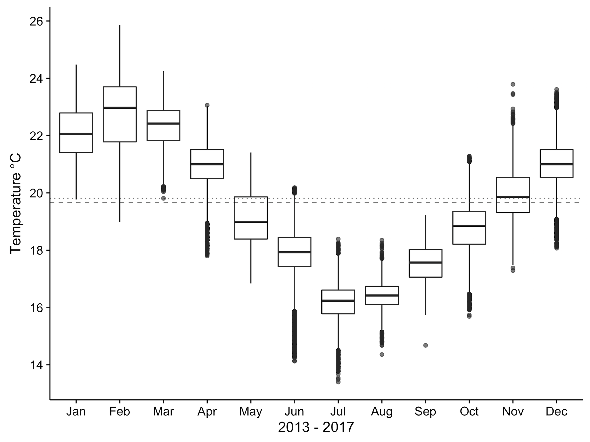
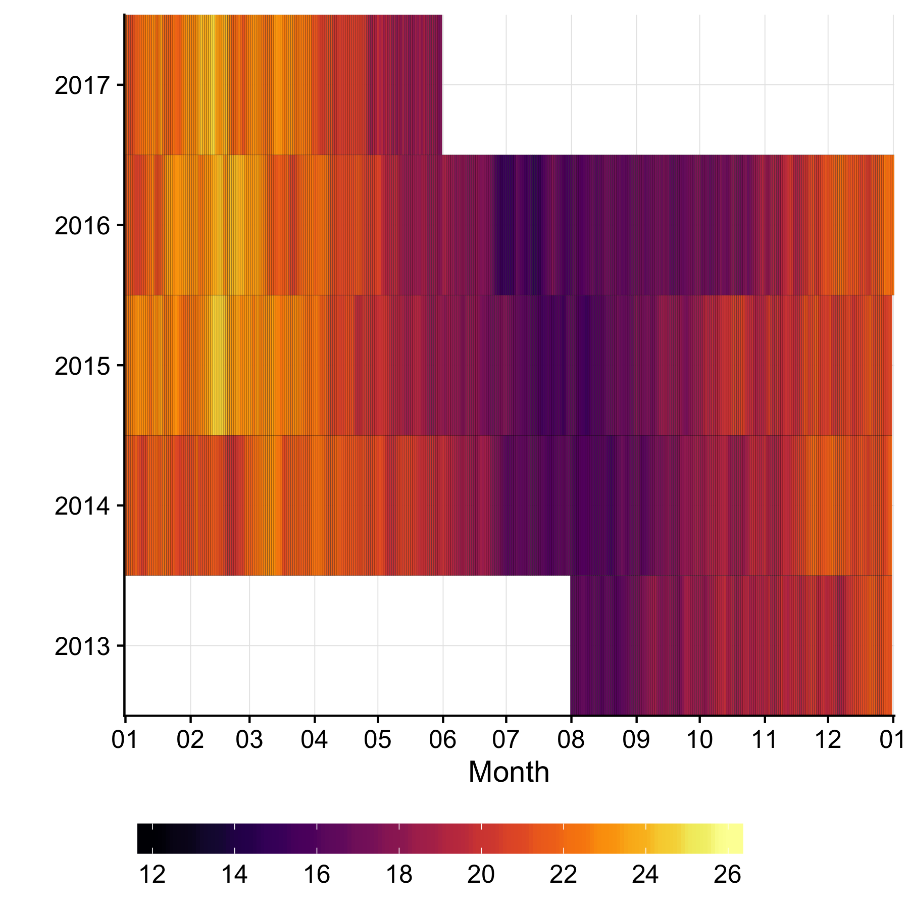
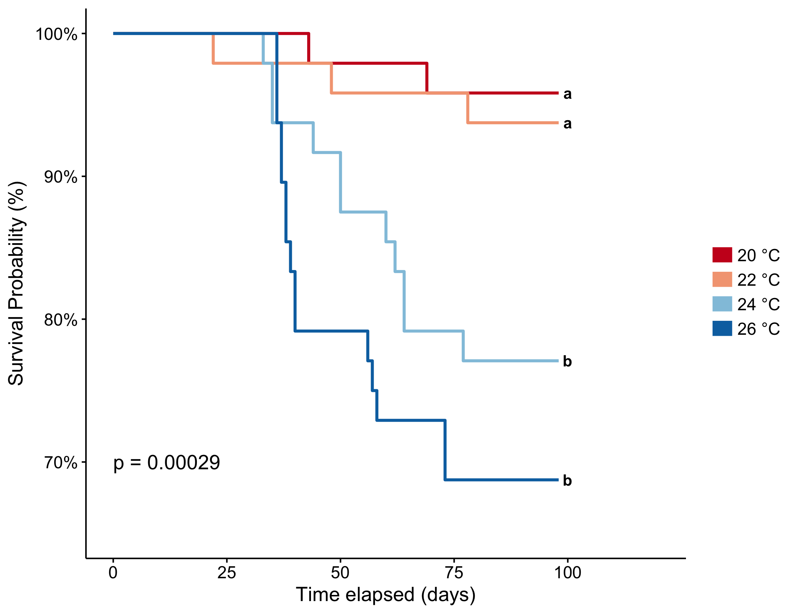
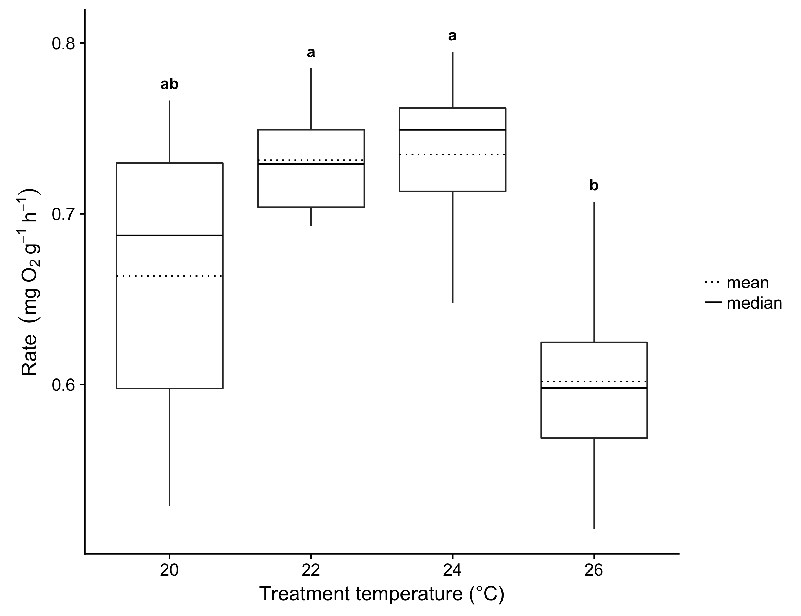
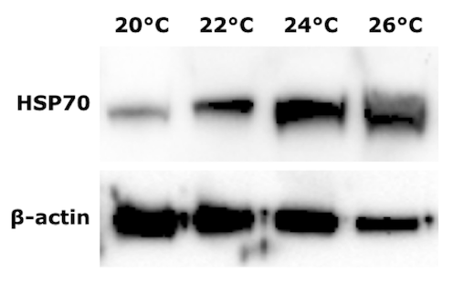
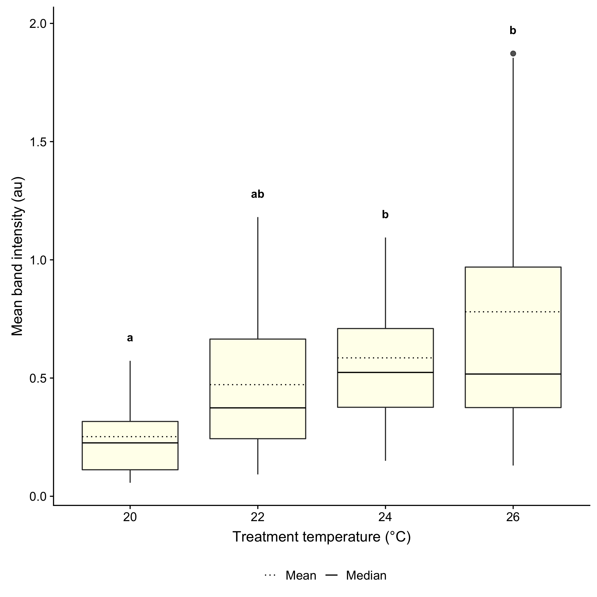
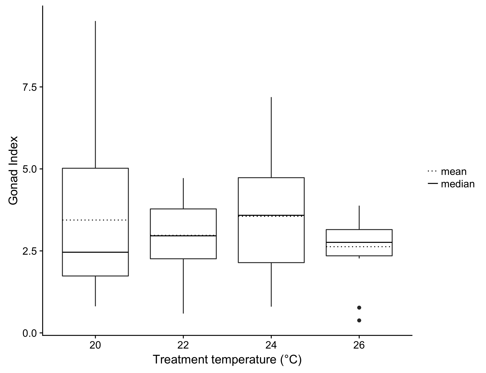
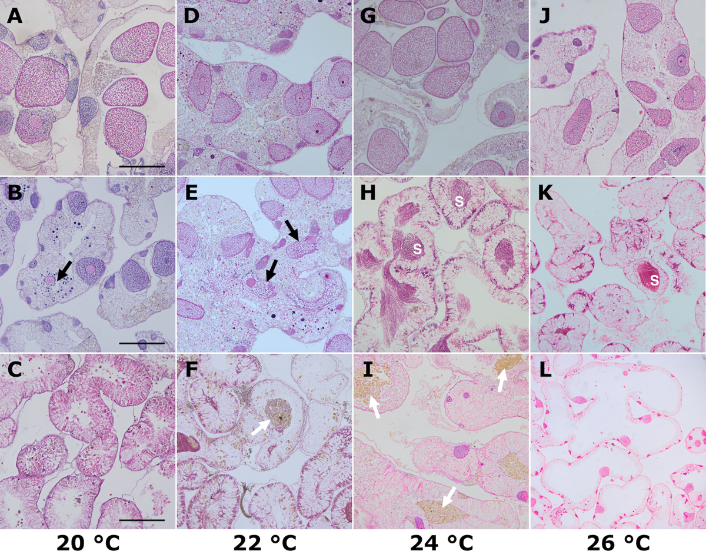

```{r, include=FALSE}

library(knitr)
library(tidyverse)
library(data.table)
library(kableExtra)
library(pander)
library(plotly)
library(lubridate)
library(viridis)
library(scales)
library(cowplot)

knitr::opts_chunk$set(echo = FALSE, comment = "#>")
options(knitr.kable.NA = '') 
options(kableExtra.auto_format = TRUE)
options(readr.num_columns = 0) # hide readr output messages

output <- knitr::opts_knit$get("rmarkdown.pandoc.to")


```

\SingleSpacing

# The effect of warming on mortality, metabolic rate, heat-shock protein response and gonad growth in thermally acclimated sea urchins (*Heliocidaris erythrogramma*) {#chapter2}
\chaptermark{Effect of warming on \textit{Heliocidaris erythrogramma}}

\OnehalfSpacing

<!-- [^published2]: This chapter is *published*: Harianto J, Nguyen HD, Holmes SP and Byrne M (2018). The effect of warming on mortality, metabolic rate, heat-shock protein response and gonad growth in thermally acclimated sea urchins (*Heliocidaris erythrogramma*). *Marine Biology* 165(6):96. doi: 10/gdqdv4. -->

\footnote[]{This chapter is published: Harianto J, Nguyen HD, Holmes SP and Byrne M (2018). The effect of warming on mortality, metabolic rate, heat-shock protein response and gonad growth in thermally acclimated sea urchins (\textit{Heliocidaris erythrogramma}). \textit{Marine Biology} 165(6):96. doi: 10/gdqdv4.}

## Abstract {-}

Environmental temperature affects the physiology and fitness of ectotherms, an important consideration in a warming ocean.
We investigated the effects of acclimation to increased temperature in the Australian sea urchin, *Heliocidaris erythrogramma*. 
After a gradual introduction to increasing temperature (1 \degree C $\cdot$ 6d^−1^), sea urchins were held for $\sim$ 3 months in four treatments at three elevated temperatures (22 \degree C, 24 \degree C and 26 \degree C) and the median annual temperature, 20 \degree C. The effect of elevated temperature on survival, metabolic rate, $Q_{10}$, heat-shock protein (HSP70) expression, gonad index and gonad histology were examined. 
There was no detectable effect of temperature on metabolic rate for the 22 \degree C and 24 \degree C treatments, although survival decreased by 23 \% in the 24 \degree C treatment and there was an increase in mean HSP70 expression. 
At 26 \degree C, metabolic rate was lower than at 22 \degree C and 24 \degree C, but was similar to controls, indicating that metabolic depression may have occurred, whereas survival decreased by 31\% and HSP70 expression increased threefold. 
It is clear that there is an active physiological response in urchins held at the highest temperatures.
The deleterious effect of living at temperatures projected for the future indicates that the persistence of future populations of *H. erythrogramma* will depend on acclimation as habitat warming continues.

## Introduction

Environmental temperature is one of the most important factors affecting the biological performance of marine ectotherms and is a major determinant of species distribution patterns across latitude and depth [@Huey1989; @Brown2004; @Sunday2012; @Poloczanska2016]. 
As the oceans warm due to climate change, marine organisms respond to thermal stress through adaptation via natural selection and/or by adjusting their behaviour and their physiology via phenotypic plasticity [@Hochachka2002; @Portner2010; @Hoffmann2011; @Sunday2014]. 
Whether an individual can respond favourably to a changing environment depends not only on its genotype and the associated level of phenotypic plasticity, but also the time-scale of the stress [@Seebacher2014]. Migration, shifts in reproductive timing and changes to planktonic larval distribution in response to increasing temperatures are reshaping populations worldwide, contributing to the poleward migration of marine species [@Poloczanska2016; @Pecl2017]. 
For many benthic invertebrates, however, movement is limited especially in the adult life stages, and physiological plasticity (i.e. acclimation) is essential to ensure survival and to maintain reproductive success in a warming climate [@Seebacher2014; @Gunderson2017].

The influence of elevated temperature on marine invertebrate performance and fitness has been investigated in many taxa including crustaceans, molluscs, polychaetes and echinoderms [@Calosi2013; @Lah2017; @Vergara2017; @Gunderson2017]. 
Like most benthic invertebrates, sea urchins are vulnerable to habitat warming due to their limited ability to migrate as adults [@DaSilva1986; @Steneck2013].
Sea urchins are ecologically important in the structuring of macroalgal reef systems [@Keesing2013; @Steneck2013] and due to their sensitivity to environmental stress, are used as bio-indicators of perturbation [@Branco2013; @Pinsino2015; @Savriama2015].
Elevated temperature affects sea urchin growth, fecundity, immune response and survival [@Nguyen2011; @Suckling2015; @Brothers2016; @Delorme2016]. 
In thermal-ramping experiments where urchins are exposed to acute (instantaneous and short-term) thermal stressors [@Magozzi2015; @Lah2017; @Vergara2017], organism responses can be interpreted to indicate thermal tolerance or sensitivity during marine heat spikes and heat waves [@Lenton2015; @Wernberg2016]. 
In contrast, long-term chronic exposure to increased temperature – where organisms have an opportunity to acclimate – provide insights into the long-term effects of warming [e.g. @Suckling2015; @Brothers2016; @Carey2016; @Delorme2016]. 
The distinction between acute versus acclimated experiments is important, because long-term acclimation increases resilience and reduces sensitivity to elevated temperatures [@Stillman2003; @Seebacher2014]. 

Acclimation studies of sea urchins have provided important insights into the effects of long-term exposure to elevated temperature on metabolism and reproduction. 
For example, a 3-month acclimation to elevated temperature (+3 \degree C) resulted in an increased metabolic rate, reduced growth and reproductive failure in the temperate sea urchin, *Evechinus chloroticus* [@Delorme2016]. 
In a 2-year acclimation to increased temperature (+2 \degree C), individuals of the Antarctic sea urchin *Sterechinus neumayeri* were able to adjust their metabolic performance such that their metabolic rates were similar to that of control urchins [@Suckling2015]. 
The acclimated *S. neumayeri* also produced larger eggs compared with control urchins, a response suggested to reflect increased investment in developmental success due to acclimation [@Suckling2015]. 
These responses would not be evident in acute experiments and show the importance of incorporating acclimation times as a factor in global warming studies.

The characterisation of the physiological responses of organisms to thermal stress is essential to understand the effects of climate change on marine biota [@Portner2002; @Brown2004; @Helmuth2005]. 
The most common physiological metric measured is metabolic rate [@White2013]. 
In marine invertebrates, metabolic rate increases with temperature due to the effects of thermodynamics on reaction rates [@Gillooly2001; @Hochachka2002; @Gianguzza2014; @Carey2016] although this becomes limited as lethal levels are approached [@Nguyen2011; @Marshall2011; @Delorme2016]. 
However, given sufficient acclimation time, ectotherms subject to elevated temperatures within their range of thermal tolerance are expected to attain a higher lethal temperature limit compared to non-acclimated conspecifics [@Schmidt-Nielsen1997; @Suckling2015].
In addition, changes in energetics due to physiological compensation or depression may alter processes such as growth and reproduction [Newell1980; @Parry1983; @Angilletta2010; @Coggan2011]. This makes it difficult to predict the effect of acclimation on physiological performance unless additional physiological indicators, such as survival, thermal tolerance, gonad development, or enzyme activity, are also investigated [@Huey2012; @Calosi2013a; @Magozzi2015; @Delorme2016].

The chaperone heat-shock protein (HSP) response is an important trait in thermal biology, and the protective roles of HSP expression against heat damage to cells are well-documented [@Feder1999; @Kregel2002; @Sorensen2003]. 
By far the most-studied are HSPs of the 70-kDa size class, which consist of stress-inducible (HSP70) and constitutively-expressed (HSC70) isoforms. 
Acute exposure to thermal shock results in an increase in HSP70 gene expression in sea urchins, indicating that the protein plays a crucial role in thermal tolerance [@Feder1999; @ODonnell2009; @Vergara2017]. 
Long-term exposure to elevated temperature may result in accumulation of the constitutive HSP70 form in response to chronic stress, as shown in mussels [@Roberts1997; @Franzellitti2005]. 
Few studies, however, have examined the effect of long-term acclimation to different thermal environments on the HSP70 response in sea urchins, although there are studies that demonstrated the importance of HSP70 in resisting long-term exposure to pollution [@Pinsino2008; @Pinsino2015]. 
One study examined the acute HSP70 (one hour thermal shock) response in urchins to a range of temperatures (5 \degree C to 36.5 \degree C) in individuals that had been acclimated for 4 weeks in 5 \degree C (−9 \degree C) and 20 \degree C (+6 \degree C) treatments [@Osovitz2005].
The synthesis of HSPs is energetically costly and the increased thermal resistance conveyed by upregulation of HSPs may come at a cost to metabolism, normal cell function and survival [@Krebs1997; @Hochachka2002; @Hoekstra2013]. 

We investigated the effects of long-term acclimation to elevated temperatures on the sea urchin *Heliocidaris erythrogramma* through determination of survivorship, metabolic rate, HSP70 expression, gonad index and gonad histology. 
To place our experiment in an ecologically relevant context, we characterised the thermal environment of the source populations of *H. erythrogramma* in Sydney Harbour by compiling in situ temperature data over 5 years.
This region is located in an ocean warming hotspot due to warming of the continent and climate-driven intensified, poleward flow of the East Australian Current [@Hill2008; @Hobday2011; @IPCC2013; @Lenton2015]. 
In the Sydney region, *H. erythrogramma* has a 6-month spawning season from October/November to March/April with episodic gamete release [Byrne, pers comm; @Laegdsgaard1991]. 
We collected the urchins when the seawater was 18 \degree C and maintained them in ambient flow-through aquaria for a week.
The urchins were then gradually introduced to the experimental temperatures, by incremental increase over several weeks, to 20 \degree C (annual median, and mean spring temperature) as the control, and to 22 \degree C, 24 \degree C and 26 \degree C, representing elevated temperatures predicted for the years 2070, 2100 and far future [@IPCC2014: +2, +4 and +6 \degree C, respectively].
It was predicted that *H. erythrogramma* exposed to elevated temperature would exhibit: (1) an increase in metabolic rate up to its upper critical thermal limit, i.e. in line with would be expected for an ectotherm; (2) an increase in HSPs70 expression with chronic exposure to increased temperature; (3) decreased survival; and (4) failure to develop gonads as reported for a closely-related echinoid following extended exposure to increased temperature [@Delorme2016].

## Materials and methods

### Collection

Adult *Heliocidaris erythrogramma* (54.4 $\pm$ 6.1 $mm$ diameter) were collected at a depth of 2--3 $m$ from three locations in Sydney Harbour, Australia: Chowder Bay ([\ang{33;50;27.6}S \ang{151;15;9.8}E](https://www.google.com/maps/?q=-33.840986,151.252714)), Milk Beach ([\ang{33;51;23.3}S \ang{151;16;0.7}E](https://www.google.com/maps/?q=-33.856467,151.266856))  and Bottle and Glass Point ([\ang{33;50;55.2}S \ang{151;16;11.5}E](https://www.google.com/maps/?q=-33.848678,151.269870)) during winter in July 2013. 
The urchins were transported to the Sydney Institute of Marine Science (SIMS) and held in aquaria (80 $L$) supplied with ambient ($\sim$ 18 \degree C) flow-through filtered sea water (FSW; 70 $\mu$m; 1.5 L min^-`^) for up to 4 weeks before being acclimated to the four temperature treatments (see below).

### Habitat temperature profile

To characterise the thermal environment of *H. erythrogramma* and place our experimental data in context, seawater temperature at one of the urchin collection sites, Chowder Bay, was recorded for five years. 
Temperature loggers (HOBO TidbiT, Onset, Bourne, MA, USA) were deployed and recorded temperature at 20-minute intervals from Sep 2013 to Jun 2017, at 3--5 m depth. 
The loggers were recovered, calibrated and redeployed every 3--4 months for data compilation. Monthly statistics (e.g. mean, median, maximum and minimum) and the number of weeks where the surface seawater temperature (SST) exceeded our experimental temperatures (22 \degree C, 24 \degree C, 26 \degree C) during summer were determined from the data.

### Acclimation setup and maintenance

The acclimation experiment was performed in a temperature-controlled room with a weekly-adjusted light:dark regime that reflected the diurnal sunrise/sunset cycle. 
A thermocouple-solenoid feedback system maintained temperatures automatically, by mixing warm (25.5 \degree C) and cold (16.0 \degree C) FSW (20 $\mu$m filtered) into 16 header tanks (60 $L$). 
As a second level of control, heaters (75 W, EHEIM GmbH & Co KG, Deizisau, Germany) attached to temperature controllers (model 7028/3, TUNZE Aquarientechnik GmbH, Penzberg, Germany) maintained temperature stability within header tanks.
The tanks were aerated to ensure that the dissolved oxygen in the system was $\geq$ 90 \%. Each header tank provided a continuous supply of FSW to 3 treatment tanks at a flow rate of 0.3 L min^-1^ L min^-1^.

All tanks were initially adjusted to ambient conditions (18 \degree C) at the time of transfer. 
There were 6 tanks (25 $L$) per treatment, and 8 urchins were randomly transferred to each tank ($n =$ 192 urchins). 
Temperatures were gradually increased by 1 \degree C every 6 days in a staggered schedule, so that the four target levels (20 \degree C, 22 \degree C, 24 \degree C, 26 \degree C) were achieved for all treatments at the same time after 6 weeks. 
Temperatures were then kept constant and sea urchins were acclimated for a further 14 weeks under stable conditions (20.3 $\pm$ 0.2 \degree C; 22.1 $\pm$ 0.2 \degree C; 24.0 $\pm$ 0.3 \degree C; 26.0 $\pm$ 0.5 \degree C; s.e., $n =$ 48 treatment^-1^). 
The control 20 \degree C group were held at spring/early summer temperature approximating field conditions after the temperature adjustment period. 
This temperature treatment also represented the annual mean temperature of the habitat (Figure \@ref(fig:c2harbourtemps)). 

```{r c2harbourtemps, echo=FALSE, message=FALSE, warning=FALSE, fig.cap='(ref:c2harbourtemps)', fig.scap='(ref:sc2harbourtemps)', fig.pos='p'}

# 

ptemp <- read_csv("input/ch_warming/sims13-17cal.csv") %>%
  mutate(month = month.abb[month(time)],  # extract month char using month.abb
    month = factor(month, levels = month.abb)) %>% # order the months
  ggplot() +
  geom_boxplot(aes(month, temp, group = month), 
    alpha = .6, fill = "lightyellow",width = .8, show.legend = F) +
  # scale_fill_manual(values=c(coloura, coloura, coloura, coloura,
  #   coloura, coloura, colourb, colourb,
  #   colourb, colourb, colourb, colourb)) +
  geom_hline(yintercept = 19.66975, linetype = 2, alpha = .5) +  # mean
  geom_hline(yintercept = 19.81, linetype = 3, alpha = .5) +  # median
  xlab("2013 - 2017") +
  ylab("Temperature °C") +
  scale_y_continuous(breaks = seq(0,40,2)) +
  cowplot::theme_cowplot() +
  geom_blank()


if(output %in% c("latex","docx")){
  ptemp
} else if(output == "html"){
  ggplotly(ptemp, height = 600)
} else(print("No format defined for this output filetype"))


```

(ref:c2harbourtemps) Monthly temperature at the habitat of *Heliocidaris erythrogramma* in Chowder Bay, NSW, Australia, averaged over 5 years (2013--2017). The horizontal line represents the median (Q2), and the vertical lines (whiskers) represent the range of the data computed as follows: $Q1 − 1.5\ IQR$ (bottom whisker); greater than $Q3 + 1.5\ IQR$ (top whisker). Data were recorded using in-situ loggers deployed at 3--5 m depth. The 5-year median (19.8 \degree C, dotted line) and mean (19.7 \degree C, dashed line) are shown. Outliers are included (dots). 

(ref:sc2harbourtemps) Monthly temperature at the habitat of Heliocidaris erythrogramma in Chowder Bay, NSW, Australia, averaged over 5 years (2013--2017).

Treatment stability was monitored by checking temperatures daily using a temperature probe (Vernier TMP-BTA, Beaverton, Oregon, USA). 
Temperature loggers (IBCod Type G, Alpha Mach, Bombardier, Quebec, Canada) were also randomly deployed between 6 treatment tanks. 
These were checked every two weeks and redeployed at random. 
No major deviations from set temperature points were observed during the experiment.
Urchins were fed *ad libitum* on fresh *Sargassum* spp. collected from their habitat.
All tanks were cleaned daily and uneaten food and faeces were siphoned off every 2 days. 

### Survival

Treatment tanks were monitored daily for mortality during the acclimation period for 14 weeks, and dead urchins were removed immediately.
A few urchins ($n =$ 4) that displayed signs of stress (e.g. dropped spines, reduced movement) were promptly removed.

### Metabolic rate

After 12 weeks of acclimation, the weight-specific metabolic rate (MO~2~; mgO~2~ h^-1^ g^-1^) of the urchins was determined using constant volume respirometry. 
For every tank, four random urchins were measured for metabolic rate and the mean MO~2~ used for statistical analysis ($n =$ 6 treatment^-1^).
Urchins were starved for 3 days and then transferred to stirred 2 $L$ respirometry chambers, supplied with treatment water, so that each urchin was maintained at its respective experimental temperature level during respirometry measurements.
Dissolved oxygen (DO) was recorded using an optical fluorescence quenching probe (Vernier ODO-BTA) until a decrease of $\sim$ 15\% in oxygen concentration was achieved. 
FSW-only blanks were measured routinely ($n =$ 16) to correct the recordings for background respiration and instrument drift. 
After each measurement, the chamber was removed from the system, wiped dry and weighed. 
The urchin was then taken out of the chamber, blotted dry with tissue, and weighed for wet-weight.
The weight of the sea water was calculated by deducting pre-weighed chamber, stir-bar and urchin wet-weight from the total weight of the chamber, and then converted to volume by multiplying it with its density adjusted based on current treatment temperature, salinity and barometric air pressure [@Fofonoff1983]. 
MO~2~ was calculated using the equation based on @Lighton2008: $$MO_2 = \frac{\Delta O_2 V}{W}$$ where $\Delta O_2$ is the local linear regression (i.e. slope) of oxygen concentration over time (mg L^-1^ h^-1^), $V$ is the volume of seawater (L), and $W$ is the wet weight of the urchin (g).

Thermal sensitivity, $Q_{10}$, was determined as a function of mean temperature across a 10 \degree C range using the equation provided by @Prosser1991: $$Q_{10} =\left( \frac{R_1}{R_2} \right)^{10/T_1-T_2}$$ where $R_1$ and $R_2$ are the MO~2~ at their corresponding lower and higher temperatures, $T_1$ (20 \degree C) and $T_2$ (22 \degree C, 24 \degree C or 26 \degree C), respectively.

### Gonad index and HSP70 expression

After 14 weeks of acclimation, 15 urchins were randomly selected from each treatment, weighed ($W$) and dissected. 
The gonads were removed, weighed ($G$) and one gonad flash-frozen in liquid nitrogen. Gonad index ($GI$) was calculated using the formula: $$GI =100 * G / W$$
To analyse the expression of HSP70, we performed Western blots on the frozen gonad tissue samples. 
This has been done previously in @Nguyen2013 and ensures that sufficient protein is obtained.
Small pieces of the frozen gonad ($\sim$ 10 mm) were placed in 10 mL of Radio-Immuno-Precipitation Assay (RIPA buffer; 150 mM NaCl, 1 \% IGEPAL CA-630, 0.5 \% sodium deoxycholate, 0.1 \% SDS, and 50 mM Tris, pH 8.0) containing a protease inhibitor tablet (Thermo Scientific, Catalog. No. 88266).
The mix was homogenised with a glass micro pestle, left on ice for 15 minutes, and then centrifuged at 13200 $\times$g for 10 minutes. 
The supernatant protein sample was extracted from below the lipid layer, and protein content was estimated using the Pierce BCA Protein Assay (Thermo Scientific, Catalog. No. 23225) according to manufacturer instructions.

Based on protein content estimates, we prepared protein samples to a concentration of 2 mg mL^-1^, by dilution in buffer (50 mM Tris-HCl pH 6.8, 2 \% SDS w/v, 10 \% glycerol and 5 \% beta-mercaptoethanol).
Samples containing 40 µg of total protein were loaded in 4 to 20 \% Tris-Glycine pre-cast gels and separated via gel electrophoresis at 250 $V$ for 35 min using a Mini Protean III system (Bio-Rad Laboratories, Gladesville, New South Wales, Australia).
A recombinant rat 70 kDa heat shock protein (Stressgen, Catalog. ID ADI-SSP-758, Sapphire Bioscience Pty. Ltd., Redfern, New South Wales, Australia), diluted to 1:100, was loaded as a positive control.
A prestained protein molecular weight marker (Invitrogen Catalog. No.10748-010, Invitrogen, Carlsbad, California, USA) was also loaded to each gel (7 $\mu$L) to monitor protein separation during gel electrophoresis and to enable evaluation of western transfer efficiency.

Following electrophoresis, separated proteins were transferred to Polyvinylidene Difluoride (PVDF) membranes (0.45 $\mu$m pore size) using a Mini Trans-Blot Cell (Bio-Rad Laboratories). 
Each membrane was cut into two horizontal strips, for the detection of HSP70 and $\beta$-actin (loading control), respectively.
The membranes were blocked in 5 \% non-fat milk powder in phosphate-buffered saline (PBS) for 20 min to prevent nonspecific binding.
After blocking, the membranes were incubated for 1 hour in a solution of the appropriate primary antibody, either mouse monoclonal anti-HSP70 antibody (Sigma-Aldrich, Catalog. No. H5147, Sigma Aldrich, St. Louis, Missouri, USA) or mouse monoclonal anti $\beta$-actin (Sigma-Aldrich, Catalog. No. A1978) diluted at 1:1000 in antibody buffer (1 \% w/v gelatin in PBS) for 1 hour. Membranes were quickly rinsed twice (2 $s$) with PBS containing 0.05 \% (v/v) Tween-20 (TPBS) then given a further four washes in TPBS, with each wash lasting for 5 min. 

After washing, membranes were incubated for 1 hour with a secondary antibody, an anti-mouse IgG conjugated with horseradish peroxidase (Santa Cruz Biotechnology, Catalog. No. sc-516102, Santa Cruz Biotechnology, Dallas, Texas, United States) diluted at 1:10,000 in antibody buffer. 
The membranes were rinsed and washed in TPBS as before. Finally, membranes were incubated in SuperSignal West Pico chemiluminescent substrate (Pierce, Catalog. No. 34080, Thermo Fisher) for 1 minute and the chemiluminescent signal was detected using an imaging densitometer (ChemiDocMP System, Bio-Rad Laboratories, Inc.). 
Image analysis to determine relative HSP70 levels in arbitrary units (AU) was done using ImageJ [@Abramoff2004].
Band densities of the samples were normalised to $\beta$-actin and the positive control to account for differences in total protein loaded in the gels and to allow for comparisons between blots.

### Gonad Histology

For all remaining urchins ($n =$ 11 to 15 treatment^-1^), gonads were harvested and preserved with Bouin’s fixative. 
Sections (7 $\mu$m thick) were then stained with haematoxylin and eosin, and examined for the presence of gametes. 
From October, episodic, non-synchronous spawning occurred in urchins across all treatments as revealed by the presence of eggs at the surface of the seawater. 
These events happened at night, and so it was not possible to identify individuals that spawned.
As spawning had occurred prior to harvesting of the gonads at the end of the experiment, the histological sections were scored in two categories, spent (few or no gametes) and partly spawned/post spawned (with gametes) following a previous study of gonad histology in this species [see @Laegdsgaard1991].

### Data analyses

There was no significant effect of nesting replicate tanks within treatments (Likelihood Ratio Test, $\chi^2$ = 0.03, $p =$ 0.9). MO~2~ data were averaged by tank ($n =$ 6) and analysed using a one-way Analysis of Variance (ANOVA).
All data were tested for homogeneity of variance and normality assumptions [@Quinn2002]. Post-hoc analyses were performed using Tukey's HSD test ($p =$ 0.05) to detect significant differences between treatments. 
Survival data were generated using the Kaplan-Meier method with right-censoring [see @Rich2010] and analysed using a log-rank test. 
The stressed urchins that were removed ($n =$ 4) were also censored from the experiment. 
A Cox proportional hazards model was applied to determine the contribution of increased temperature on survival probability. 
The fitted Cox regression met the assumption of proportional hazards [Schoenfeld residual tests, $p =$ 0.36, @Grambsch1994].
To compare the differences in survivorship between treatments, Bonferroni-adjusted post-hoc pairwise comparisons among treatments were conducted [@Logan2005]. 
The HSP70 expression data did not meet the assumptions of normality (Levene’s Test, $p =$ 0.001), and so were analysed using a Kruskal-Wallis test with temperature as an independent variable [@Quinn2002] followed by post-hoc analysis using Dunn’s test, adjusted with the false discovery rate method [$p =$ 0.025, @Zar2009]. 
Six out of the 60 blots did not yield sufficient protein and were removed from the analyses. 
Gonad index was analysed with a one-way ANOVA using treatment as a fixed factor. 
All analyses were performed in R (version 3.4.3) using RStudio [@RStudioTeam2015]. 
Survival computations for the Kaplan-Meier and Cox proportional hazards model were performed using the `survival` package. 
Metabolic rate data were analysed using a mixed-effect model using the `lme4` package [@Bates2015], with tank as a random effect to account for nesting. The post-hoc Dunn’s Test was performed using the `dunns.test` package. 
All other tests were performed using the default `stats` package provided in R.

## Results

### Habitat temperature profile

Analysis of the temperatures recorded between 2013--2017 at the Chowder Bay site showed that the mean annual temperature was 19.7 \degree C (Figure 1), similar to our control treatment at 20 \degree C. Temperature exceeded 22 \degree C and 24 \degree C for an average of 8.8 $\pm$ 4.1 (s.d.) and 0.4 $\pm$ 0.9 (s.d.) consecutive weeks a year, respectively, for the period which we had complete records (2014--2016, Figure \@ref(fig:heatmap). The highest temperature level, 26 \degree C, was not reached in our records, although there were two separate days exceeding 25.5 \degree C in Feb 2015 and Feb 2017 (see Figure \@ref(fig:heatmap)).

```{r heatmap, fig.cap="(ref:heatmap)", fig.scap="(ref:sheatmap)", fig.pos="p"}
# 

dt <- read_csv("input/ch_warming/sims13-17cal.csv")

# Manipulate data ----

## summarise data for tile plot:

daily <- dt %>%
mutate(day = yday(time), year = year(time)) %>%
  group_by(year, day) %>%
  summarise(mean = mean(temp)) %>%
  mutate(date = ymd_hms("2013-01-01 00:00:00") + days(day - 1))

# Plotting ----

heatmap <-
  ggplot(daily, aes(date, year)) +
  # Plots
  geom_tile(aes(fill = mean), colour = "black", size = .04) +
  # Theme
  scale_fill_viridis(option = "B", name = "", limits = c(12, 26),
    breaks = seq(10, 26, by = 2)) +
  background_grid(major = "xy", minor = "none") +
  # theme(panel.grid.minor = element_line(colour = "black", size = 0.5,
  #   linetype = 3)) +
  # Axes (scale)
  scale_x_datetime(date_breaks = "1 month", labels = date_format("%m"),
    expand = c(0, 0)) +
  # theme(plot.margin=grid::unit(c(0,0,0,0), "mm")) +
  scale_y_continuous(expand = c(0, 0)) +
  # Labels (title, x & y)
  xlab("Month") +
  ylab("") +
  # legend
  theme(legend.position = "bottom") +
  guides(fill = guide_colorbar(barwidth = 20, barheight = 1)) +
  cowplot::theme_cowplot() +
  geom_blank()
# END ggplot

if(output %in% c("latex","docx")){
  heatmap
} else if(output == "html"){
  ggplotly(heatmap, height = 600)
} else(print("No format defined for this output filetype"))

```

(ref:heatmap) Average daily seawater temperature at the habitat of *Heliocidaris erythrogramma* in Chowder Bay, NSW, Australia. There are 365–366 vertical tiles for each year, and each tile represents a day. Temperatures were recorded every 20 minutes using in-situ loggers at 3--5 m depth. Colour determines the average temperature for the day. Temperatures reached 25.5 \degree C in Feb 2015 and in Feb 2017.

(ref:sheatmap) Average daily seawater temperature at the habitat of *Heliocidaris erythrogramma* in Chowder Bay, NSW, Australia.

### Survival

No mortality was recorded during the 6-week temperature-adjustment period. Over the subsequent 14-week acclimation period there was a significant effect of elevated temperature on the survival of *H. erythrogramma* (log-rank test, $\chi^2 =$ 18.9, $df =$ 3, $p <$ 0.001). Survival in +4 \degree C and +6 \degree C treatments (77.1--68.8 \%) were more than three times lower than that of the control and +2 \degree C treatments (93.7--95.8 \%; Figure \@ref(fig:c2survival)). post-hoc analyses (pairwise comparisons, Bonferroni-adjusted, critical $p <$ 0.0083) showed that survival in the +4 \degree C and +6 \degree C treatments were significantly lower than the control treatments (+4 \degree C, $p =$ 0.004; +6 \degree C, $p =$ 0.002) and +2 \degree C treatments (+4 \degree C, $p =$ 0.005; +6 \degree C, $p =$ 0.003), respectively. The control and +2\degree C treatments did not differ from each other ($p =$ 0.65). 
Cox’s regression analysis showed that temperature significantly affected survival (Likelihood ratio test, $df =$ 3, $p <$ 0.001), and that the calculated risk ratios showed that specimens acclimated to +4 \degree C and +6 \degree C were 6 and 9 times less likely to survive compared to those kept in control conditions (+4 \degree C, $p =$ 0.019; +6 \degree C, $p =$ 0.004; Table \@ref(tab:c2coxtab)).

```{r c2survival, fig.cap="(ref:c2survival)", fig.scap="(ref:sc2survival)", fig.pos="p"}

```

(ref:c2survival) Survival in *Heliocidaris erythrogramma* over 14 weeks of acclimation to elevated temperature treatments of 20 \degree C, 22 \degree C, 24 \degree C and 26 \degree C. Day zero is the time when target temperature was reached after temperature adjustments (+1 \degree C every 6 days). Survival was significantly lower in the high temperature treatments (24 \degree C, 26 \degree C: log-rank test, Bonferroni-corrected, $p <$ 0.0083), but not for 22 \degree C. Shaded regions denote 95 \% confidence interval. $n =$ 48 treament^-1^. 

(ref:sc2survival) Survival in *Heliocidaris erythrogramma* over 14 weeks of acclimation to elevated temperature treatments of 20 \degree C, 22 \degree C, 24 \degree C and 26 \degree C.

```{r c2coxtab, message=FALSE, out.extra=''}

c2cox_tab <- readr::read_csv("input/ch_warming/c2cox.csv")
knitr::kable(c2cox_tab, "latex", booktabs = T, escape = F,
  caption = "(ref:c2coxtab)",
  caption.short = "(ref:sc2coxtab)") %>%
  # kable_styling(position = "center") %>%
  # kable_styling(latex_options = "hold_position") %>%
  # kable_styling(full_width = T) %>%
  row_spec(c(0), bold = T)

```

(ref:c2coxtab) Results of Cox proportional hazards analysis on the risk of death in the sea urchin, *Heliocidaris erythrogramma* when acclimated to elevated temperatures of 22 \degree C, 24 \degree C, and 26\degree C from the control temperature of 20 \degree C. Test results were significant ($p <$ 0.001, $df =$ 3). \*\* $p <$0.005, \* $p <$ 0.05.

(ref:sc2coxtab) Results of Cox’s proportional hazards analysis on the risk of death in the sea urchin, *Heliocidaris erythrogramma*.

### Metabolic Rate

Elevated temperature had a significant effect on the MO~2~ of *H. erythrogramma* (ANOVA, $F_{3,20} =$ 5.60, $p =$ 0.005). Pairwise comparisons were complex (20 \degree C $=$ 22 \degree C $=$ 24 \degree C; 20 \degree C $=$ 26 \degree C; 22 \degree C $=$ 24 \degree C $<$ 26 \degree C; Figure \@ref(fig:c2mr)). At +2 \degree C and +4 \degree C, there was a slight but not statistically significant increase in mean MO~2~. At +6 \degree C, MO~2~ was significantly lower compared to the +2 \degree C and +4 \degree C treatments but not to the control (Tukey’s HSD, +2 \degree C, $p =$ 0.013; +4 \degree C, $p =$ 0.011). $Q_{10}$, with respect to the control treatment, were 1.67 for +2 \degree C, 1.34 for +4 \degree C, and 0.88 for +6 \degree C. 

```{r c2mr, fig.cap="(ref:c2mr)", fig.scap="(ref:sc2mr)", fig.pos="p"}

```

(ref:c2mr) Weight-specific metabolic rate for *Heliocidaris erythrogramma* after a 12-week acclimation to elevated temperature treatments of 20 \degree C, 22 \degree C, 24 \degree C and 26 \degree C. The top and bottom of the boxes represent the interquartile range (IQR) between the 25th and 75th percentile (Q1 and Q3, respectively). The horizontal line represents the median (Q2), the horizontal dotted line represents the mean, and the vertical lines (whiskers) represent the range of the data computed as follows: Q1 $-$ 1.5IQR (bottom whisker); greater than Q3+1.5 IQR (top whisker). Letters denote significant differences between treatment groups (Tukey's HSD, p < 0.05). n = 6 treatment^-1^.

(ref:sc2mr) Weight-specific metabolic rate for Heliocidaris erythrogramma after a 12-week acclimation to elevated temperature treatments.

### HSP70 expression

Representative gel images are presented in Figure \@ref(fig:c2gels). HSP70 expression in the gonad tissue differed significantly between treatments (Kruskal-Wallis test, $\chi^2$ = 10.293, df = 3, p = 0.016). Mean HSP70 protein expression was significantly higher in the 24 \degree C and 26 \degree C treatments compared with the control (+4 \degree C, $p =$ 0.0159; +6 \degree C, $p =$ 0.0147), but the +2 \degree C treatment did not differ from any treatment (Dunn’s test, 20 \degree C $=$ 22 \degree C; 20 \degree C $<$ 24 \degree C $=$ 26 \degree C; 22 \degree C $=$ 24 \degree C $=$ 26 \degree C; Figure \@ref(fig:c2hsp)).

```{r c2gels, fig.cap="(ref:c2gels)", fig.scap="(ref:sc2gels)", fig.pos="p"}

```

(ref:c2gels) Levels of HSP70 and n the gonad tissue of *Heliocidaris erythrogramma* after 14 weeks of acclimation to 20 \degree C, 22 \degree C, 24 \degree C and 26 \degree C treatments. Representative blots are shown for each acclimation temperature. Blots are quantified manually using ImageJ.

(ref:sc2gels) Levels of HSP70 and n the gonad tissue of *Heliocidaris erythrogramma* after 14 weeks of acclimation temperature treatments.


```{r c2hsp, fig.cap="(ref:c2hsp)", fig.scap="(ref:sc2hsp)", fig.pos="p"}

```

(ref:c2hsp) Relative HSP70 levels expressed in the gonad tissue of *Heliocidaris erythrogramma* after 14 weeks of acclimation in constant temperature treatments at 20 \degree C, 22 \degree C, 24 \degree C and 26 \degree C. The top and bottom of the boxes represent the interquartile range (IQR) between the 25th and 75th percentile (Q1 and Q3, respectively). The horizontal line represents the median (Q2), the horizontal dotted line represents the mean, and the vertical lines (whiskers) represent the range of the data computed as follows: Q1 $-$ 1.5 IQR (bottom whisker); greater than Q3+1.5 IQR (top whisker). Outliers that fall outside of the whiskers are included (dots). Letters indicate treatments that differed (Dunn’s test). 20 \degree C, $n =$ 13; 22 \degree C, $n =$ 15; 24 \degree C, $n =$ 14; 26 \degree C, $n =$ 12. 

(ref:sc2hsp) Relative HSP70 levels expressed in the gonad tissue of *Heliocidaris erythrogramma* after 14 weeks of acclimation in constant temperature treatments.

### Gonad index

All urchins had gonads and there were no significant differences in gonad index between treatments (ANOVA, $F_{1,55} =$ 0.899, $p =$ 0.35; Figure \@ref{c2gi}). Partially spawned gonads were observed in 67 \%, 71 \%, 73 \% and 81 \% of gonad samples for the control, +2 \degree C, +4 \degree C and +6 \degree C treatments, respectively. The remaining gonad samples had few or no gametes evident and were scored as "spent" (Figure \@ref(fig:c2histo)).

```{r c2gi, fig.cap="(ref:c2gi)", fig.scap="(ref:sc2gi)", fig.pos="p"}

```

(ref:c2gi) Gonad index of *H. erythrogramma* after 14 weeks of acclimation in constant temperature treatments at 20, 22, 24 and 26 \degree C. The top and bottom of the boxes represent the interquartile range (IQR) between the 25th and 75th percentile (Q1 and Q3, respectively). The horizontal line represents the median (Q2) and the vertical lines (whiskers) represent the range of the data computed as follows: Q1−1.5 IQR (bottom whisker); greater than Q3+1.5 IQR (top whisker). Outliers that fall outside of the whiskers are included (dots). There were no significant differences between treatments. $n =$ 15 treatment^−1^

(ref:sc2gi) Gonad index of *H. erythrogramma* after 14 weeks of acclimation in constant temperature treatments.


```{r c2histo, fig.cap="(ref:c2histo)", fig.scap="(ref:sc2histo)", fig.pos="p"}

```

(ref:c2histo) Histology of the gonads of female (A, B, D, E, G, J, L) and male (C, F, H, K) *Heliocidaris erythrogramma* after 14 weeks of acclimation in experimental treatments. The gonads were in a range of conditions with a few remaining unspawned gametes (top row; A–J), a mixture of intact and degenerating (arrows) gametes (second row; B–K) or spent with few or no gametes (bottom row; C–L) some with lipofuschin-like degradation pigment (arrows). Scale bars = 50 $\mu$m.

(ref:sc2histo) Histology of the gonads of female and male *Heliocidaris erythrogramma* after 14 weeks of acclimation in experimental treatments.

## Discussion

After a gradual introduction to increased temperatures over 6 weeks and subsequent acclimation for 14 weeks, *H. erythrogramma* exhibited a range of responses to warming across the traits investigated, and the different responses highlighted the importance of using multiple physiological traits to assess responses to global warming scenarios. 
Survival data provided the clearest assessment of the sensitivity of this species to warming, where Cox proportional hazards analysis showed significantly higher risk of mortality (6--9 times) at the higher acclimation temperature treatments of +4 \degree C and +6 \degree C.
In comparison, a +2 \degree C increase in acclimation temperature appeared to be tolerable for *H. erythrogramma* with no significant effect on survival. 

Climate warming is expected to increase metabolic rates in marine ectotherms worldwide [@Yvon-Durocher2010; @Dillon2010; @Seebacher2014]. 
For *H. erythrogramma*, acclimation to intermediate levels of temperature increase (+2 \degree C, +4 \degree C) caused a slight, but non-significant increase in metabolic rate, but acclimation to (+6 \degree C) decreased metabolic rate significantly such that it was similar to metabolic rate in control urchins. 
The result suggested that metabolic depression [@Storey2004] or a disruption of cellular oxidative phosphorylation [reduced ATP turnover, @Guderley2002] might have occurred. With respect to potential metabolic depression, the sea urchins might also have actively suppressed physiological processes to maintain fitness. 
This was indicated by the $Q_{10}$ values which were lower than those recorded for other echinoderms and aquatic ectotherms [@Lawrence1987; @DelGiorgio2005; @Fly2012; @McElroy2012]. 
For sea urchins, $Q_{10}$ typically lies between 1.2 to 3, including for *H. erythrogramma* [@Siikavuopio2008; @Carey2016].
In our results, mean $Q_{10}$ values showed a decreasing trend (from 1.67 to 0.88) as acclimation temperature increased, indicating decreasing thermal sensitivity [@Seebacher2014]. 

Reduced metabolic rate in response to increased temperature are common in nature, as seen in fish [@Kelly2013; @Kelly2014], molluscs [@Anestis2007; @Nguyen2011; @Marshall2011] and crustaceans [@Whiteley1997; @Terwilliger2001]. 
Metabolic depression due to elevated temperature has been reported in both acute and long-term studies on echinoderms with reduced metabolic rates at temperatures 1 to 3 \degree C above maximum summer SST [@Christensen2011; @Delorme2016]. 
Such changes in metabolism could alter food consumption and feeding energetics [@OConnor2009]. As primary grazers [@Keesing2013], changes in feeding by *H. erythrogramma* in response to habitat warming may lead to altered plant-herbivore interactions and impact the structure of marine communities. 
In our study, the urchins were fed *ad libitum* and were sufficiently nourished to produce gametes that were spawned while in treatment conditions and as indicated by gonad histology. 
However, food is rarely unlimited in nature, and whether *H. erythrogramma* would be able to meet the energetic costs required to sustain performance in a warmer ocean is unknown, given that previous studies have shown that this species could not compensate for temperature-driven, increased metabolism with increased food intake [@Carey2016]. 

Elevated expression of HSP70 in response to acclimation to elevated temperature was in agreement with our expectations that this protein would be upregulated in response to increased temperature, and consistent with other findings that examined heat-shock responses in sea urchins [@Osovitz2005; @Nguyen2013]. 
The antibody we used detects both the stress-inducible HSP70 and the constitutively expressed HSC70 proteins [@Wood1998; @Clayton2000; @Garcia-Santos2011].
While HSP70 is typically upregulated rapidly in response to stress, HSC70 accumulates over time upon exposure to long-term, chronic stress [@Deane2006; @Pinsino2008], and is expressed prominently in response to prolonged exposure to increased temperature, pollution and other stressors in sea urchins and mussels [@Franzellitti2005; @Deane2006; @Pinsino2008; @Pinsino2015]. 

Regardless of what isoform is expressed, it is clear that the upregulation of HSP70 occurred during the acclimation indicating a protective response against heat damage. HSP synthesis is considered to be an energetically-demanding process [@Parsell1993; @Roberts1997; @Vergara2017], but metabolic rates did not significantly increase to keep up with increased energy demand from significantly increased HSP70 production.
This suggests that there may be a trade-off between respiratory physiology and the heat-shock response to maintain a compromised level of fitness, especially when held at sub-lethal (e.g. +6 \degree C) temperature as seen in the survivors, which appear to be heat-tolerant in our experiment.
Also, it was possible that at 26 \degree C, the ability of *H. erythrogramma* to maintain physiological function and maximise survival was impaired, perhaps due to a reduced capacity of its coelomic and respiratory systems to meet energetic and oxygen demands [@Portner2010].
This is significant, as warming of +6 \degree C (from 17 \degree C) has been known to diminish the physiological capacity of *H. erythrogramma* to maintain its cellular immune response and antibacterial resistance to disease [@Brothers2016].
The increased incidence of bald sea urchin disease which is known to be lethal in wild populations of H. erythrogramma over recent decades had also been ascribed to climate warming [@Sweet2016].

Few other studies have taken the gradual approach to introduce elevated temperatures followed by an acclimation period as we did for *H. erythrogramma* to measure HSP70 levels. 
For example, @Buckley2001 acclimated the mussel *Mytilus trossulus* for 6 weeks to their winter-collected temperature, but measured HSP gene expression on isolated gill tissue following a 2-hour exposure to a range of elevated temperatures (14--35 \degree C). 
@Osovitz2005 acclimated the sea urchin, *Strongylocentrotus purpuratus* to both decreased (5 \degree C) and increased (20 \degree C) temperature for 4 weeks, and tested the HSP gene response in isolated tube feet that were incubated to 5--36.5 \degree C for 30 min. 
For *H. erythrogramma*, an 8-fold expression of HSP70 protein occurred following exposure to temperature shock at +3--8 \degree C above ambient [@Nguyen2013].
It is evident that HSP70 is a useful cellular-level marker for both long-term and acute physiological stress.

The in-situ temperature data in the habitat of *H. erythrogramma* showed that the subtidal populations of *H. erythrogramma* in Sydney Harbour are already experiencing some of the temperature levels that were used in our experiments, though not over the long exposure time (14 weeks). 
Over five years, temperatures during spring and summer periods exceeded 22 \degree C for an average of 9 consecutive weeks, thus a near-future warming scenario of +2 \degree C could mean that 24 \degree C may become more common over the same period. 
Further, due to the poleward advance of the EAC, a warming of up to 7 \degree C above pre-industrial temperatures is projected for southeast Australia by the end of the century [@Lenton2015]. 
It is therefore conceivable that in the near future, the urchin populations investigated here will experience temperatures that we found deleterious in our study. 

An EAC-driven migration of thermotolerant *H. erythrogramma* propagules could facilitate the persistence of local populations, with likely range retraction of more equatorward populations [@Byrne2011]. 
However, temperature is but one of a multitude of stressors that these urchins experience. Increased levels of ocean *p*CO~2~ are exposing *H. erythrogramma* to ocean acidification, and it is likely to interact with temperature [@Przeslawski2015]. 

Our study investigated responses of metabolic rate, HSP70 expression, gonad condition and survival to evaluate the influence of elevated temperature on *H. erythrogramma*. 
Significantly increased HSP70 expression and mortality, especially at 24 \degree C and 26 \degree C, suggested that these temperature levels were thermally stressful. 
Predicting the impact of these responses as they interact in long-term studies remains a high-priority area for future investigation.

