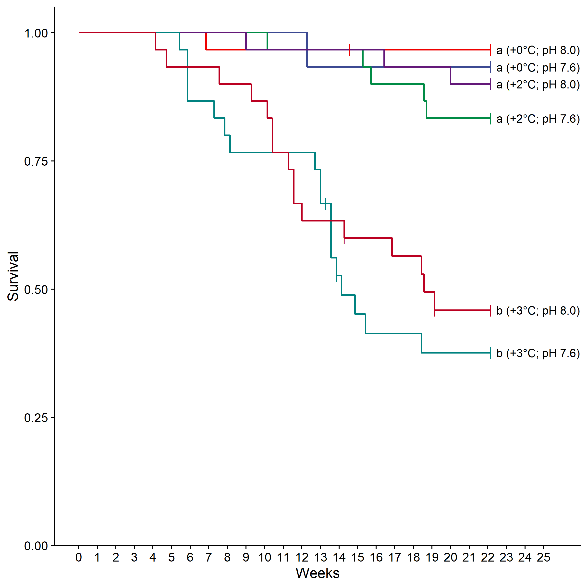
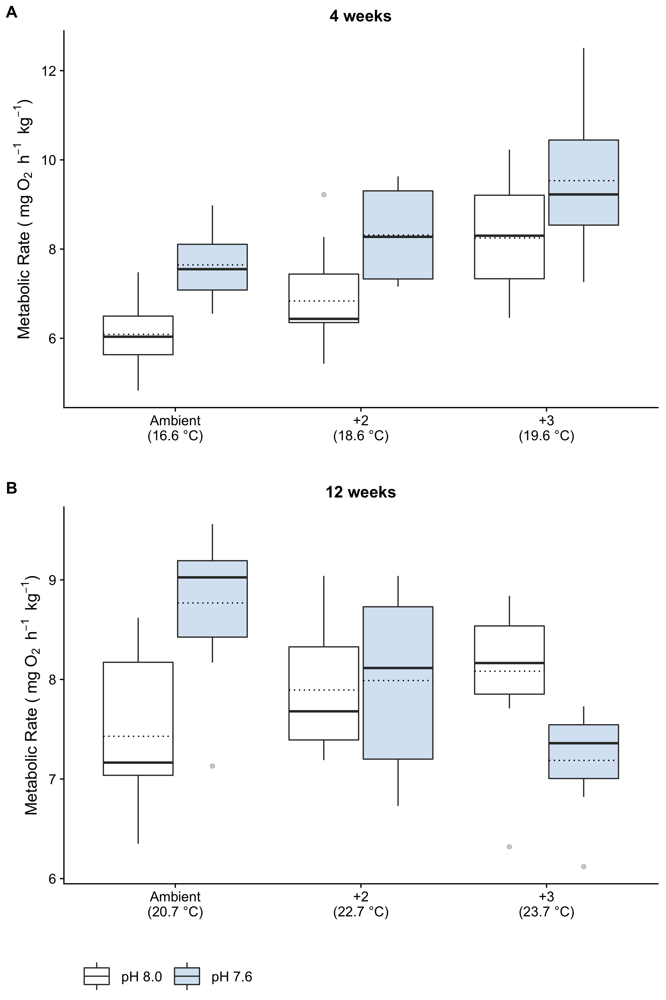
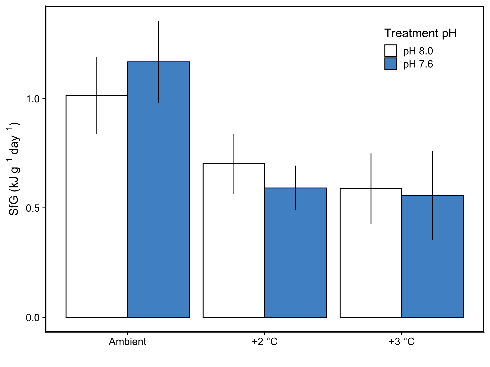

```{r, echo = FALSE, include = FALSE}
# Settings

options(knitr.kable.NA = '')
knitr::opts_chunk$set(echo = FALSE,
                      out.width = '100%', 
                      comment = "#>")

library(tidyverse)
library(kableExtra)
```

# Long-term study of the multistressor impacts of ocean warming and acidification on the physiology of the sea urchin, *Heliocidaris erythrogramma*
\chaptermark{Warming and acidification on \textit{Heliocidaris erythrogramma}}

## Abstract{-}

\SingleSpacing

The warming and acidification of the world’s oceans affect nearly all aspects of physiology in marine organisms, and it is important to consider both stressors when predicting biological responses to a changing climate.
We investigated the effects of long-term exposure to these stressors on the physiological responses of the sea urchin, *Heliocidaris erythrogramma*, a species that resides in the south-east Australian ocean warming hotspot. 
Urchins collected in winter were slowly-adjusted over 7 weeks to conditions of elevated temperature (ambient +0, +2, +3 &deg;C) and decreased pH (ambient -0, -0.4 pH units) conditions, before they were maintained at seasonally changing temperature and fixed pH based on a baseline temperature which was adjusted weekly to mimic the temperature change that occurs over time from winter to summer. 
Metabolic rate was measured at 4 and 12 weeks of acclimation, feeding rate and ammonia excretion rate at 12 weeks, and survival was monitored for 22 weeks. 
Assimilation efficiency was also determined between weeks 12 and 13 to calculate scope for growth.
Results showed that at +3 &deg;C and regardless of pH, urchins were stressed, as demonstrated by the low survival (37 – 45 \% at 22 weeks), decreased feeding rate and increased rates of excretion, whereas + 2 &deg;C had no observable effect on survival.
While metabolic rate increased additively with temperature and low pH at 4 weeks, urchins showed evidence of physiological acclimation as there were no detectable differences in metabolic rate between all treatments at 12 weeks.
The potential to acclimate to environmental stress emphasises the importance of continuous, long-term studies in predicting the consequences of climate change on organism responses and marine species.

\cleardoublepage
\OnehalfSpacing

## Introduction

Many of the key challenges in predicting the ecological consequences of climate change stem from the fact that most ecosystems are simultaneously confronted with multiple chemical, physical and biological stressors, which often interact [@Byrne2013; @Przeslawski2015; @Goldenberg2017].
For the world's oceans, the impacts of both global warming and ocean acidification (OA) are intricately linked as approximately $90\%$ of the Earth's heat and $25\%$ of anthropogenic $CO_2$ emissions are absorbed directly into the ocean [@Fletcher2006; @Wanninkhof2013; @Gattuso2015].

Ocean warming (OW) increases the body temperature of marine ectotherms, affecting metabolism and almost all biological processes [@Brown2004; @Hochachka2002]. 
Concurrently, OA alters the balance of carbonate saturation states in sea water, increasing the metabolic costs associated with acid–base regulation, calcification and skeletogenesis [@Doney2009; @Kroeker2013; @Portner2008; @Thomsen2015].
Given that both stressors influence important metabolic processes, interaction is inevitable and can affect biological responses in unexpected ways, highlighting the uncertainty surrounding our understanding of the drivers of ecosystem change.
<!-- biological responses which would not necessarily be predicted from investigating the stressors in isolation. -->
<!-- where the overall effects are likely to be dependent on location and species (Henson et al. 2017, Pecl et al. 2017, Poloczanska et al. 2016). -->
For example, ocean warming affects both oxygen demand and the supply of oxygen in water [@Schulte2015; @Portner2010; @Christensen2011], and may limit oxygen delivery which restricts metabolism, despite increased energetic demands associated with ocean acidification [@Dillon2010; @Deutsch2015; @Lefevre2016]. 

Understanding the combined effects of ocean warming and acidification on marine ecosytems is ecologically important, but remains a challenge [@Byrne2013; @Gaylord2015; @Queiros2015]. 
This issue is compounded by the difficulties of conducting multi-factorial experiments with respect to time and resources [@Collins2009; @Boyd2017].
<!-- Exposure to combined ocean warming and acidification often causes additive or synergistic impacts to organisms, as seen in the reduced development of marine bivalves (Talmage and Gobler 2011) and increased metabolism in sea urchins (Carey et al. 2016). -->
Exposure to combined ocean warming and acidification often causes negative impatcs that are either additive [e.g. increased metabolism in sea urchins, @Carey2016] or synergistic [e.g. greatly increased photosynthesis in Foraminifera, @Schmidt2014] to organisms.
However, in other cases, positive or neutral responses have been observed, such as in the development and thermal windows of echinoderm larvae [@Byrne2010; @Karelitz2016], growth of juvenile and adult sea urchins [@Dworjanyn2018], growth in mussells [@Keppel2015] and reproduction in crustaceans, macroalgae and autotrophs [@Harvey2013]. 
<!-- These results highlight the subtle and complex uncertainty surrounding our understanding of the drivers of ecosystem change. -->
<!-- A synthesis of marine invertebrate responses to multistressors, including ocean warming and acidification, can be found in Przeslawski et al. (2013) and Byrne and Przeslawski (2015). -->

<!-- Calcifying organisms, such as echinoderms, are at high risk to the impacts of ocean warming and acidification (reviewed by Przeslawski et al. 2015).  -->
Echinoderms are marine calcifiers, and are important in many marine environments as ecosystem engineers through their roles in herbivory and bioturbation [@Ling2010; @Steneck2013; @Vanderklift2005].
These animals at risk to the impacts of ocean warming and acidification [@Przeslawski2015], with varying deleterious effects on larval and adult growth and development [@Sewell1999; @Byrne2011], juvenile behaviour [@Manriquez2017], adult immune defence [Brothers2016; @Sweet2016], metabolism [@Carey2016] and reproductive success [@Delorme2016; @Dworjanyn2018].

Despite the plethora of studies on the effects of warming and ocean acidification on echinoderms as individual stressors and a few that consider both stressors [@Manriquez2017; @Morley2016; @Karelitz2016; @Carey2016; @Brothers2016; @Suckling2015], critical gaps remain in our knowledge with regard to the ability to acclimate or adapt to global change stressors, especially considering that many observations were based on non-lethal responses.
<!-- If they are introduced to stress immediately, as is often done in many acute type of experiments, they may respond differently as they are unlikely to acclimate to their new conditions appropriately. -->
When introduced to stress immediately, as is often done in many acute-type experiments, organisms are likely to respond differently as when they are exposed to a more gradual, long-term change, as they are not provided with the opportunity to acclimate to their new conditions.
<!-- , with most experiments exposing specimens to acute stress with short acclimation times (e.g. 16 days; Catarino et al. 2012, 45 days; Uthicke et al. 2013). -->
There is compelling evidence that we need to conduct longer-term experiments to realistically incorporate acclimation and/or adaptation to stressful conditions in the face of a changing climate. 
The few studies that did so revealed responses that would not have been identified in short-term experiments.
For example, exposure to long-term warming and acidification on the Antarctic sea urchin *Sterechinus neumayeri* revealed that the negative effects of increased temperature ($+2^\circ C$) and decreased pH ($-0.3$ to $-0.5$ units) on metabolism and reproduction diminished within two years [@Suckling2015; @Morley2016].
In general, acclimation decreases thermal sensitivity over time [@Seebacher2014], reflecting increased resilience to the effects of elevated temperature.
@Dupont2013 showed that although four months of exposure to acidification affected female fecundity in *Strongylocentrotus droebachiensis*, there was no effect for sea urchins acclimated to a longer, 16-month period.
Acclimation time is thus a crucial factor to consider when conducting experiments that investigate responses to climate change and can be tested by assessing responses over different time periods [e.g. @Suckling2015; @Morley2016; @Carey2016].

Here we examined the combined effects of prolonged exposure to increased temperature and elevated $pCO_2$ on the survival and physiological responses of the sea urchin, *Heliocidaris erythrogramma*, with the expectation for greater tolerance to the stressors over time.
This species is abundant in the shallow subtidal kelp habitats of south-east Australia and plays an important role in structuring benthic communities [@Wright2005; @Ling2010; @Keesing2013].
Past studies on adult *H. erythrogramma* indicated that the sea urchin had some capacity to acclimate to warming, but struggled to survive at $26 ^{\circ}C$ with significant mortality when kept for 14 weeks at this temperature [@Harianto2018].
@Carey2016 acclimated *H. erythrogramma* for 8 weeks and showed that both warming and acidification increased metabolism additively, but feeding rates did not increase in response to higher energetic costs.
This species also exhibited a reduced immune capacity in response to the pathogen, *Vibrio anguillarum*, when maintained in warming and acidification conditions, although immune function showed signs of recovery after 30 days [@Brothers2016].

To avoid acute shock responses our experimental approach incorporated a slow introduction to treatment conditions over a $7$ week adjustment period over which target conditions were reached. 
Then, urchins were acclimated for up to $22$ weeks under constant pH ($8.0$, $7.6$) under a natural pattern of seasonally-changing temperature based on their habitat in Sydney Harbour at distinct warming levels (ambient $+0$, $+2$, $+3^\circ C$).
Metabolic rate was measured at $4$ and $12$ weeks to evaluate differences in physiological responses over two acclimation periods, and survival was recorded over 22 weeks.
Feeding, assimilation efficiency, excretion and survival were also recorded to evaluate fitness of *H. erythrogramma* to increased temperature and decreased pH conditions predicted for the near-future [@Lough2011; @Lenton2015; @King2017].

As maintaining energy is key to long-term survival, we used the data from these physiological metrics to model scope for growth (SfG). 
This model assesses the rate and efficiency at which *H. erythrogramma* allocates energy in the different treatment conditions and is a physiological index used to quantify the energy budgets of organisms to optimise feeding strategies, as also applied to sea urchins [e.g. @Stumpp2011; @Orr2014; @Rubilar2016; @Delorme2016].
Using SfG allows us to explore the effect of ocean warming and acidification on *H. erythrogramma* based on changes in its energy budget, and provides a single bioenergetics-based framework to empirically determine the overall performance of the sea urchin in the long term.
This is important, as integrating multiple physiological traits has been shown to better predict vulnerability to global change effects [@Calosi2013a; @Magozzi2015].
We hypothesised that: (1) warming and low pH will interact to affect metabolic rate, feeding rate and ammonia excretion rate; and (2) under a long-term acclimation period (22 weeks), survival will decrease with warming and low pH.

## Methods 

### Collection

*Heliocidaris erythrogramma* ($44.15$ $\pm$ $3.25\ mm$ test diameter) were collected from the subtidal ($2$--$3\ m$ depth) at low tide, at Milk Beach ([-33.856478, 151.266958](https://www.google.com/maps/?q=-33.856478,151.266958)) and Bottle and Glass Point ([-33.847960, 151.270122](https://www.google.com/maps/?q=-33.847960,151.270122)) in June, $2014$. Sea surface temperature (SST) at the time was approximately $15.3^{\circ}C$.
The urchins were transported to the Sydney Institute of Marine Science (SIMS) in Chowder Bay and were held in aquaria ($80\ L$) supplied with ambient flow-through, filtered seawater (FSW, $70\ \mu m$, $1.5\ L\ min^{-1}$).
After one week, they were randomly allocated into six treatments, based on three temperature profiles (ambient: $+0^{\circ}C$, elevated: $+2^{\circ}C$ and $+3^{\circ}C$, adjusted weekly with regard to the mean SST profile (see below) and two constant total pH ($pH_T$, on the total hydrogen scale) levels (ambient $8.0$, low: $7.6$).
For each treatment we used three replicate tanks ($28 L$) with 10 urchins per tank.

### Experimental setup

We performed all acclimation experiments in a constant-temperature room for precise adjustments of water temperature and pH (see Appendix \@ref(fig:multisetup)).
Room lighting was adjusted weekly to reflect the diurnal sunrise/sunset cycle via a digital 24-hour timer. 
Adjustments to water parameters were made in header tanks, before the water was channeled to treatment tanks.
Each header tank was supplied with FSW ($20\ \mu m$) via a thermocouple-solenoid feedback system that automatically mixed warm ($25^{\circ}C$) and cold ($14.5^{\circ}C$) filtered FSW ($20\ \mu m$) in a $2\ L$ mixing chamber to supply temperature-controlled water consistently.
Each header tank was also equipped with a heater (75 W, EHEIM GmbH & Co KG, Germany) attached to a temperature controller (model 7028/3, TUNZE Aqraientechnik GmbH, Germany) as a second level of temperature control.

Sea water pH was maintained using a mixed $CO_2$ system, where a thermally-compensated, low-flow controller valve (Parker Hannifin, OH, USA) and a proportional–integral–derivative controller, updated every $10\ s$, were used to precisely inject food-grade $CO_2$ (BOC, Australia) into ambient air that had been scrubbed of $CO_2$.
The $CO_2$-mix was bubbled vigorously and continuously into header tanks using $20 cm$ ceramic diffusers.

### Gradual adjustment to treatment conditions and acclimation

To minimise physiological shock to altered conditions, adjustments to the levels of warming and acidification of the tanks were performed gradually. 
Temperature was increased at a rate of $1^{\circ}C$ every 6 days until target elevated temperatures were achieved.
Sea water pH was decreased at a rate of $-0.1\ pH_T$ units every week.
Both temperature and pH manipulations were performed on a staggered schedule such that all treatments achieved target conditions in the same week (Fig. \@ref(fig:acclim) A).
Adjustments were made at the level of the header tanks such that the experimental tanks reached the new conditions within 1 to 2 days.
<!-- Further, all adjustments were made in header tanks such that treatments slowly stabilised to their new conditions within 1 to 2 days. -->
The adjustment process took 7 weeks during which no mortality occured.
Once the treatment conditions were established, treatment temperatures were at $15.6 \pm 0.4^{\circ}C$ for the ambient, $17.6 \pm 0.4^{\circ}C$ for $+2^{\circ}C$ and $18.6 \pm 0.3^{\circ}C$ for the $+3^{\circ}C$ treatments, respectively ($\pm s.d.$).

After the adjustment period, the acclimation period started with temperature levels regulated weekly based on the mean weekly temperature over the same period in Sydney Harbour (Fig. \@ref(fig:acclim) A \& B). 
Thus, treatment temperatures were changed to mimic the natural seasonal change expected over winter to early summer, based on reference data collected from *in situ* loggers deployed in Chowder Bay from 2009–2014 (Fig. \@ref(fig:harbour)).
Because temperature has an effect on $CO_2$ solubility and temperatures were changing every week, the system maintained constant pH (not $CO_2$ ppm) within each treatment.

```{r acclim, fig.cap = "(ref:acclim)", fig.pos = "p"}
knitr::include_graphics("figs/ch_multistressor/acclim.png")
```

(ref:acclim) Temperature and pH in treatment tanks, measured daily. Only one replicate tank for every treatment was selected at random for daily measurements. Shaded regions are the pre-acclimation adjustment periods for temperature (pink) and pH (blue), respectively. (A) Coloured lines represent the planned temperature profiles (+0, +2, +3), which change every week, while coloured dots represent the actual temperatures measured. The black dots are the reference temperatures collected from *in situ* loggers deployed in Chowder Bay from 2009 to 2014, averaged by day. (B) Black lines represent the reference constant pH levels, with the initial adjustments (8.0, 7.6). Shapes represent the pH treatment group (triangle: 8.0; circle: 7.6), colours represent the temperature treatment group (+0, +2, +3).


```{r harbour, fig.cap = "(ref:harbour)", fig.pos = "p"}
knitr::include_graphics("figs/ch_multistressor/harbour.png")
```

(ref:harbour) Mean weekly-averaged temperature ($\pm$ s.d.) for Chowder Bay, NSW, Australia, from 2009 to 2014. Data were obtained from loggers deployed *in situ* at 3 m depth at the level of the sea urchin habitat. Colours represent the adjustment (blue) and acclimation (red) periods of the experimental treatments, respectively. The shaded region is the max/min of the temperatures recorded. These data were used to design the temperature profile of the elevated temperature treatments.

### Monitoring and surival

Specimens and treatment conditions were checked regularly throughout the experimental period. 
As the spawning season (Oct -- Dec) approached the sea urchins were monitored for spawning activity every morning. 
Spawning was detected easily as *H. erythrogramma* produces large, bouyant eggs [@Keesing2013], which remained trapped on the surface of the water in the experimental tanks until they were removed.
Survival was recorded by documenting the survival time of individuals over 22 weeks (155 days; Aug--Dec). 
The urchins were observed daily for mortality, and dead individuals were removed immediately. 


Temperature was recorded daily in all treatments.
Sea water pH was measured spectrophotometrically on the total scale with a custom-built pH sampling system connected to an Ocean Optics USB4000+ fibre optic spectrometer, using m-Cresol dye indicator (Acros Argonics, catalog number 110585000, Lot A0321770) and calculated according to @Liu2011. 
The measurements were calibrated to certified reference material (CRM) for $CO_2$ in seawater (Batch 139) following SOP 6b in @Dickson2007.
The pH of the tanks were measured every 2 to 3 days.
In addition, the pH sampling system automatically measured pH in one ambient and one low pH treatment every two hours to characterise pH during the acclimation period (Appendix ##).

For total alkalinity ($A_T$) measurements, sea water samples (330 mL) were taken randomly from experimental tanks every 2 to 3 weeks (total $n = 64$ samples). 
$A_T$ was determined by potentiometric titration (907 Titrando, Metrohm), calibrated using sea water CRMs [Batch 139, @Dickson2007]. 
The carbonate chemistry parameters $pCO_2$, calcite and aragonite staturation states ($\Omega Ca$ and $\Omega Ar$) were calculated by running the data in the "seacarb" package in R [@Gattuso2018] using the dissociation constants of Mehrbach et al. (1973) refitted by Dickson & Millero (1987).


### Maintenance

Specimens were fed on a diet mixture of fresh *Ecklonia radiata* and *Sargassum* spp. suspended in kelp-based agar (MSC CO, Kyeongnam, Korea). 
To prepare the food, *E. radiata*, and *Sargassum* spp. were washed in fresh water, dried at $50^{\circ}C$ over 48 hours, and then ground into fine powder for storage. 
The food was mixed with agar powder to a ratio of $1:4$ by weight, and then mixed with FSW ($20\ \mu m$) to a ratio of 1:10 by weight at $\sim 80 ^{\circ}C$.
The agar was left to cool and solidify for $45$ minutes, before it was cut into $1$ to $2$ $cm^2$ cubes and fed to the specimens. 
We fed the specimens twice a week by placing $3$ to $4$ cubes on top of each individual urchin. 
This feeding technique ensured that each animal received the same amount of food in excess during the entire experimental period.
All treatment tanks were siphoned every two days and wiped weekly to remove faecal matter and minimise algal growth. 
All $CO_2$ diffusers were scrubbed and replaced every $3$ to $5$ days.
Header tanks were cleaned of algal growth once a month.

### Metabolic rate

Routine weight-specific metabolic rate, $MO_2$ was estimated by intermittent-flow respirometry at two time-points (at 4 and 12 weeks of acclimation), from a random sample of 10 specimens from each treatment.
<!-- By 4 weeks survival was high with some mortality ensuing (see below), therefore the caveat with respect to the 12-week measurement is that we did this on the survivors. -->
At 4 weeks, the temeperature levels were at $16.6$, $18.6$ and $19.6^\circ C$ and at 12 weeks, the temperature levels were at $20.7$, $22.7$ and $23.7^\circ C$ for the control $+0$, $+2$ and $+3 ^\circ C$ treatments, respectively.
The specimens were not fed for 5 days prior to measurements and they were transferred individually into $1\ L$ respirometry chambers maintained by individual water baths. 
Each chamber contained an oxygen sensor spot (SP-PSt3-NAU, PreSens GmbH, Germany) for the detection of dissolved oxygen concentration using an external multi-channel sensor (OXY-10-mini, PreSens Gmbh, Germany). 
A magnetic stirrer ensured even mixing of water.
The specimens were allowed to adjust to the chambers under flow-through conditions for 30 minutes prior to respirometry measures.


To measure oxygen uptake, chambers were sealed and dissolved oxygen (DO, $mgO_2\ L^{-1}$) was measured every 10 seconds until a 10\% decrease in DO was recorded. 
The chamber was then flushed, and the measurement repeated.
Background respiration was determined by recording FSW-only blanks ($n$ = 8) to correct the recordings for background respiration and instrument drift.
At the end of each measurement, sea water weight was calculated by deducting chamber, stir bar and urchin wet weights from the total weight of the chamber, and then converted to volume using sea water density estimated from current temperature, salinity and barometric air pressure [@Fofonoff1983]. 

Weight-specific $MO_2$ ($mgO_2\ L^{-1}\ h^{-1}$) was calculated using the equation [@Lighton2008]: 

\begin{equation}
  MO_2 = \frac{\Delta O_2V}{W}
  (\#eq:mo2)
\end{equation}

\noindent where $\Delta O_2$ is the linear regression of $O_2$ concentration over time ($mg\ L^{-1}\ h^{-1}$), $V$ is the volume of the sea water available ($L$) and $W$ is the wet weight of the urchin ($g$). 

### Feeding rate and assimilation efficiency

Feeding trials were conducted after 13 weeks of acclimation where the temperature levels were at $20.1$, $22.1$ and $23.1^\circ C$ for the control $+0$, $+2$ and $+3 ^\circ C$ treatments, respectively, a difference of approximately $-0.6^\circ C$ from the previous week.
Ten random specimens from each treatment were transfered into individual tanks ($4\ L$) supplied with flowthrough FSW ($6\ L\ h^{-1}$) at the same treatment conditions.
They were starved for 6 days in their new environments before feeding trials commenced, using the same agar-based food mixture used in routine feeding.
Initial wet weight of the diet was determined and food was added to each tank in excess.
Food-only autogenic controls were used to determine background changes in agar composition ($n = 24$).

After 48 hours, unconsumed food was carefully collected and oven dried at $80^{\circ}C$ for 48 h, and then re-weighed.
Faecal pellets were also siphoned at the same time for calculations of assimilation efficiency (see below).
The specimens were removed from the tanks, blotted briefly with paper towel, and weighed.
To convert the initial wet weight ($W_{wet}$) of the food to their dry-weight equivalents, the wet:dry ratio of the food was determined in a regression analysis of wet to dry weights ($n = 60$, $r^2 = 0.82$, $p < 0.01$), and determined as: 

\begin{equation}
  W_{dry} = (0.1529 \times W_{wet}) - 0.036
  (\#eq:wdry)
\end{equation}


Feeding rate, $C$ ($mg\ day^{-1}\ kg^{-1}$), was calculated by subtracting the final dry weight ($W_{T1}$) from the initial dry weight ($W_{T0}$), with adjustments for background changes and specimen weight ($W_{sp}$) and adjusted by time ($T$): 

\begin{equation}
  C = \frac{W_{T0} - W_{T1}}{W_{sp} \cdot T}
  (\#eq:c)
\end{equation}

Faecal samples were dried at $60^{\circ}C$ for 48 hours and weighed.
These samples were then ashed in a muffle furnace at $500^{\circ}C$ for 2--3 hours and re-weighed to determine their ash-free dry weight (AFDW). 
Assimilaiton efficiency (\%) was calculated using the Conover method (Conover, 1966): 

\begin{equation}
  A = \left[ \frac{F - E}{(1 - E) \cdot F} \right] \times 100\%
  (\#eq:a)
\end{equation}

where $F$ and $E$ denote the AFDW:dry weight fraction measured in the diet and the faeces, respectively.
All weights were determined using the same analytical balance accurate to 0.0001 g.


### Ammonia excretion

Ammonia excretion rate was determined at 12 weeks of acclimation immediately after respiration experiments were completed. 
Ten specimens were randomly selected from each treatment and transferred into 1L chambers supplied with flowthrough FSW at the same treatment conditions, and left to rest for at least 45 minutes.
Initial water samples were carefully collected ($50\ mL$, $0.22\ \mu m$) and frozen.
The chambers were then sealed and left in the water baths for 3 hours before final water samples were collected.
Background ammonia levels were determined by repeating the experiment without specimens ($n = 3\ treatment^{-1}$).
The water samples were immediately frozen and stored in the dark until they were analysed spectrophotometrically (within 10 days) for total ammonia, following the methods of @Parsons2013. 
Spectrophotometric readings were obtained at 640 nm on a microplate reader (CLARIOstar Microplate Reader, BMG LABTECH, Offenburg, Germany) and calibrated using daily blanks and a standard ammonium solution. 
Ammonia excretion rate, $U$ ($\mu g\ kg^{-1}\ h^{-1}$) was calculated according to the equation: 

\begin{equation}
  U = \frac{N_c}{W \cdot T}
  (\#eq:u)
\end{equation}
where $N_c$ is the concentration of ammonia ($\mu g\ at\mbox{-}N\ L^{-1}$), $W$ is the weight of the specimen in $kg$ and $T$ is the time elapsed in hours. 
Ammonia concentration, $N_c$ is determined using the equation:

\begin{equation} 
  N_c = \frac{3 \cdot V}{\Delta E}
  (\#eq:nc)
\end{equation} 
where $\Delta E$ is the difference between the standard and corrected spectrophotometric extinction values of the blue indophenol colour formed with ammonia and $V$ is the volume of the chamber ($L$).


### Scope for growth (SfG) parameters

To explore the influence of temperature and pH stressors on the growth potential of *H. erythrogramma*, we constructed a SfG model using data from respirometry (week 12), feeding trials (week 13) and ammonia analyses (week 12).

Oxygen consumption was converted to energy equivalent values to calculate the energy lost in respiration per day, $R_E$, using a conversion factor of $14.14 J\ mg^{-1}\ O_2$ [@Elliott1975]. 
A conversion factor of $0.025 J\ g^{-1}$ ammonia [@Crisp2013; @Elliott1975] was used to estimate the energy equivalent of the energy lost due to ammonia excretion per day, $U_E$. 

The energy available from food, $C_E$, was calculated with bomb-calorimetry using an automatic adiabatic bomb calorimeter (Gallenkamp, London).
The calorimeter was calibrated for the heat of combustion of $1 g$ of benzoic acid (26.493 $kJ\ g^{−1}$) at least three times to determine the approximate effective heat capacity of both the bomb chamber and the mass of the water within the calorimeter chamber, $C_S$ (10.27 $\pm$ 0.07 $kJ\ ^{\circ}C$).

The diet was dried in an oven at $60^{\circ}C$ to remove moisture.
Approximately 1 $g$ of the diet was used each time to determine gross energy via combustion, and the experiment was repeated six times to obtain an average value (12.67 $\pm$ 0.25 s.d. $kJ\ g^{-1}$) using the equation:

\begin{equation}
  C_E = \frac{\Delta T \times C_S}{W_S}
  (\#eq:ce)
\end{equation}

where $\Delta T$ $(^{\circ}C)$ is the change in temperature -- detected using a Beckmann thermometer -- between the initial and post-combustion of the sample, $C_S$ is the effective heat capacity of the system (bomb chamber and water), and $W_S$ is the weight of the diet sample ($g$). 

To calculate scope for growth ($SfG$) we used the equation adapted from Winberg (1960): 

\begin{equation}
  SfG = C_E \cdot A - (R_E + U_E)
  (\#eq:sfg)
\end{equation}

where $C_E$ is the energy obtained from diets, $A$ is the assimilation efficiency, $R_E$ is the energy lost in respiration and $U_E$ is the energy lost due to ammonia excretion.
All energy-related units are in $kJ\ g^{-1}\ day^{-1}$, while assimilation efficiency is a proportion.

<!-- We did not follow individual urchins, so the SfG data could not be analysed using the statistical approach (e.g.). Rather, we constructed the SfG model using treatment-averaged parameters as an indicative assessment of the impacts of our acclimation treatments on *H. erythrogramma*. -->

### Statistical analyses

Analyses were performed in R (v 3.4.3). The survival time for each specimen was determined by the number of days from time zero (when the acclimation period started) to the end of the experiment, a total period of 155 days.
Survival data were analysed using Kaplan-Meier logrank analysis, with right censoring, to determine whether temperature and pH affect survival time. 
In addition, a Cox proportional hazards model (Cox, 1972) was fitted using survival as a function of temperature and pH to assess the effects of each stressor to mortality risk.
The fitted Cox regression met the assumption of proportional hazards (Schoenfeld residual tests, Grambsch and Therneau 1994; $p = 0.673$). 
As no interactions were found between temperature and pH (Cox proportional hazards regression, $z =$ 0.61, $d.f. =$ 3, $p =$ 0.54), the interaction term was removed and the analysis was repeated with only the main effects tested.
*Post-hoc* tests for the differences between treatments were determined using pairwise tests of significance corrected using the Benjamini-Hochberg (BH) false discovery rate method [@Benjamini1995].

Metabolic rate data were first analysed by constructing a generalised linear mixed model of metabolic rate as a function of relative temperature ($+0^{\circ}C$,  $+2^{\circ}C$,  $+3^{\circ}C$) and pH ($8.0$, $7.6$).
Acclimation time was not included as a factor and the two periods (4 and 12 weeks) were analysed separately to avert the effect of any survivor bias in the results.
Feeding rate and ammonia excretion rate data were also analysed as above with the response variable as a function of temperature and pH.
For all analyses, the nested effects of tank, temperature within tank and pH within tank were added as a random parameter in the models, and then tested using a likelihood ratio test on random effects, which were all not significant ($p \geq 0.9$ for all tests, Appendix XX).
Thus, the nested tank parameter was removed from all models and data were analysed individually using simple linear models.
To test for fixed effects, ANOVA was performed on the models, using Type III sums of squares when interactions were present, or Type II sums of squares when they were not [@Langsrud2003].

For metabolic rate data, there were no interactions between temperature and pH at 4 weeks, thus the interaction term was removed from the model and the data re-analysed to only test for main effects (see Appendix Table XX).
For feeding and ammonia excretion rate data, there were no significant interactions between temperature and pH ($F_{2,47} = 1.07$, $p = 0.35$ and $F_{2,54} = 2.31$, $p = 0.11$, respectively), so the temperature $\times$ pH interaction terms were removed before ANOVA was performed on each model.

All ANOVA analyses were tested for normality using the Shapiro-Wilk test of normality [@Royston1983], and homogeneity of variances using the Fligner-Killeen Test [@Conover1981].
<!-- Check ?shapiro.test and ?fligner.test for references -->
Where treatment conditions were indicated to be significantly different, estimated marginal means (EMM, aka Least-Squares Means) were used to develop linear estimates, and then analysed using the *post-hoc* Tukey Highest Significant Difference (HSD) test to identify the significance between temperature-pH combinations. Significance was determined at $p < 0.05$ or lower for all statistical tests. 

For SfG, as the parameters used to construct the model were obtained from individual, but different, urchins, the metric was calculated using treatment-averaged parameters (so, $n =$ 1), similar to @Delorme2016, and @Stumpp2011. 
Thus, the SfG model was constructed to assimilate all the physiological parameter data, as an indicative assessment of the impacts of our acclimation treatments on *H. erythrogramma*, but we did not perform statistical tests of significant differences in SfG between treatment groups.

## Results

### Survival

There was a significant effect of treatment on survival (*logrank test*, $\chi_2$ = 61.23, $d.f. =$ 3, $p$ < 0.001).
As single stressors, decreased pH did not significantly affect survival ($p\ = 0.296$, HR: 0.46, 95\% CI: 0.10 -- 1.99), neither did a $+2 ^{\circ}C$ increase in temperature ($p = 0.146$, HR: 2.68, 95\% CI: 0.71 -- 10.09).
For these treatments, survival was $>80\%$ after 22 weeks. 
At $+3 ^{\circ}C$, survival decreased significantly ($p < 0.001$, HR: 17.2, 95\% CI: 5.27 -- 56.25) regardless of pH level.
<!-- (pH 8.0: 40\%; pH 7.6: 33\%). -->
These $+3^{\circ}C$ treatments intersected the median surival threshold after 14 to 20 weeks (Figure \@ref(fig:surv)). 
Results of the Cox proportional hazards showed that there was a statistically significant effect of temperature, but not pH, in terms of survival risk (hazard ratios of 3.38 and 0.47, respectively).
*Post-hoc* results (pairwise tests, BH-corrected) showed that urchins acclimated to $+3 ^{\circ}C$ had significantly lower survival compared to all other treatments ($p <$ 0.01 for all pairwise combinations with $+3^{\circ} C$), with no significant differences in all other pairwise comparisons.
At 155 days, urchins acclimated to $+3^{\circ} C$ and pH $7.6$ had the lowest survival at 33\%.

```{r surv, fig.cap="(ref:surv)", fig.pos="p"}

```

(ref:surv) Survival in *H. erythrogramma* acclimated to combinations of increased temperature (ambient $+0$, $+2$, $+3 ^\circ C$) and decreased pH (ambient 8.0, decreased 7.6). Letters indicate treatments that differed (pairwise tests, with Benjamini-Hochberg [BH] false discovery rate corrections, $p < 0.05$). The horizontal line is th median survival threshold; vertical lines highlight periods of data collection at 4 and 12 weeks of acclimation. 

### Metabolic rate

After 4 weeks of acclimation to treatments, the metabolic rate of *H. erythrogramma* was significantly affected by increased temperature ($F_{2,54}= 15.9$, $p < 0.001$) and decreased pH ($F_{1,54}= 23.4$, $p < 0.001$, Table \@ref(tab:c3mrtab)).
Generally, metabolic rate increased by up to 35 \% with warming and 25 \% with reduced pH.
The two stressors did not interact ($F_{2,54}= 0.07$, $p = 0.93$, Appendix Table XX), however their combined effects were additive, increasing metabolic rate by up to 56 \% (Figure \@ref(fig:resp)A).
At 12 weeks of acclimation, metabolic rate responses were still significantly influenced by both warming ($F_{2,51}=$ 9.49, $p <$ 0.001, Table \@ref(tab:c3mrtab)) or reduced pH ($F_{1,51}=$ 16.37, $p <$ 0.001, Table \@ref(tab:c3mrtab)).
However, significant interaction between temperature and pH resulted in an antagonistic effect on metabolic rate ($F_{2,51}=$ 10.5, $p <$ 0.001; Figure \@ref(fig:resp) B; Appendix C Figure \@ref(fig:respinteract)).
Thus, while warming elevated metabolic rate by 9 \%, and decreased pH by 18 \%, their combined effects reduced metabolic rate by up to 3 \% less than the controls.
*Post-hoc* analysis using Tukey's HSD showed significant differences between groups at 4 weeks of acclimation, but there were no differences when the same groups were compard at 12 weeks (Appendix C Table XX).

```{r resp, fig.cap = "(ref:resp)"}

```

(ref:resp) Metabolic rate ($mg\ O_2\ h^{-1}\ kg^{-1}$) of *H. erythrogramma* acclimated for (A) 4 weeks, and (B) 12 weeks in six treatments of three temperatures ($+0, +2, +3 ^\circ C$) and two pH levels (white: 8.0, blue: 7.6). The top and bottom of the boxes represent the interquartile range (IQR) between the 25th and 75th percentile (Q1 and Q3, respectively). The horizontal line represents the median (Q2), the horizontal dotted line represents the mean, and the vertical lines (whiskers) represent the range of the data computed as follows: Q1 − 1.5IQR (bottom whisker); greater than Q3 + 1.5 IQR (top whisker).


```{r c3mrtab, message=FALSE}
c3mrtab <- readr::read_csv("input/ch_multistressor/c3mrtab.csv")

# kable(c3mrtab, caption = "(ref:c3mrtab)", booktabs = TRUE) %>%
kable(c3mrtab, "latex", caption = "(ref:c3mrtab)", booktabs = TRUE) %>%
  kable_styling(position = "center") %>%
  kable_styling(latex_options = "HOLD_position") %>%
  kable_styling(full_width = T) %>%
  row_spec(c(0,1,6), bold = T)
```

(ref:c3mrtab) Analysis of Variance (ANOVA) of the effects of increased temperature and decreased pH, and their interaction on the metabolic rate of *Heliocidaris erythrogramma*. Data were analysed separately for 4-week and 12-week acclimation periods. There were no significant interactions at 4 weeks, and thus the interaction term was removed and the data reanalysed (See Appendix). Significant differences are indicated with asterisks. ***: $p <$ 0.001.

### Feeding rate 

Feeding rate was significantly influenced by elevated temperature (ANOVA, $F_{2,49} = 13.5$, $p < 0.001$, Table \@ref(tab:c3feedtab)), but not pH ($F_{1,49} = 1.25$, $p = 0.27$, Table \@ref(tab:c3feedtab)). 
There were also no statistically significant interactions between temperature and pH ($F_{2,47} = 1.15$, $p < 0.35$).
Pairwise comparisons using Tukey's HSD showed that the general trend was that feeding decreased with increasing temperature, and specimens acclimated to increased temperature of $+2 ^\circ C$ and $+3 ^\circ C$ had significantly decreased feeding at pH $7.6$ ($p = 0.001$ and $p = 0.008$, respectively), but not at pH 8.0.
No other significant differences between treatment groups were detected.

```{r c3feedtab, message=FALSE}
c3feedtab <- readr::read_csv("input/ch_multistressor/c3feedanova.csv")

# kable(c3feedtab, caption = "(ref:c3feedtab)", booktabs = TRUE) %>%
kable(c3feedtab, "latex", caption = "(ref:c3feedtab)", booktabs = TRUE) %>%
  kable_styling(position = "center") %>%
  kable_styling(latex_options = "HOLD_position") %>%
  kable_styling(full_width = T) %>%
  row_spec(c(0), bold = T)

```

(ref:c3feedtab) Analysis of Variance (ANOVA) test on the effects of temperature or pH on the feeding rate of *H. erythrogramma* after 12 weeks of incubation to elevated temperature ($+0$, $+2$, $+3^\circ C$) and decreased pH ($8.0$ , $7.6$). The ANOVA was performed with the non-significant interaction terms removed. $n = 10$.

```{r, fig.cap = "(ref:feeding)", fig.pos = "p"}
knitr::include_graphics("figs/ch_multistressor/feed_plot.png")
```

(ref:feeding) Feeding rate, in dry food weight ($g\ day^{-1}\ kg^{-1}$) of *H. erythrogramma* acclimated for 12 weeks to conditions of increased temperature ($+0, +2, +3 ^\circ C$) and decreased pH (white: 8.0, blue: 7.6). The top and bottom of the boxes represent the interquartile range (IQR) between the 25th and 75th percentile (Q1 and Q3, respectively). The horizontal line represents the median (Q2), the horizontal dotted line represents the mean, and the vertical lines (whiskers) represent the range of the data computed as follows: Q1 − 1.5IQR (bottom whisker); greater than Q3 + 1.5 IQR (top whisker).

### Ammonia excretion rate
<!-- TODO fix this -->

Urchins acclimated to elevated temperature treatments had significantly higher ammonia excretion rates (ANOVA, $F_{2, 56} = 8.94$, $p < 0.001$; Figure \@ref(fig:nitrogen), Table \@ref(tab:c3nhanova)). 
Decreased pH had no significant effect ($F_{1, 56} = 0.91$, $p < 0.34$), and there was no evidence of interaction between temperature and pH ($F_{1, 56} = 0.67$, $p = 0.42$). 
*Post-hoc* using Tukey's HSD ($p = 0.05$) showed that at ambient pH (8.0), acclimation to $+2 ^\circ C$ increased ammonia excretion by 1.3-fold ($d.f. =$ 54, $p =$ 0.016), but not at $+3 ^\circ C$ ($p =$ 0.099). At low pH (7.6), acclimation to $+2 ^\circ C$ did not significantly affect ammonia excretion ($p =$ 0.29), but at $+3 ^\circ C$, excretion increased by 1.5-fold ($p =$ 0.016).  

```{r c3nhanova, message=FALSE}
c3nhtab <- readr::read_csv("input/ch_multistressor/c3nhanova.csv")

kable(c3nhtab, "latex", caption = "(ref:c3nhanova)", booktabs = TRUE) %>%
  kable_styling(position = "center") %>%
  # kable_styling(latex_options = "hold_position") %>%
  kable_styling(full_width = T) %>%
  row_spec(c(0), bold = T)

```

(ref:c3nhanova) Analysis of Variance (ANOVA) test on the effects of temperature or pH on the ammonia excretion rate of *H. erythrogramma* after 12 weeks of incubation to elevated temperature ($+0$, $+2$, $+3^\circ C$) and decreased pH ($8.0$ , $7.6$). The ANOVA was performed with the non-significant interaction terms removed (See Appendix X). $n = 10$.

```{r nitrogen, fig.cap="(ref:nitrogen)", fig.pos='p'}
knitr::include_graphics("figs/ch_multistressor/nh_plot.png")
```

(ref:nitrogen) Ammonia ($NH_3$) excretion rate of *H. erythrogramma* acclimated for 12 weeks to three temperatures ($+0, +2, +3 ^\circ C$) and two pH levels (8.0, 7.6). The top and bottom of the boxes represent the interquartile range (IQR) between the 25th and 75th percentile (Q1 and Q3, respectively). The horizontal line represents the median (Q2), the horizontal dotted line represents the mean, and the vertical lines (whiskers) represent the range of the data computed as follows: Q1 − 1.5IQR (bottom whisker); greater than Q3 + 1.5 IQR (top whisker).

### Scope for growth

The scope for growth model for *H. erythrogramma*, which incorporated data from metabolic rate, feeeding rate, ammonia excretion rate and assimilation efficiency, showed that there is a net positive energy budget under all experimental scenarios of increased temperature and low pH after $12$ weeks of acclimation (SfG $> 0$; Figure \@ref(fig:c3sfg)). 
Further, the energy acquired by feeding contributed to the majority (>90 \%) of the energy budget of *H. erythrogramma* (Table \@ref(tab:c3sfgtab).
<!-- (Table \@ref(tab:sfgtab)). -->
While specimens acclimated to low pH only recorded a $16\%$ increase in SfG ($1.17$), exposure to conditions of increased temperature only reduced overall SfG by $31$ to $41\%$.
When simultaneously acclimated to both stressors of increased temperature and low pH, mean SfG was reduced the most by $42$ to $45\%$.

```{r c3sfg, fig.cap = "(ref:c3sfg)", fig.pos = "p"}

```

(ref:c3sfg) Scope for growth ($\pm s.d.$) in the sea urchin, *H. erythrogramma* acclimated to conditions of increased temperature ($+0, +2, +3 ^\circ C$) and decreased pH (8.0, 7.6). The model was determined from measurements of metabolic rate, feeeding rate, ammonia excretion rate and assimilation efficiency. $n = 10$.

```{r c3sfgtab}
load("output/ch_multistressor/sfg.RData")

sfg %>%
  select(treatment, A, Ce, Re, Ue, sfg) %>%
  mutate(Treatment = c("+0 °C; pH 7.6", "+0 °C; pH 8.0", "+2 °C; pH 7.6", 
    "+2 °C; pH 8.0", "+3 °C; pH 7.6", "+3 °C; pH 8.0")) %>%
  mutate(Treatment = factor(Treatment, 
    levels = c("+0 °C; pH 8.0", "+0 °C; pH 7.6",  "+2 °C; pH 8.0",
      "+2 °C; pH 7.6", "+3 °C; pH 8.0", "+3 °C; pH 7.6"))) %>%
  arrange(Treatment) %>%
  rename("AE (%)" = A, Feeding = Ce, Respiration = Re, Excretion = Ue,
    SfG = sfg) %>%
  select(7,2,3,4,5,6) %>%
  kable("latex", booktabs = TRUE, caption = "(ref:c3sfgtab)", digits = 3) %>%
  # kable(booktabs = TRUE, caption = "(ref:c3sfgtab)", digits = 3) %>%
  # kable_styling(latex_options = "hold_position") %>%
  kable_styling(full_width = F)


```

(ref:c3sfgtab) Scope for growth (SfG) parameters, standardised to the same unit ($kJ\ g^{-1}\ day^{-1}$). Each parameter was obtained after 12 -- 13 weeks of acclimation to three temperatures ($+0, +2, +3 ^\circ C$) and two pH levels (8.0, 7.6).

### Spawning activity

Synchronous, mass-spawning of the urchins took place in two separate occassions, on 7 October and 24 October, 2014. 
The first even coincided with a full moon, while the second occurred approximately two weeks after.
Direct spawning behaviour were not observed in both occassions as they happened overnight, however eggs retained within treatment tanks and developed into juveniles over the next few days (see Appendix Figures \@ref(fig:floateggs) \& \@ref(fig:juvies)).
In the first spawning event, eggs were observed for all treatment combinations.
However, in the second spawning event, eggs were observed for all +3 &deg;C treatments and in the combined +2 &deg;C with 7.6 pH treatments only, with fertilisation occurring only in the +3 &deg;C treatments.

## Discussion

<!-- This is the first long-term, multistressor experiment on adult echinoderms that acclimated specimens to a natural seasonal profile based on the progression of temperature from winter to summer. -->

<!-- Most other long-term multistressor studies maintained specimens under constant-temperature conditions (e.g. Suckling et al. 2015, Carey et al. 2016,  Morey et al. 2016).  -->

Long-term acclimation to warming and acidification affected the survival, feeding, metabolic and ammonia excretion rates of *H. erythrogramma*, especially at the higher temperature offsets ($+3 ^\circ C$).
Contrary to our predictions, we found no evidence of interactive effects between temperature and pH affecting survival, feeding rate and ammonia excretion.
For metabolic rate, temperature and pH did not interact at 4 weeks of acclimation, but significant, antagonistic interactions were detected at 12 weeks where at pH 7.6, metabolic rate decreased with increasing temperature.
Acclimation to +3 &deg;C over 22 weeks caused significant mortality, but neither a +2 &deg;C increase in temperature, nor the inclusion of low pH -- with or without warming -- affected survival within the same period.
It appears that pH had a significant effect on metabolic rate response only, while temperature significantly influenced every measured response.
Scope for growth values were positive in all treatments, indicating energy surplus adequate to support energy demands.
<!-- (may shift to conclusion?) -->


### Effect on survival

As survival was documented daily and over a long period of 22 weeks, we were able to analyse the relationship between temperature, pH and survival rate to determine mortality risks associated with different treatment groups.
Past studies have indicated that temperatures above $24-26 ^{\circ}C$ were sublethal to both adult and larval stages of *H. erythrogramma* while there was no evidence of pH affecting survival [@Byrne2009; @Byrne2011; @Harianto2018].
In particular, @Harianto2018 showed that exposure increased temperature (24 &deg;C to $26 ^{\circ}C$) caused significant decreases in adult survival (up to 33 \%) after 14 weeks of acclimation to those conditions.

In this study, warming was the main driver affecting survival and was associated with increased mortality risk ($\sim$ 3 fold) while low pH did not interact with temperature and was associated with a much lower risk ($\sim$ 0.5 fold).
The majority of mortality events occured at the higher temperature increase of +3 &deg;C, regardless of pH.
<!-- , and no significant mortality occurred in treatments set to +2 &deg;C. -->
Interestingly, in the +3 &deg;C treatments, up to 25 \% mortality occurred when temperatures were still increasing from 20 &deg;C to 24 &deg;C over 10 weeks (see Figure \@ref(fig:surv)), well before the sublethal temperature thresholds of 24 &deg;C to 26 &deg;C were achieved.
This temperature range did not cause the same levels of mortality for +2 &deg;C treatments -- there was no significant mortality for these treatments.
Similarly, @Carey2016 reported low mortality (6 out of approx. 100) when *H. erythrogramma* was acclimated to constant warming below the  24 &deg;C to 26 &deg;C threshold (18 &deg;C, 23 &deg;C) and acidification ($pH_T$ 8.0, 7.5) scenarios for two months.

<!-- Mortality occured even before the sublethal temperature thresholds of 24 &deg;C to $26 ^{\circ}C$ -- for the $+3 ^{\circ}C$-only treatments, $25\%$ mortality occurred when temperatures were still increasing from $20$ to $24 ^{\circ}C$ over 10 weeks. -->
The data suggest the rise in mortality cannot be attributed to increased temperature alone, as the same temperature range did not induce the same levels of mortality between treatments in our study.
<!-- We propose one probable reason for the contrasting differences in survival between the two treatment temperatures and other studies on *H. erythrogramma*. -->
Likely, the seasonally-changing temperature regime that we introduced resulted in additional biological consequences, especially at the beginning of the study during Winter where the transition of temperatures to Summer typically triggers a period of vigorous gonadal regeneration in *H. erythrogramma* to prepare for reproductive spawning [@Williams1975].
Goand growth is an metabolically intensive process, where protein, lipid and carbohydrate reserves stored in eggs can increase the wet mass of a sea urchin by up to 16 \% in less than 100 days [@Marsh2007].
When experimental temperatures are kept constant, as seen in many past marine global change experiments on sea urchins [e.g. @Uthicke2014; @Brothers2015; @Delorme2016; @Morley2016; @Harianto2018], gonad development may occur without the added pressures of constant physiological adjustments to changing environmental conditions.
However, gonad development may also decrease at high temperatures as an energetic trade-off to maintain critical physiological functions, as seen in the sea urchin *Evechinus  chloroticus* [@Delorme2016] and *Echinometra* sp. *A* [@Uthicke2014].
<!-- In this study, there was strong evidence of synchronous mass-spawning through the presense of eggs and settled juveniles in our treatments, which suggest that for urchins that spawned, a substantial amount of their energy  -->

It is possible that under a more realistic, laboratory-driven transition from Winter to Summer conditions for our study, *H. erythrogramma* focused on gametogenesis in Winter, but was energetically compromised closer to Summer conditions in the seasonal cycle, when warming was increased above the ambient baseline levels, with +3 &deg;C showing severe consequences to survival while +2 &deg;C did not.
This is an important conseqence of environmental variation that is often not considered in the majority of current ocean climate change experiments but has been highlighted in recent reviews [e.g. @Gunderson2016].
Many marine invertebrates do exhibit a seasonal cycle in activities such as growth, reproduction and feeding, and understanding seasonal biology is vital for predicting how organisms will respond to temporal changes in environmental conditions with the added pressure of ocean warming and acidification [@Kreyling2013; @Thompson2013].

<!-- Second, it is possibile that the populations of sea urchins collected in this experiment have different tolerance levels to temperature compared to past studies on the same species. -->
<!-- The specimens used for this study were from within the Sydney Harbour -->
<!-- Whether Sydney Harbour populations of *H. erythrogramma* are less tolerant to environmental stress to their open ocean counterparts remains a knowledge gap that needs to be investigated, but diversity in tolerance to climate change stressors between different populations is expected. -->
<!-- Regardless, *H. erythrogramma* has a wide distribution in southern Australia (Keesing, 2013) and the availability of populations that are more tolerant than others can provide resilience to the species via larval dispersal mechanisms across the coast (Byrne et al, 2011). -->


<!-- These differences may be attributed to several factors, the most obvious being the source populations... we collected from within Sydney Harbour, pollution? While Carey collected from exposed to open ocean.  -->
<!-- Another possiblility is the variance in temperature causing different physiological responses, but more testing is necessary. Regardless, future experiments need to incorporate more realistic warming scenarios to tease this apart. -->


<!-- A $+3 ^{\circ}C$ increase in the baseline temperatures of Sydney Harbour would mean that temperatures may approach $26 ^{\circ}C$ during the hottest times of the year. -->

### Effect on metabolism

<!-- When Carey et al. (2016) acclimated *H. erythrogramma* for 8 weeks to constant warming and acidified conditions ($18$ vs. $23 ^\circ C$, $-0.4$ pH vs control), they found that temperature and pH had an additive effect on metabolic rate.  -->
<!-- Our results were similar -- at 4 weeks of acclimation, increased temperature (control $16.6 ^\circ C$ vs. $18.6$ and $19.6 ^{\circ}C$) and reduced $pH_T$ (control $8.0$ vs $7.6$) also influenced metabolic rate additively, with no interactions detected between both stressors. -->

<!-- The increased metabolism due to increased temperature and/or reduced pH are expected due to the positive effect of temperature on biochemical reactions (Hochachka and Somero 2002) whereas pH affects acid-base relationships associated with maintaining physiological integrity (Pörtner 2008). -->
<!-- However, when metabolic rate was estimated again at 12 weeks of acclimation, specimens responded differently. By then, antagonistic interactions between temperature and pH were observed resulting in decreased metabolic rate with simultaneous exposure to both increased temperature and reduced pH conditions, but no significant main effects when single stressors were considered. -->
<!-- Here, temperatures had increased ($20.7$, $22.7$ and $23.7 ^{\circ}C$, respectively) but were only slightly higher than those recorded in Carey et al. (2016) at $23 ^{\circ}C$. -->
As single stressors, both increased temperature and reduced pH had a clear, positive effect on the metabolic rate of *H. erythrogramma* for both sampling periods of 4 and 12 weeks of acclimation.
This was expected -- it is well-known that temperature modulates physiological activity in ectotherms [@Hochachka2002; @Brown2004; @Dillon2010; @Somero2012], and changes in oceanic pH alters biochemical pathways which affects acid-base relationships associated with maintaining physiological processes in echinoderms [@Kurihara2008; @Catarino2012; @Dupont2012; @Collard2013]. 

Under the combined effects of warming and decreased pH, metabolic rate increased additively with temperature at 4 weeks of acclimation -- which were at 16.6 &deg;C, 18.6 &deg;C and 19.6 &deg;C respectively at the time -- and decreased pH, with no interactions detected between both stressors.
These results were similar to @Carey2016 where, *H. erythrogramma* specimens, acclimated for 8 weeks to constant warming and acidified conditions (18 &deg;C, 23 &deg;C; $pH_T$ 8.0, 7.6) showed positive and additive metabolic responses to both stressors, which did not interact.
<!-- The increased metabolism due to increased temperature and/or reduced pH are expected due to the positive effect of temperature on biochemical reactions (Hochachka and Somero 2002) whereas pH affects acid-base relationships associated with maintaining physiological integrity (Pörtner 2008). -->
<!-- The increased metabolism due to increased temperature and/or reduced pH are expected due to the positive effect of temperature on biochemical reactions (Hochachka and Somero 2002) whereas pH affects acid-base relationships associated with maintaining physiological integrity (Pörtner 2008). -->
<!-- When the urchins were measured again for metabolic rate at 12 weeks of acclimation, the same effects were found. -->
<!-- However, we found that our specimens responded differently when metabolic rate was estimated again at 12 weeks. -->
<!-- As single stressors neither temperature nor pH were influencing metabolic rate, but antagonistic interactions between temperature and pH were observed resulting in decreased metabolic rate with simultaneous exposure to both increased temperature and reduced pH conditions.  -->
However, after 12 weeks of acclimation to treatments, antagonistic interactions between temperature and pH were observed resulting in a clearly stressed response of decreased metabolic rate with simultaneous exposure to both increased temperature and reduced pH conditions.
*H. erythrogramma* appeared to have reduced its metabolic rate in response to the simultaneous exposure to both stressors.
Metabolic depression is a known stress response of many organisms when faced with stressful conditions [@Guppy1999] as lowering of metabolism is an effective mechanism to conserve energy and maximise fitness [@Storey1990; @Guppy1999].
Similarly, reduced pH has been shown to reduce ATP allocation in sea urchins [@Stumpp2011; @Pan2015], and when combined with the physiological impacts of warming, can potentially cause significant impacts to metabolic functioning at the cellular level [@Pan2015].

The metabolic depression response to the combined effects of temperature and pH may be attributed to several factors. At 12 weeks, temperatures have increased to 20.7 &deg;C, 22.7 &deg;C and 23.7 &deg;C, while pH levels remained the same at 7.6.
Likely, the increased stress from exposure to a higher temperature was energetically demanding, but *H. erythrogramma* was able to respond appropriately by increasing metabolic rates, although survival data showed that this was stressful.
Since low pH also alters metabolism because of its effect upon biochemical pathways [@Melzner2009; @Hendriks2015], the metabolic costs of maintaining physiological homeostasis -- in addition to the physiological stress from increased metabolism -- may have resulted in a forced depression of physiological activity.
This was reflected in the significant reduction in feeding rates, indicating ongoing energetic trade-offs between the needs of routine metabolism and important processes such as feeding, reproduction, and ATP allocation [@Portner2010; @Pan2015].
<!-- The addition of low pH may have been the breaking point which resulted in a decrease in the sea urchin's ability to compensate for the increased metabolic demands. -->
<!-- This was clearly reflected in the high mortality rate associated -->

Acclimation time might also have an effect on the physiological condition of *H. erythrogramma*, as it had been shown previously that *H. erythrogramma* was able to achieve physiologically steady states to altered conditions in 2 months [@Carey2016].
<!-- The differences in metabolic response between the two sampling periods also highlight the importance of acclimation time on physiological responses, since the sea urchins appear to be still adjusting between different physiological states.  -->
Generally, physiological acclimation to stressors can be tested by repeating experiments over time (e.g. Suckling et al, 2016, Carey et al. 2016, Moulin et al. 2016).
However, the specimens in our study may not be able to achieve these states as temperature was adjusted weekly to mimic a gradual warming profile based on the natural progression of temperature from winter to summer in Sydney Harbour.
To the best of our knowledge, only two other echinoderm studies [@Yeruham2015, Zhao2018] performed similar manipulations of temperature using offset temperatures from the seasonal trend.
However, those were single factor investigations which did not test for interactive effects with multiple stressors, but @Yeruham2015 also showed significant mortality (up to 100 \%) when sea urchins (*Paracentrotus lividus*) were acclimated to +2 &deg;C above seasonal temperatures in the Eastern Mediterranean.
<!-- However, performing a multistressor experiment is that it reflects realistic interactions between stressors in the natural environment, which is more ecologically relevant (Przeslawski et al. 2015). -->
For studies that included multistressor impacts from both ocean warming and acidification, only a few used adults (e.g. Catarino et al. 2012, Suckling et al. 2015, Uthicke et al. 2014, Brothers et al. 2016, Carey et al. 2016, Morey et al. 2016, Dworjanyn & Byrne, 2018) and most maintained constant treatment conditions over time.
In many of these studies, mortality was not reported mainly because survival rates remained high under exposure to constant levels of both stressors.

<!-- However we also highlight that the implementation of more realistic environmental conditions, such as seasonally-changing conditions, may also mean that organisms may not be able to achieve  -->
<!-- In general, it has been shown that sea urchin juveniles and adults are relatively resilient to ocean acidification effects (Karelitz et al. 2016, Sucking et al. 2015, Morley et al. 2016, Moulin et al. 2015)  -->

<!-- Although pH alone did not appear to impact metabolic rate, reduced pH has been shown to influence ATP allocation in sea urchin larvae (Stumpp et al 2011, Pan et al. 2015). -->
<!-- However, low pH  on juveniles and adults (Karelitz et al. 2016, Sucking et al. 2015, Morley et al. 2016, Moulin et al. 2015) -->


<!-- ### Feeding, excretion and energetics -->

<!-- We used SfG to better understand the thermal responses of *H. erythrogramma* as it incorporates most of the physiological responses that were measured, and showed that there was less available energy available for *H. erythrogramma* to maintain physiological functions after 12 weeks of acclimation in treatments. -->
<!-- Regardless, SfG values were still positive in all experimental situations indicating energy surplus adequate to support energy demands. -->

<!-- However, the sea urchins were clearly stressed.  -->


<!-- ### Temperature drives physiological responses -->

<!-- Our study implemented a gradual warming profile based on the natural progression of temperature from winter to summer in Sydney Harbour. -->
<!-- To the best of our knowledge, only two other echinoderm studies (Yeruham et al. 2015, Zhao et al. 2018) performed similar manipulations of temperature using offset temperatures from the seasonal trend. -->
<!-- However, those were single factor investigations which did not test for interactive effects with multiple stressors. -->
<!-- <!-- However, performing a multistressor experiment is that it reflects realistic interactions between stressors in the natural environment, which is more ecologically relevant (Przeslawski et al. 2015). --> 
<!-- For studies that included multistressor impacts from both ocean warming and acidification, only a few used adults (e.g. Catarino et al. 2012, Suckling et al. 2015, Uthicke et al. 2014, Brothers et al. 2016, Carey et al. 2016, Morey et al. 2016, Dworjanyn & Byrne, 2018) and most maintained constant treatment conditions over time. -->


### Long-term multistressor impacts

To date, long-term multistressor experiments spanning months on echinoderms are still uncommon, possibly due to time and resource constraints (but see Suckling et al. 2015, Morley et al. 2016, Carey et al. 2016).
Morley et al. (2016) presented the longest (40-month) study to date investigating the effects of both warming and acidification on an echinoderm species, the antarctic sea urchin *Sterechinus neumayeri*, using the same sample populations from Suckling et al. (2015).
They found that long-term acclimation to warming and acidification eventually had no significant effect on feeding bioenergetics.
Carey et al. (2016) looked into metabolic and feeding responses of *H. erythrogramma* after two months of acclimation to constant warming and acidification conditions, and showed evidence of metabolic acclimation.
<!-- These studies demonstrated that given time, adult sea urchins can respond and even become resilient to the effects of warming and acidification. -->
In our study, urchins were introduced to treatment conditions over 7 weeks and were acclimated for another 12 weeks before the relevant physiological responses were recorded.

Generally, strong tolerance to OA effects is a common result in studies of adult sea urchin species, often demonstrated by their ability to maintain internal acid-base balance.
For example, *Paracentrotus lividus* showed partial compensation of internal coelomic fluid buffering capacity when exposed to low pH (7.7 and 7.4 vs 8.0 control) for 19 days (Catarino et al. 2012), and *Echinometra* sp. *A*  was resilient to increased acidification, maintaining perivisceral coelomic fluid pH after approximately 3 months of acclimation to nea future levels of acidification ($\sim$ 860--940 $\mu Atm$ $pCO_2$).
*Strongylocentrotus droebachiensis* fully compensated for extracellular acidosis after 5 days of exposure to elevated pCO~2~ (1275 $\mu$atm, Dupont and Thorndyke, 2012), and in longer-term experiments, @Catarino2012 showed that *Echinometra mathaei* was able to maintain its extracellular pH after 7 months in low pH conditions (7.4, 7.7 vs. control 8.0).
The maintenance of acid-base balance is an metabolically costly process since the regulation of ions requires the use of energy, thus exposure to OA effects often impacts metabolism, as shown in this study by the significantly increased metabolic rates when *H. erythrogramma* was exposed to low pH. 
Similarly, @Catarino2012 showed that *P. lividus* upregulated its metabolic rate when in low pH conditions.

Long-term exposure to low pH did not significantly affect feeding, excretion and survival rates of *H. erythrogramma*, even when combined with warming, suggesting that the urchin was able to successfully compensate for the effects of ocean acidification for these traits.
Energetic trade-offs would be necessary maintain acid-base balance, however metabolic rate did not increase with warming and low pH but was depressed as described above, limiting the energy available to maintain these processes.
While metabolic depression might be a necessary response to maintain balance between energy supply and demand [@Guppy1994; @Guppy1999; @Guderley2002], in the longer term it can lead to a decrease in energy budget and reproduction as seen in gastropods and urchins [@Stumpp2011; @Zhang2015] which can affect the sea urchin's ability to persist in the face of ongoing ocean warming and acidification.
<!-- At a +3 &deg;C increase in temperature, severe impacts were observed resulting in high mortality over time (>50 \%), which indicated inability to acclimate to those conditions. -->
<!-- At a +3 &deg;C increase in temperature, high mortality occurred with or without OA, which indicated that *H. erythrogramma* was unable to acclimate to this temeprature increase threshold while its survival was not affected at +2 &deg;C. -->


<!-- When combined with warming, OA may enhance the cost of living with negative population-level consequences, as shown by  -->
<!-- Even when combined with warming, pH did not significantly interact for those responses. -->


<!-- which suggests that when exposed to reduced pH alone, it could compensate for CO~2~-induced changes in extracellular pH (Wittmann and Pörtner, 2013) while maintaining usual biological activity. -->
<!-- Thus, there is currently strong evidence that while larval and juvenile life stages of sea urchins are affected -->


<!-- Importantly, when *H. erythrogramma* is exposed to the combined effects of both low pH and increased temperature, +3 &deg;C appeared to be the tipping point for significant sublethal impacts to both survival and metabolism. -->


### Conclusions


The results of this study underscore the need for a multifactorial and integrative approach to predicting the effects of climate change stressors as they show how physiolgical responses can change the interpretation of sensitivities to climate change [@Gunderson2016].
Increased energetic costs of OA may interact with warming to affect metabolism that contrasts with single stressor effects alone.

<!-- As a single stressor, reduced pH did not appear to physiologically affect *H. erythrogramma*, with no significant effects on survival, metabolic rate, feeding and ammonia excretion. -->
<!-- In contrast, warming significantly influenced all of the responses above. -->


<!-- In our study, urchins spent up to 19 weeks in treatments -- inclusive of adjustment period -- before response variables were measured. -->
<!-- Here, we showed that slow-acclimation to warming and reduced pH had significant impacts on *H. erythrogramma's* survival, feeding, metabolic and ammonia excretion rates, especially at high temperature offsets ($+3 ^\circ C$). -->

<!-- Additionally, long-term exposure to warming appeared to be more stressful than reduced pH, as demonstrated by the greatly increased mortality risk from calculated risk ratios ($> 330\ \%$), whereas pH did not significantly affect mortality risk and did not interact with temperature to affect survival rates.  -->


<!-- Warming was the main driver affecting many of the physiological responses recorded, although metabolic rate responses showed that the duration of acclimation can also be a factor affecting the results. -->


<!-- Thus, *H. erythrogramma* appeared to have responded to the effects of both stressors by reducing its metabolic rate. -->

<!-- However, the decrease in metabolic rates was accompanied by significantly reduced feeding and ammonia excretion rates. -->
<!-- The worsened feeding performance highlighted the possibility of sublethal thermal stress, likely caused by a reduced oxygen delivery capacity or impaired mitochondrial functions (Guderley and St-Pierre 2002, etc). -->
While a $+3 ^{\circ}C$ increase in temperature caused significant levels of mortality in our treatments, a lower $+2 ^{\circ}C$ increase did not.
It is possible that temperatures were approaching lethal limits in the warmest treatment.
For *H. erythrogramma*, it has been demonstrated that temperatures above $24 ^{\circ}C$ were detrimental (Harianto et al. 2018).
Taking seasonal changes in temperature into account, our results suggest that *H. erythrogramma* lives close to the incipient lethal temperature, and despite slow acclimation to increased temperatures, it is vunerable to future near-future ocean warming and acidification especially during summer months when temperatures approach $25 ^{\circ}C$.


<!--As the first long-term multi-stressor study on echinoderms that used data from loggers to recreate seasonal change over time under realistic conditions
In this study, *H. erythrogramma* was exposed to a temperature profile which stimulated the transition of increasing temperature from winter to summer. -->
<!-- This influenced survival greatly, especially as temperatures approached sublethal limits over the acclimation period.  -->
<!-- By the end of the experiment at 22 weeks of acclimation, our $+3 ^\circ C$ treatments ($25.8 `^\circ C$) were close to the maximum thermal threshold of *H. erythrogramma* (26 &deg;C, Harianto et al. 2018, Byrne et al. 2010), but a few individuals were able to tolerate the high temperature. -->
<!-- The ability to remodel for the effects of environmental stress is species-specific and depends on individual plasticity (Wilson and Franklin, 2002), with thermal compensation often measured by quantifying phyiological rates such as metabolic rate () and feeding performance () -->
