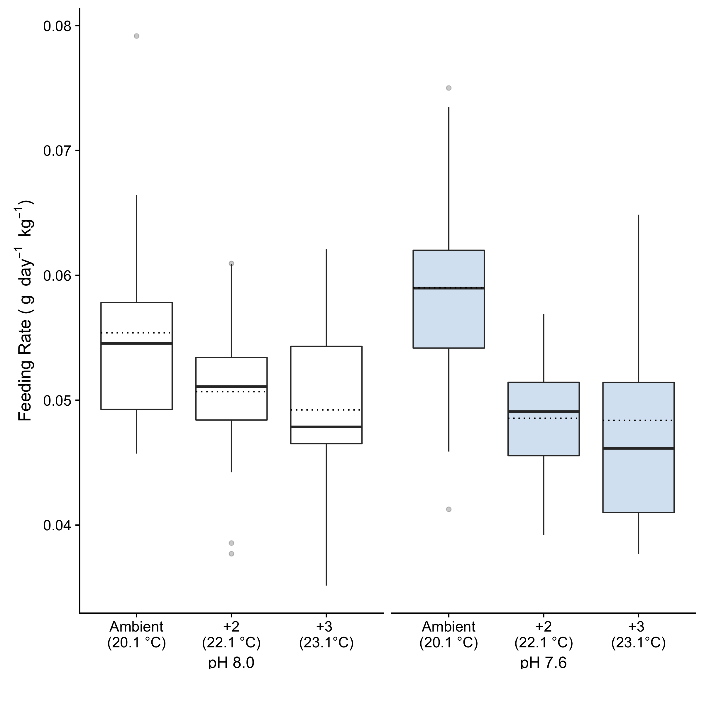

```{r, echo = FALSE, include = FALSE}
# Settings
knitr::opts_chunk$set(echo=FALSE, fig.height=6, fig.width=6, out.width='100%', comment="#>")

options(knitr.kable.NA = '') # this will hide missing values in the kable table
```

```{r, include = FALSE}
# Load required libraries here
library(snipR)
snipR::refresh()
snipR::pkgs(
  tidyverse,
  readxl,
  survminer,
  emmeans,
  knitr,
  huxtable,
  car,
  pander
)
# set pander table-layout options
panderOptions('table.alignment.default', function(df)
    ifelse(sapply(df, is.numeric), 'right', 'left'))
panderOptions('table.split.table', Inf)
panderOptions('big.mark', ",")
panderOptions('keep.trailing.zeros', TRUE)

# library(pander)     # table output
library(kableExtra) # enhance kable with pipes
# library(stargazer)  # table output for models
# library(texreg)     # output for models
# library(papeR)      # prettify table outputs

```

# Long-term exposure to ocean warming and acidification reduce survival and energy budget of the sea urchin, *Heliocidaris erythrogramma*
\chaptermark{Warming and acidification on \textit{Heliocidaris erythrogramma}}

## Abstract{-}

The warming and acidification of the world’s oceans affect nearly all aspects of physiology in marine organisms, and it is important to consider both stressors when predicting biological responses to a changing climate.
Here we present a long-term study on the effects of these stressors on the physiological responses of the sea urchin, *Heliocidaris erythrogramma*, a species that resides in the south-east Australian ocean warming hotspot. 
Urchins collected in winter were slowly-adjusted over 7 weeks to conditions of elevated temperature (ambient $+0$, $+2$, $+3^\circ C$) and decreased pH (ambient $-0$, $-0.4$ pH units) conditions, before they were maintained and the baseline temperature was adjusted weekly to mimic the seasonal change expected over time. 
Metabolic rate was measured at weeks 4 and 12, ammonia excretion rate at week 12, feeding rate at week 13, and survival for up to 22 weeks. 
Results showed that at $+3^\circ C$ and regardless of pH, urchins were stressed, with low survival (37 – 45%), decreased feeding and increased ammonium excretion at 12 -- 13 weeks of acclimation.
In addition, while both warming and acidification increased metabolic rates significantly at 4 weeks of acclimation, their effects were diminished at 12 weeks of acclimation as the surviving sea urchins appeared to have acclimated to the new environmental conditions.
The potential to acclimate to environmental stress emphasises the importance of continuous, long-term studies in predicting the consequences of climate change on study organisms.

<!-- **Keywords:** ocean warming; ocean acidification; multistressor; physiology; scope for growth -->

## Introduction

<!-- - intro about multiple stressors -->
<!-- - southeastern australia -->
<!-- - temperature and pH, and the importance of temperature? -->
<!-- - the need to use models? -->
<!-- - hypothesis -->


Many of the key challenges in predicting the ecological consequences of climate change stem from the fact that most ecosystems are confronted with multiple chemical, physical and biological stressors, which often interact (Byrne et al. 2013; Przeslawski et al. 2015, Goldenberg et al. 2017).
For the world's oceans, the impacts of both global warming and ocean acidification are intricately linked as approximately $90\%$ of the Earth's heat and $25\%$ of anthropogenic $CO_2$ emissions are absorbed directly into the ocean (Mikaloff Fletcher et al. 2006; Wanninkhof et al. 2013, Gattuso et al 2015).

Ocean warming increases the body temperature of marine ectotherms, affecting metabolism and almost all biological processes (Brown et al. 2014, Hochachka and Somero 2002). 
Concurrently, ocean acidification alters the balance of carbonate saturation states in sea water, increasing the metabolic costs associated with acid–base regulation, calcification and skeletogenesis (Doney et al. 2009, Hofmann et al. 2010, Kroeker et al. 2013, Portner 2008).
Given that both stressors influence important metabolic processes, interaction is inevitable and can affect biological responses in unexpected ways, highlighting the uncertainty surrounding our understanding of the drivers of ecosystem change.
<!-- biological responses which would not necessarily be predicted from investigating the stressors in isolation. -->
<!-- where the overall effects are likely to be dependent on location and species (Henson et al. 2017, Pecl et al. 2017, Poloczanska et al. 2016). -->
For example, ocean warming affects both oxygen demand and the supply of oxygen in water (Schulte 2015, Pörtner et al. 2010, Christensen et al. 2011), and may limit oxygen delivery which restricts metabolism, despite increased energetic demands associated with ocean acidification (Lefevre 2016). 

Current evidence suggests that exposure to the combined effects of ocean warming and acidification are additive or synergistic, as seen in the reduced development of marine bivalves (Talmage and Gobler 2011) and increased metabolism in sea urchins (Carey et al. 2016).
However, in other cases, positive or neutral responses have been observed, such as in the development and thermal windows of echinoderm larvae (Byrne et al. 2010, Karelitz et al. 2017), growth of juvenile and adult sea urchins (Dworjanyn and Byrne, 2018) and ONE MORE EXAMPLE HERE. 
<!-- These results highlight the subtle and complex uncertainty surrounding our understanding of the drivers of ecosystem change. -->
Understanding the effects of ocean warming and acidification on marine ecosytems in an ecologically relevant context remains a challenge (Byrne et al. 2013, MORE REFS) that is compounded by the difficulties of conducting multi-factorial experiments with respect to time and resources (Collins et al. 2009).
<!-- A synthesis of marine invertebrate responses to multistressors, including ocean warming and acidification, can be found in Przeslawski et al. (2013) and Byrne and Przeslawski (2015). -->

<!-- Calcifying organisms, such as echinoderms, are at high risk to the impacts of ocean warming and acidification (reviewed by Przeslawski et al. 2015).  -->
Echinoderms are marine calcifiers, and are important in many marine environments as ecosystem engineers through their roles in herbivory and bioturbation (Steneck 2013).
These animals at risk to the impacts of ocean warming and acidification (Przeslawski et al. 2015), with varying deleterious effects on larval and adult growth \& development (Byrne et al. 2011, Sewell and Young 1999), juvenile behaviour (Manríquez et al. 2017), adult immune defence (Brothers et al. 2016, Sweet et al. 2016), metabolism (Carey et al. 2017) and reproductive success (Delorme and Sewell 2016, BETTER REF).

Despite the plethora of studies on the effects of warming and ocean acidification on echinoderms as individual stressors and a few that consider both stressors (Manríquez et al. 2017 ,Morley et al. 2016, Karelitz et al. 2016, Carey et al. 2016, Brothers et al. 2016, Suckling et al. 2015), critical gaps remain in our knowledge with regards to the ability to acclimate or adapt to global change stressors.
<!-- If they are introduced to stress immediately, as is often done in many acute type of experiments, they may respond differently as they are unlikely to acclimate to their new conditions appropriately. -->
If they are introduced to stress immediately, as is often done in many acute type of experiments, they may respond differently as they are not provided the opportunity to acclimate to their new conditions.
<!-- , with most experiments exposing specimens to acute stress with short acclimation times (e.g. 16 days; Catarino et al. 2012, 45 days; Uthicke et al. 2013). -->
There is compelling evidence that we need to conduct longer-term experiments to realistically incorporate acclimation and/or adaptation to stressful conditions in the face of a changing climate, and the few studies that did so revealed responses that would not have been identified in short-term experiments.
For example, exposure to long-term warming and acidification on the Antarctic sea urchin *Sterechinus neumayeri* revealed that the negative effects of increased temperature ($+2^\circ C$) and decreased pH ($-0.3$ to $-0.5$ units) on metabolism and reproduction diminished within two years (Suckling et al. 2014, Morley et al. 2016).
Dupont et al. (2013) showed that although four months of exposure to inreased $pCO_2$ affected female fecundity in *Strongylocentrotus droebachiensis*, there was no effect for sea urchins acclimated to a longer, 16-month period.
<!-- Long-term (90-day) acclimation to temperature  -->
In general, acclimation decreases thermal sensitivity over time (Seebacher et al. 2015), reflecting increased resilience to the effects of elevated temperature.
Acclimation time is thus a crucial factor to consider when conducting experiments that investigate responses to climate change and can be tested by assessing responses over different time periods (e.g. Carey et al. 2016, Suckling et al 2014, more please).

<!-- In addition, studies are increasingly measuring multiple physiological and biological responses . -->

In this study, we examined the combined effects of prolonged exposure to increased temperature and elevated $pCO_2$ on the survival and physiological responses of the subtidal sea urchin, *Heliocidaris erythrogramma*.
Our experiments incorporated ecologically realistic conditions that involved the slow introduction to treatment conditions over $7$ weeks. 
Then, urchins were acclimated for up to another $22$ weeks under constant pH ($8.0$, $7.6$) and variable weekly temperature, based on the temperature profile of their habitat in Sydney Harbour at distinct warming levels (ambient $+0$, $+2$, $+3^\circ C$).
Metabolic rate was measured at $4$ and $12$ weeks to evaluate differences in physiological responses over two acclimation periods, and survival recorded over 22 weeks.
Feeding, assimilation efficiency, excretion and survival were also recorded at 12 -- 13 weeks of acclimation to evaluate fitness of *H. erythrogramma* to increased temperature and decreased pH conditions predicted for the near-future (REF).
As maintaining energy is key to long-term survival, we incorporated multiple physiological metrics and calculated the rate and efficiency at which *H. erythrogramma* allocates energy in the different treatment conditions using the scope for growth (SfG) model, a physiological index used to quantify the energy budgets of living organisms to optimise feeding strategies, including sea urchins (e.g. Stumpp et al. 2011, Orr et al. 2014, Rubilar et al. 2016, Delorme and Sewell, 2016).
Using SfG allows us to explore the effect of ocean warming and acidification on *H. erythrogramma* based on changes in its energy budget, and provides a single bioenergetics-based framework to determine the overall performance of the sea urchin in the long term.
This is important, as integrating multiple physiological traits has been shown to better predict vulnerability to global change effects (Magozzi and Calosi, 2015).
We hypothesised that over the acclimation period, (1) the response variables metabolic rate, feeding rate and ammonia excretion rate will differ between ambient and increased temperature/decreased pH conditions; and (2) survival will decrease under increased temperature/decreased pH conditions. 

<!-- Calcifying organisms, such as echinoderms, are at high risk to the impacts of OW and OA (reviewed by Przeslawski et al. 2015), but understanding how the stressors interact remains a complex endeavour (reviews). -->

<!-- For echinoderms, synergistic and additive effects have been documented on larval development (refs), metabolism (Carey et al. 2016) and immune response (Brothers et al. 2016) which have largely been negative. -->
<!-- However, positive or neutral responses have also been observed, likely due to antagonistic interactions between temperature and pH (Karelitz et al 2017; more refs). -->
<!-- As we continue to understand the response of echinoderms to multiple stressors, of particular relevance in their ability to adapt or acclimate to a changing climate is the speed at which they are exposed to these drivers of environmental stress. -->
<!-- Our understanding of the long-term, chronic impacts of OW and OA has lagged far behind our knowledge of acute responses. -->
<!-- In part, this is because there is considerable difficulty in maintaining and incubating  -->

<!-- all of which are excarbated as anthropogenic carbon emissions are expected to increase under all mitigation scenarios projected for the near future (IPCC 201X). -->
<!-- (Representative Concentration Pathways, RCP2.6 -- RCP8.5, IPCC 201X). -->

<!-- For the adult Antarctic sea urchin, *Sterechinus neumayeri*, longer term experiments have   -->
 <!-- implying some uncertainty surrounding the ability of echinoderms to adapt or acclimate to change (refs). -->

<!-- As our understanding of the impacts of climate change improve, the focus shifts to increasinly multistressor, and longer period, experiments. -->

<!-- Further, many marine organisms are impacted by reduced aerobic capacity when exposed to environmental stressors, and if OW and OA cause long-term reductions in aerobic scope, the fitness and survival of marine organisms may be affected severely. -->
<!-- Thus, maintaining energy surplus is key for long-term survival.  -->
<!-- bioenergetics-based models can be used to examine how environmental stressors affect the fitness and survival of marine organisms by changing their energy budget. -->

## Methods 

### Collection

*Heliocidaris erythrogramma* ($44.15$ $\pm$ $3.25\ mm$ test diameter) were collected from the subtidal ($2$--$3\ m$ depth) at low tide, at Milk Beach ([-33.856478, 151.266958](https://www.google.com/maps/?q=-33.856478,151.266958)) and Bottle and Glass Point ([-33.847960, 151.270122](https://www.google.com/maps/?q=-33.847960,151.270122)) in June, $2014$. Sea surface temperature (SST) at the time was approximately $15.3^{\circ}C$.
The urchins were transported to the Sydney Institute of Marine Science (SIMS) in Chowder Bay and were held in aquaria ($80\ L$) supplied with ambient flow-through, filtered seawater (FSW, $70\ \mu m$, $1.5\ L\ min^{-1}$).
After one week, they were randomly allocated into six treatments, based on three temperature profiles (ambient: $+0^{\circ}C$, elevated: $+2^{\circ}C$ and $+3^{\circ}C$, adjusted weekly with regard to the mean SST profile as detailed below) and two constant total pH ($pH_T$, on the total hydrogen scale) levels (ambient $8.0$, low: $7.6$).
For each treatment we used three replicate tanks with 10 urchins per tank.

### Experimental setup

We performed all acclimation experiments in a constant-temperature room for precise adjustments of water temperature and pH (see Appendix \@ref(fig:multisetup)).
In addition, room lighting was adjusted weekly to reflect the diurnal sunrise/sunset cycle.
Adjustments to water parameters were made in header tanks, before the water was channeled to treatment tanks.
Each header tank was supplied with FSW ($20\ \mu m$) via a thermocouple-solenoid feedback system that automatically mixed warm ($25^{\circ}C$) and cold ($14.5^{\circ}C$) filtered FSW ($20\ \mu m$) in a $2\ L$ mixing chamber to supply temperature-controlled water consistently.
Each header tank was also equipped with a heater (75 W, EHEIM GmbH & Co KG, Germany) attached to a temperature controller (model 7028/3, TUNZE Aqraientechnik GmbH, Germany) as a second level of temperature control.

Sea water pH was maintained using a mixed $CO_2$ system, where a thermally-compensated, low-flow controller valve (Parker Hannifin, OH, USA) and a proportional–integral–derivative controller, updated every $10\ s$, were used to precisely inject food-grade $CO_2$ (BOC, Australia) into ambient air that had been scrubbed of $CO_2$.
The $CO_2$-mix was bubbled vigorously and continuously into header tanks using $20 cm$ ceramic diffusers.

### Gradual adjustment to treatment conditions and acclimation

To minimise physiological shock to altered conditions, adjustments to the levels of warming and acidification of the tanks were performed gradually. 
Temperature was increased at a rate of $1^{\circ}C$ every 6 days until target elevated temperatures were achieved.
Sea water pH was decreased at a rate of $-0.1\ pH_T$ units every week.
Both temperature and pH manipulations were performed on a staggered schedule such that all treatments achieved target conditions in the same week (Fig. \@ref(fig:acclim) A).
Adjustments were made at the level of the header tanks such that the experimental tanks reached the new conditions within 1 to 2 days.
<!-- Further, all adjustments were made in header tanks such that treatments slowly stabilised to their new conditions within 1 to 2 days. -->
The adjustment process took 7 weeks during which no mortality occured.
Once the treatment conditions were established, treatment temperatures were at $15.6 \pm 0.4^{\circ}C$, $17.6 \pm 0.4^{\circ}C$ and $18.6 \pm 0.3^{\circ}C$ (s.d.) for the ambient, $+2^{\circ}C$ and $+3^{\circ}C$ treatments respectively.

After the adjustment period, the acclimation period started with temperature levels regulated weekly based on the mean weekly temperature over the same period in Sydney Harbour (Fig. \@ref(fig:acclim) A \& B). 
Thus, treatment temperatures were changed to mimic the seasonal change expected over winter to early summer, based on reference data collected from *in situ* loggers deployed in Chowder Bay from 2009–2014 (Fig. \@ref(fig:harbour)).
Because temperature has an effect on $CO_2$ solubility and temperatures were changing every week, the system maintained constant pH (not $CO_2$ ppm) within each treatment.

(ref:acclim) Temperature and pH in treatment tanks, measured daily. Only one replicate tank for every treatment was selected at random for daily measurements. Shaded regions are the pre-acclimation adjustment periods for temperature (pink) and pH (blue), respectively. (A) Coloured lines represent the planned temperature profiles (+0, +2, +3), which change every week, while coloured dots represent the actual temperatures measured. The black dots are the reference temperatures collected from *in situ* loggers deployed in Chowder Bay from 2009 to 2014, averaged by day. (B) Black lines represent the reference constant pH levels, with the initial adjustments (8.0, 7.6). Shapes represent the pH treatment group (triangle: 8.0; circle: 7.6), colours represent the temperature treatment group (+0, +2, +3).

```{r acclim, fig.cap = "(ref:acclim)", fig.pos = "p"}
knitr::include_graphics("figs/ch_multistressor/acclim.png")
```

(ref:harbour) Mean weekly-averaged temperature ($\pm$ s.d.) for Chowder Bay, NSW, Australia, from 2009 to 2014. Data were obtained from loggers deployed *in situ* at 3 m depth at the level of the sea urchin habitat. Colours represent the adjustment (blue) and acclimation (red) periods of the experimental treatments, respectively. The shaded region is the max/min of the temperatures recorded. These data were used to design the temperature profile of the elevated temperature treatments.

```{r harbour, fig.cap = "(ref:harbour)", fig.pos = "p"}
knitr::include_graphics("figs/ch_multistressor/harbour.png")
```

### Monitoring

Temperature was recorded daily in all tanks.
Sea water pH was measured spectrophotometrically with a custom-built pH sampling system connected to an Ocean Optics USB4000+ fibre optic spectrometer, using m-Cresol dye indicator (Acros Argonics, catalog number 110585000, Lot A0321770) and calculated according to Liu et al. (2011). 
The measurements were calibrated to certified reference material (CRM) for $CO_2$ in seawater (Batch 139) following SOP 6b in Dickson et al. (2007).
The pH of the tanks were measured every 2 to 3 days.
In addition, the pH sampling system automatically measured pH in one ambient and one low pH treatment every two hours to characterise pH during the acclimation period (Appendix ##).

To estimate total alkalinity ($A_T$) of the sea water, water samples (330 mL) were taken randomly from experimental tanks every 2 to 3 weeks (total $n = 64$ samples). 
$A_T$ was determined by potentiometric titration (907 Titrando, Metrohm), calibrated using sea water CRMs (Batch 139; Dickson et al., 2007). 
The carbonate chemistry parameters $pCO_2$, calcite and aragonite staturation states ($\Omega Ca$ and $\Omega Ar$) were calculated by running the data in the "seacarb" package in R (Lavigne et al., 2011) using the dissociation constants of Mehrbach et al. (1973) refitted by Dickson & Millero (1987).


### Maintenance

Specimens were fed on a diet mixture of fresh *Ecklonia radiata* and *Sargassum* spp. suspended in kelp-based agar (MSC CO, Kyeongnam, Korea). 
To prepare the food, *E. radiata*, and *Sargassum* spp. were washed in fresh water, dried at $50^{\circ}C$ over 48 hours, and then ground into fine powder for storage. 
The food was mixed with agar powder to a ratio of $1:4$ by weight, and then mixed with FSW ($20\ \mu m$) to a ratio of 1:10 by weight at $\sim 80 ^{\circ}C$.
The agar was left to cool and solidify for $45$ minutes, before it was cut into $1$ to $2$ $cm^2$ cubes and fed to the specimens. 
We fed the specimens twice a week by placing $3$ to $4$ cubes on top of each individual urchin. 
This feeding technique ensured that each animal received the same amount of food in excess during the entire experimental period.

All treatment tanks were siphoned every two days and wiped weekly to remove faecal matter and minimise algal growth. 
$CO_2$ diffusers were scrubbed and replaced every $3$ to $5$ days.
Header tanks were cleaned of algal growth once a month.


### Survival

Survival was recorded by measuring the survival time of individual specimens for 155 days (Aug--Dec 2014). 
Specimens were observed daily for mortality, and dead urchins were removed immediately. 


### Metabolic rate

Routine weight-specific metabolic rate, $MO_2$ was estimated by intermittent-flow respirometry at two time-points (at 4 and 12 weeks of acclimation), from a random subsample of 10 specimens from each tank.
At 4 weeks, the temeperature levels were at $16.6$, $18.6$ and $19.6^\circ C$ and at 12 weeks, the temperature levels were at $20.7$, $22.7$ and $23.7^\circ C$ for the control $+0$, $+2$ and $+3 ^\circ C$ treatments, respectively.
The specimens were not fed for 5 days prior to measurements and transferred individually into $1\ L$ respirometry chambers.
Each respirometry chamber was kept in an individual water bath and contained an oxygen sensor spot (SP-PSt3-NAU, PreSens GmbH, Germany) for the detection of dissolved oxygen concentration using an external multi-channel sensor (OXY-10-mini, PreSens Gmbh, Germany). 
A magnetic stirrer ensured even mixing of water.
The specimens were allowed to adjust to the chambers under flow-through conditions for 30 minutes prior to respirometry measures.

To measure oxygen uptake, chambers were sealed and dissolved oxygen (DO, $mgO_2\ L^{-1}$) was measured every 10 seconds until a 10\% decrease in DO was recorded. 
The chamber was then flushed, and the measurement repeated.
Background respiration was determined by recording FSW-only blanks ($n$ = 8) to correct the recordings for background respiration and instrument drift.
At the end of each measurement, sea water weight was calculated by deducting chamber, stir bar and urchin wet weights from the total weight of the chamber, and then converted to volume using sea water density estimated from current temperature, salinity and barometric air pressure (Fofonoff & Millard 1983). 

Weight-specific $MO_2$ ($mgO_2\ L^{-1}\ h^{-1}$) was calculated using the equation (Lighton 2008): 

\begin{equation}
  MO_2 = \frac{\Delta O_2V}{W}
  (\#eq:mo2)
\end{equation}

\noindent where $\Delta O_2$ is the linear regression of $O_2$ concentration over time ($mg\ L^{-1}\ h^{-1}$), $V$ is the volume of the sea water available ($L$) and $W$ is the wet weight of the urchin ($g$). 


### Feeding rate and assimilation efficiency

Feeding trials were conducted after 13 weeks of acclimation where the temperature levels were at $20.1$, $22.1$ and $23.1^\circ C$ for the control $+0$, $+2$ and $+3 ^\circ C$ treatments, respectively, a difference of approximately $-0.6^\circ C$ from the previous week.
Ten random specimens from each treatment were transfered into individual tanks ($4\ L$) supplied with flowthrough FSW ($6\ L\ h^{-1}$) at the same treatment conditions.
They were starved for 6 days in their new environments before feeding trials commenced, using the same agar-based food mixture used in routine feeding.
Initial wet weight of the diet was determined and food was added to each tank in excess.
Food-only autogenic controls were used to determine background changes in agar composition ($n = 24$).

After 48 hours, unconsumed food was carefully collected and oven dried at $80^{\circ}C$ for 48 h, and then re-weighed.
Faecal pellets were also siphoned at the same time for calculations of assimilation efficiency (see below).
The specimens were removed from the tanks, blotted briefly with paper towel, and weighed.
To convert the initial wet weight ($W_{wet}$) of the food to their dry-weight equivalents, the wet:dry ratio of the food was determined in a regression analysis of wet to dry weights ($n = 60$, $r^2 = 0.82$, $p < 0.01$), and determined as: 

\begin{equation}
  W_{dry} = (0.1529 \times W_{wet}) - 0.036
  (\#eq:wdry)
\end{equation}


Feeding rate, $C$ ($mg\ day^{-1}\ kg^{-1}$), was calculated by subtracting the final dry weight ($W_{T1}$) from the initial dry weight ($W_{T0}$), with adjustments for background changes and specimen weight ($W_{sp}$) and adjusted by time ($T$): 

\begin{equation}
  C = \frac{W_{T0} - W_{T1}}{W_{sp} \cdot T}
  (\#eq:c)
\end{equation}

Faecal samples were dried at $60^{\circ}C$ for 48 hours and weighed.
These samples were then ashed in a muffle furnace at $500^{\circ}C$ for 2--3 hours and re-weighed to determine their ash-free dry weight (AFDW). 
Assimilaiton efficiency (\%) was calculated using the Conover method (Conover, 1966): 

\begin{equation}
  A = \left[ \frac{F - E}{(1 - E) \cdot F} \right] \times 100\%
  (\#eq:a)
\end{equation}

where $F$ and $E$ denote the AFDW:dry weight fraction measured in the diet and the faeces, respectively.
All weights were determined using the same analytical balance accurate to 0.0001 g.


### Ammonia excretion

Ammonia excretion rate was determined at 12 weeks of acclimation immediately after respiration experiments were completed. 
Ten specimens were randomly selected from each treatment and transferred into 1L chambers supplied with flowthrough FSW at the same treatment conditions, and left to rest for at least 45 minutes.
Initial water samples were carefully collected ($50\ mL$, $0.22\ \mu m$) and frozen.
The chambers were then sealed and left in the water baths for 3 hours before final water samples were collected.
Background ammonia levels were determined by repeating the experiment without specimens ($n = 3\ treatment^{-1}$).
The water samples were immediately frozen and stored in the dark until they were analysed spectrophotometrically (within 10 days) for total ammonia, following the methods of Parsons et al. (1984). 
Spectrophotometric readings were obtained at 640 nm on a microplate reader (CLARIOstar Microplate Reader, BMG LABTECH, Offenburg, Germany) and calibrated using daily blanks and a standard ammonium solution (Parsons et al., 1984). 
Ammonia excretion rate, $U$ ($\mu g\ kg^{-1}\ h^{-1}$) was calculated according to the equation: 

\begin{equation}
  U = \frac{N_c}{W \cdot T}
  (\#eq:u)
\end{equation}
where $N_c$ is the concentration of ammonia ($\mu g\ at\mbox{-}N\ L^{-1}$), $W$ is the weight of the specimen in $kg$ and $T$ is the time elapsed in hours. 
Ammonia concentration, $N_c$ is determined following Parsons et al. (1984) and is summarised in the equation:

\begin{equation} 
  N_c = \frac{3 \cdot V}{\Delta E}
  (\#eq:nc)
\end{equation} 
where $\Delta E$ is the difference between the standard and corrected spectrophotometric extinction values of the blue indophenol colour formed with ammonia and $V$ is the volume of the chamber ($L$).


### Scope for growth (SfG) parameters

To explore the influence of temperature and pH stressors on the growth potential of *H. erythrogramma*, we constructed a SfG model using data from respirometry (week 12), feeding trials (week 13) and ammonia analyses (week 12).

Oxygen consumption was converted to energy equivalent values to calculate the energy lost in respiration per day, $R_E$, using a conversion factor of $14.14 J\ mg^{-1}\ O_2$ (Elliot and Davidson, 1975). 
A conversion factor of $0.025 J\ g^{-1}$ ammonia (Crisp, 1984, Elliott and Davison, 1975) was used to estimate the energy equivalent of the energy lost due to ammonia excretion per day, $U_E$. 

The energy available from food, $C_E$, was calculated with bomb-calorimetry using an automatic adiabatic bomb calorimeter (Gallenkamp, London).
The calorimeter was calibrated for the heat of combustion of $1 g$ of benzoic acid (26.493 $kJ\ g^{−1}$) at least three times to determine the approximate effective heat capacity of both the bomb chamber and the mass of the water within the calorimeter chamber, $C_S$ (10.27 $\pm$ 0.07 $kJ\ ^{\circ}C$).

The diet was dried in an oven at $60^{\circ}C$ to remove moisture.
Approximately 1 $g$ of the diet was used each time to determine gross energy via combustion, and the experiment was repeated six times to obtain an average value (12.67 $\pm$ 0.25 s.d. $kJ\ g^{-1}$) using the equation:

\begin{equation}
  C_E = \frac{\Delta T \times C_S}{W_S}
  (\#eq:ce)
\end{equation}

where $\Delta T$ $(^{\circ}C)$ is the change in temperature -- detected using a Beckmann thermometer -- between the initial and post-combustion of the sample, $C_S$ is the effective heat capacity of the system (bomb chamber and water), and $W_S$ is the weight of the diet sample ($g$). 

To calculate scope for growth ($SfG$) we used the equation adapted from Winberg (1960): 

\begin{equation}
  SfG = C_E \cdot A - (R_E + U_E)
  (\#eq:sfg)
\end{equation}

where $C_E$ is the energy obtained from diets, $A$ is the assimilation efficiency, $R_E$ is the energy lost in respiration and $U_E$ is the energy lost due to ammonia excretion.
All energy-related units are in $kJ\ g^{-1}\ day^{-1}$, while assimilation efficiency is a proportion.

<!-- We did not follow individual urchins, so the SfG data could not be analysed using the statistical approach (e.g.). Rather, we constructed the SfG model using treatment-averaged parameters as an indicative assessment of the impacts of our acclimation treatments on *H. erythrogramma*. -->

### Statistical analyses

Analyses were performed in R (v 3.4.3). The survival time for each specimen was determined by the number of days from time zero (when the acclimation period started) to the end of the experiment, a total period of 155 days.
Survival data were analysed using Cox proportional hazards models (Cox, 1972), with right censoring, to determine whether temperature and pH affect survival time. 
This was done by fitting survival time as a function of temperature and pH.
The fitted Cox regression met the assumption of proportional hazards (Schoenfeld residual tests, Grambsch and Therneau 1994; $p = 0.673$). 
As no interactions were found between temperature and pH (Cox regression, $z =$ 0.61, $d.f. =$ 3, $p =$ 0.54), the interaction term was removed and the analysis was repeated with only the main effects tested.
*Post-hoc* tests for the differences between treatments were determined using pairwise tests of significance corrected using the Benjamini-Hochberg (BH) false discovery rate method (Benjamini and Hochberg, 1995).

Metabolic rate data were first analysed by constructing a generalised linear mixed model of metabolic rate as a function of relative temperature ($+0^{\circ}C$,  $+2^{\circ}C$,  $+3^{\circ}C$), pH ($8.0$, $7.6$) and absolute time ($4$ weeks, $12$ weeks).
Feeding rate and ammonia excretion rate data were also analysed as above with the response variable as a function of temperature and pH.
For all analyses, the nested effects of tank, temperature within tank and pH within tank were added as a random parameter in the models, and then tested using a likelihood ratio test on random effects, which were all not significant ($p \geq 0.9$ for all tests).
Thus, the nested tank parameter was removed from all models and data were analysed individually using simple linear models.
To test for fixed effects, ANOVA was performed on the models, using Type III sums of squares when interactions were present, or Type II sums of squares when they were not (Langsrud 2003).

<!-- It is important to note that at week 12, metabolic rate data was collected from a smaller sample population due to high mortality in some treatments (see results).  -->
<!-- Thus, we analysed the data separately for each period by constructing a generalised linear mixed model of metabolic rate as a function of relative temperature ($+0^{\circ}C$,  $+2^{\circ}C$,  $+3^{\circ}C$) and pH ($8.0$, $7.6$). -->

For metabolic rate data, there were no significant interactions between acclimation time, temperature and pH ($F_{2,104}= 2.37$, $p = 0.098$), thus, the three-way interaction term was removed from the model and the data re-analysed to only test for two-way interactions using ANOVA.
For feeding and ammonia excretion rate data, there were no significant interactions between temperature and pH ($F_{2,47} = 1.07$, $p = 0.35$ and $F_{2,54} = 2.31$, $p = 0.11$, respectively), so the temperature:pH interaction terms were removed before ANOVA was performed on each model.

All ANOVA analyses were tested for normality using the Shapiro-Wilk test of normality (Royston 1982), and homogeneity of variances using the Fligner-Killeen Test (Conover et al. 1981).
<!-- Check ?shapiro.test and ?fligner.test for references -->
Where treatment conditions were indicated to be significantly different, estimated marginal means (EMM, aka Least-Squares Means) were used to develop linear estimates, and then analysed using the *post-hoc* Tukey Highest Significant Difference (HSD) test to identify the significance between temperature-pH combinations. Significance was determined at $p < 0.05$ or lower for all statistical tests. 

For SfG, as the parameters used to construct the model were obtained from individual, but different, urchins, the metric was calculated using treatment-averaged parameters (so, $n = 1$), similar to Delorme and Sewell (2016), and Stumpp et al. (2011). 
Thus, the SfG model was constructed as an indicative assessment of the impacts of our acclimation treatments on *H. erythrogramma*, but we did not perform statistical tests of significant differences in SfG between treatment groups.

## Results

### Survival

There was a significant effect of treatment on survival (*logrank test*, $\chi_2$ = 61.23, $d.f. =$ 3, $p$ < 0.001).
As single stressors, decreased pH did not significantly affect survival ($p\ = 0.296$, HR: 0.46, 95\% CI: 0.10 -- 1.99), neither did a $+2 ^{\circ}C$ increase in temperature ($p = 0.146$, HR: 2.68, 95\% CI: 0.71 -- 10.09).
For these treatments, survival was $>80\%$ after 155 days. 
At $+3 ^{\circ}C$, survival decreased significantly ($p < 0.001$, HR: 17.2, 95\% CI: 5.27 -- 56.25) regardless of pH level.
<!-- (pH 8.0: 40\%; pH 7.6: 33\%). -->
These $+3^{\circ}C$ treatments intersected the median surival threshold after 155 days (Figure \@ref(fig:surv)). 
*Post-hoc* results (pairwise tests, BH-corrected) showed that urchins acclimated to $+3 ^{\circ}C$ had significantly lower survival compared to all other treatments ($p <$ 0.01 for all pairwise combinations with $+3^{\circ} C$), with no significant differences in all other pairwise comparisons.
At 155 days, urchins acclimated to $+3^{\circ} C$ and pH $7.6$ had the lowest survival at 33\%.

(ref:surv) Survival in *H. erythrogramma* acclimated to combinations of increased temperature (ambient $+0$, $+2$, $+3 ^\circ C$) and decreased pH (ambient 8.0, decreased 7.6). Letters indicate treatments that differed (pairwise tests, with Benjamini-Hochberg (BH) false discovery rate corrections, $p < 0.05$).

```{r surv, fig.cap="(ref:surv)", fig.pos = "p"}
knitr::include_graphics("figs/ch_multistressor/surv_plot.png")
```


### Metabolic rate

There were significant two-way interactions for acclimation time $\times$ pH ($F_{1,107}= 11.25$, $p = .001$), temperature $\times$ pH ($F_{2,107} = 3.58$, $p = 0.031$), and acclimation time $\times$ temperature ($F_{2,107}= 14.1$, $p < 0.001$).
<!-- As single stressors, increased temperature ($F_{2,106} = 14.1$, $p < .001$) and decreased pH ($F_{1,106}= 22.8$, $p < .001$) significantly influenced metabolic rate.  -->
At 4 weeks of acclimation, metabolic rate increased additively with increased temperature, low pH, or a combination of both (Figure \@ref(fig:resp) A; Appendix Figure \@ref(fig:respinteract)). 
However, after 12 weeks of acclimation, increased temperature interacted with low pH resulting in decreasing metabolic rate with increasing temperature when pH was $7.6$ (Figure \@ref(fig:resp) B; Appendix Figure \@ref(fig:respinteract)).
*Post-hoc* analyses using Tukey's HSD showed that at 4 weeks of acclimation, metabolic rate was significantly different between groups that were subject to elevated temperature ($p = < 0.0001$) or decreased pH ($p < 0.001$), compared to control treatments, with no interactions observed (Appendix Table \@ref(tab:mrcontrasts)).
However, at 12 weeks of acclimation, there were no significant differences between any treatment groups ($p > 0.1$; Appendix Table \@ref(tab:mrgroups)).

<!-- ```{r anovaresp, results = "asis"} -->
<!-- load("output/ch_multistressor/respiration.RData") -->
<!-- table_rav <- as_huxtable(car::Anova(model)) %>% -->
<!--   huxtable::add_rownames(colname = "Response") %>% -->
<!--   rename(p = `Pr(>F)`, df = Df, F = "F value") %>% -->
<!--   mutate(sig = p_stars(p))     %>% -->
<!--   huxtable::add_colnames()     %>% -->
<!--   set_bold(1,1:6,T)            %>% -->
<!--   set_align(1:8,1,"right")     %>% -->
<!--   set_top_border(1,1:6,.8)     %>% -->
<!--   set_bottom_border(1,1:6,.5)  %>% -->
<!--   set_bottom_border(4,1:6,.5)  %>% -->
<!--   set_bottom_border(8,1:6,.8)  %>% -->
<!--   set_right_padding(5)         %>% -->
<!--   set_left_padding(5)          %>% -->
<!--   set_top_padding(5)           %>% -->
<!--   set_bottom_padding(5)        %>% -->
<!--   set_latex_float("p")         %>% -->
<!--   set_position("left")         %>% -->
<!--   set_caption("ANOVA results") %>% -->
<!--   # add_footnote("*** p < 0.001; ** p < 0.01; * p < 0.05; . p < 0.1.") %>% -->
<!--   set_caption_pos("top") -->
<!-- table_rav -->
<!-- ``` -->

(ref:anovaresptab) ANOVA test on the effects of temperature, pH or acclimation time on the metabolic rate of *H. erythrogramma*, at 4 or 12 weeks of incubation to elevated temperature ($+0$, $+2$, $+3^\circ C$) and decreased pH ($8.0$ , $7.6$). As the three-way interaction term was not significant, it was removed from the model before analysis. $n = 10$

```{r anovaresptab, warning=FALSE}
load("output/ch_multistressor/respiration.RData")
table_rav <- 
  as.data.frame(car::Anova(model)) %>%
  rename(p = `Pr(>F)`) %>%
  mutate(Source = c("Temperature", "pH", "Time", 
    "Temperature:pH", "Temperature:Time", "pH:Time",
    "Residuals")) %>%
  select(Source, "Sum Sq", Df, "F value", p) %>%
  mutate(" " = snipR::p_stars(p)) %>%
  kable(booktabs = TRUE, linesep = "", caption = "(ref:anovaresptab)") %>%
  kable_styling(latex_options = "striped") %>%
  row_spec(0, bold = TRUE) %>%
  row_spec(3, hline_after = TRUE)

table_rav
```


(ref:resp) Metabolic rate ($mg\ O_2\ h^{-1}\ kg^{-1}$) of *H. erythrogramma* acclimated for 12 weeks in six treatments of three temperatures ($+0, +2, +3 ^\circ C$) and two pH levels (8.0, 7.6). The top and bottom of the boxes represent the interquartile range (IQR) between the 25th and 75th percentile (Q1 and Q3, respectively). The horizontal line represents the median (Q2), the horizontal dotted line represents the mean, and the vertical lines (whiskers) represent the range of the data computed as follows: Q1 − 1.5IQR (bottom whisker); greater than Q3 + 1.5 IQR (top whisker).

```{r resp, fig.cap = "(ref:resp)"}
knitr::include_graphics("figs/ch_multistressor/resp_plot.png")
```

### Feeding rate and assimilation efficiency

The 2-way ANOVA showed that feeding rate was significantly influenced by elevated temperature ($F_{2,49} = 13.5$, $p < 0.001$), but not pH ($F_{1,49} = 1.25$, $p = 0.27$). 
There were also no statistically significant interactions between temperature and pH ($F_{2,47} = 1.15$, $p < 0.35$).
Pairwise comparisons using Tukey's HSD showed that the general trend was that feeding decreased with increasing temperature, and specimens acclimated to increased temperature of $+2 ^\circ C$ and $+3 ^\circ C$ had significantly decreased feeding at pH $7.6$ ($p = 0.001$ and $p = 0.008$, respectively), but not at pH 8.0.
No other significant differences between treatment groups were detected.

<!-- ```{r anovafeeding, results = "asis"} -->

<!-- load("output/ch_multistressor/feeding.RData") -->
<!-- anovafeeding <- car::Anova(model) -->
<!-- table_fav <- as_huxtable(anovafeeding) %>% -->
<!--   huxtable::add_rownames(colname = "Response") %>% -->
<!--   mutate(Response = c("Temperature","pH","Residuals")) %>% -->
<!--   rename(p = `Pr(>F)`, df = Df) %>% -->
<!--   mutate(sig = p_stars(p))    %>% -->
<!--   huxtable::add_colnames()    %>% -->
<!--   set_bold(1,1:6,T)           %>% -->
<!--   set_align(1:4,1,"right")    %>% -->
<!--   set_top_border(1,1:6,1)     %>% -->
<!--   set_bottom_border(1,1:6,.5) %>% -->
<!--   set_bottom_border(4,1:6,1)  %>% -->
<!--   set_right_padding(5)        %>% -->
<!--   set_left_padding(5)         %>% -->
<!--   set_top_padding(5)          %>% -->
<!--   set_bottom_padding(5)       %>% -->
<!--   set_latex_float("p")        %>% -->
<!--   set_position("left")        %>% -->
<!--   # add_footnote("*** p < 0.001; ** p < 0.01; * p < 0.05; . p < 0.1.") %>% -->
<!--   set_caption("ANOVA results") -->
<!-- table_fav -->
<!-- ``` -->

<!-- ```{r} -->
<!-- load("output/ch_multistressor/feeding.RData") -->
<!-- # anovafeed <- Anova(model) -->
<!-- # kable(anovafeed, booktabs = TRUE,  -->
<!-- #   caption = "Demo table") -->
<!-- hsd$contrasts -->
<!-- grps$contrasts -->
<!-- ``` -->

(ref:anovafeedtab) ANOVA test on the effects of temperature or pH on the feeding rate of *H. erythrogramma* after 12 weeks of incubation to elevated temperature ($+0$, $+2$, $+3^\circ C$) and decreased pH ($8.0$ , $7.6$). The ANOVA was performed with the non-significant interaction terms removed. $n = 10$.

```{r anovafeedtab, warning=FALSE}
load("output/ch_multistressor/feeding.RData")
anovafeeding <- car::Anova(model)
anovafeedtab <- 
  as.data.frame(car::Anova(model)) %>%
  rename(p = `Pr(>F)`) %>%
  mutate(Source = c("Temperature", "pH", "Residuals")) %>%
  select(Source, "Sum Sq", Df, "F value", p) %>%
  mutate(" " = snipR::p_stars(p)) %>%
  kable(booktabs = TRUE, caption = "(ref:anovafeedtab)") %>%
  # kable_styling(latex_options = "striped") %>%
  row_spec(0, bold = TRUE)
```

(ref:feeding) Feeding rate, in dry food weight ($g\ day^{-1}\ kg^{-1}$) of *H. erythrogramma* acclimated for 12 weeks to conditions of increased temperature ($+0, +2, +3 ^\circ C$) and decreased pH (8.0, 7.6). The top and bottom of the boxes represent the interquartile range (IQR) between the 25th and 75th percentile (Q1 and Q3, respectively). The horizontal line represents the median (Q2), the horizontal dotted line represents the mean, and the vertical lines (whiskers) represent the range of the data computed as follows: Q1 − 1.5IQR (bottom whisker); greater than Q3 + 1.5 IQR (top whisker).

```{r, fig.cap = "(ref:feeding)", fig.pos = "p"}

```

### Ammonia excretion rate
<!-- TODO fix this -->

Urchins acclimated to elevated temperature treatments had significantly higher ammonia excretion rates (ANOVA, $F_{2, 56} = 8.94$, $p < 0.001$; Figure). 
Decreased pH had no significant effect ($F_{1, 56} = 0.91$, $p < 0.34$), and both temperature and pH did not significantly interact ($F_{1, 56} = 0.67$, $p = 0.42$). 
*Post-hoc* using Tukey's HSD ($p = 0.05$) showed that at ambient pH (8.0), acclimation to $+2 ^\circ C$ increased ammonia excretion by 1.3-fold ($d.f. =$ 54, $p =$ 0.016), but not at $+3 ^\circ C$ ($p =$ 0.099). At low pH (7.6), acclimation to $+2 ^\circ C$ did not significantly affect ammonia excretion ($p =$ 0.29), but at $+3 ^\circ C$, excretion increased by 1.5-fold ($p =$ 0.016).  


(ref:anovanhtab) One-way ANOVA test on the effects of temperature or pH on the ammonia excretion rate of *H. erythrogramma* after 12 weeks of incubation to elevated temperature ($+0$, $+2$, $+3^\circ C$) and decreased pH ($8.0$ , $7.6$). The ANOVA was performed with the non-significant interaction terms removed. $n = 10$.

```{r anovanhtab, results='asis', warning=FALSE}
load("output/ch_multistressor/ammonia.RData")
anovanhtab <- 
  as.data.frame(car::Anova(model)) %>%
  rename(p = `Pr(>F)`) %>%
  mutate(Source = c("Temperature", "pH", "Residuals")) %>%
  select(Source, "Sum Sq", Df, "F value", p) %>%
  mutate(" " = snipR::p_stars(p)) %>%
  kable(booktabs = TRUE, caption = "(ref:anovanhtab)") %>%
  # kable_styling(latex_options = "striped") %>%
  row_spec(0, bold = TRUE)

anovanhtab
```


(ref:nitrogen) Feeding rate of *H. erythrogramma* acclimated for 12 weeks to three temperatures ($+0, +2, +3 ^\circ C$) and two pH levels (8.0, 7.6). The top and bottom of the boxes represent the interquartile range (IQR) between the 25th and 75th percentile (Q1 and Q3, respectively). The horizontal line represents the median (Q2), the horizontal dotted line represents the mean, and the vertical lines (whiskers) represent the range of the data computed as follows: Q1 − 1.5IQR (bottom whisker); greater than Q3 + 1.5 IQR (top whisker).

```{r nitrogen, fig.cap="(ref:nitrogen)", fig.pos='p'}
knitr::include_graphics("figs/ch_multistressor/nh_plot.png")
```

### Scope for growth

The scope for growth model for *H. erythrogramma* showed that there is a net positive energy budget under all experimental scenarios of increased temperature and low pH after $12$ to $13$ weeks (SfG $> 0$; Table \@ref(tab:sfgtab); Figure \@ref(fig:sfg)).
However, while specimens acclimated to low pH only recorded a $16\%$ increase in SfG ($1.17$), exposure to conditions of increased temperature only reduced overall SfG by $31$ to $41\%$.
When simultaneously acclimated to both stressors of increased temperature and low pH, mean SfG was reduced the most by $42$ to $45\%$.


(ref:sfgtab) Scope for growth (SfG) parameters, standardised to the same unit ($kJ\ g^{-1}\ day^{-1}$). Each parameter was obtained after 12 -- 13 weeks of acclimation to three temperatures ($+0, +2, +3 ^\circ C$) and two pH levels (8.0, 7.6). 

```{r sfgtab, results='asis', warning=FALSE}
# sfgtab <-
#   as.data.frame(readxl::read_excel("figs/ch_multistressor/sfg_table.xlsx")) %>%
#   rename("AE (%)" = A,
#     Feeding = Ce,
#     Respiration = Re,
#     Excretion = Ue) %>%
#   kable(booktabs = TRUE, caption = "(ref:sfgtab)")
# 
# sfgtab
load("output/ch_multistressor/sfg.RData")

sfgtab <- sfg %>%
  select(treatment, A, Ce, Re, Ue, sfg) %>%
  mutate(Treatment = c("+0 °C; pH 7.6", "+0 °C; pH 8.0", "+2 °C; pH 7.6", 
    "+2 °C; pH 8.0", "+3 °C; pH 7.6", "+3 °C; pH 8.0")) %>%
  mutate(Treatment = factor(Treatment, 
    levels = c("+0 °C; pH 8.0", "+0 °C; pH 7.6",  "+2 °C; pH 8.0",
      "+2 °C; pH 7.6", "+3 °C; pH 8.0", "+3 °C; pH 7.6"))) %>%
  mutate(A = round(A, 1), Ce = round(Ce, 2), Re = round(Re, 2), 
    Ue = round(Ue, 5), sfg = round(sfg, 2)) %>%
  arrange(Treatment) %>%
  rename("AE (%)" = A, Feeding = Ce, Respiration = Re, Excretion = Ue,
    SfG = sfg) %>%
  select(7,2,3,4,5,6) %>%
  kable(booktabs = TRUE, caption = "(ref:sfgtab)") %>%
  # kable_styling(latex_options = "striped") %>%
  row_spec(0, bold = TRUE)


sfgtab

```

(ref:sfg) Scope for growth ($\pm s.d.$) in the sea urchin, *H. erythrogramma* acclimated to conditions of increased temperature ($+0, +2, +3 ^\circ C$) and decreased pH (8.0, 7.6). $n = 10$.

```{r sfg, fig.cap = "(ref:sfg)", fig.pos = "p"}
knitr::include_graphics("figs/ch_multistressor/sfg_plot.png")
```

## Discussion


Our study revealed significant long-term impacts of experimental ocean warming (OW) and ocean acidification (OA) on the physiological responses of *H. erythogramma*.
In particular, prolonged ($\sim 12$-week) exposure to OW and OA reduced the overall energy budget of the urchins. 
We found that regardless of pH, survival was reduced significantly with more than two-thirds of specimens lost at the $+3^{\circ}C$ treatments after 22 weeks of acclimation.

Metabolic rate increased with OW and OA, and the interaction of temperature and pH resulted in an additive response at 4 weeks of acclimation (Fig. \@ref(fig:resp)A). 
This is expected due to the effects of thermodynamics on reaction rates (Hochachka and Somero 2002) and the increased energetic demands for acid-base balance (REFS) which are crucial in the maintenance of many physiological processes (REFS).
The additive interaction is consistent with 
<!-- Temperature appears to be the dominant stressor affecting survival, since  -->
In contrast, after 12 weeks of acclimation, the surviving urchins appeared to have compensated for the combined effects of experimental OW and OA and showed reduced sensitivity to either stressor as seen by overall reduced metabolic rates.
An antagonistic interaction between temperature and pH was also observed, where metabolic rate decresed with increasing OW and OA conditions (Fig. \@ref(fig:resp)B).

It is important to note that due to mortality, the metabolic rates recorded were obtained from a smaller sample population of surviving urchins. 
At 12 weeks when all our other physiological parameter were recorded, approximately 25\% of the urchins in both $+ 3 ^\circ C$ treatments had been removed from the experiments.


<!-- It is important to note that at week 12, metabolic rate data was collected from a smaller sample population due to high mortality in some treatments (see results).  -->

<!-- In particular, with increasing temperature and decreased pH, metabolic rate decreased at week 12, a reversal of the positive effects observed at week 4. -->

<!-- Here, we showed that contrary to theory (REFERENCES), while long-term acclimation to low pH increased metabolism significantly, it also increased feeding rates, resulting in an increase in energy budget shown by the increase in scope for growth. -->

- Results appear to be similar to other studies (e.g. Carey et al. 2016) at 4 weeks of acclimation, where the relationship between temperature and pH on metabolic rate was additive. Maybe discuss this separately as all other results are 12-13 weeks.
- At 12 weeks, there are interactions.
- It is possible that the interactions are due to acclimation, but we cannot ignore that it might also be due to temeprature differences between the two period. [Need referecens to back up..]
- Maintaining energy surplus is key to survival. Increased temperature reduced assimilation efficiency, affected by reduced feeding rate.
<!-- - It is possible that higher temperatures have an effect on the results, but whatever that effect was, acclimation diminished the effects. Evidence: controls were no diferent from each other at 4 or 12 weeks despite an increase in overall temperatures. -->
- Acclimation time is important, obviously, but it may be difficult to determine the appropriate period to incubate study organisms. Plus, it's so specific to the animal that it may also complicate comparisons between different experiments.
- Scope for growth showed that despite the range of conditions, urchins generally still had net positive energy for growth.
- But low survival in the +3 °C treatments indicate that physiological processes may still be hindered despite availability of energy reserves (talk more).


