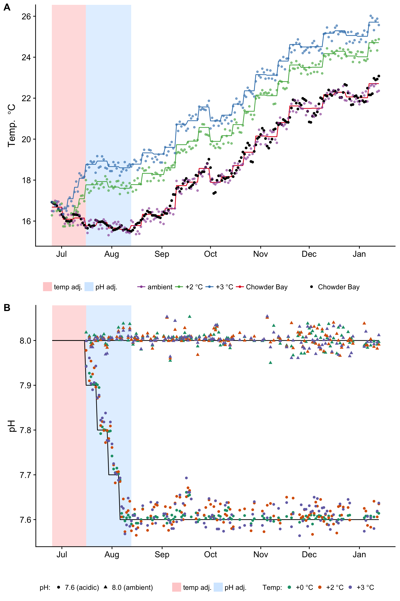
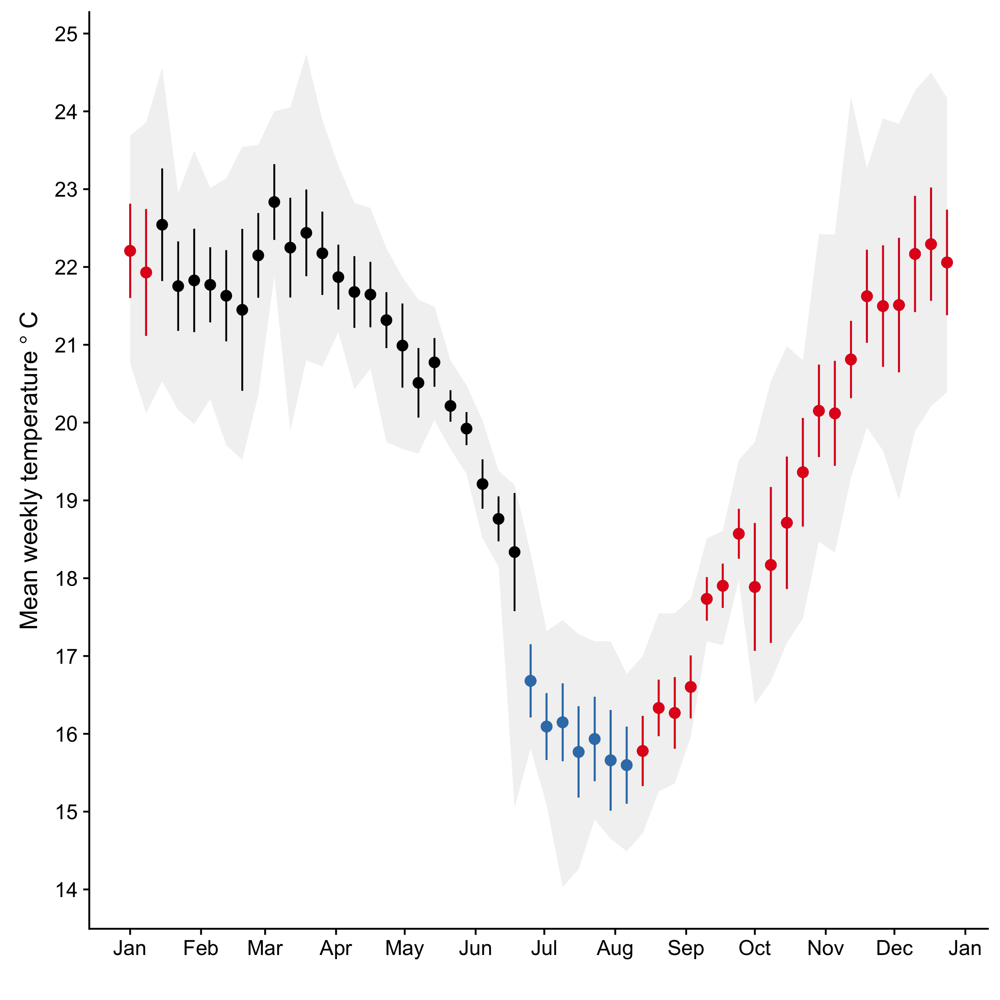
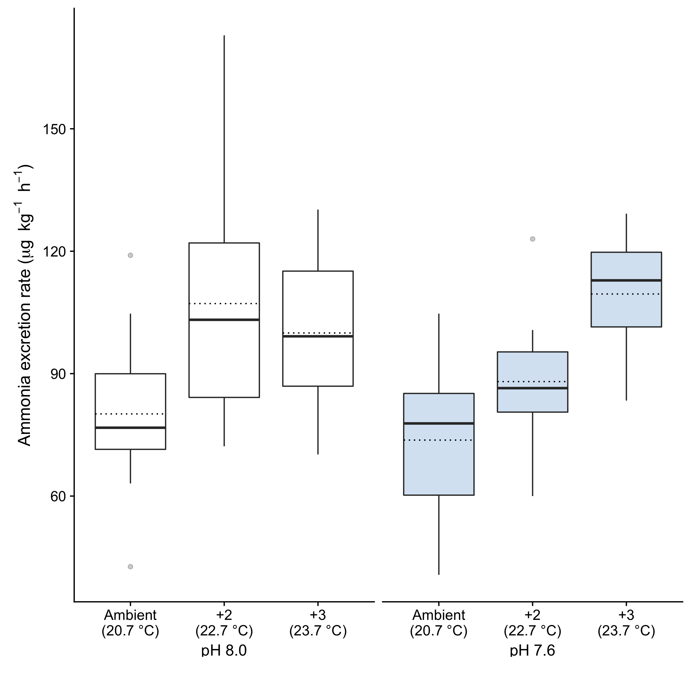

```{r, echo = FALSE, include = FALSE}
# Settings
knitr::opts_chunk$set(
  # echo    = FALSE,
  # warning = FALSE,
  # message = FALSE,
  # error   = FALSE,
  # cache   = FALSE,
  fig.height = 6,
  fig.width = 6,
  out.width = '100%'
)

# options(knitr.kable.NA = '') # this will hide missing values in the kable table
```

```{r, include = FALSE}
# Load required libraries here
library(snipR)
snipR::refresh()
snipR::pkgs(
  tidyverse,
  readxl,
  survminer,
  emmeans,
  knitr,
  huxtable
)
# library(pander)     # table output
# library(kableExtra) # enhance kable with pipes
# library(stargazer)  # table output for models
# library(texreg)     # output for models
# library(papeR)      # prettify table outputs

```

# Long-term exposure to ocean warming and acidification reduce the survival and energy budget of the sea urchin, *Heliocidaris erythrogramma*
\chaptermark{\textit{Heliocidaris erythrogramma} under future warming and acidification}

## Abstract{-}

## Introduction

<!-- - intro about multiple stressors -->
<!-- - southeastern australia -->
<!-- - temperature and pH, and the importance of temperature? -->
<!-- - the need to use models? -->
<!-- - hypothesis -->


Many of the key challenges in predicting the ecological consequences of climate change stem from the fact that most ecosystems are confronted with multiple chemical, physical and biological stressors, which often interact (Byrne et al. 2013; Przeslawski et al. 2015, Goldenberg et al. 2017).
For the world's oceans, the impacts of both global warming and ocean acidification are intricately linked as more than 90% of the Earth's heat and 25\% of anthropogenic $CO_2$ emissions are absorbed directly into the ocean (Mikaloff Fletcher et al. 2006; Wanninkhof et al. 2013, Gattuso et al 2015).

Ocean warming increases the body temperature of marine ectotherms, affecting metabolism and almost all biological processes (Brown et al. 2014, Hochachka and Somero 2002). 
Concurrently, ocean acidification alters the balance of carbonate saturation states in sea water, increasing the metabolic costs associated with acid–base regulation, calcification and skeletogenesis (Doney et al. 2009, Hofmann et al. 2010, Kroeker et al. 2013, Portner 2008).
Given that both stressors influence important metabolic processes, they may interact in unexpected ways.
<!-- biological responses which would not necessarily be predicted from investigating the stressors in isolation. -->
<!-- where the overall effects are likely to be dependent on location and species (Henson et al. 2017, Pecl et al. 2017, Poloczanska et al. 2016). -->
For example, ocean warming affects both oxygen demand and the supply of oxygen in water (Schulte 2015, Pörtner et al. 2010, Christensen et al. 2011), and may limit oxygen delivery which restricts metabolism despite the elevated energetic demands necessary to respond to the negative effects of ocean acidification (Lefevre 2016). 
Current evidence suggests that exposure to the combined effects of both stressors are additive or synergistic, as seen in the reduced development of marine bivalves (Talmage and Gobler 2011), increased metabolism in urchins (Carey et al. 2016) and reduced fertilisation in cnidarians (Albright and Mason 2013). 
However, in other cases, positive or neutral responses have been observed, such as in the development and thermal windows of echinoderm larvae (Byrne et al. 2010, Karelitz et al. 2017). 
These results highlight the subtle and complex uncertainty surrounding our understanding of the drivers of ecosystem change.
Comprehending the effects of ocean warming and acidification on marine ecosytems at large remains a complex endeavour, and is compounded by the difficulties of conducting multi-factorial experiments with respect to time and resources (Collins et al. 2009).
<!-- A synthesis of marine invertebrate responses to multistressors, including ocean warming and acidification, can be found in Przeslawski et al. (2013) and Byrne and Przeslawski (2015). -->

<!-- Calcifying organisms, such as echinoderms, are at high risk to the impacts of ocean warming and acidification (reviewed by Przeslawski et al. 2015).  -->
Echinoderms are marine calcifiers, and are ecologically important in many marine environments as ecosystem engineers through herbivory and bioturbation (Steneck 2013).
Studies have shown that they are at high risk to the impacts of both ocean warming and ocean acidification (Przeslawski et al. 2015), with varying effects on larval growth \& development (Byrne et al. 2011, Sewell and Young 1999), behaviour (Manríquez et al. 2017), immune defense (Brothers et al. 2016, Sweet et al. 2016), metabolism (Carey et al. 2017) and reproductive success (Delorme and Sewell 2016).
Despite the common occurrence of studies investigating the impacts of warming and ocean acidification on echinoderms, critical gaps remain in out knowledge with regards to their ability to acclimate to stressful conditions, especially in the adult life stages.
<!-- , with most experiments exposing specimens to acute stress with short acclimation times (e.g. 16 days; Catarino et al. 2012, 45 days; Uthicke et al. 2013). -->
There is compelling evidence that we need to conduct longer-term experiments to realistically incorporate acclimation and/or adaptation to stressful conditions, and the few recent studies that did so revealed subtle responses that would not have been identified in acute experiments.
Long-term warming and acidification experiments on the antarctic sea urchin *Sterechinus neumayeri* showed that the negative effects of increased temperature ($+2^\circ C$) and decreased pH ($-0.3$ to $-0.5$ units) on metabolism and reproduction are diminished over time of up to more than two years (Suckling et al. 2014, Morley et al. 2016).
<!-- Long-term (90-day) acclimation to temperature  -->
Seebacher et al. (2015) showed that acclimation generaly decreases thermal sensitivity, reflecting increased resilience to the effects of elevated temperature.
Acclimation time is thus a crucial factor to consider when conducting experiments that investigate responses to environmental stress, and should be tested by repeating measurements at different time periods where possible (e.g. Carey et al. 2016, Suckling et al 2014).

<!-- In addition, studies are increasingly measuring multiple physiological and biological responses . -->

Here, we examined the combined effects of prolonged exposure to increased temperature and elevated $pCO_2$ on the survival and physiological responses of the subtidal sea urchin, *Heliocidaris erythrogramma*. 
Experiments incorporated ecologically realistic conditions that involved the slow adjustment to treatment conditions over weeks, and then an acclimation period conforming to a temperature protocol that included mean-ambient conditions based on in situ loggers deployed in their habitat in Sydney Harbour.
Metabolic rate, feeding, assimilation efficiency and excretion were all measured to evaluate the responses of *H. erythrogramma* after long-term (155 day) exposure to conditions of increased temperature and decreased pH.
As maintaining energy is key to long-term survival, we calculated the rate and efficiency at which *H. erythrogramma* allocates energy using the scope for growth (SfG) model, a physiological index commonly used in aquaculture to quantify the energy budgets of living organisms to optimise feeding strategies (ref). 
Using SfG allows us to examine how environmental stressors affect *H. erythrogramma* based on changes in its energy budget, and provides a single bioenergetics-based index to determine the overall fitness of the sea urchin in the long term.


<!-- Calcifying organisms, such as echinoderms, are at high risk to the impacts of OW and OA (reviewed by Przeslawski et al. 2015), but understanding how the stressors interact remains a complex endeavour (reviews). -->

<!-- For echinoderms, synergistic and additive effects have been documented on larval development (refs), metabolism (Carey et al. 2016) and immune response (Brothers et al. 2016) which have largely been negative. -->
<!-- However, positive or neutral responses have also been observed, likely due to antagonistic interactions between temperature and pH (Karelitz et al 2017; more refs). -->
<!-- As we continue to understand the response of echinoderms to multiple stressors, of particular relevance in their ability to adapt or acclimate to a changing climate is the speed at which they are exposed to these drivers of environmental stress. -->
<!-- Our understanding of the long-term, chronic impacts of OW and OA has lagged far behind our knowledge of acute responses. -->
<!-- In part, this is because there is considerable difficulty in maintaining and incubating  -->

<!-- all of which are excarbated as anthropogenic carbon emissions are expected to increase under all mitigation scenarios projected for the near future (IPCC 201X). -->
<!-- (Representative Concentration Pathways, RCP2.6 -- RCP8.5, IPCC 201X). -->


<!-- For the adult Antarctic sea urchin, *Sterechinus neumayeri*, longer term experiments have   -->
 <!-- implying some uncertainty surrounding the ability of echinoderms to adapt or acclimate to change (refs). -->


<!-- As our understanding of the impacts of climate change improve, the focus shifts to increasinly multistressor, and longer period, experiments. -->

<!-- Further, many marine organisms are impacted by reduced aerobic capacity when exposed to environmental stressors, and if OW and OA cause long-term reductions in aerobic scope, the fitness and survival of marine organisms may be affected severely. -->
<!-- Thus, maintaining energy surplus is key for long-term survival.  -->
<!-- bioenergetics-based models can be used to examine how environmental stressors affect the fitness and survival of marine organisms by changing their energy budget. -->

 


## Methods 

### Collection

*Heliocidaris erythrogramma* (44.15 $\pm$ 3.25 mm test diameter) were collected from the subtidal (2--3m depth) at low tide, at Milk Beach ([-33.856478, 151.266958](https://www.google.com/maps/?q=-33.856478,151.266958)) and Bottle and Glass Point ([-33.847960, 151.270122](https://www.google.com/maps/?q=-33.847960,151.270122)) in June, 2014. Sea surface temperature (SST) at the time was approximately $15.3^{\circ}C$.
The urchins were transported to the Sydney Institute of Marine Science (SIMS) in Chowder Bay and were held in aquaria ($80\ L$) supplied with ambient flow-through, filtered seawater (FSW, $70\ \mu m$, $1.5\ L\ min^{-1}$).
After 1 week, they were randomly allocated 6 treatments, based on three temperature profiles (ambient: $+0^{\circ}C$, elevated: $+2^{\circ}C$ and $+3^{\circ}C$, adjusted weekly with regard to the mean SST profile as detailed below) and two constant total pH ($pH_T$, on the total hydrogen scale) levels (ambient $8.0$, low: $7.6$).
For each treatment we used three replicate tanks with 10 urchins per tank.

### Experimental setup

We performed all acclimation experiments in a constant-temperature room where the lighting was adjusted weekly to reflect the diurnal sunrise/sunset cycle.
Each header tank was supplied with FSW ($20\ \mu m$) via a thermocouple-solenoid feedback system that automatically mixed warm ($25^{\circ}C$) and cold ($14.5^{\circ}C$) filtered FSW ($20\ \mu m$) in a $2\ L$ mixing chamber to supply temperature-controlled water consistently.
Each header tank was also equipped with a heater (75 W, EHEIM GmbH & Co KG, Germany) attached to a temperature controller (model 7028/3, TUNZE Aqraientechnik GmbH, Germany) as a second level of temperature control.

Sea water pH was maintained using a mixed $CO_2$ system, where a thermally-compensated, low-flow controller valve (Parker Hannifin, OH, USA) and a proportional–integral–derivative controller, updated every $10\ s$, were used to precisely inject food-grade $CO_2$ (BOC, Australia) into ambient air that had been scrubbed of $CO_2$.
The $CO_2$-mix was bubbled vigorously and continuously into header tanks using $20 cm$ ceramic diffusers.


### Gradual adjustment to treatment conditions and acclimation

To minimise physiological shock to altered conditions, adjustments to the levels of warming and acidification of the tanks were performed gradually. 
Temperature was increased at a rate of $1^{\circ}C$ every 6 days until target elevated temperatures were achieved.
Sea water pH was decreased at a rate of $-0.1\ pH_T$ units every week.
Both temperature and pH manipulations were performed on a staggered schedule such that all treatments achieved target conditions in the same week (Fig. \@ref(fig:acclim) A).
Further, all adjustments were made in header tanks such that treatments slowly stabilised to their new conditions within 1 to 2 days.
The adjustment process took 7 weeks, and no mortality was recorded during this period.
Once the treatment conditions were established, treatment temperatures were at $15.6 \pm 0.4^{\circ}C$, $17.6 \pm 0.4^{\circ}C$ and $18.6 \pm 0.3^{\circ}C$ (s.d.) for the ambient, $+2^{\circ}C$ and $+3^{\circ}C$ treatments respectively.

Once treatment conditions were established, all treatments underwent an acclimation protocol where temperature levels were regulated weekly based on an offset to previously-recorded mean weekly temperature over the same period in Sydney Harbour (Fig. \@ref(fig:acclim) A \& B). 
Thus, treatment temperatures were adjusted to mimic the seasonal change expected over winter to early summer, based on reference data collected from *in situ* loggers deployed in Chowder Bay from 2009–2014 (Fig. \@ref(fig:harbour)).
Because temperature has an effect on $CO_2$ solubility and temperatures were changing every week, the system maintained constant pH (not $CO_2$ ppm) within each treatment.

```{r acclim, fig.cap = "Temperature and pH in treatment tanks, measured daily. Only one replicate tank for every treatment was selected at random for daily measurements. Shaded regions are the pre-acclimation adjustment periods for temperature (pink) and pH (blue), respectively. (A) Coloured lines represent the planned temperature profiles (+0, +2, +3), which change every week, while coloured dots represent the actual temperatures measured. The black dots are the reference temperatures collected from *in situ* loggers deployed in Chowder Bay from 2009 to 2014, averaged by day. (B) Black lines represent the reference constant pH levels, with the initial adjustments (8.0, 7.6). Shapes represent the pH treatment group (triangle: 8.0; circle: 7.6), colours represent the temperature treatment group (+0, +2, +3)."}

```

```{r harbour, fig.cap = "Mean weekly-averaged temperature ($\\pm$ s.d.) for Chowder Bay, NSW, Australia, from 2009 to 2014. Data were obtained from loggers deployed *in situ* at 3 m depth at the level of the sea urchin habitat. Colours represent the adjustment (blue) and acclimation (red) periods of the experimental treatments, respectively. The shaded region is the max/min of the temperatures recorded. These data were used to design the temperature profile of the elevated temperature treatments."}

```

### Monitoring

Temperature was recorded daily in all tanks.
Sea water pH was measured spectrophotometrically with a custom-built sampling system connected to an Ocean Optics USB4000+ fibre optic spectrometer, using m-Cresol dye indicator (Acros Argonics, catalog number 110585000, Lot A0321770) and calculated according to Liu et al. (2011). 
The measurements were calibrated to certified reference material (CRM) for $CO_2$ in seawater (Batch 139) following SOP 6b in Dickson et al. (2007).
The pH of the tanks were measured every 2 to 3 days.
In addition, the sampling system automatically measured pH in one ambient and one low pH treatment every two hours to characterise pH during the acclimation period (Supplementary Material ##).

To estimate total alkalinity ($A_T$) of the sea water, water samples (330 mL) were taken randomly from experimental tanks every 2 to 3 weeks (total $n = 64$ samples). 
$A_T$ was determined by potentiometric titration (907 Titrando, Metrohm), calibrated using sea water CRMs (Batch 139; Dickson et al., 2007). 
The carbonate chemistry parameters $pCO_2$, calcite and aragonite staturation states ($\Omega Ca$ and $\Omega Ar$) were calculated by running the data in the "seacarb" package in R (Lavigne et al., 2011) using the dissociation constants of Mehrbach et al. (1973) refitted by Dickson & Millero (1987).


### Maintenance

Specimens were fed on a diet mixture of fresh *Ecklonia radiata* and *Sargassum* spp. suspended in kelp-based agar (MSC CO, Kyeongnam, Korea). 
To prepare the food, *E. radiata*, and *Sargassum* spp. were washed in fresh water, dried at $50^{\circ}C$ over 48 hours, and then ground into fine powder for storage. 
The food was mixed with agar powder to a ratio of 1:4 by weight, and then mixed with FSW (20 $\mu m$) to a ratio of 1:10 by weight at $\sim 80 ^{\circ}C$.
The agar was left to cool and solidify for 45 minutes, before it was cut into 1 to 2 $cm^2$ cubes and fed to the specimens. 
We fed the specimens twice a week by placing 3 to 4 cubes on top of each individual urchin. 
This feeding technique ensured that each animal received the same amount of food in excess during the entire experimental period.

All treatment tanks were siphoned every two days and wiped weekly to remove faecal matter and minimise algal growth. 
$CO_2$ diffusers were scrubbed and replaced every 3 to 5 days.
Header tanks were cleaned of algal growth once a month.


### Survival

Survival was recorded by measuring the survival time of individual specimens for 155 days (Aug--Dec 2014). 
Specimens were observed daily for mortality, and dead urchins were removed immediately.


### Metabolic rate

Routine weight-specific metabolic rate, $MO_2$ was estimated by intermittent-flow respirometry at two time-points (at 4 and 12 weeks of acclimation), from a random subsample of specimens ($n = 10\ treatment^{-1}$).
The specimens were not fed for 5 days prior to measurements and transferred individually into $1\ L$ respirometry chambers.
Each respirometry chamber was kept in an individual water bath and contained an oxygen sensor spot (SP-PSt3-NAU, PreSens GmbH, Germany) for the detection of dissolved oxygen concentration using an external multi-channel sensor (OXY-10-mini, PreSens Gmbh, Germany). 
A magnetic stirrer ensured even mixing of water.
The specimens were allowed to adjust to the chambers under flow-through conditions for 30 minutes prior to respirometry measures.

To measure oxygen uptake, chambers were sealed and dissolved oxygen (DO, $mgO_2\ L^{-1}$) was measured every 10 seconds until a 10\% decrease in DO was recorded. 
The chamber was then flushed, and the measurement repeated.
Background respiration was determined by recording FSW-only blanks ($n$ = 8) to correct the recordings for background respiration and instrument drift.
At the end of each measurement, sea water weight was calculated by deducting chamber, stir bar and urchin wet weights from the total weight of the chamber, and then converted to volume using sea water density estimated from current temperature, salinity and barometric air pressure (Fofonoff & Millard 1983). 

Weight-specific $MO_2$ ($mgO_2\ L^{-1}\ h^{-1}$) was calculated using the equation (Lighton 2008): 

\begin{equation}
  MO_2 = \frac{\Delta O_2V}{W}
  (\#eq:mo2)
\end{equation}

\noindent where $\Delta O_2$ is the linear regression of $O_2$ concentration over time ($mg\ L^{-1}\ h^{-1}$), $V$ is the volume of the sea water available ($L$) and $W$ is the wet weight of the urchin ($g$). 


### Feeding rate and assimilation efficiency

Feeding trials were conducted after 13 weeks of acclimation.
Specimens were transfered into individual tanks ($4\ L$) supplied with flowthrough FSW ($6\ L\ h^{-1}$) at the same treatment conditions.
They were starved for 6 days in their new environments before feeding trials commenced, using the same agar-based food mixture used in routine feeding.
Initial wet weight of the diet was determined and food was added to each tank in excess.
Food-only autogenic controls were used to determine background changes in agar composition ($n = 24$).

After 48 hours, unconsumed food was carefully collected and oven dried at $80^{\circ}C$ for 48 h, and then re-weighed.
Faecal pellets were also siphoned at the same time for calculations of assimilation efficiency (see below).
The specimens were removed from the tanks, blotted briefly with paper towel, and weighed.
To convert the initial wet weight ($W_{wet}$) of the food to their dry-weight equivalents, the wet:dry ratio of the food was determined in a regression analysis of wet to dry weights ($n = 60$, $r^2 = 0.82$, $p < 0.01$), and determined as: 

\begin{equation}
  W_{dry} = (0.1529 \times W_{wet}) - 0.036
  (\#eq:wdry)
\end{equation}


Feeding rate, $C$ ($mg\ day^{-1}\ kg^{-1}$), was calculated by subtracting the final dry weight ($W_{T1}$) from the initial dry weight ($W_{T0}$), with adjustments for background changes and specimen weight ($W_{sp}$) and adjusted by time ($T$): 

\begin{equation}
  C = \frac{W_{T0} - W_{T1}}{W_{sp} \cdot T}
  (\#eq:c)
\end{equation}

Faecal samples were dried at $60^{\circ}C$ for 48 hours and weighed.
These samples were then ashed in a muffle furnace at $500^{\circ}C$ for 2--3 hours and re-weighed to determine their ash-free dry weight (AFDW). 
Assimilaiton efficiency (\%) was calculated using the Conover method (Conover, 1966): 

\begin{equation}
  A = \left[ \frac{F - E}{(1 - E) \cdot F} \right] \times 100\%
  (\#eq:a)
\end{equation}

where $F$ and $E$ denote the AFDW:dry weight fraction measured in the diet and the faeces, respectively.
All weights were determined using the same analytical balance accurate to 0.0001 g.


### Ammonia excretion

To determine ammonia excretion rate 10 randomly selected specimens from each treatment that had not been used for respirometry were placed in the respirometry chambers (total $n = 60$).
Initial water samples were carefully collected ($50 mL$, $0.22 \mu m$).
The chambers were sealed and left in the water baths for 3 hours before final water samples were collected.
Background ammonia levels were determined by repeating the experiment without specimens ($n = 3\ treatment^{-1}$).
The water samples were immediately frozen and stored in the dark until they were analysed spectrophotometrically (within 10 days) for total ammonia, following the methods of Parsons et al. (1984). 
Spectrophotometric readings were obtained at 640 nm on a microplate reader (CLARIOstar Microplate Reader, BMG LABTECH, Offenburg, Germany) and calibrated using daily blanks and a standard ammonium solution (Parsons et al., 1984). 
Ammonia excretion rate, $U$ ($\mu g\ kg^{-1}\ h^{-1}$) was calculated according to the equation: 

\begin{equation}
  U = \frac{N_c}{W \cdot T}
  (\#eq:u)
\end{equation}

where $N_c$ is the concentration of ammonia ($\mu g\ at\mbox{-}N\ L^{-1}$), $W$ is the weight of the specimen in $kg$ and $T$ is the time elapsed in hours. 
Ammonia concentration, $N_c$ is determined following Parsons et al. (1984) and is summarised in the equation:
\begin{equation} 
  N_c = \frac{3 \cdot V}{\Delta E}
  (\#eq:nc)
\end{equation} 
where $\Delta E$ is the difference between the standard and corrected spectrophotometric extinction values of the blue indophenol colour formed with ammonia and $V$ is the volume of the chamber ($L$).


### Scope for growth (SfG) parameters

To explore the influence of temperature and pH stressors on the growth potential of *H. erythrogramma*, we constructed a SfG model using data from respirometry, feeding trials and ammonia analyses.

Oxygen consumption was converted to energy equivalent values to calculate the energy lost in respiration per day, $R_E$, using a conversion factor of $14.14 J\ mg^{-1}\ O_2$ (Elliot and Davidson, 1975). 
A conversion factor of $0.025 J\ g^{-1}$ ammonia (Crisp, 1984, Elliott and Davison, 1975) was used to estimate the energy equivalent of the energy lost due to ammonia excretion per day, $U_E$. 

The energy available from food, $C_E$, was calculated using bomb-calorimetry using an automatic adiabatic bomb calorimeter (Gallenkamp, London).
The calorimeter was calibrated for the heat of combustion of $1 g$ of benzoic acid (26.493 $kJ\ g^{−1}$) at least three times to determine the approximate effective heat capacity of both the bomb chamber and the mass of the water within the calorimeter chamber, $C_S$ (10.27 $\pm$ 0.07 $kJ\ ^{\circ}C$).

The diet was dried in an oven at $60^{\circ}C$ to remove moisture.
Approximately 1 $g$ of the diet was used each time to determine gross energy via combustion, and the experiment was repeated six times to obtain an average value (12.67 $\pm$ 0.25 s.d. $kJ\ g^{-1}$) using the equation:

\begin{equation}
  C_E = \frac{\Delta T \times C_S}{W_S}
  (\#eq:ce)
\end{equation}

where $\Delta T$ $(^{\circ}C)$ is the change in temperature -- detected using a Beckmann thermometer -- between the initial and post-combustion of the sample, $C_S$ is the effective heat capacity of the system (bomb chamber and water), and $W_S$ is the weight of the diet sample ($g$). 

To calculate scope for growth ($SfG$) we used the equation adapted from Winberg (1960): 

\begin{equation}
  SfG = C_E \cdot A - (R_E + U_E)
  (\#eq:sfg)
\end{equation}

where $C_E$ is the energy obtained from diets, $A$ is the assimilation efficiency, $R_E$ is the energy lost in respiration and $U_E$ is the energy lost due to ammonia excretion.
All energy-related units are in $kJ\ g^{-1}\ day^{-1}$, while assimilation efficiency is a proportion.

We did not follow individual urchins, so the SfG data could not be analysed using the statistical approach (e.g.). Rather, we constructed the SfG model using treatment-averaged parameters as an indicative assessment of the impacts of our acclimation treatments on *H. erythrogramma*.

### Statistical analyses

Analyses were performed in R (v 3.4.3). The survival time for each specimen was determined by the number of days from time zero when the acclimation period started to the end of the experiment. Survival data were analysed using Cox proportional hazards models (Cox, 1972), with right censoring, to determine whether temperature and pH affect survival time. Two model fits were run: 

1. Model 1: `(survival time) ~ temperature + pH + (temperature * pH)` -- where the interaction between temperature and pH was included; and
2. Model 2: `(survival time) ~ temperature + pH` -- main effects only.

The fitted Cox regression met the assumption of proportional hazards (Schoenfeld residual tests, Grambsch and Therneau 1994; $p = 0.673$). 
As no interactions were found between temperature and pH (Cox, $p = 0.54$), Model 1 was selected to test for main effects.  
*Post-hoc* tests for the differences between treatments were determined using pairwise tests of significance corrected using the Benjamini-Hochberg (BH) false discovery rate method (Benjamini and Hochberg, 1995).

<!-- Metabolic rate data were analysed using 3-way analysis of variance (ANOVA) with temperature ($+0^{\circ}C$,  $+2^{\circ}C$,  $+3^{\circ}C$), pH (8.0, 7.6) and time (4 weeks, 12 weeks) as fixed factors. -->
<!-- Metabolic rate data were analysed by constructing a linear model of metabolic rate as a function of temperature ($+0^{\circ}C$,  $+2^{\circ}C$,  $+3^{\circ}C$), pH (8.0, 7.6) and time (4 weeks, 12 weeks) as fixed factors.  -->
<!-- An ANOVA was then performed on the model, using type III sums of squares. -->
<!-- The ANOVA revealed no significant interactions between acclimation time, temperature and pH ($F_{2,104}= 2.37$, $p = 0.098$).  -->
<!-- Thus, the three-way interaction term was removed from the model and the data re-analysed to only test for two-way interactions and single effects. -->

<!-- Feeding rate data were analysed using a two-way ANOVA, using temperature ($+0^{\circ}C$,  $+2^{\circ}C$,  $+3^{\circ}C$) and pH (8.0, 7.6) as fixed factors.  -->


Metabolic rate data were analysed by constructing a linear model of metabolic rate as a function of temperature ($+0^{\circ}C$,  $+2^{\circ}C$,  $+3^{\circ}C$), pH (8.0, 7.6) and time (4 weeks, 12 weeks) as fixed factors.
Feeding rate data were analysed by constructing a linear model of feeding rate as a function of temperature and pH as fixed factors.
To test for effects, ANOVA was performed on the models, using type III sums of squares when interactions were present, or type II sums of squares when they were not (Langsrud 2003).
For metabolic rate data, the ANOVA revealed no significant interactions between acclimation time, temperature and pH ($F_{2,104}= 2.37$, $p = 0.098$). 
Thus, the three-way interaction term was removed from the model and the data re-analysed to only test for two-way interactions and single effects.
All analyses were tested for normality and homogeneity of variances. 
Where treatment conditions were indicated to be significantly different, estimated marginal means (EMM, aka Least-Squares Means) were used to develop linear estimates for the post-hoc Tukey Highest Significant Difference (HSD) test to identify the significance between metal-tissue combinations. Significance was determined at p < 0.05 or lower for all statistical tests. 

As different individual urchins were used to provide some of the parameters used to construct the model, SfG was calculated based using treatment-averaged parameters. Thus, we were unable to perform statistical tests of significant differences in SfG between treatment groups.

<!-- and differences between treatments were performed using Tukey's HSD *post-hoc* with a confidence level of 0.95 and a significance level of 0.05. -->

## Results

### Survival

There was a significant effect of treatment condition on survival response (*logrank test*, $\chi_2$ = 61.23, $d.f. =$ 3, $p$ < 0.001) with no interaction between temperature and pH (Cox regression, $z =$ 0.61, $d.f. =$ 3, $p =$ 0.54).
As single stressors, decreased pH did not significantly affect survival ($p\ = 0.296$, HR: 0.46, 95\% CI: 0.10 -- 1.99), neither did a $+2 ^{\circ}C$ increase in temperature ($p = 0.146$, HR: 2.68, 95\% CI: 0.71 -- 10.09).
For these treatments, survival was $>80\%$ after 155 days. 
At $+3 ^{\circ}C$, survival decreased significantly ($p < 0.001$, HR: 17.2, 95\% CI: 5.27 -- 56.25) regardless of pH level (pH 8.0: 40\%; pH 7.6: 33\%).
These $+3^{\circ}C$ treatments were the only ones that crossed the median surival threshold after 155 days (Figure \@ref(fig:surv)). 
*Post-hoc* results (pairwise tests, BH-corrected) showed that urchins acclimated to $+3 ^{\circ}C$ had significantly lower survival compared to all other treatments ($p <$ 0.01 for all pairwise combinations), with no significant differences in other pairwise comparisons.


```{r surv, fig.cap="Survival in *H. erythrogramma* acclimated to combinations of increased temperature (ambient +0, +2, $+3 ^\\circ C$) and decreased pH (ambient 8.0, decreased 7.6). Letters indicate treatments that differed (pairwise tests, with Benjamini-Hochberg (BH) false discovery rate corrections, p < 0.05)."}
knitr::include_graphics("figs/ch_multistressor/surv_plot.png")
```


### Metabolic rate

The 2-way ANOVA showed that there were significant two-way interactions for acclimation time$\times$pH ($F_{1,106}= 10.7$, $p = .001$), temperature$\times$pH ($F_{5,106}= 3.36$, $p = 0.039$), and acclimation time$\times$temperature ($F_{2,106}= 14.1$, $p < 0.001$).
As single stressors, increased temperature ($F_{2,106}= 8.69$, $p < .001$) and decreased pH ($F_{1,106}= 22.8$, $p < .001$) significantly influenced metabolic rate. 

Results of *post-hoc* analyses using Tukey's HSD showed that although acclimation time alone did not significantly affect metabolic rate ($F_{1,106}= 1.42$, $p = 0.24$), it clearly interacted with temperature or pH. 
At 4 weeks of acclimation, metabolic rate increased significantly as a result of elevated temperature ($p = < 0.0001$--$0.08$) or decreased pH ($p < 0.001$).

but at 12 weeks of acclimation, there were no significant pairwise differences between any treatment combinations.


```{r resp, fig.cap = "Metabolic rate of *H. erythrogramma* acclimated for 12 weeks in six treatments of three temperatures ($+0, +2, +3 ^\\circ C$) and two pH levels (8.0, 7.6). The top and bottom of the boxes represent the interquartile range (IQR) between the 25th and 75th percentile (Q1 and Q3, respectively). The horizontal line represents the median (Q2), the horizontal dotted line represents the mean, and the vertical lines (whiskers) represent the range of the data computed as follows: Q1 − 1.5IQR (bottom whisker); greater than Q3 + 1.5 IQR (top whisker)."}
knitr::include_graphics("figs/ch_multistressor/resp_plot.png")
```

### Feeding rate and assimilation efficiency

The 2-way ANOVA showed that feeding rate was significantly influenced by elevated temperature ($F_{2,90} = 10.88$, $p < 0.001$), but not pH ($F_{2,90} = 0.02$, $p = 0.9$). 
There were also no statistically significant interactions between temperature and pH ($F_{2,90} = 1.15$, $p < 0.32$).
Acclimation to increased temperature of $+2 ^\circ C$ and $+3 ^\circ C$ significantly decreased feeding at pH 7.6 (p = 0.001 and p = 0.008, respectively), but not at pH 8.0.
No other significant differences were detected.

```{r}
load("output/ch_multistressor/feeding.RData")
hsd$contrasts
grps$contrasts
```

```{r, fig.cap = "Feeding rate of *H. erythrogramma* acclimated for 12 weeks to conditions of increased temperature ($+0, +2, +3 ^\\circ C$) and decreased pH (8.0, 7.6). The top and bottom of the boxes represent the interquartile range (IQR) between the 25th and 75th percentile (Q1 and Q3, respectively). The horizontal line represents the median (Q2), the horizontal dotted line represents the mean, and the vertical lines (whiskers) represent the range of the data computed as follows: Q1 − 1.5IQR (bottom whisker); greater than Q3 + 1.5 IQR (top whisker)."}
knitr::include_graphics("figs/ch_multistressor/feed_plot.png")
```

### Ammonia excretion rate
<!-- TODO fix this -->

Urchins acclimated to elevated temperature treatments had significantly higher ammonia excretion rates (2-Way ANOVA, $F_{1, 56} = 17.9$, $p < 0.001$). 
Decreased pH had no significant effect ($F_{1, 56} = 0.92$, $p < 0.34$), and both temperature and pH did not significantly interact ($F_{1, 56} = 0.67$, $p = 0.42$). 
*Post-hoc* using Tukey's HSD ($p = 0.05$) showed that at ambient pH (8.0), acclimation to $+2 ^\circ C$ increased ammonia excretion by 1.3$\times$ ($d.f. =$ 54, $p =$ 0.016), but not at $+3 ^\circ C$ ($p =$ 0.099). At low pH (7.6), acclimation to $+2 ^\circ C$ did not significantly affect ammonia excretion ($p =$ 0.29), but at $+3 ^\circ C$, excretion increased by 1.5$\times$ ($p =$ 0.016).  

```{r}
load("output/ch_multistressor/ammonia.RData")
hsd$contrasts
grps$contrasts
```

```{r, fig.cap = "Feeding rate of *H. erythrogramma* acclimated for 12 weeks in six treatments of three temperatures ($+0, +2, +3 ^\\circ C$) and two pH levels (8.0, 7.6). The top and bottom of the boxes represent the interquartile range (IQR) between the 25th and 75th percentile (Q1 and Q3, respectively). The horizontal line represents the median (Q2), the horizontal dotted line represents the mean, and the vertical lines (whiskers) represent the range of the data computed as follows: Q1 − 1.5IQR (bottom whisker); greater than Q3 + 1.5 IQR (top whisker)."}

```

### Scope for growth

The SfG model for *H. erythrogramma* indicated a negative relationship between increased temperature and SfG. The highest SfG of $1.17 au$ was recorded for urchins in the ambient temperature $+$ low pH treatment.

```{r}
sfg_table <- as.data.frame(readxl::read_excel("figs/ch_multistressor/sfg_table.xlsx"))
sfg_table
```

```{r, fig.cap = "Scope for growth ($\\pm s.d.$) in the sea urchin, *H. erythrogramma* acclimated to conditions of increased temperature ($+0, +2, +3 ^\\circ C$) and decreased pH (8.0, 7.6). "}
knitr::include_graphics("figs/ch_multistressor/sfg_plot.png")
```