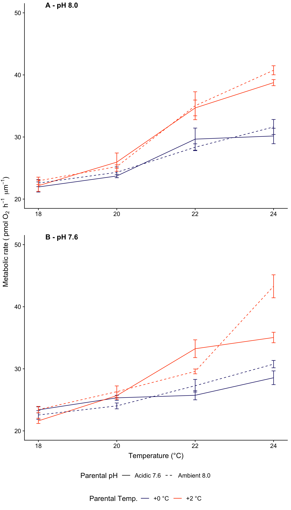
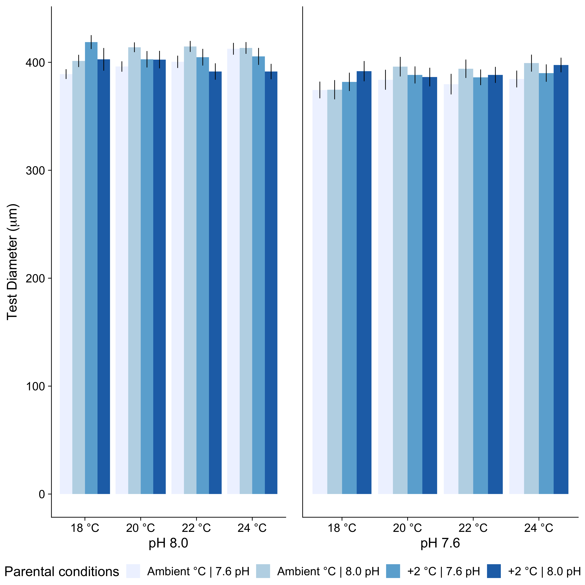

<!-- # Parental acclimation influences the metabolic response of *Heliocidaris erythrogramma* larvae to near-future ocean warming and acidification -->

```{r, echo = FALSE, include = FALSE}
# Settings

options(knitr.kable.NA = '')
knitr::opts_chunk$set(echo = FALSE,
                      out.width = '100%', 
                      comment = "#>")

library(tidyverse)
library(kableExtra)
library(snipR)

```

# Offspring metabolic responses to ocean warming and acidification are shaped by parental environment in the sea urchin, *Heliocidaris erythrogramma*

\chaptermark{Offspring metabolic responses to warming and acidification}


## Abstract {-}


## Introduction

The unprecedented rate in which carbon dioxide ($\mathrm{CO_2}$) is being absorbed by the ocean has significantly altered its physical and chemical properties, contributing to the phenomena of ocean warming (OW) and ocean acidification (OA) [@Howes2015]. 
These two environmental stressors are well-studied in the literature, with their diverse and interactive effects documented across many taxa [reviewed by @Byrne2013; @Harvey2013; @Przeslawski2015; @Poloczanska2016].
Increased temperature from OW affects all levels of animal physiology and thus, their fitness [@Somero2010; @Somero2012; @Verberk2016], and OA alters the carbonate chemistry of seawater and influences biochemical pathways related to physiological functioning [@Cyronak2016; @Clements2018].

How organisms react to OW and OA are dependent on their phenotypic plasticity since it determines their capacity to acclimate to increased environmental stress [@Munday2013; @Seebacher2014; @Murren2015].
<!-- Given time, marine animals have limited capacity to acclimate to increased environmental stress due to their phenotypic plasticity. -->
However, recognising the extent to which the observed responses are beneficial to their overall fitness is currently a challenge, since we still lack a mechanistic understanding of the physiological traits responsible for many biological responses [@Portner2004; @Portner2008; @Gunderson2016].
<!-- Discussion: For example, increased metabolism may be a result of an increase in aerobic scope for growth and reproduction [@Sandblom2014; @Hansen2017] -->
In addition, recent marine studies have demonstrated that the plastic responses of organisms to environmental stress within one generation may influence the responses to environmental conditions in the next [e.g. @Wong2018; @Borges2018; @Scanes2018; @Ross2016].
These carry-over effects are still an area of ongoing research ranging from investigations of developmental plasticity, maternal effects and transgenerational plasticity [@Torda2017; @Donelson2018].

In this study, I investigated the effect of parental acclimation to warming and low pH conditions on the metabolic rate response of offspring to a range of temperatures, using the sea urchin *Heliocidaris erythrogramma* as a model specimen.
Sea urchins, as calcifying benthic marine ectotherms, are vunerable to the effects of OW and OA in the ocean, especially in their developmental larval and juvenile life stages [@Byrne2013; @Przeslawski2015].

<!-- Discussion: Currently it is difficult to determine whether the altered responses of the offspring generation in many of these studies is a result of transgenerational plasticity (TGP), maternal effects or developmental plasticity [@Torda2017; @Donelson2018]. -->

<!-- These responses vary depending on the scale and rate of the change experienced, as all organisms can adjust their physiology to buffer against acute or chronic levels of environmental stress [@Munday2013; @Seebacher2014; @Murren2015]. -->


<!-- In the face of fluctuating climates, phenotypic plasticity is a crucial mechanism for determining whether an animal is able to maintain fitness in response to acute or chronic levels of environmental stress [@Munday2013; @Seebacher2014; @Murren2015]. -->

<!-- Echinoderms such as sea urchins are vunerable to climate change -->
<!-- , especially in their developmental and juvenlie life stages,  -->
<!-- as both OW and OA can produce a range of complex and negative biological responses in growth [@Byrne2011; @Moulin2015], metabolism [@Stumpp2011; @Delorme2016], calcification [@Wolfe2013; @Collard2016] and immune response [@Branco2013; @Brothers2016]. -->


<!-- In general, marine ectotherms are able to respond to environmental stress by adjusting their physiology [@Seebacher2014] and by genetic adaptation [@Hoffmann2011; @Sunday2014]. -->


<!-- The most important climate change stressors, ocean warming (OW) and ocean acidification (OA), are occurring at unprecedented rates due the continuous increase of anthropogenic carbon dioxide ($\mathrm{CO_2}$) in the atmosphere and the ocean [refs]. -->


<!-- However, the multistressor and rapid nature of environmental change means that changes may be experienced across a few generations, or even within one generation, which require more immediate responses. -->


<!-- Recent studies have also provided some evidence that the response of marine organisms to environmental stress may be influenced by the conditions experienced by the previous generation(s) [@Torda2017; @Donelson2018]. -->
<!-- As scientists explore the mechanisms behind these effects, they have been denoted by various labels such as trans-generational plasticity (TGP), parental effects, intergenerational effects and non-genetic inheritance and carry-over effects [@Donelson2018]. -->
<!-- Understanding these processes across generations is still an area of ongoing research [refs], but evidence is mounting that these effects can occur environmental influence on paternal -->

<!-- Recent marine climate change research has focused on their combined effects on organisms [reviewed by @Byrne2013; @Harvey2013; @Kroeker2013; @Przeslawski2015; @Hoegh-Guldberg2017], and ample evidence from meta-analyses suggests that the combined and interactive effects of both OW and OA will result in a range of complex biological responses due to differences in physiological characteristics of organisms [@Przeslawski2015; @Lefevre2016].  -->
<!-- Calcifying organisms in particular have been shown to be more susceptible to OA effects as changes in the carbonate chemistry of the ocean will directly impair their ability to calcify, as shown in echinoderms [@Wolfe2013; @Yuan2016; @Manriquez2017], corals [@Hoegh-Guldberg2007; @Gao2010; @Hoegh-Guldberg2017] and molluscs [@Mackenzie2014; @Waldbusser2015; @Parker2017a]. -->


<!-- For sea urchins, both ocean warming and acidification have been shown to alter biochemical reactions and pathways, affecting metabolism [citation], acid-base regulation [citation], heat-shock [citation] and immune [citation] responses. -->
<!-- These studies showed that sea urchins are vulnerable to climate change -->

<!-- Although the majority of studies to date have focused on potential impacts based on short-term and single-generation experiments, recent experiments on sea urchins indicate that there is a need to consider the potential for evolutionary adaptation or carry-over effects over multiple generations in response to environmental stress [@Wong2018; @Zhao2018]. -->


<!-- In addition, phenotypic plasticity may increase resilience of organisms to climate change stressors,  -->
<!-- This means that experiments need to be conducted relatively long-term -->


## Methods

<!-- From past research we know that an offset of $+2 ^{\circ}C$ is non-lethal to the species. -->
<!-- pH was set at 6 levels ranging from 7.6 to 8.0. -->

### Collection of adults

*Heliocidaris erythrogramma* (35--44 $mm$ test diameter) were collected from three locations within Sydney Harbour: Milk Beach ([-33.856478, 151.266958](https://www.google.com/maps/?q=-33.856478,151.266958)), Bottle and Glass Point ([-33.847960, 151.270122](https://www.google.com/maps/?q=-33.847960,151.270122)) and Chowder Bay ([-33.841657, 151.253677](https://www.google.com/maps/?q=-33.847960,151.270122)).
The sea urchins were collected in the subtidal zone (2--3 $m$) in June 2015 in mid-winter when the gonads are less developed [@Laegdsgaard1991] and transported to the Sydney Institute of Marine Science (SIMS) in Chowder Bay, Australia.
There, they were maintained at the ambient flowthrough facility with filtered seawater (FSW, 70 $\mu m$, 1.5 $L\ min^{-1}$) for 2 weeks before they were transferred into acclimation treatments.

### Experimental design

All experiments were performed in a climate-controlled room which was capable of adjusting room temperature, lighting, seawater temperature and pH. 
Room lights were calibrated weekly to follow the dirunal sunrise/sunset cycle.
A thermocouple-solenoid feedback system controlled seawater temperature by automatically mixing warm (26 &deg;C) and cold (14.5 &deg;C) filtered FSW (20 $\mu m$) to produce water at a constant temperature. 
The water was stored in insulated header tanks, and each header tank was further equipped with a submersible heater (200 W, Blue Sea, Guangdong, China) attached to a temperature controller (model 7028/3, TUNZE Aqraientechnik GmbH, Germany) to maintain stable temperature.

Seawater pH control was performed separately for adult treatments and larval cultures.
In the adult treatments, pre-mixed $CO_2$ gas was bubbled vigorously into header tanks using a venturi injector.
<!-- which allows the flowthrough system to maintain stable pH rapidly. -->
The gas was prepared realtime using a proportional–integral–derivative controller which injects food-grade $CO_2$ (BOC, Australia) into scrubbed ambient air through a controller valve (Parker Hannifin, OH, USA).
For larval experiments, the total flow rate was higher to maintain more treatments (>2 $L\ min^{-1}$), thus pH was controlled by mixing pure $CO_2$ gas directly into header tanks. This was done using an APEX AquaController system (Neptune Systems, Inc., CA, USA), where lab grade pH probe modules (model no. PRBPH) were used to provide feedback to control modules (model no. PM1) for adjustments to seawater pH. 
The pH was adjusted to the total scale ($pH_T$) by an offset to spectrophotometric measurements of pH, which was measured daily (see below).
The control modules automatically injected $CO_2$ micro-bubbles via solenoid valves into $CO_2$ reactors (Max Mix 2000 $L\ hr^{-1}$, Ista Professional Aquarium System, Taiwan) attached to submersible pumps (model AP550LV, Aquatec Equipment, Perth, Australia) inside each header tank.
<!-- that run continuously to mix the $CO_2$-infused water into header tank. -->

Treatment temperature was logged daily in all treatments using PT1000 resistance temperature detectors (RTDs) attached to a Graphtec Multifunction logger (model: GL840, Graphtec). 
Treatment pH on the total scale was measured spectrophotometrically using a custom-built automated sampling system connected to an optic-fibre spectrophotometer (model: USB4000+, Ocean Optics, Inc., FL, USA).
The dye indicator used for spectrophotometric measurements was m-cresol (Acros Argonics, catalog number 110585000, Lot A0321770) and all measurements were calibrated to certified reference material (CRM) for $CO_2$ in seawater obtained from the Scripps Institution of Oceanography (University of California, San Diego, USA) following SOP 6b in @Dickson2007. Calculations of pH were based on @Liu2011.

### Adult treatment setup

Sea urchins were randomly assigned to 4 treatments of two temperatures (ambient +0 &deg;C, elevated +2 &deg;C) and two pH levels (ambient 8.0 $pH_T$, 7.6$pH_T$). 
Each treatment combination consists of five replicate tanks (4 $L$) with three sea urchins per tank for a total of 15 sea urchins per treatment.
<!-- The temperatures and pH levels were selected based on projections of OA conditions predicted for the region by the year 2100 [@Lenton2015]. -->
To minimise physiological stress, all treatments were at ambient temperature and pH at the beginning of the acclimation period, and adjustments to elevated temperature (or low pH) were carried out slowly at +1 *&deg;C* $week^{-1}$ and -0.1 pH $week^{-1}$.
Once treatment levels were established, pH was kept constant while temperature was adjusted weekly based on the natural temperature profile of Chowder Bay, determined using *in situ* loggers previously deployed in sea urchin habitats from 2009--2014 (See Chapter 3, Figure \@ref(fig:harbour)). 


### Larval kreisel setup

Embryos were incubated in custom-built, mini-kreisels of similar design to those built by @Hammill2017.
<!-- as these tanks allow us to culture larvae in flowthrough conditions. -->
Each kriesel was constructed by mounting a cylindrical acrylic tube (10 $cm$ diameter, 4 $cm$ wide) between two acrylic panels (12 $\times$ 11 $\times$ 0.3 $cm$) using acetone adhesive (Figure \@ref(fig:kreisel)).
An inflow tubing leading into the kreisel provided continuous laminar flow in a circular motion within the kreisel.
As the seawater input was flowthrough, it was delivered through a series of three filters (70 $\mu m \Rightarrow$ 20 $\mu m \Rightarrow$ 1 $\mu m$) to prevent pelagic organisms in the flowthrough system from interacting with the specimens.
The outflow was covered with a 50 $\mu m$ mesh to prevent escape.

There were 10 treatments of 4 temperatures (18 &deg;C, 20 &deg;C, 22 &deg;C, 24 &deg;C) and two pH levels (8.0, 7.6). Each treatment contained three experimental kreisels, supplied with flowthrough seawater at a rate of 50 $mL\ min^{-1}$. 
<!-- The flow rate was adjusted slightly ($\pm 5\ mL\ min^{-1}$) for each kreisel to ensure that the larva were not pressed against the outflow mesh . -->

```{r kreisel, fig.cap = "(ref:kreisel)", fig.pos="p"}
knitr::include_graphics("figs/ch_larval/kreisel.png")
```

(ref:kreisel) This is the caption for the kreisel setup.


### Spawning and incubation

<!-- To accomodate all treatments in the larval culture system, larval spawning was performed sequentially for each adult treatment. -->
<!-- The selection of treatment group was performed at random and incubations lasted 14 days each, starting in October 2015 and ending in December 2015. -->
Adult sea urchins were incubated to their treatments for at least 3 months before spawning was induced in October 2015 by injection of 1--2 $mL$ of 0.5 M potassium chloride (KCl).
During spawning, all treatments were held at their temepratures (ambient: 18.2 &deg;C, elevated 20.2 &deg;C) and the weekly adjustments to temperature were halted.
From each parental treatment, gametes from at least 3 females and 2 males were pooled.
Eggs were mixed at their parental temperature (18.2 &deg;C and 20.2 &deg;C). 
Then, approximately 1000--1500 unfertilised eggs were added directly into the kreisels.
Sperm was introduced to all 10 treatment after 15 minutes at a pre-diluted sperm concentration of approximately $2 \times 10^5\ sperm\ mL^{−1}$.
<!-- to avoid polyspermy (cite?). -->
The flowthrough system was not turned off during fertilisation, but fertilisation success was checked for each treatment after 20 minutes (98--100 \% for all treatments). 
The embryos left to develop and incubate in the kreisels into settled juveniles, over 14 days, under constant temperature (18 &deg;C to 24 &deg;C) and pH levels (8.0, 7.6), before metabolic rate measurements were made.


### Metabolic rate and growth

Metabolic rate, $MO_2$, was estimated using constant-volume respirometry. 
The respirometry chambers used were 2 $mL$ borosilicate glass vials with silicon septum lids (Mfr. No. CERT97E-12, Thomas Scientific, NJ, USA).
Oxygen concentration within the glass vials were measured using needle-type microsensors (NTH-PSt1, PreSens GmbH, Regensburg, Germany) attached to 4-channel and 10-channel meters (OXY-10 micro and OXY-4 micro, PreSens GmbH).
<!-- We used 9 vials for larvae while the other 5 contained only treatment water to account for the presence of background respiration. -->
From each kreisel, 50 juveniles were collected at random and placed into a respirometry vial for measurement of oxygen uptake.
Each respirometry vial was rinsed at least two times and filled with 0.22 $\mu m$ FSW at the same treatment conditions as the source juveniles before the specimens were transferred for measurement.
To account for background respiration, 4-6 vials containing only treatment water were measured separately for each larval group.
Respirometry experiments ran for 12 to 15 hours in the dark and oxygen concentrations did not drop below 85 \% air saturation when the experiments were completed.
Temperature was kept constant throughout the experiment using a water bath.

After respirometry, juveniles were collected and photographed under a compound microscope. 
To test for the effects of parental and offspring treatments on growth, 30 photographed juveniles were randomly sampled for measurements of test diameter ($\mu m$) as a proxy for growth.
Metabolic rate results were scaled to the average test diameter per larvae based on the 30 juveniles measured per treatment [$pmol\ O_2\ h^{-1}\ larvae^{-1}\ \mu m^{-1}$, @Dorey2013].

### Data analyses

To test for the effect of parental treatments on the metabolic rate and growth response of juveniles to temperature, we ran a general linear mixed model (GLMM) on the response data using parental temperature and parental pH as categorical variables, larval temperature and pH as continuous covariates, and then included all possible interactions between all variables.
The GLMM was analysed for effects using analysis of covariance (ANCOVA) with type III error to test for both main effects and the interaction terms.
For metabolic rate, there were no significant three-way interactions ($p <$ 0.05) when the analysis was run, thus the terms were removed and the model re-analysed.
For growth, there were no two- or three-way interactions, thus the model was analysed for main effects only using type II error. 
All data were analysed in R (version 3.5.0) using the `car` package for ANCOVA analyses.

## Results

### Metabolic Rate

We found a significant interaction between parental temperature treatment and offspring metabolic response to temperature (GLMM ANCOVA, $F_{3,22} =$ 24.04, $p<$ 0.001). 
Juvenile metabolic rate increased significantly with temperature ($F_{1,22} =$ 20.41, $p<$ 0.001), but parental acclimation to warmer warmer treatments (+2 &deg;C) resulted in increased metabolism at higher temperatures. 
At 24 &deg;C, the difference in metabolic rates due to parental acclimation was up to $\sim$ 30 \%.
Parental acclimation to low pH (7.6) did not have an effect on metabolic rate responses ($F_{1,22} =$ 1.63, $p=$ 0.22), and offspring exposure to low pH also did not significantly affect metabolic rate responses ($F_{1,22} =$ 0.65, $p=$ 0.43).

```{r c4ancovamr, message=FALSE}

c4ancovamr <- readr::read_csv("input/ch_larval/c4ancovamr.csv")


# example below
# c4mrancova <- readr::read_csv("input/ch_larval/c4ancovagrowth.csv")
kable(c4ancovamr, "latex", caption = "(ref:c4ancovamr)", booktabs = TRUE) %>%
  kable_styling(position = "center") %>%
  # kable_styling(latex_options = "hold_position") %>%
  kable_styling(full_width = T) %>%
  row_spec(c(0), bold = T) %>%  
  footnote("***: p < 0.001; **: p < 0.01")

```

(ref:c4ancovamr) Results of generalised linear mixed model (GLMM) analyses of covariance (ANCOVA, Type III) on the effect of parental environments (ambient, +2 &deg;C, $pH_T$ 8.0, $pH_T$ 7.6) and offspring treatments (18 &deg;C, 20 &deg;C, 22 &deg;C, 24 &deg;C, $pH_T$ 8.0, $pH_T$ 7.6) on juvenile (14-day) metabolic rate in *Heliocidaris erythrogramma*. Non-significant three-way interactions were removed from the model.


```{r larvalrates, fig.cap="(ref:larvalrates)", fig.pos="p", out.width="90%"}



```

(ref:larvalrates) Mean metabolic rate ($\pm SE$) of 14-day, juvenile *Heliocidaris erythrogramma* recorded after incubation to a range of temperatures (18 &deg;C, 20 &deg;C, 22 &deg;C, 24 &deg;C) under constant *(A)* ambient $pH_T$ (8.0); and *(B)* low $pH_T$ (7.6) conditions. Specimens were spawned from specific parents acclimated for 3 months to temperature (blue: ambient +0 &deg;C, red: elevated +2 &deg;C) and $pH_T$ levels (dashed: ambient 8.0, line: 7.6).

### Growth

Juveniles grew less under acidified (7.6 $pH_T$) conditions ($F_{1,953} =$ 38.1, $p<$ 0.001, Table \@ref(tab:larvalgrowthancova)), but there was no evidence of any effect of parental acclimation to temperature ($F_{1,953} =$ 0.003, $p=$ 0.95, Table \@ref(tab:larvalgrowthancova)) or pH ($F_{1,953} =$ 1.99, $p=$ 0.16, Table \@ref(tab:larvalgrowthancova)) on test diameter.
Overall, we saw approximately 4\% decrease in average test diameter across all temperature treatments between treatments at ambient $pH_T$ (8.0) and low $pH_T$ (7.6).


```{r larvalgrowthancova, message=FALSE}

gdt <- readr::read_csv("input/ch_larval/c4ancovagrowth.csv")

kable(gdt, "latex", caption = "(ref:larvalgrowthancova)", booktabs = TRUE) %>%
  kable_styling(position = "center") %>%
  # kable_styling(latex_options = "hold_position") %>%
  kable_styling(full_width = T) %>%
  row_spec(c(0), bold = T) 


```

(ref:larvalgrowthancova) Results of generalised linear mixed model (GLMM) analyses of covariance (ANCOVA, Type II) on the effect of parental environments (ambient, +2 &deg;C, $pH_T$ 8.0, $pH_T$ 7.6) and offspring treatments (18 &deg;C, 20 &deg;C, 22 &deg;C, 24 &deg;C, $pH_T$ 8.0, $pH_T$ 7.6) on juvenile (14-day) test diameter of *Heliocidaris erythrogramma*. Only main effects were analsed as interactions were all not significant. Significant differences are indicated with asterisks. ***: $p <$ 0.001.

<!-- Increased temperature had a significant effect on juvenile metabolic rate (GLMM ANCOVA, $F_{1,22} =$ 20.41, $p<$ 0.001), however parental temperature treatment also had a significant effect on the slope of metabolic rate response to temperature ($F_{1,22} =$ 24.04, $p<$ 0.001). -->
<!-- When parent sea urchins were acclimated to warmer temperature (+ 2&deg;C) -->

<!-- however an interaction of parental temperature environment and offspring temperature treatment significantly affected the metabolic rate response to temperature of the juveniles (GLMM ANCOVA, $F_{3,22} =$ 24.04, $p<$ 0.001) showing evidence of and effect of parental temperature treatment on juvenile metabolic rate responses. -->
<!-- There was no effect of parental pH treatment ($F_{1,22} =$ 1.63, $p=$ 0.22), neither did larval incubation to pH affect metabolic rate results ($F_{1,22} =$ 0.65, $p=$ 0.43). -->

<!-- Juvenile metabolic rate was higher in warmer treatments, but depending on the source parents ($F_{1,22} =$ 1.63, $p<$ 0.001). -->


```{r larvalgrowth, fig.cap="(ref:larvalgrowth)", fig.pos="p"}



```

(ref:larvalgrowth) Mean test diameter ($\mu m \pm$ SD) of juvenile *Heliocidaris erythrogramma* recorded after incubation to a range of temperatures (18 &deg;C, 20 &deg;C, 22 &deg;C, 24 &deg;C) under constant *(A)* ambient $pH_T$ (8.0); and *(B)* low $pH_T$ (7.6) conditions. Specimens were spawned from specific parents acclimated for 3 months to temperature (blue: ambient +0 &deg;C, red: elevated +2 &deg;C) and $pH_T$ levels (dashed: ambient 8.0, line: 7.6).


## Discussion
