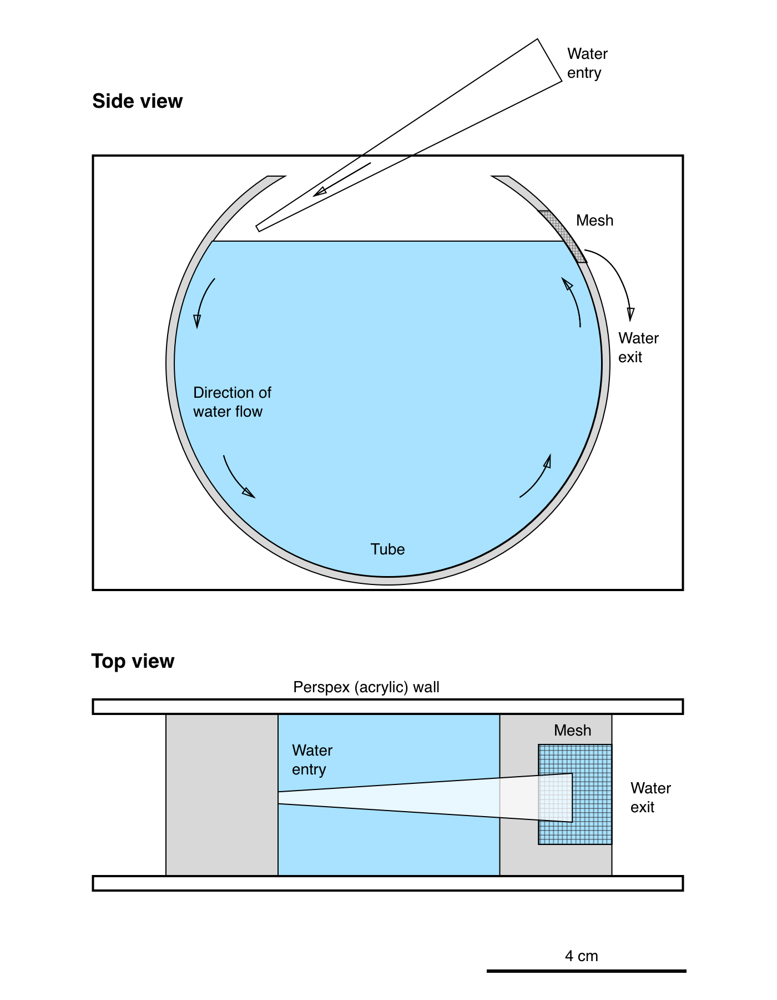
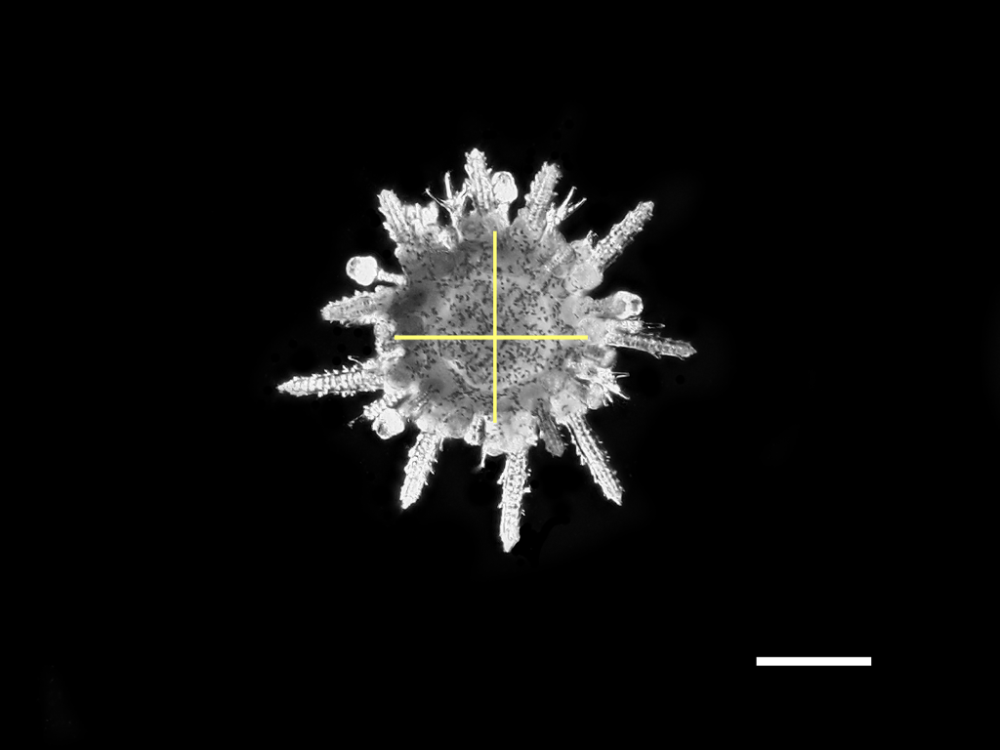
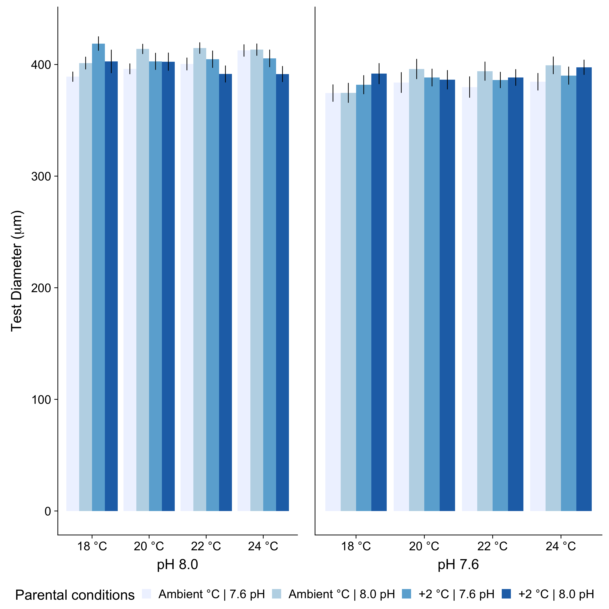

<!-- # Parental acclimation influences the metabolic response of *Heliocidaris erythrogramma* larvae to near-future ocean warming and acidification -->

```{r, echo = FALSE, include = FALSE}
# Settings

options(knitr.kable.NA = '')
knitr::opts_chunk$set(echo = FALSE,
                      out.width = '100%', 
                      comment = "#>")

library(tidyverse)
library(kableExtra)
library(snipR)

```

# Offspring metabolic reaction norms to ocean warming and acidification are shaped by parental environment in the sea urchin, *Heliocidaris erythrogramma*

\chaptermark{Offspring metabolic responses to warming and acidification}


## Abstract {-}

Understanding 

## Introduction

The unprecedented rate in which anthropogenic carbon dioxide ($\mathrm{CO_2}$) is being absorbed by the ocean has significantly altered its physical and chemical properties, contributing to the phenomena of ocean warming and ocean acidification [@Caldeira2003; @Howes2015]. 
These two environmental stressors are well-studied in the literature with diverse and interactive effects documented across many taxa and influencing fitness [reviewed by @Byrne2013; @Harvey2013; @Przeslawski2015; @Poloczanska2016].
Generally, increased temperature alters all levels of animal physiology due to its effects on biological rates [@Somero2010; @Somero2012; @Verberk2016], while ocean acidification alters the carbonate chemistry of seawater, influencing biochemical pathways related to physiological functioning [@Cyronak2016; @Clements2018].

Whether marine organisms are resilient to ocean warming and acidification depends greatly on their phenotypic plasticity as it determines their capacity to acclimate to increased environmental stress [@Munday2013; @Seebacher2014; @Murren2015].
Recognising the extent to which the plastic responses are beneficial to their fitness is a challenge due to the difficulties in identifying the physiological mechanisms underlying changes in performance [@Portner2004; @Portner2008].
For example, increased metabolism due to warming may be a result of an increase in aerobic scope for growth and reproduction, which is beneficial [@Sandblom2014; @Hansen2017], however it may also signal trade-offs diverting energy from growth and reproduction to metabolism in order to maintain fitness [@Marshall2011; @Hoefnagel2017].
<!-- Thus it is important to demonstrate whether an observed plastic response increases the fitness of individuals with rigorous experimental design. -->

In addition to phenotypic plasticity, recent marine climate change studies have also demonstrated that plastic responses to environmental stress within one generation may influence the responses to environmental conditions in the next [e.g. @Borges2018; @Scanes2018; @Wong2018; @Zhao2018]. 
This is currently an active area of climate adaptation research ranging from investigations of developmental plasticity, maternal effects and transgenerational plasticity [reviewed by @Ross2016; @Torda2017; @Donelson2018].
In this study we denonte the term "carry-over" effects as we use exposure of parents to environmental stress to assess the performance of their offspring.
<!-- to incorporate all of the above mechanisms to describe possible influences of parental exposure to environmental conditions on offspring responses. -->
<!-- Generally, parents experiencing stressful conditions can influence their offspring by adjusting resources to the egg (i.e. maternal investment), or by influencing the offspring phenotype directly [@Donelson2018]. -->
<!-- Carry-over effects have been demonstrated in fish [@Donelson2012; @Heckwolf2018; @Allan2014], bivalve molluscs [@Parker2015; @Scanes2018], crustaceans [@Pedersen2014; @Borges2018] and sea urchins [@Wong2018; @Zhao2018]. -->

Because marine calcifiers are particularly vunerable to the effects of ocean warming and acidification especially during their early developmental stages [@Byrne2011; @Byrne2013; @Nagelkerken2015; @Poloczanska2016], many studies have used sea urchin larvae as models for the response of calcifying marine organisms to changing environmental conditions from gamete to juvenile stages [@ODonnell2009; @Sewell1999; @Byrne2011; @Stumpp2011; @Dorey2013; @Hardy2014; @Gianguzza2014].
The influence of carry-over effects between sea urchin generations in the context of climate change has only been considered recently.
Few studies to date have examined the effects of environmental cues from parents on offspring responses to ocean warming and acidification.
For sea urchins, @Wong2018 demonstrated that incubating the sea urchin *Strongylocentrotus purpuratus* to upwelling conditions of colder temperature and high *p*$\mathrm{CO_2}$ for 4.5 months intensified the transcriptomic response and growth (i.e. size) of the progeny.
Similarly, @Zhao2018 found evidence of transgenerational effects in the sea urchin *Strongylocentrotus intermedius* when they were incubated for 15 months to elevated temperature conditions, whereby the hatchability and size of larvae were negatively affected by parental exposure to warming.
These results suggest the importance of parental environmental history on the responses of offspring as their effects may either buffer or negate the performance of developing sea urchin larvae to future climate change scenarios.

<!-- to better visualise -->
In this study, the interactive effects of increased temperature and reduced pH were investigated in the sea urchin, *Heliocidaris erythrogramma*, across two generations.
Parents were incubated for 3 months to different temperature (ambient, +3 \degree C) and $\mathrm{pH_T}$ levels (8.0, 7.6) during their gamete development period from winter to summer.
They were then spawned and offspring were incubated to a range of temperature (18 \degree C to 24 \degree C) and $\mathrm{pH_T}$ (8.0, 7.6) for 14 days.
Interactions between parental treatments and offspring plastic responses were compared using thermal reaction norms with metabolic rate and growth as performance traits. 
Metabolic rate was used as it is a fundamental biological rate that modulates all other biological activities [@Brown2004]. 
Measuring metabolic rate performance in sea urchin larvae can provide important insights to their plasticity as it can be associated with bioenergetics and fitness consequences [e.g. @Stumpp2011; @Dorey2013].
It was expected that there will be an interaction between parental acclimation environments (temperature/pH) and offspring metabolic rate and growth reaction norms to temperature, signalling carry-over effects to the offspring from parental environments.


## Methods

<!-- From past research we know that an offset of $+2 ^{\circ}C$ is non-lethal to the species. -->
<!-- pH was set at 6 levels ranging from 7.6 to 8.0. -->

### Collection of adults

<!-- *Heliocidaris erythrogramma* (35--44 $mm$ test diameter) were collected from Milk Beach ([-33.856478, 151.266958](https://www.google.com/maps/?q=-33.856478,151.266958)) in Sydney Harbour during low tide. -->
*Heliocidaris erythrogramma* (35--44 $mm$ test diameter) were collected from three locations within Sydney Harbour: Milk Beach ([-33.856478, 151.266958](https://www.google.com/maps/?q=-33.856478,151.266958)), Bottle and Glass Point ([-33.847960, 151.270122](https://www.google.com/maps/?q=-33.847960,151.270122)) and Chowder Bay ([-33.841657, 151.253677](https://www.google.com/maps/?q=-33.847960,151.270122)).
The sea urchins were collected in the subtidal zone (2--3 $m$) in June 2015 in mid-winter when the gonads are less developed [@Laegdsgaard1991] and transported to the Sydney Institute of Marine Science (SIMS) in Chowder Bay, Australia.
There, they were maintained at the ambient flowthrough facility with filtered seawater (FSW, 70 $\mu m$, 1.5 $L\ min^{-1}$) for 2 weeks before they were transferred into acclimation treatments.

### Experimental design

All experiments were performed in a climate-controlled room which was capable of adjusting room temperature, lighting, seawater temperature and pH. 
Room lights were calibrated weekly to follow the dirunal sunrise/sunset cycle.
A thermocouple-solenoid feedback system controlled seawater temperature by automatically mixing warm (26 &deg;C) and cold (14.5 &deg;C) filtered FSW (20 $\mu m$) to produce water at a constant temperature. 
The water was stored in insulated header tanks, and each header tank was further equipped with a submersible heater (200 W, Blue Sea, Guangdong, China) attached to a temperature controller (model 7028/3, TUNZE Aqraientechnik GmbH, Germany) to maintain stable temperature.

Seawater pH control was performed separately for adult treatments and larval cultures.
In the adult treatments, pre-mixed $CO_2$ gas was bubbled vigorously into header tanks using a venturi injector.
<!-- which allows the flowthrough system to maintain stable pH rapidly. -->
The gas was prepared realtime using a proportional–integral–derivative controller which injects food-grade $CO_2$ (BOC, Australia) into scrubbed ambient air through a controller valve (Parker Hannifin, OH, USA).
For larval experiments, the total flow rate was higher to maintain more treatments (>2 $L\ min^{-1}$), thus pH was controlled by mixing pure $CO_2$ gas directly into header tanks. This was done using an APEX AquaController system (Neptune Systems, Inc., CA, USA), where lab grade pH probe modules (model no. PRBPH) were used to provide feedback to control modules (model no. PM1) for adjustments to seawater pH. 
The pH was adjusted to the total scale ($\mathrm{pH_T}$) by an offset to spectrophotometric measurements of pH, which was measured daily (see below).
The control modules automatically injected $CO_2$ micro-bubbles via solenoid valves into $CO_2$ reactors (Max Mix 2000 $L\ hr^{-1}$, Ista Professional Aquarium System, Taiwan) attached to submersible pumps (model AP550LV, Aquatec Equipment, Perth, Australia) inside each header tank.
<!-- that run continuously to mix the $CO_2$-infused water into header tank. -->

Treatment temperature was logged daily in all treatments using PT1000 resistance temperature detectors (RTDs) attached to a Graphtec Multifunction logger (model: GL840, Graphtec). 
Treatment pH on the total scale was measured spectrophotometrically using a custom-built automated sampling system connected to an optic-fibre spectrophotometer (model: USB4000+, Ocean Optics, Inc., FL, USA).
The dye indicator used for spectrophotometric measurements was m-cresol (Acros Argonics, catalog number 110585000, Lot A0321770) and all measurements were calibrated to certified reference material (CRM) for $CO_2$ in seawater obtained from the Scripps Institution of Oceanography (University of California, San Diego, USA) following SOP 6b in @Dickson2007. Calculations of pH were based on @Liu2011.

### Adult treatment setup

Sea urchins were randomly assigned to 4 treatments of two temperatures (ambient, elevated +2 &deg;C) and two pH levels (ambient 8.0 $\mathrm{pH_T}$, 7.6$\mathrm{pH_T}$). 
Each treatment combination consists of five replicate tanks (4 $L$) with three sea urchins per tank for a total of 15 sea urchins per treatment.
<!-- The temperatures and pH levels were selected based on projections of OA conditions predicted for the region by the year 2100 [@Lenton2015]. -->
To minimise physiological stress, all treatments were at ambient temperature and pH at the beginning of the acclimation period, and adjustments to elevated temperature (or low pH) were carried out slowly at +1 *&deg;C* $week^{-1}$ and -0.1 pH $week^{-1}$.
Once treatment levels were established, pH was kept constant while temperature was adjusted weekly based on the natural temperature profile of Chowder Bay, determined using *in situ* loggers previously deployed in sea urchin habitats from 2009--2014 (See Chapter 3, Figure \@ref(fig:harbour)). 


### Larval kreisel setup

Embryos were incubated in custom-built, mini-kreisels of similar design to those built by @Hammill2017.
<!-- as these tanks allow us to culture larvae in flowthrough conditions. -->
Each kriesel was constructed by mounting a cylindrical acrylic tube (10 $cm$ diameter, 4 $cm$ wide) between two acrylic panels (12 $\times$ 11 $\times$ 0.3 $cm$) using acetone adhesive (Figure \@ref(fig:kreisel)).
An inflow tubing leading into the kreisel provided continuous laminar flow in a circular motion within the kreisel.
As the seawater input was flowthrough, it was delivered through a series of three filters (70 $\mu m \Rightarrow$ 20 $\mu m \Rightarrow$ 1 $\mu m$) to prevent pelagic organisms in the flowthrough system from interacting with the specimens.
The outflow was covered with a 50 $\mu m$ mesh to prevent escape.

There were 10 treatments of 4 temperatures (18 &deg;C, 20 &deg;C, 22 &deg;C, 24 &deg;C) and two pH levels (8.0, 7.6). Each treatment contained three experimental kreisels, supplied with flowthrough seawater at a rate of 50 $mL\ min^{-1}$. 
<!-- The flow rate was adjusted slightly ($\pm 5\ mL\ min^{-1}$) for each kreisel to ensure that the larva were not pressed against the outflow mesh . -->

```{r kreisel, fig.cap = "(ref:kreisel)", fig.scap = "(ref:skreisel)", fig.pos="p"}

```

(ref:kreisel) Diagram of the mini-kreisel used to incubate *Heliocidaris erythrogramma* embryos. Filtered seawater was supplied at a rate of 50 $\mathrm{mL\ min^{-1}}$. As it enters the kreisel it generates a continuous, circular flow which suspends larvae until they settle.

(ref:skreisel) Diagram of the mini-kreisel used to incubate *Heliocidaris erythrogramma* embryos. 

### Spawning and incubation

<!-- To accomodate all treatments in the larval culture system, larval spawning was performed sequentially for each adult treatment. -->
<!-- The selection of treatment group was performed at random and incubations lasted 14 days each, starting in October 2015 and ending in December 2015. -->
Adult sea urchins were incubated to their treatments for at least 3 months before spawning was induced in October 2015 by injection of 1--2 $mL$ of 0.5 M potassium chloride (KCl).
During spawning, all treatments were held at their temepratures (ambient: 18.2 &deg;C, elevated 20.2 &deg;C) and the weekly adjustments to temperature were halted.
From each parental treatment, gametes from at least 3 females and 2 males were pooled.
Eggs were mixed at their parental temperature (18.2 &deg;C and 20.2 &deg;C). 
Then, approximately 1000--1500 unfertilised eggs were added directly into the kreisels.
Sperm was introduced to all 10 treatment after 15 minutes at a pre-diluted sperm concentration of approximately $2 \times 10^5\ sperm\ mL^{−1}$.
<!-- to avoid polyspermy (cite?). -->
The flowthrough system was not turned off during fertilisation, but fertilisation success was checked for each treatment after 20 minutes (98--100 \% for all treatments). 
The embryos left to develop and incubate in the kreisels into settled juveniles, over 14 days, under constant temperature (18 &deg;C to 24 &deg;C) and pH levels (8.0, 7.6), before metabolic rate measurements were made.


### Metabolic rate and growth

Metabolic rate, $MO_2$, was estimated using constant-volume respirometry. 
The respirometry chambers used were 2 $mL$ borosilicate glass vials with silicon septum lids (Mfr. No. CERT97E-12, Thomas Scientific, NJ, USA).
Oxygen concentration within the glass vials were measured using needle-type microsensors (NTH-PSt1, PreSens GmbH, Regensburg, Germany) attached to 4-channel and 10-channel meters (OXY-10 micro and OXY-4 micro, PreSens GmbH).
<!-- We used 9 vials for larvae while the other 5 contained only treatment water to account for the presence of background respiration. -->
From each kreisel, 50 juveniles were collected at random and placed into a respirometry vial for measurement of oxygen uptake.
Each respirometry vial was rinsed at least two times and filled with 0.22 $\mu m$ FSW at the same treatment conditions as the source juveniles before the specimens were transferred for measurement.
To account for background respiration, 4-6 vials containing only treatment water were measured separately for each larval group.
Respirometry experiments ran for 12 to 15 hours in the dark and oxygen concentrations did not drop below 85 \% air saturation when the experiments were completed.
Temperature was kept constant throughout the experiment using a water bath.

After respirometry, juveniles were collected and photographed under a compound microscope. 
To test for the effects of parental and offspring treatments on growth, 30 photographed juveniles were randomly sampled for measurements of test diameter ($\mu m$) as a proxy for growth (Figure \@ref(fig:juvdiam).
Metabolic rate results were scaled to the average test diameter per larvae based on the juveniles measured [$pmol\ O_2\ h^{-1}\ larvae^{-1}\ \mu m^{-1}$, @Dorey2013].

```{r juvdiam, fig.cap="(ref:juvdiam)", fig.pos="p"}

```

(ref:juvdiam) Micrograph of a juvenile *Heliocidaris erythrogramma* after 14 days of incubation to temprature (18 \degree C to 24 \degree C) and pH ($\mathrm{pH_T}$ 8.0, $\mathrm{pH_T}$ 7.6). Juveniles which were tested for metabolic rate were measured on the oral surface twice to obtain estimates of test diameter (yellow lines) using the image analysis software ImageJ. Scale = 200 $\mu$m.

### Data analyses

To test for the effect of parental treatments on the metabolic rate and growth response of juveniles to temperature, we ran a general linear mixed model (GLMM) on the response data using parental temperature and parental pH as categorical variables, larval temperature and pH as continuous covariates, and then included all possible interactions between all variables.
The GLMM was analysed for effects using analysis of covariance (ANCOVA) with type III error to test for both main effects and the interaction terms.
For metabolic rate, there were no significant three-way interactions ($p <$ 0.05) when the analysis was run, thus the terms were removed and the model re-analysed.
For growth, there were no two- or three-way interactions, thus the model was analysed for main effects only using type II error. 
All data were analysed in R (version 3.5.0) using the `car` package for ANCOVA analyses.

## Results

### Metabolic Rate

We found a significant interaction between parental temperature treatment and offspring metabolic response to temperature (GLMM ANCOVA, $F_{3,22} =$ 24.04, $p<$ 0.001). 
Juvenile metabolic rate increased significantly with temperature ($F_{1,22} =$ 20.41, $p<$ 0.001), but parental acclimation to warmer warmer treatments (+2 &deg;C) resulted in increased metabolism at higher temperatures. 
At 24 &deg;C, the difference in metabolic rates due to parental acclimation was up to $\sim$ 30 \%.
Parental acclimation to low pH (7.6) did not have an effect on metabolic rate responses ($F_{1,22} =$ 1.63, $p=$ 0.22), and offspring exposure to low pH also did not significantly affect metabolic rate responses ($F_{1,22} =$ 0.65, $p=$ 0.43).

```{r c4ancovamr, message=FALSE}

c4ancovamr <- readr::read_csv("input/ch_larval/c4ancovamr.csv")


# example below
# c4mrancova <- readr::read_csv("input/ch_larval/c4ancovagrowth.csv")
kable(c4ancovamr, "latex", caption = "(ref:c4ancovamr)", 
  caption.short = "(ref:sc4ancovamr)", booktabs = TRUE) %>%
  kable_styling(position = "center") %>%
  # kable_styling(latex_options = "hold_position") %>%
  kable_styling(full_width = T) %>%
  row_spec(c(0), bold = T) %>%  
  footnote("***: p < 0.001; **: p < 0.01")

```

(ref:c4ancovamr) Results of generalised linear mixed model (GLMM) analyses of covariance (ANCOVA, Type III) on the effect of parental environments (ambient, +2 &deg;C, $\mathrm{pH_T}$ 8.0, $\mathrm{pH_T}$ 7.6) and offspring treatments (18 &deg;C, 20 &deg;C, 22 &deg;C, 24 &deg;C, $\mathrm{pH_T}$ 8.0, $\mathrm{pH_T}$ 7.6) on juvenile (14-day) metabolic rate in *Heliocidaris erythrogramma*. Non-significant three-way interactions were removed from the model.

(ref:sc4ancovamr) Results of generalised linear mixed model (GLMM) analyses of covariance (ANCOVA, Type III) on the effect of parental environments and offspring treatments on juvenile metabolic rate in *Heliocidaris erythrogramma*. 


```{r juvrates, fig.cap="(ref:juvrates)", fig.pos="p", out.width="90%"}

knitr::include_graphics("figs/ch_larval/juvrates.png")

```

(ref:juvrates) Mean metabolic rate ($\pm SE$) of 14-day, juvenile *Heliocidaris erythrogramma* recorded after incubation to a range of temperatures (18 &deg;C, 20 &deg;C, 22 &deg;C, 24 &deg;C) under constant *(A)* ambient $\mathrm{pH_T}$ (8.0); and *(B)* low $\mathrm{pH_T}$ (7.6) conditions. Specimens were spawned from specific parents acclimated for 3 months to temperature (blue: ambient +0 &deg;C, red: elevated +2 &deg;C) and $\mathrm{pH_T}$ levels (dashed: ambient 8.0, line: 7.6).

### Growth

Juveniles grew less under acidified (7.6 $\mathrm{pH_T}$) conditions ($F_{1,953} =$ 38.1, $p<$ 0.001, Table \@ref(tab:juvgrowthancova)), but there was no evidence of any effect of parental acclimation to temperature ($F_{1,953} =$ 0.003, $p=$ 0.95, Table \@ref(tab:juvgrowthancova)) or pH ($F_{1,953} =$ 1.99, $p=$ 0.16, Table \@ref(tab:juvgrowthancova)) on test diameter.
Overall, we saw approximately 4\% decrease in average test diameter across all temperature treatments between treatments at ambient $\mathrm{pH_T}$ (8.0) and low $\mathrm{pH_T}$ (7.6).


```{r juvgrowthancova, message=FALSE}

gdt <- readr::read_csv("input/ch_larval/c4ancovagrowth.csv")

kable(gdt, "latex", caption = "(ref:juvgrowthancova)", 
  caption.short = "(ref:sjuvgrowthancova)", booktabs = TRUE) %>%
  kable_styling(position = "center") %>%
  # kable_styling(latex_options = "hold_position") %>%
  kable_styling(full_width = T) %>%
  row_spec(c(0), bold = T) 


```

(ref:juvgrowthancova) Results of generalised linear mixed model (GLMM) analyses of covariance (ANCOVA, Type II) on the effect of parental environments (ambient, +2 &deg;C, $\mathrm{pH_T}$ 8.0, $\mathrm{pH_T}$ 7.6) and offspring treatments (18 &deg;C, 20 &deg;C, 22 &deg;C, 24 &deg;C, $\mathrm{pH_T}$ 8.0, $\mathrm{pH_T}$ 7.6) on juvenile (14-day) test diameter of *Heliocidaris erythrogramma*. Only main effects were analsed as interactions were all not significant. Significant differences are indicated with asterisks. ***: $p <$ 0.001.

(ref:sjuvgrowthancova) Results of generalised linear mixed model (GLMM) analyses of covariance (ANCOVA, Type II) on the effect of parental environments (ambient, +2 &deg;C, $\mathrm{pH_T}$ 8.0, $\mathrm{pH_T}$ 7.6) and offspring treatments (18 &deg;C, 20 &deg;C, 22 &deg;C, 24 &deg;C, $\mathrm{pH_T}$ 8.0, $\mathrm{pH_T}$ 7.6) on juvenile (14-day) test diameter of *Heliocidaris erythrogramma*.


```{r juvgrowth, fig.cap="(ref:juvgrowth)", fig.pos="p"}



```

(ref:juvgrowth) Mean test diameter ($\mu m \pm$ SD) of juvenile *Heliocidaris erythrogramma* recorded after incubation to a range of temperatures (18 &deg;C, 20 &deg;C, 22 &deg;C, 24 &deg;C) under constant *(A)* ambient $\mathrm{pH_T}$ (8.0); and *(B)* low $\mathrm{pH_T}$ (7.6) conditions. Specimens were spawned from specific parents acclimated for 3 months to temperature (blue: ambient +0 &deg;C, red: elevated +2 &deg;C) and $\mathrm{pH_T}$ levels (dashed: ambient 8.0, line: 7.6).


## Discussion


<!-- This study tested for the parental effects of acclimation to warming and reduced pH conditions in *H. erythrogramma* using laboratory conditions. -->

<!-- Many past studies investigating any carry-over effects of climate change have assumed transgenerational plasticity even though adults experienced changes in environmental conditions during their adult life [e.g. @Zhao2018] -->

<!-- In this study, *H. erythrogramma* parents exposed to increased temperature conditions during incubation produced offspring with higher metabolic responses to increased temperature. However, parental incubation to low pH did not influence offspring metabolic response.  -->
<!-- Strong interactions between parental temperature treatment and offspring metabolic rate response to temperature suggest the possibility that the conditions experienced by the parental sea urhins during this period influenced the metabolic response of the juveniles to elevated temperature. -->
<!-- It is possible that these effects could be due to developmental plasticity since  -->

<!-- This study showed that there was an influence of parental treatment on the response of offspring, where *H. erythrogramma* parents exposed to increased temperature conditions during incubation produced offspring with higher metabolic responses to increased temperature. -->

<!-- There was a greater metabolic rate response to temperature in juveniles  -->

<!-- Identifying whether the carry-over effects of resilience to climate change across a single generation is due to transgenerational plasticity is challenging since any differences observed in these experiments could also be due to a combination of developmental plasticity [@Beaman2016; @Torda2017] or maternal influence [@Wong2018]. -->

<!-- Parental exposure to warming and reduced pH conditions were only performed over 3 months before the spawning season. -->


