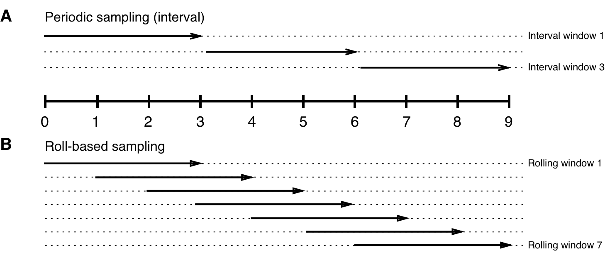
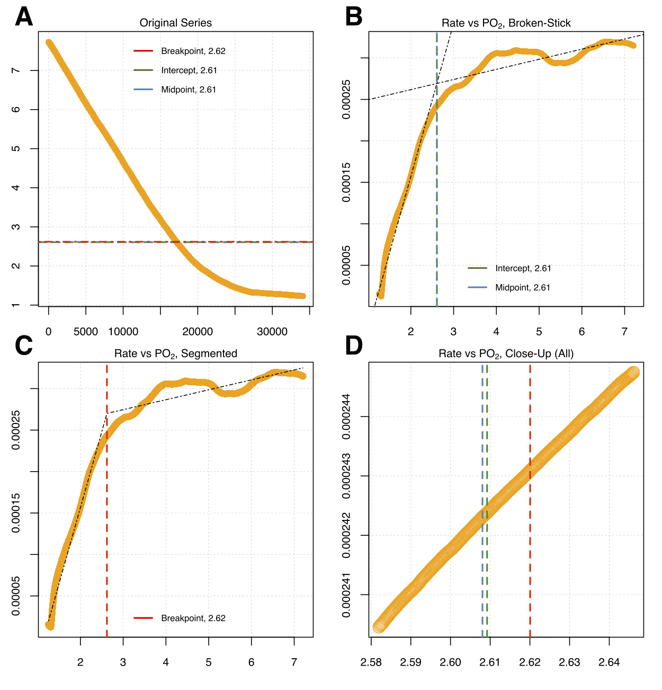

```{r, echo=FALSE}

options(knitr.kable.NA = '')
knitr::opts_chunk$set(echo = FALSE,
                      out.width = '100%', 
                      comment = "#>", 
                      cache = FALSE)
# additional packges
library(respR)
library(readxl)
library(readxl)
library(kableExtra)
# library(knitcitations)

# set pander table-layout options
library(pander)
panderOptions('table.alignment.default', function(df)
    ifelse(sapply(df, is.numeric), 'right', 'left'))
panderOptions('table.split.table', Inf)
panderOptions('big.mark', ",")
panderOptions('keep.trailing.zeros', TRUE)


listfunctions <- readxl::read_excel('tables/list-of-functions.xlsx')
conversions <- readxl::read_excel("tables/conversion-units.xlsx")
```

\cleardoublepage
\SingleSpacing

# respR -- an R package for the analysis of respirometry data[^published5] {#chapter5}
\chaptermark{respR -- an R package for respirometry}

\OnehalfSpacing

[^published5]: A portion of this chapter has been submitted and is under a third review as "Harianto J, Carey N and Byrne M (2018). `respR` -- an R package for the analysis of respirometry data. *Methods in Ecology and Evolution*. In review." In addition, the R package, `respR`, is already publishedo on GitHub as an open-source project.


## Abstract {-}


1. Respirometry is a ubiquitous practice in experimental biology, but there is a lack of standard practices when analysing the resulting data, limiting transparency and reproducibility. As respirometry datasets become increasingly large and analytical approaches more complex, manipulating the data remains a challenge and often intractable with existing tools.

2. Here we describe the `respR` R package, a collection of functions that implement a workflow-based approach to automate the analysis and visualisation of respirometry data. The package can be used for closed, intermittent flow, flow-through and open-tank respirometry and uses well-defined sets of rules to reliably and rapidly generate reproducible results.

3. We demonstrate how `respR` uses novel computing methods such as rolling regressions and kernel density estimates to reliably detect maximum, minimum and most linear sections of the data, and critical oxygen tension, $P_{crit}$.

4. Although designed specifically with aquatic respirometry in mind, the object-oriented approach of the package and the unit-less nature of its analytical functions mean that parts of the package can easily be used to estimate linear relationships from a range of applications in many research disciplines.

**KEYWORDS:** R, software, respirometry, ecophysiology, metabolic rate

## Introduction

Metabolic rate is a fundamental trait associated with virtually all biological functions and is key in predicting patterns in ecology and conservation biology, from populations [@Seibel2007; @Barneche2014] to ecosystems [@Brown2004]. 
It has been widely investigated in studies of the effects of external stressors on organisms and is increasingly used to study resilience in climate change-related studies where warming is expected to drive increased metabolism in ectotherms [e.g. @Portner2002; @Carey2016; @Delorme2016]. 
<!-- By far the most common metric used to assess physiological performance in animals, metabolic rate has been determined from whole organisms to the level of cells and tissues [@white_determinants_2013].  -->
It is also is by far the most common metric used to assess physiological performance in whole organisms, tissues and cells [@White2013].
While there are other methods such as monitoring heart or ventilatory rates, metabolic rate is typically quantified using respirometry, which measures the rate of oxygen uptake over time [@Lighton2008]. 

There are four broad methodological approaches in respirometry: closed, intermittent flow, flow-through and open. 
In closed respirometry, O~2~ decrease is measured within a hermetically sealed chamber of known volume, sometimes set within a closed loop to allow mixing of the environment within the chamber. 
Oxygen recordings may be continuous through use of an oxygen probe, periodic through withdrawing water or gas samples at set intervals, or a two-point measurement consisting of the initial and final concentrations. 
Metabolic rates are estimated from the O~2~ timeseries by assuming a linear relationship between variables, and estimates of metabolic rate are straightforward in constant volume respirometry using the equation: $$VO_2 = \dot O_2V$$ where $\mathrm{\dot O_2}$ is the slope of the regression that describes the rate of change in O~2~ concentration over time, or in the case of a two-point measurement, the difference in O~2~ concentration divided by time elapsed, and $V$ is the volume of the container [@Lighton2008].

In intermittent flow respirometry, O~2~ concentration is measured as described above, but periodically the chamber is flushed with new water or air, returning it to initial conditions, resealed, and the experiment repeated [@Svendsen2016]. 
This technique is essentially closed respirometry, but with the incorporation of repeated measures. 
Depending on the metabolic rate metric being investigated, final respiration rate can be calculated as the mean of the measures [e.g. @Carey2016], or the lowest or highest rates recorded in any trial [e.g. @Stoffels2015].

Flow-through respirometry involves a closed chamber, but with a regulated flow of air or water through it at a precisely determined rate. 
After equilibrium has been achieved, the oxygen concentration differential between the incurrent and excurrent channels, along with the flow rate, allows calculation of the oxygen extracted from the flow volume per unit time: $$VO_2 = (C_iO_2 - C_eO_2)FR$$ where $\dot{V}O_2$ is the rate of O~2~ consumption over time, $C_iO_2$ and $C_eO_2$ are the incurrent and excurrent O~2~ concentrations, and $FR$ is the flow rate of water through the system [@Lighton2008].

A final method is open respirometry, in which an open tank or semi-enclosed area is used, but the input or mixing rate of oxygen from the surroundings is known or found to be negligible relative to oxygen consumption of the specimens [@Leclercq1999]. 
It is seldom used, but for some applications it is a sufficient and practical methodology [@Gamble2014]. 
The common equation used for open respirometry is: $$VO_2 = \dot O_2V + \phi_d$$ where $\dot O_2V$ is the slope of the regression that relates O~2~ concentration to time, $V$ is the volume of the container and $\phi_d$ is the oxygen flux as determined by Fick's Law [@Leclercq1999].

Depending on the experiment, different metabolic rate parameters may be of interest to researchers. 
These include maximum metabolic rate (MMR, or $\dot{M}O_{2,max}$), rates under high activity or exhaustive exercise, and minimal metabolic rate ($\dot{M}O_{2,min}$), which may be termed standard (SMR), basal (BMR), or resting metabolic rate, and typically represents the minimum metabolic cost of maintaining biological functioning [@White2013; @Chabot2016]. 
Routine metabolic rate (RMR) is similar to $\dot{M}O_{2,min}$, but takes into account that in some organisms energy is expended on small, spontaneous movements to maintain posture or position [@Rogers2016]. 
Another metric of interest is the critical oxygen tension, which represents the lowest level of oxygen at which aerobic metabolism is independent of the ambient partial pressure of oxygen [$P_{crit}$; @Yeager1989; @Hochachka2002]. 

Respirometry studies are increasingly outputting large, high-resolution datasets conducted over long periods [e.g. 20 h; @Norin2012]. 
In many cases, processing the data involves an ad hoc selection of data points with poorly reported criteria, and subsequent manual processing of the data subset(s) using a spreadsheet program (e.g. Microsoft Excel) or an integrated development environment (IDE, e.g. R or Matlab). 
These approaches can be tedious and time-consuming especially when spreadsheet programs struggle with the vast datasets that are generated, while IDEs require a degree of expertise to use and have substantial learning curves. 
Dedicated software are also available to perform metabolic rate analyses, but many have costly licensing requirements (e.g. AutoResp by Loligo Systems), complicating or preventing their use on multiple machines, and are proprietary and closed-source, hindering scientific reproducibility and transparency.  

A number of open-source R software packages have recently become available which are designed for, or are suitable to analyse data from respirometry. 
The `respirometry` package (https://CRAN.R-project.org/package=respirometry) contains a comprehensive collection of tools to explore and evaluate experimental parameters in aquatic respirometry and is useful for the design and diagnosis of experimental setups.
The `rMR` package (https://CRAN.R-project.org/package=rMR) performs interval-based metabolic rate calculations and has a method to analyse $P_{crit}$ using the "broken-stick" regression method [@Yeager1989]. 
The package `LoLinR` [@Olito2017], while not specifically coded for respirometry, provides a statistically robust method of detecting a "best-fit" regression, and performs well at identifying truly linear subsets of a data series. 
<!-- Importantly, all of these packages assume that data are monotonic with evenly-spaced sampling periods with respect to time, an ideal structure but one where respirometry data often fails to meet.  -->
<!-- They also do not have the tools to analyse complicated datasets to automatically determine useful metric such as $\dot{M}O_{2,max}$ and $\dot{M}O_{2,min}$. -->

Here we describe `respR`, an open-source R package designed to provide an efficient and reproducible workflow for the analysis of respirometry data (Table \ref{funlist}).
The package contains utilities to: (1) analyse closed, intermittent, flow-through and open-tank respirometry data [see @Lighton2008; @Svendsen2016], (2) determine volume and mass specific oxygen uptake rates, (3) automatically detect maximal and minimal rates, $P_{crit}$, and (4) detect the most linear sections of data using novel rolling regression and kernel density estimation techniques.
In addition, the package contains "housekeeping" functions for data import and export as supplementary material at all stages of respirometry analysis, including saving raw data, subsetting criteria, background corrections, units of measure, and resulting metabolic rates. 
This streamlines the reporting of analytical methods and allows reviewers or other investigators to fully reproduce or scrutinise the results. 
Additional functions useful in processing respirometry data are available, and are described in more detail in our online html vignette (https://januarharianto.github.io/respR/).
We show how `respR` might be used to determine $\dot{M}O_{2,max}$, $\dot{M}O_{2,min}$, and $P_{crit}$.


<!-- ```{r Table-1, echo=F} -->
<!-- pander(listfunctions, caption = "Main functions available in `respR`.", -->
<!--   split.cells = 50, split.table = 80, floating = TRUE) -->

<!-- ``` -->


<!-- Table is in raw LaTeX format as kable sucks at formatting text-only tables that contain sentences and formatting. -->

\begin{table}
\centering
\caption{Main functions available in respR.}
\label{funlist}
\begin{tabular}{p{0.35\linewidth}p{0.55\linewidth}}
\toprule
\textbf{Function} & \textbf{Description} \\ 
\midrule
\texttt{import\_data()} & Automatically import and format raw data files from commonly-used respirometry devices. \\
\texttt{inspect()} & Checks data for errors, extracts a two-column dataframe for analysis, and plots the data for quick visualisation. \\
\texttt{calc\_rate.bg()} & Calculates background oxygen uptake rate. \\
\texttt{calc\_rate()} & Calculates oxygen uptake rate from precise segment(s) of the data. \\
\texttt{calc\_rate.ft()} & Calculates oxygen uptake rate in flowthrough experiments. \\
\texttt{auto\_rate()} & Calculates ``max'', ``min'', ``interval'' or ``best-fit'' rates. \\
\texttt{adjust\_rate()} & Corrects data for background changes in oxygen concentration. \\
\texttt{convert\_DO()} & Converts between units of oxygen concentration. \\
\texttt{convert\_rate()} & Converts experimental rates to specific units. \\
\texttt{pcrit()} & Calculates critical oxygen tension, $P_{crit}$. \\
subsample() & Reduces the size of a large data frame, by extracting every n-th row. \\
\texttt{intermittent.rd.rda} & Respirometry data for a single sea urchin~specimen (\textit{Heliocidaris erythrogramma}) collected using intermittent respirometry. Data were collected over 80 minutes. \\
\texttt{sardine.rd.rda} & Respirometry data for a single sardine specimen, \textit{Sardinops sagax}. Data were collected over 2 hours. \\
\texttt{squid.rd.rda} & Respirometry data for a single squid specimen, \textit{Doryteuthis opalescens}, to determine $P_{crit}$. Data were collected over a 9-hour period. \\
\texttt{urchins.rd.rda} & Multi-column dataset containing respirometry and background respirometry data for 16 sea urchin specimens (\textit{Heliocidaris erythrogramma}). Data for each urchin were collected over 45 minutes. \\
\bottomrule
\end{tabular}
\end{table}


## Package overview

The `respR` package streamlines the analysis of respirometry data by partitioning the data processing workflow into several independent actions: (1) initially, data are imported, checked for common errors, plotted for visual inspection and exported as an object; (2) the object is then analysed to estimate the desired rate parameter; (3) diagnostic plots are automatically generated and the data can be further explored using the generic S3 `print()`, `plot()`, and `summary()` commands to verify the results; (4) adjustments to the data from background respiration are applied; (5) volume or mass-specific rate conversions, specific to the respiratory chamber and specimen(s), are calculated where necessary (Fig. \@ref(fig:c4intro)). 
By design, each step of the workflow requires minimal manual manipulation of the data, and the user can pass the output of each function to the next. 
This object-oriented approach makes `respR` easy to use, even for novice users of R, and allows R programmers to extend the functionality of the package easily. 
<!-- either by adding additional intermediate actions or substituting current actions with other code without breaking the rest of the package.  -->
Note, we use $\mathrm{\dot O_2}$ in the text to represent the unit-less rate of O~2~ use with regard to the time unit, and to distinguish it from other commonly reported metrics (e.g. $\dot{M}O_2$, $\dot{V}O_2$).


```{r c4intro, fig.cap="(ref:c4intro)", fig.scap="(ref:sc4intro)"}
knitr::include_graphics("figs/ch_methods/fig1.png")
```

(ref:c4intro) Diagram showing steps in a typical workflow in the analysis of respirometry data using `respR`. **(A)** Data are first checked for errors before **(B)** main functions are used to extract and analyse segments of the data. **(C)** Summarised results and diagnostic plots provide immediate visual feedback on the outcome of the analyses. **(D)** Once the rate estimates are obtained, they can be converted into volume and/or mass-specific rates.

(ref:sc4intro) Diagram showing steps in a typical workflow in the analysis of respirometry data using `respR`.

Installation of `respR` can be performed directly via the R console using `devtools`:


```{r eval=F, echo=T}
# install.packages("devtools")
devtools::install_github("januarharianto/respR")
library(respR)
```


To illustrate the main features of the package, four example datasets, `sardine.rd`, `urchin.rd`, `intermittent.rd` and `squid.rd` are distributed with `respR`. 
<!-- Detailed information about the example data, including their source and methods, can be obtained with the `?` command in the R console (e.g. `?sardine.rd`).  -->

## Data import and exploration

Data should be formatted correctly before use in `respR`. 
The function `inspect()` extracts a two-column data frame from a multi-column dataset and performs error checks while plotting the data for quick data visualisation.
All data should be numeric; `respR` at this time has limited support for date/time data (e.g. `POSIXct` and `POSIXt` classes).
Parsing different time formats is complex and beyond the scope of this package, particularly because such packages already exist (e.g. `lubridate`).
Time data, being a continuous variable, should be sequential, without duplicates.
Ideally, sampling frequency will be monotonic, but in many instances this may not be the case, such as experiments with irregular sampling intervals, or because machine drift and/or data dropouts frequently occur during regular sampling.
The information obtained from the checks allow us to make informed decisions on how to best analyse the data, and fix any cryptic errors (e.g. non-numeric data) easily.
In particular, knowing whether a timeseries is irregular, or not, will allow us to decide whether to use time-based data extraction methods to obtain data segments of predetermined time intervals. 
<!-- `respR` uses time-based data extraction methods by default in most of its analytical functions (except `pcrit()`), and correctly handles irregular timeseries data. -->

Using `inspect()` is optional -- the main functions in our package will readily work with data frames that were not processed by the function. 
Running `inspect()` is an exploratory step that flags potential issues before analysis. 
Error check results are summarised in the R console and all tests are saved in the output object with the locations (i.e. row numbers), if any, of the errors.


### Data analysis

#### Calculating background rate

Background oxygen consumption rate is often measured to account for the contribution of microbial respiration, and applied as a correction to experimental rates [@Rogers2016]. 
Background rates typically account for a small percentage of experimental rates, and multiple “blank” experiments are usually conducted and the rates averaged to obtain a more accurate estimate of the correction [e.g. @Daoud2007; @Carey2014a]. The function `calc_rate.bg()` uses simple linear regression to process multiple background rate measurements simultaneously. 
Data segments can be truncated before analysis by time period or row numbers. The results are stored as an object for later use.

<!-- ### Extracting data and calculating rate -->

#### Processing respirometry data

Typically, the analysis of respirometry data requires the selection one or more linear sections of the data for more accurate calculations of $\mathrm{\dot O_2}$ [e.g. @Gordon1989; @Chu2017; @Carey2016]. 
The function `calc_rate()` can manually extract and process data subset from respirometry data. 
Data subsets can be selected by (1) time period, (2) row numbers, (3) O~2~ decrease or (4) proportion, which should accommodate most, if not all, manual data selection requirements and allow for consistent reporting of methods and results. 
Rates are determined using linear regression.
<!-- However a two-point analysis is also included alongside all regression results.  -->
<!-- Generally, $\mathrm{\dot O_2}$ is calculated using the equation: $$\dot O_2 = \dot O_2 \cdot V$$ where $\mathrm{\dot O_2}$ is the slope of the regression that describes the rate of change in O~2~ concentration over time, or in the case of a two-point measurement, the difference in O~2~ concentration divided by time elapsed, and $V$ is the volume of the container [@Lighton2008]. -->

<!-- ### Estimating maximum, minimum, most linear and interval rate -->

For more complex respirometry parameters, the function `auto_rate()` uses a novel method of combining rolling regression and kernel density estimate algorithms to detect patterns in respirometry data. 
First, `auto_rate()` always performs a rolling linear regression on the data before additional methods are applied. 
The rolling regression runs all possible ordinary least-squares (OLS) linear regressions $(y = \beta_0 + \beta_1 X + \epsilon)$ of a fixed sample width across the entire data series, and is expressed as: $$y_t(n) = X_t(n) \beta (n) + \epsilon_t(n), \ t = n,\ ...,\ T$$ where $n$ is the window of width $n < T$, $T$ is the total length of the dataset, $y_t(n)$ is the vector of observations (e.g. oxygen concentration), $X_t(n)$ is the matrix of explanatory variables, $\beta (n)$ is a vector of regression paramters and $\epsilon_t(n)$ is a vector of error terms.
Thus, a total of $(T - n) + 1$ number of overlapping regressions are fitted.
Here, we can obtain maximum and minimum rate values of width $n$ by ranking the regressions, and if a periodic, interval-based regression is required, the function automatically selects regression metrics for non-overlapping sections of the data (Fig. \@ref(fig:c4rolling)a).


```{r c4rolling, fig.cap="(ref:c4rolling)", fig.scap="(ref:sc4rolling)"}

```

(ref:c4rolling) Illustration showing the sampling method used by `auto_rate()` during **(A)** interval regression analysis, where sample windows do not overlap and **(B)** rolling regression analysis, where sample windows overlap and move forward by one sample unit at a time.

(ref:sc4rolling) Illustration showing the sampling methods used by `auto_rate()`.

`auto_rate()` can also automatically select the most stable (i.e. most linear) sections of noisy data by applying additional analytical techniques. 
First, we take advantage of the key assumption that linear sections of a data series are reflected by stable parameters across the rolling estimates, a property that is often applied in financial statistics to evaluate model stability and make forward predictions on time-series data [@Zivot2006].
We use kernel density estimation (KDE) techniques, often applied in various inference procedures such as machine learning, pattern recognition and computer vision, to automatically aggregate stable (i.e. linear) segments as they naturally form one or more local maximums ("modes") in the probability density estimate.

KDE requires no assumption that the data is from a parametric family, and learns the shape of the density automatically without supervision. 
KDE can be expressed as: $$\hat{f}(x) = \frac{1}{nh^d}\sum_{i = 1}^{n} K \left(\frac{x - X_i}{h} \right)$$ where $f$ is the density function from an unknown distribution $P$ for $X_1,...,X_n$, $K$ is the kernel function and $h$ is the optimal smoothing bandwidth. 
The smoothing bandwidth is computed using the solve-the-equation *plug-in* method [@Sheather1991; @Jones1996] which works well with multimodal or non-normal densities [@Raykar2006].

We then use $h$ to select all values in the rolling regression output that match the range of values around each mode ($\theta_n$) of the KDE (i.e. $\theta_n \pm h$).
These rolling estimates are grouped and ranked by size, and the upper and lower bounds of the data windows they represent are used to re-select linear segments from the original data series.
The rolling estimates are then discarded while the ranked data segments are analysed using linear regression. 
Summary diagnostics and visual plots provide supporting information on the technique and the validity of the results (Fig. \@ref(fig:c4autorate)).
The performance of this particular method is further discussed in the Supplementary Material.

```{r c4autorate, fig.cap="(ref:c4autorate)", fig.scap="(ref:sc4autorate)", out.width = '70%'}
knitr::include_graphics("figs/ch_methods/fig3.png")
```

(ref:c4autorate) Typical graphical outputs of the function `auto_rate()`. **(A)** Depending on the `method` input, the function is able to show: (clockwise from top left) the maximum rate detected, the minimum rate detected, calculation of rate by fixed-width intervals, and the most linear region as determined by kernel density estimates. **(B)** In addition, the outputs will also print diagnostic plots of: (clockwise from top left) the rolling regression of rate as a function of time with dotted lines indicating the region used to estimate the parameter, a kernel density plot that shows only when the `linear` method is called, a residual plot of the regression, and a normal Q-Q plot of the residuals of the regression. The analysis is performed using the example dataset `sardine.rd`, which is included in the package. Code to reproduce the plots is available in Appendix \ref{appendixd}.

(ref:sc4autorate) Typical graphical outputs of the function `auto_rate()`.

#### Estimating rate from flow-through respirometry

The function `calc_rate.ft()` is used to specifically analyse flow-through respirometry data, and is similar to `calc_rate()` in functionality. 
However it accepts additional inputs of incurrent and excurrent oxygen concentration, and flow rate, based on the equation: $$\dot O_2 = (C_iO_2 - C_eO_2)FR$$ where $\mathrm{\dot O_2}$ is the rate of O~2~ uptake over time, $C_iO_2$ and $C_eO_2$ are the incurrent and excurrent O~2~ concentrations, and $FR$ is the flow rate of water through the system [@Lighton2008].

#### Estimating critical oxygen tension, P$_{crit}$

We provide two methods of estimating $P_{crit}$. 
The first is a "broken-stick" regression (BSR) approach, adopted from @Yeager1989 in which two segments of the data are iteratively fitted and the intersection with the smallest sum of the residual sum of squares between the two linear models is the estimated critical point. 
The second method is a wrapper for the segmented, or "broken-line" regression approach, presented by @Muggeo2003 and available as part of the `segmented` R package [@Muggeo2008], which estimates the critical point by iteratively fitting two intersecting models on the data and selecting the point that minimises the "gap" between the two fitted lines.
Both methods are well-used in the literature [@Labra2016; @Hansen2017; @Chu2017; @Regan2017].

As $P_{crit}$ is the break-point in the relationship between ambient dissolved oxygen (O~2~) and rate of O2 uptake ($\mathrm{\dot O_2}$), the user has two options to input data. With an $O_2 \sim$ timeseries dataset, the function will automatically perform both a rolling mean and a rolling regression of O~2~ data over time to produce the required $\bar O_2 \sim \dot O_2$ dataset (Fig. 4). 
This computationally intensive, but fast, method is unique to `respR` as most other methods use non-overlapping intervals to characterise their data, but rolling metrics are more sensitive to $P_{crit}$ analysis due to their high resolution.
Alternatively, the user can input already calculated $\bar O_2 \sim \dot O_2$ data and the function will determine $P_{crit}$ using the data directly. 

```{r c4pcrit, fig.cap="(ref:c4pcrit)", fig.scap="(ref:sc4pcrit)"}

```

(ref:c4pcrit) Output plots of the function `pcrit()`, used in the calculation of critical oxygen tension, P$_{crit}$. **(A)** To determine P$_{crit}$ in a regular O~2~ timeseries, the function performs a rolling regression against the rolling mean of the data. This step is skipped if similar data is already provided, and the argument `has.rate` is `TRUE`. This produces **(B, C)** data that represents the rate of O~2~ consumption as a function of O~2~ concentration. Regression lines are then fitted iteratively, based on the broken-stick methods of Yeager and Ultsch (1989) and the segmented approach of Muggeo (2003), until convergence is achieved. The output then highlights the critical points as indicated by the coloured lines. **(D)** A close-up plot of the results in B and C is provided for the user to visualise the positions of the dotted lines relative to the x-axis.

(ref:sc4pcrit) Output plots of the function `pcrit()`, used in the calculation of critical oxygen tension, P$_{crit}$.

## Correcting, converting and scaling data

### Corrections for background respiration

The function `adjust.rate()` can be used to correct $\mathrm{\dot O_2}$ estimates for background respiration. 
As the oxygen consumption units are not mass-specific at the point of correction, the function adjusts $\mathrm{\dot O_2}$ directly without bias using the equation: $$\dot O_{2(correction)} = \dot O_2 - (\phi_d + \dot O_{2(bg)})$$ where $\phi_d$ is the air-water oxygen flux as determined by Fick's Law [@Leclercq1999] and $\dot O_{2(bg)}$ is background respiration.

### Rate conversions

Because `respR` does not make any underlying assumptions on the units used to calculate metabolic rate, we provide two functions, `convert_DO()` and `convert_rate()`, to transform $\mathrm{\dot O_2}$ into volume-adjusted or mass-specific units. These functions are comprehensive and can currently convert between 168 combinations of units and has support for changes in temperature, salinity and pressure.
<!-- Units of measurement are not used when determining $\mathrm{\dot O_2}$ in `respR`. Instead, two functions, `convert_DO()` and `convert_rate()`, are used to transform $\mathrm{\dot O_2}$ to specific units and perform volumetric or mass-specific conversions.  -->
This unique approach has the advantage of allowing rate calculations for data that may not be entirely supported by the `respR` workflow. 
For example, measurements of respiration can be scaled to surface area [e.g. diatoms & coral, @Iversen2013; @Naumann2014], volume [e.g. copepod eggs, @Hammervold2015], or density [e.g. sea urchin larvae, @Stumpp2011], all of which are not yet supported in `respR`'s conversion functions.
Thus any respirometry data may still be analysed without any restriction until conversion is required, in which users at this point perform those conversions manually.
<!-- all of which are currently not supported in `respR`. -->
<!-- Users may also be interested in using respR's analytical functions to investigate other linear relationships or perform breakpoint analyses on non-respirometry-related data. -->

The function `convert_DO()` is used to convert units of oxygen concentration only (e.g. mg L or \%; Table \ref{convertlist}). 
For ease of use, we implemented a simple fuzzy string-matching algorithm to match relevant units (e.g. mg/L, mgl-1, mg L^-1^ and mg\ l^-1^ are identified as the same units). 
<!-- even when they have been provided in different formats -->
The function `convert_rate()` is conceptually similar to `convert_DO()`, but it focuses on volumetric and mass-specific conversions (e.g. mg h^-1^ kg^-1^).


\begin{table}[tbp]
\centering
\caption{Units available for conversions in \texttt{convert\_DO()} and \texttt{convert\_rate()}.}
\label{convertlist}
\begin{tabular}{p{0.2\linewidth}p{0.2\linewidth}p{0.5\linewidth}}
\toprule
\textbf{Parameter} & \textbf{Used in} & \textbf{Units} \\ 
\midrule
O~2~ & \texttt{convert\_DO()}, \texttt{convert\_rate()} & mg L\textsuperscript{-1}, $\mu$g L\textsuperscript{-1},  $\mu$mol L\textsuperscript{-1}, mL L\textsuperscript{-1}, $\mu$g kg\textsuperscript{-1}, mg kg\textsuperscript{-1}, $\mu$mol kg\textsuperscript{-1}, mmol kg\textsuperscript{-1}, mL kg\textsuperscript{-1}, hPa, kPa, mmHg, inHg\\
Mass & \texttt{convert\_rate()} & $\mu$g, mg, g, kg \\
Time & \texttt{convert\_rate()} & second, minute, hour \\
\bottomrule
\end{tabular}
\end{table}

## Concluding remarks and future improvements

The package `respR` implements a number of methods not available in any other R package or software. 
These include the use of rolling regression techniques to estimate $\dot{M}O_{2,max}$, $\dot{M}O_{2,min}$, and $P_{crit}$, the use of kernel density estimation techniques to detect and rank linear segments of the data, support for unevenly-spaced time data, and the ability to extract and analyse data precisely by time, row, or O~2~ concentration.
<!-- In particular, there are clear advantages to using `respR` when estimating parameters for $\dot{M}O_{2,max}$ or $\dot{M}O_{2,min}$. -->
It is important to note, however, that while `respR` contains automated methods to assist in processing difficult data, no amount of data manupilation can fix poor data. Users should still ensure that their data has been collected using acceptable methods (e.g. closed respirometry setups should always be equipped with mixing devices, see @Clark2013 before performing analyses of any kind.
<!-- Unlike manual methods where data ranges may be arbitrarily selected,  -->
Nevertheless, `respR` adheres to well-defined rules to obtain rates of interest, and its methods and results are transparent and fully reproducible. 
The `respR` package allows for more effective and less time-consuming handling and processing of the extensive datasets that are increasingly common in respirometry research.


<!-- ```{r Table2, echo = F, results='asis'} -->

<!-- pander(conversions, caption = "Units available for conversions in `convert_DO()` and `convert_rate()`.") -->

<!-- ``` -->


