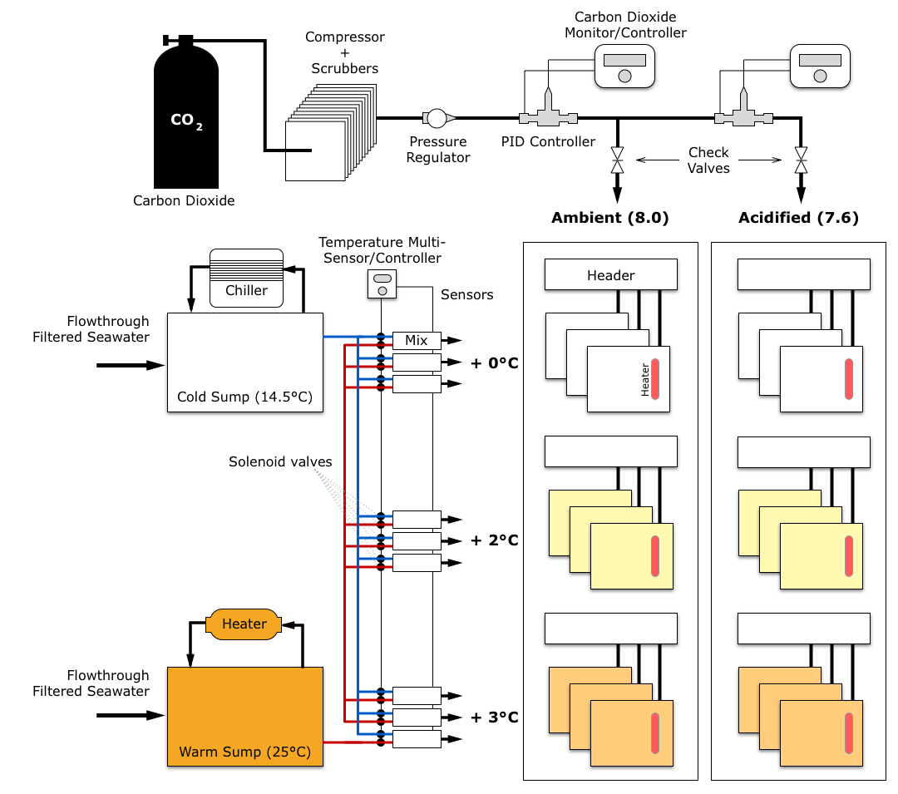

```{r, echo = FALSE, include = FALSE}
# Settings
knitr::opts_chunk$set(echo=FALSE, fig.height=6, fig.width=6, out.width='100%', comment="#>")

# options(knitr.kable.NA = '') # this will hide missing values in the kable table
```

```{r, include = FALSE}
# Load required libraries here
library(snipR)
snipR::refresh()
snipR::pkgs(
  tidyverse,
  readxl,
  survminer,
  emmeans,
  knitr,
  huxtable
)

# set pander table-layout options
library(pander)
panderOptions('table.alignment.default', function(df)
    ifelse(sapply(df, is.numeric), 'right', 'left'))
panderOptions('table.split.table', Inf)
panderOptions('big.mark', ",")
panderOptions('keep.trailing.zeros', TRUE)

library(pander)     # table output
library(kableExtra) # enhance kable with pipes

```

# Supplementary Material for Chapter 3


(ref:multisetup) Diagram of experimental setup used to control temperature and pH in flowthrough filtered seawater.

```{r multisetup, fig.cap = "(ref:multisetup)"}

```