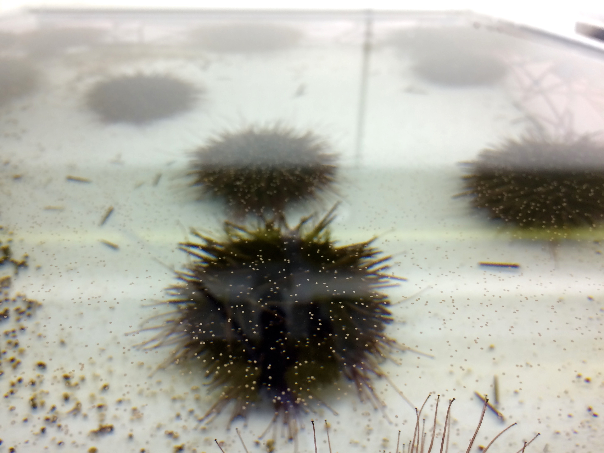
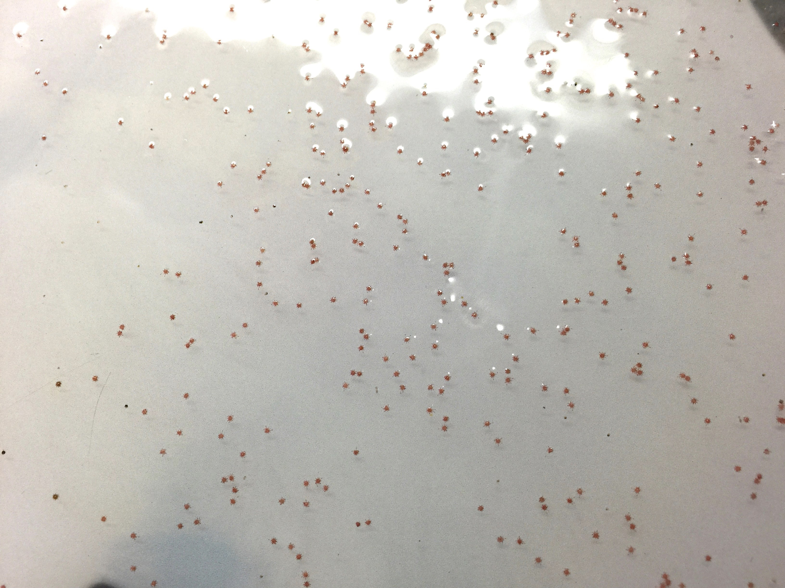
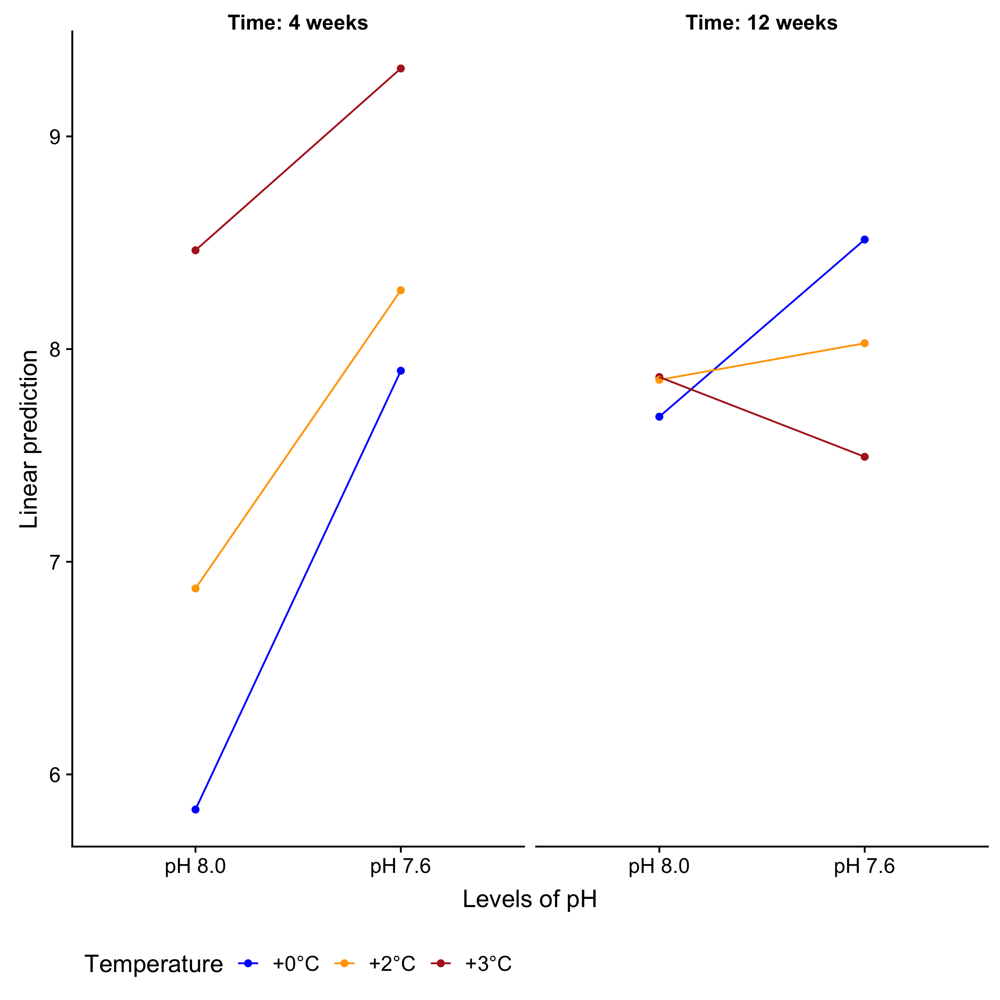

```{r, echo = FALSE, include = FALSE}
# Settings
knitr::opts_chunk$set(echo=FALSE, fig.height=6, fig.width=6, out.width='100%', comment="#>")

# options(knitr.kable.NA = '') # this will hide missing values in the kable table
```

```{r, include = FALSE}

library(knitr)
library(kableExtra) # enhance kable with pipes
library(tidyverse)
library(snipR)

```

# Supplementary Material for Chapter 3

```{r floateggs, fig.cap = "(ref:floateggs)", fig.pos="h"}

```

(ref:floateggs) Eggs of *H. erythrogramma*, floating near the surface of the tank. Mass spawning occurred in all treatments, spontaneously. As the eggs of *H. erythrogramma* are buoyant, they were not immediately flushed by the flowthrough system. It was not possible to determine which urchins spawned as the spawning events were not directly observed.  

```{r juvies, fig.cap = "(ref:juvies)", fig.pos="p"}

```

(ref:juvies) Juvenile *H. erythrogramma* observed settling on the lid of a treatment tank. Following spawning events, settling juveniles were observed on the tank surfaces of all treatments, providing evidence that at least one male and one female urchin spawned gametes during the mass spawning events. 


```{r respinteract, fig.cap = "(ref:respinteract)"}

```

(ref:respinteract) Interaction plots showing the effects of pH (8.0, 7.6) in three temperature treatments (+0 &deg;C, +2 &deg;C, +3 &deg;C) on metabolic rate at 4 weeks and 12 weeks of acclimation to conditions. 


```{r c3mranovaix, message=FALSE}
c3mranovaix <- readr::read_csv("input/ch_multistressor/c3mranovaix.csv")

kable(c3mranovaix, "latex", caption = "(ref:c3mranovaix)", booktabs = TRUE) %>%
  kable_styling(position = "center") %>%
  # kable_styling(latex_options = "hold_position") %>%
  kable_styling(full_width = T) %>%
  row_spec(c(0), bold = T)

```

(ref:c3mranovaix) Analysis of Variance (ANOVA) test on the effects of temperature or pH on the metabolic rate of *H. erythrogramma* after 4 weeks of incubation to elevated temperature ($+0$, $+2$, $+3^\circ C$) and decreased pH ($8.0$ , $7.6$). There was no significant interaction between temperature and pH, thus the analysis was repeated with the terms removed (see Chapter 3 Table /@ref(tab:c3mrcontrasts). Significant differences are indicated with asterisks. **: $p= <0.01$ 


```{r c3mrcontrasts}
load("output/ch_multistressor/respiration.RData")

#caption
# cp <- "P-values from \\emph{post hoc} Tukey's Honest Significant Difference test performed on the estimated marginal means of treatment group results, for comparisons of performance of metabolic rate between treatments at 4 weeks and 12 weeks of acclimation to increased temperature (+0 \\degree C, +2 \\degree C, +3 \\degree C) and decreased pH (8.0, 7.6). Significant differences were found between treatments at 4 weeks of acclimation, but not at 12 weeks."

as.data.frame(emmresp$contrasts) %>%
  mutate(sig = p_stars(p.value)) %>%
  kable(format = "latex", booktabs = TRUE, 
    digits = 3, caption = "(ref:c3mrcontrasts)") %>%
  kable_styling(font_size = 10) %>%
  group_rows(index = c("4 weeks" = 15, "12 weeks" = 15)) %>%
  footnote("***: p < 0.001; **: p < 0.01; *: p < 0.05; .: p < 0.1")
```

(ref:c3mrcontrasts) P-values from *post hoc* Tukey's Honest Significant Difference test performed on the estimated marginal means of treatment group results, for comparisons of performance of metabolic rate between treatments at 4 weeks and 12 weeks of acclimation to increased temperature (+0 &deg;C, +2 &deg;C, +3 &deg;C) and decreased pH (8.0, 7.6). Significant differences were found between treatments at 4 weeks of acclimation, but not at 12 weeks.

<!-- ```{r mrgroups} -->
<!-- load("output/ch_multistressor/respiration.RData") -->

<!-- as.data.frame(emmresp$contrasts) %>% -->
<!--   mutate(sig = p_stars(p.value)) %>% -->
<!--   # kable(booktabs = TRUE, digits = 3, caption = cp) %>% -->
<!--   kable(format = "latex", booktabs = TRUE, digits = 3, caption = cp) %>% -->
<!--   kable_styling(font_size = 10) %>% -->
<!--   group_rows(index = c("4 weeks" = 15, "12 weeks" = 15)) %>% -->
<!--   footnote("***: p < 0.001; **: p < 0.01; *: p < 0.05; .: p < 0.1") -->
<!-- ``` -->
