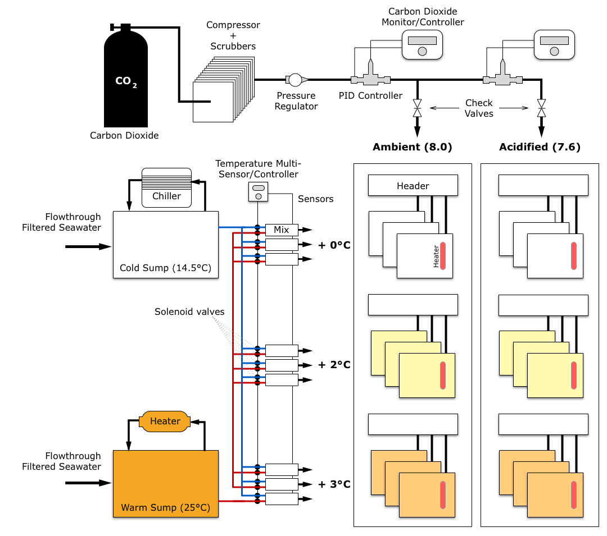

```{r, echo = FALSE, include = FALSE}
# Settings
knitr::opts_chunk$set(echo=FALSE, fig.height=6, fig.width=6, out.width='100%', comment="#>")

# options(knitr.kable.NA = '') # this will hide missing values in the kable table
```

```{r, include = FALSE}

library(kableExtra) # enhance kable with pipes

```

# Supplementary Material for Chapter 3

```{r multisetup, fig.cap = "(ref:multisetup)", fig.pos="h"}

```

(ref:multisetup) Diagram of experimental setup used to control both temperature (&deg;C) and pH ($pCO_2$) in flowthrough filtered seawater. Briefly, filtered seawater (20 $\mu m$) was stored in warm (25 &deg;C) and cold (14.5 &deg;C) sumps and mixed to target temperatures via solenoid valves controlled by custom software. At the same time,food-grade carbon dioxide ($CO_2$) was injected into $CO_2$-scrubbed air to the desired $ppm$ and bubbled vigorously into header tanks using 20 $cm$ ceramic diffusers.


```{r respinteract, fig.cap = "(ref:respinteract)"}
knitr::include_graphics("figs/ch_multistressor/resp_interaction.png")
```

(ref:respinteract) Interaction plots showing the effects of pH (8.0, 7.6) in three temperature treatments (+0 &deg;C, +2 &deg;C, +3 &deg;C) on metabolic rate at 4 weeks and 12 weeks of acclimation to conditions. 


```{r mrcontrasts}
load("output/ch_multistressor/respiration.RData")

#caption
cp <- "P-values from \\emph{post hoc} Tukey's Honest Significant Difference test performed on the estimated marginal means of treatment group results, for comparisons of performance of metabolic rate between treatments at 4 weeks and 12 weeks of acclimation to increased temperature (+0 \\degree C, +2 \\degree C, +3 \\degree C) and decreased pH (8.0, 7.6). Significant differences were found between treatments at 4 weeks of acclimation, but not at 12 weeks."

as.data.frame(emmresp$contrasts) %>%
  mutate(sig = p_stars(p.value)) %>%
  kable(format = "latex", booktabs = TRUE, digits = 3, caption = cp) %>%
  kable_styling(font_size = 10) %>%
  group_rows(index = c("4 weeks" = 15, "12 weeks" = 15)) %>%
  footnote("***: p < 0.001; **: p < 0.01; *: p < 0.05; .: p < 0.1")
```


