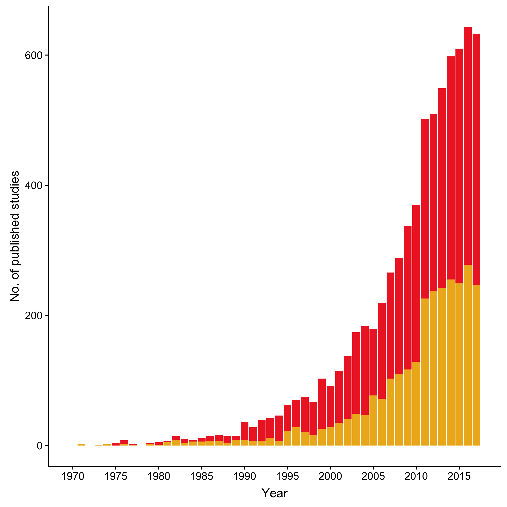

```{r setup, include=FALSE}
library(tufte)
# invalidate cache when the tufte version changes
knitr::opts_chunk$set(
  cache.extra = packageVersion('tufte'),
  comment = "#>",
  echo = FALSE)
knitr::opts_chunk$set(echo = FALSE, fig.height = 6, fig.width = 6, 
                      out.width = '100%', comment = "#>",
                      cache.extra = packageVersion('tufte'))
options(htmltools.dir.version = FALSE)
```


<!-- Because human-environmental interactions are so intertwined in the Anthropocene, anthropogenic activities continue to transform the earth's natural systems, where climate change is a driving force for many of the environmental impacts on ecosystems worldwide [@Hoegh-Guldberg2010; @Henson2017].  -->


<!-- In recent years, the term "Anthropocene" has been used increasingly within the broader academic body to define a new geological epoch of irreversible change, emphasising the global influence of human activity on the living world [e.g. @Crutzen2006; @Steffen2011; @Hughes2017; @Somero2017]. -->
<!-- Because human-environmental interactions are so intertwined in the Anthropocene, anthropogenic activities continue to transform the earth's natural systems, where climate change is a driving force for many of the environmental impacts on ecosystems worldwide [@Hoegh-Guldberg2010; @Henson2017].  -->


<!-- what about salinity? -->
<!-- and the onset of disease [@Burge2014]. -->


## From physiology to population-level consequences of climate change

<!-- While large-scale impacts are -->
<!-- An ongoing major challenge in the face  -->

Understanding the underlying mechanisms by which climate change is affecting biota is an area of increasing interest to marine ecophysiologists worldwide [@Dahlhoff2004; @Helmuth2005; @Chown2010; @Somero2017].
As anthropogenic activities continue to transform the ocean's natural systems, these changes will influence the marine biosphere across temporal and spatial scales, from organisms to whole ecosystems [@Munday2013; @Gattuso2015; @Howes2015].

<!-- Scientists recognise that there is a need to tease apart the direct effects of abiotic factors mechanistically to explain the broad impacts that are changing marine ecosystems worldwide. -->
Alterations in temperature [@Mann2017; @Wijffels2016], carbonate chemistry [@Caldeira2003; @Hoegh-Guldberg2017], oxygen concentration [@Schmidtko2017] and light availability [@Gattuso2006] have been documented with broad impacts on oceanic primary productivity [@Behrenfeld2016], trophic interactions [@Ullah2018], and species distributions [@GarciaMolinos2015; @Brown2016; @Sommer2018].

The challenge now is to accurately predict which species within ecosystems are most vulnerable to the risks associated with future ocean change [@Magozzi2015; @Sinclair2016].
This is not a trivial undertaking as organisms possess a wide range of physiological systems to maintain optimal function under variable environmental conditions, and some have the intrinsic physiological capacity to depress metabolism or restrict damage when exposed to extreme conditions [@Storey2004; @Hoffmann2011].


<!-- how climate-induced abiotic changes in the environment will influence biota across spatial scales, from organisms to whole ecosystems [@Munday2013, @Gattuso2015; @Howes2015]. -->

<!-- Biologists and ecologists are increasingly interested in the effects of changing abiotic conditions (e.g. temperature, light) on organisms and their interactions.  -->
<!-- Because biologists and ecologists are increasingly interested in the effects of changing abiotic conditions (e.g. temperature, light) on organisms and their interactions,  -->

Tolerance studies that measure physiological responses to changes in physical conditions -- within the context of ocean climate change -- are increasing tremendously, from $<10$ papers published per year before 1990, to approximately 250 papers published per year making up at least $42 \%$ of marine-related climate change publications between 2013 and 2017 (Figure 1).


```{r pcount, fig.cap = "Trends in the number of published marine climate change research studies indexed by Clarivate Web of Science from 1970 to 2017. Including reviews, over 7118 papers were published (red bars). Yellow bars show the proportion of those papers that collected or mentioned physiological data, amounting to 2766 publications. Data is extracted from a search of topics and abstracts using the keywords: ('climate\\*change' or 'environmental change' or 'climate\\*driven') AND (marine or ocean or sea or coastal or \\*tidal). To filter papers that use or mention physiological metrics, common keywords associated with physiological measures were added: (physiolog\\* or ecophysiolog\\* or 'evolutionary physiolog\\*' or \\*toleran\\* or metabolic or biomarker or respirat\\* or heat\\*shock). Note that the keywords used are not exhaustive and do not include many other common physiological terms, and are thus an underestimate the size of the dataset. Search was performed on 27 May 2018."}

```

Central to the outcomes of many of these studies have been the use of quantifiable physiological responses and biomarkers, such as growth and feeding rates [@Clements2018], metaboic performance [@White2013], immune response [@Pinsino2015], and molecular or gene expression [e.g. heat shock proteins, @Osovitz2005; @Tomanek2008] to assess organismal responses under future oceanic conditions.
These techniques allow scientists to obtain snapshots of responses to changes in abiotic conditions across temporal and spactial scales and quantify tolerances to environmental variation [e.g. @Sunday2012].
Combined with advances in remote sensing and in-situ measurements of environmental conditions [@Chmura2018], researchers now have the means to explore patterns of resilience in individuals and populations within the context of their immediate environments.


<!-- ## Climate change -->

<!-- It is now well-understood that the increased concentration of atmospheric carbon dioxide ($pCO_2$) from human activity contributes to rising temperatures globally [@IPCC2014]. -->
<!-- In addition, the ocean acts as a climate "buffer" that absorbs $25 \%$ to $40 \%$ of $CO_2$ emissions and $90 \%$ of heat, changing its chemistry and physics [@Fletcher2006; @IPCC2014; @Gattuso2015]. -->
<!-- As a result, alterations in temperature [@Mann2017; @Wijffels2016], carbonate chemistry [@Caldeira2003; @Hoegh-Guldberg2017], oxygen concentration [@Schmidtko2017] and light availability [@Gattuso2006] have been documented worldwide, with broad impacts on oceanic primary productivity [@Behrenfeld2016], trophic interactions [@Ullah2018], and species distributions [@GarciaMolinos2015; @Brown2016; @Sommer2018]. -->

<!-- Under "business-as-usual" projections, the consensus view is that global $pCO_2$ levels will continue to increase from the current $410\ ppm$ (NOAA-ESRL, accessed 30 May, 2018) to $985\ ppm$, and average global temperatures will likely exceed $+2 ^{\circ}C$, relative to 1986--2005, by the end of this century [RCP8.5 scenario, @Riahi2011; @IPCC2014]. -->
<!-- It is highly likely that these changes will further amplify current impacts on both our natural and human ecosystems globally [@IPCC2013]. -->


<!-- COPYPASTA A fundamental tenet of physiological ecology is that processes that occur at the level of the organism, cell and genome can have cascading effects on the distribution, abundance and fitness of organisms at scales ranging from microhabitats to continents and oceans (Magnuson, 1991; Pörtner, 2002; Somero, 2005). -->


<!-- COPYPASTA To date, however, most studies investigating the causal mechanisms underpinning species vulnerability to warming have focused on physiological traits in isolation (e.g., Stillman & Somero, 2000; Po€rtner & Knust, 2007; Calosi et al., 2008; Bartolini et al., 2013). -->


<!-- The purpose of this General Introduction is to focus on the use of physiological metrics to assess the impact of climate change on a sea urchin species... -->

<!-- ## Sydney Harbour -->


<!-- Here we explore the approaches in -->
<!-- Advances in remote sensing, biologging and extensive ground-based measurements of environmental conditions  also potentially allow us to integrate spatial and temporal patterns of the physical environment to these studies [@Chmura2018].  -->
<!-- These techniques allow researchers to test physiological and behavioural adjustments (i.e. plasticity) on a large number of organisms relatively quickly and determine ongoing and future resilience to climate change at scales ranging from species to ecosystems [e.g. @Harris2018].  -->

<!-- Once these physiological traits are understood, we can then begin to make predictions of how the same organisms will respond to future anthropogenic change. -->

<!-- ## Trends in the use of physiological response variables  -->
## Metabolic rate -- the most fundamental physiological measure

Metabolic rate is an important indicator of physiological condition [@Brown2004] and a multitude of techniques have been developed to measure and analyse metabolic rates using respirometry [@Lighton2008; @Chabot2016; @Svendsen2016].
Patterns in metabolic rate responses can provide deep insights to the physiological condition of an organism, since metabolism moderates almost all other biological activities [@Brown2004], from individual traits such as growth and feeding rate [@Kiorboe2014], to ecological interactions [@Seibel2007], to the dynamics of communities [@Barneche2014], and even whole ecosystems [@Brown2004]. 
This is because as a fundamental biological trait, metabolic rate is sensitive to changes in the biophysical environment, and changes in metabolism can be inferred to result in biological and ecological consequences. 

For these reasons, scientists, especially physiologists, have long recognised the importance of measuring metabolic rate to assess performance in marine organisms. 
Quantifying metabolic rate is part of an increasing number of studies where it is the main topic of investigation [@Carey2016], and also where it is only one metric of many being investigated (Kaniewska et al., 2012). 
<!-- For example, metabolic depression is a known stress response which often highlights profound changes to an organism's internal environment as it responds to unfavourable environmental conditions to maximise survival [@Guppy1999; @Storey2004]. -->
<!-- Conversely, an increase in metabolic rate is often associated with increased energetic demands associated with increased biological activity [@Hochachka2002]. -->
It is the most commonly reported response variable when physiological measures are used in marine-related climate change publications, where it is mentioned in up to $19.8 \%$ of all reported response variables, in $16\%$ of 2,766 articles published from $1970$ to $2017$ (Figure 2).

<!-- Among all the different physiological metrics used, metabolic rate is the most commonly reported response variable, making up to $19.8 \%$ of all reported response variables from $16 \%$ of marine-focused, climate change research publications (Figure 2). -->

```{r revpie, fig.cap = "Common physiological response variables reported in research articles published from 1970 -- 2017 and indexed by Clarivate Web of Science. Papers may report more than one response variable, thus the percentage values are based on the proportion of all reported response variables ($n = 2239$), not the number of publications selected ($n = 2766$). Numbers are tallied based on specific keywords used to describe experimental results and outcomes (e.g. 'survivorship' or 'survival rate' instead of 'survival'). Less common or species-specific response variables (e.g. coelomocyte counts in sea urchins) are not included. See Appendix XX for search terms used. Search was performed on 27 July 2018."}
knitr::include_graphics("../figs/ch_intro/counts.png")
```

## Understanding other physiological responses through metabolic rate
- A comprehensive understanding of the metabolic limits of an organism to environmental stress provides a stepping stone to the interpretation of many other physiological rsponses.

## Using bioenergetics as an integrative framework for multiple physiological responses

<!-- Together with metabolic rate, many studies are starting to  -->

## The pivotal role of temperature on physiological activity

- temperature modulates most physiological responses
- talk about the large scale effects (save specifics for urchin secion below)
<!-- Many studies have highlighted the central role of temperature on.... -->

## Ocean acidification and its combined effects with temperature
<!-- Among the different metrics obtained from metabolic rate measurements are  -->
- the reality is that organisms face a multitude of changes
- the direct effect of increased CO2 is acidification
- known effects (again, large scale, save specifics for urchin section below)


<!-- Survival and mortality - surprisingly few mentions in the literature. Normally not recorded, but can significantly influence the interpretation of results. -->

<!-- to determine ongoing and future resilence to climate change  -->


<!-- These bioindicators often represent physiological processes that adjust dynamically in response to environmental conditions, researchers use these measurements to determine the condition of the organisms under various levels of stress [e.g. @Madeira2018; @Hansen2017]. -->


<!-- A majority of these studies are on invertebrates (##\%). -->
 

<!-- Understanding the mechanisms by which environmental variation impacts organisms is of increasing interest to climate change biologists.-->
<!-- Predicting whether species or populations are under threat from future anthropogenic change is currently a fundamental goal for many climate change biologists [@Munday2013]. -->
<!-- However, it remains uncertain if we can reliably predict the trajectory of biological responses to environmental change over time due to the complexities of quantifying organismal responses under future conditions [@Munday2013; @Huey2012]. -->

<!-- Temperature and pH are most studied. -->


<!-- Importantly, ecosystems can be influenced by the above abiotic stressors simultaneously [@Byrne2013; @Boyd2017; @Gunderson2017]. -->
<!-- , all of which may interact to influence their structures and functions in profound ways. -->


<!-- Part of the reason for these gaps in our knowledge are due to the complexities quantify organismal responses under future conditions. -->
 <!-- of designing appropriate laboratory experiments to -->
<!-- To effectively diagnose the consequences of environmental change, scientists need to conduct stress-response experiments that incorporate ecologically realistic conditions involving multiple drivers and their interactive effects [@Byrne2013; @Boyd2017; @Gunderson2017]. -->
<!-- Species differ widely in terms of the risks they face from environmental stress since nearly all phenotypic traits demonstrate some level of variation in the environment [i.e. phenotypic plasticity, @Murren2015].  -->


<!-- Additionally, there is an increasing need to rely on multidisciplinary and integrative techniques to separate species that are most threatened by climate change, as we begin to discover and characterise phenotypic and transgenerational resilience to those changes [@Byrne2013; @Munday2013; @Sunday2014]. -->

<!-- Understanding the mechanisms by which climate change impacts organisms in their habitats is of increasing interest to biologists and ecologists [@Dahlhoff2004; @Helmuth2005; @Chown2010; @Somero2017]. -->
<!-- There is now a large body of evidence showing synergestic or antagonistic interactions between climate change stressors and that they do not act independently [@Boyd2017; @Byrne2013; @Przeslawski2015]. -->
<!-- From a management perspective, being able to provide metrics of stress levels under field conditions is beneficial for decision makers -->

<!-- Many studies document shifts in species distribution patterns, etc... -->


<!-- Until recently, en- vironmental physiologists have relied primarily on carefully controlled laboratory experiments in which they manipulate a single environmental variable in order to assess organismal performance under changing conditions (Todgham & Stillman 2013). However, investigators are increasingly realizing that single-stressor experiments may not be appropriate in assessing the effects of climate change in marine habitats (Wernberg et al. 2012). Experimental marine biologists now often incor- porate two or more environmental factors into their experimental designs, with the hope of gener- ating more realistic inferences about the effects of global change -->

<!-- - Detecting the effects of climate change from a physiological context - why do it? People, especially decision makers, like to see numbers to prioritise actions. Strong correlation between abiotic factors and responses (most of the time). -->
<!-- - **On the growing importance of understanding underlying mechanisms to explain large-scale ecological patterns**: We need to understand that global patterns may reflect correlation, but not causation. Understanding the mechanisms that cause changes in behaviour is important in verifying areas of importance for further research, and not chase the wrong tree? -->
<!-- - There are currently ## papers studying climate change effects, and ##\% used physiological measurements of some kind. A majority of these studies are on invertebrates (##%). Year over year, the use of physiological metrics to quantify responses increases exponentially (Figure #). Metabolic rate was the most popular physiological metric (### papers), followed by the quantification of metabolic enzymes (### papers). Most papers look at multiple physiological traits at once (#\%). A few have integrated multiple physiological metrics into models for better synthesis (e.g. scope for growth, dynamic energy budget, oxygen-limitation theory). -->
<!-- - Bringing it all together: bioenergetics as an integrated ecophysiological approach - scope for growth model to better model physiological results -- especially if multiple metrics contradict each other, an overall model will be easier to understand whether the effects are positive, or not. -->

## The Echinoidea - sea urchins bioindicators of climate change effects

- Studied since the 19th century as model organisms in developmental biology, sea urchins 
- Why echinoderms? Invertebrates - easy to work with. Large body of research on echinoderm biology, so we know the baseline.
check Chiarelli 2014
- Effect of ocean warming - Table #
- Effect of ocean acidification - Table #
- Multistressor impacts - Table # (note, all refer to same table!)
- Transgenerational effects - Meta-analysis? Check


## Back to metabolic rate - emphasising the need for reproducible analyses

Popularity of respirometry among scientists not familiar with physiology - obvious signs in the literature (e.g. no stirring, confusion in the use of units - maybe - no background corrections, no description of analytical method or selection criteria)

- At the very least, if experiments are not realistically reproducible, their analyses should be. This makes studies more comparable if analytical approaches are similar.
- Are respirometry studies reproducible? Not really.Out of ## papers that performed respirolmetry of some kind, a very low percentage (## \%) actually published their data. When we assessed methodology, many show signs of subjectivity (i.e. arbitrarily selecting data) when determining rates: ## studies mentioned the metric of interest, but did not define how it was measured; ## studies defined the measurement technique, but were not specific (i.e. "we selected stable regions of the data"" instead of "we used method xx to select stable regions of the data").
- Reliable methods of measuring biological rates. Focus on metabolic rate -- why is it important? Show how different measures of the same rate can have a high margin of error (cite papers - probably 40-50\% margin of error).
- Current solutions, identify the issue with these current solutions. Talk about data collection, data storage and data wrangling.
- Reiterate the need for reproducible analyses.

## Aims and outline

This thesis examines, first, the effects of warming on the physiology of *Heliocidaris erythrogramma* to reaffirm the thermal limits of the sea urchin over a long-term period. It then explores the multistressor effects of both ocean warming and acidification on the...

### Sydney Harbour lies in a hotspot of ocean warming


- Australia as a hotspot for environmental change
- Sydney Harbour
- *Heliocidaris erythrogramma* -- study organism
- Short-term studies
- Long-term studies

### Study gaps
- Future shock: most studies are acute. Organisms are not provided the opportunity to physiologically acclimate to their surroundings, and are instead placed abruptly into future conditions. (However, acute studies can still be relevant when investigating climate extremes).
- Natural variation: most studies use constant conditions. In reality, varition occurs on the temporal scale of days to months to years. Seasonality may affect interpretation of results as well. E.g. at constant temperature, organisms do not get the cue to prepare for spawning, so they don't have to allocate resources for reproduction. This is critical information -- for urchins, they allocate > 80\% of their feeding energetics to reproduction, so
- Reproducibility. Briefly mention this (to open up for section below). Many studies are not realistically reproducible. How do we deal with this?
- Aims
<!-- We have reviewed merely a portion of the enormous body of research on physiological processes that are sensitive to variations in climate. Talk about what is known. -->

<!-- However, the complexity of environmental interactions renders it difficult to extrapolate from studies of individuals and populations to the community and ecosystem level. We do not, for example,  have a clear understanding of the roles of short-term versus long-term environmental stochasticity and population-intrinsic processes in community dynamics and stability76,78. Currently, the most relevant physical and temporal scales of ecological investigation are local and short-term (less than three decades). In contrast, climatology generally encompasses much larger spatial and temporal scales. As a consequence, it remains difficult to link population and community-level dynamics to the global-scale studies of atmospheric and oceanic processes23,79,80. -->

<!-- ## References -->
<!-- An increase of temperature in an ectotherm system has two major effects at the molecular level: firstly, it will result in an increase in the proportion of molecules possessing sufficient kinetic energy to achieve the activation level for any given reaction, and secondly it will influence the equilibrium constant of reactions, especially those involving weak chemical bonds Ž Hochachka, 1991 . . Q 10 values for individual biochemical functions can fall anywhere from one through to very high vales, although the Q 10 for purely physical processes such as diffusion is typically around 1.5 or lower. Many studies however report Q 10 values in the range 2–3 for whole animal physiological processes under normal conditions Ž Clarke, 1983; Clarke and Johnston, 1999 . . The maintenance of whole organism Q 10 values within this range as a result of evolutionary adjustment allows for the integration of enzyme-mediated biochemical reactions with physical processes which are essential to physiology Ž Hochachka, 1991 . . -->

