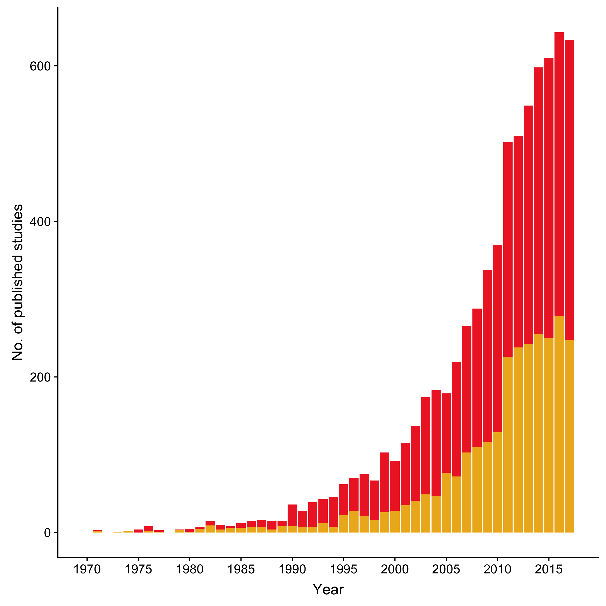
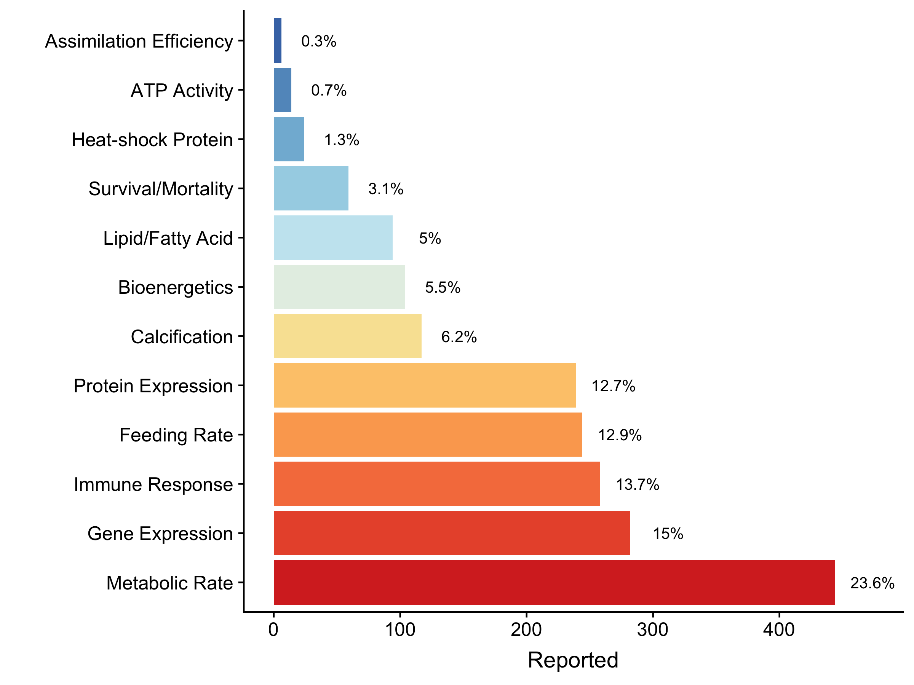

--- 
author: "Januar Harianto"
site: bookdown::bookdown_site
documentclass: memoir
classoption: oneside, 11pt, a4paper
bibliography: [book.bib, packages.bib, bibliography.bib]
biblio-style: apalike
link-citations: yes
always_allow_html: yes
# Fonts (these are all paid fonts):
mainfont: Minion Pro
sansfont: Myriad Pro
mathfont: Minion Pro
---
<!-- \OnehalfSpacing -->

```{r include=FALSE}
knitr::opts_chunk$set(echo = FALSE, fig.height = 6, fig.width = 6, 
                      out.width = '100%', comment = "#>")
# automatically create a bib database for R packages
# knitr::write_bib(c(
#   .packages(), 'bookdown', 'knitr', 'rmarkdown'
# ), 'packages.bib')
```

# General Introduction

## The consequences of climate change

Understanding the underlying mechanisms by which climate change is affecting marine organisms is an area of increasing concern to marine ecophysiologists worldwide [@Dahlhoff2004; @Helmuth2005; @Chown2010; @Somero2017].
As anthropogenic activities transform the ocean's natural systems, their impacts will continue to cascade through the marine biosphere across temporal and spatial scales, from organisms to whole ecosystems [@Munday2013; @Gattuso2015].

It is now known that the increased concentration of atmospheric carbon dioxide ($pCO_2$) from human activity contributes to rising temperatures globally [@IPCC2014], and the ocean acts as a climate buffer that absorbs 25\% to 40\% of $CO_2$ emissions and 90\% of heat, changing its chemistry and physics [@Fletcher2006; @IPCC2014; @Gattuso2015]. 
Consequently, alterations in temperature [@Mann2017; @Wijffels2016], carbonate chemistry [@Caldeira2003; @Hoegh-Guldberg2017], oxygen concentration [@Schmidtko2017; @Chu2017] and light availability [@Gattuso2006] are causing wide-ranging impacts on oceanic primary productivity [@Behrenfeld2016], trophic interactions [@Ullah2018], and species distributions [@Molinos2015; @Brown2016; @Sommer2018].

Without mitigation measures, global $pCO_2$ levels will continue to increase from the current $410 ppm$ to $985 ppm$, and average global temperatures will likely exceed $+2^{\circ}C$ relative to 1986--2005 by the end of this century [RCP8.5 scenario, @Riahi2011; @IPCC2014]. 
These changes are expected to amplify the ecological impacts currently observed on both our natural and human ecosystems globally [@Howes2015]. 

## Predicting resilience through physiology
 
While the broad consequences of ocean change continue to be documented in the literature, the challenge now is to tease apart the underlying casual mechanisms that drive those changes to understand the linkages between ecosystem effects and the processes that occur at the level of organism and cell [@Portner2002; @Somero2005; @Somero2012]. 
Climate manipulation experiments are valuable tools for understanding these links.
By subjecting organisms to current and future scenarios of ocean change, we can predict, based on experimental evidence, which species within ecosystems are most vulnerable [@Munday2013; @Sinclair2016; @Verberk2016]. 
However, doing so is not a trivial undertaking, owing to the diverse and multi-stressor nature of environmental stress [@Byrne2013; @Boyd2015].
In addition, it is often difficult to deduce the adaptive potential of organisms from physiological responses due to the intrinsic phenotypic plasticity of individuals as they modify their growth, development and behaviour dynamically to environmental cues [@Forsman2015; @Murren2015].

Nevertheless, studies that measure or physiological responses to changes in physical conditions — within the context of ocean climate change — provide critical insights to the tolerance or organisms to environmental stress. 
These publications are increasing tremendously, from <10 papers published per year before 1990, to approximately 250 papers published per year making up at least 42\% of marine-related climate change publications between 2013 and 2017 (Figure 1).
	
```{r pcount, fig.cap = "(ref:pcount)", fig.pos = "p"}

```

(ref:pcount) Trends in the number of published marine climate change research studies using metrics related to physiological traits, indexed by Clarivate Web of Science from 1970 to 2017. Including reviews, over 7,118 papers were published (red bars). Yellow bars show the proportion of those papers that collected or mentioned physiological metrics or biomarkers, amounting to 2,766 publications. Data is extracted from a search of topics and abstracts using the keywords: ('climate\*change' or 'environmental change' or 'climate\*driven') AND (marine or ocean or sea or coastal or \*tidal). To filter papers that use or mention physiological metrics, common keywords associated with physiological measures were added: (physiolog\* or ecophysiolog\* or 'evolutionary physiolog\*' or \*toleran\* or metabolic or biomarker or respirat\* or heat\*shock). Note that the keywords used are not exhaustive and do not include many other common physiological terms, and are thus an underestimate the size of the dataset. Search was performed on 27 May 2018.

Central to the outcomes of many of these studies has been the use of physiological traits and molecular or genetic biomarkers to quantify responses to current and future scenarios of environmental stress, such as growth and feeding rates [@Clements2018], metaboic performance [@White2013], immune response [@Pinsino2015], and molecular/gene expression [e.g. heat shock proteins/genes, @Osovitz2005; @Tomanek2008]. 
As the data can be measured at specific time points, researchers are able to obtain snapshots of responses to changes in abiotic conditions across temporal and spatial scales [e.g. @Sunday2012].

In particular, protein and genetic biomarkers that are sensitive to stress are increasingly popular as they yield new insights to the influence of abiotic conditions on cellular physiology [@Helmuth2005; @Stillman2015].
For example, in echinoderms, which are the focus of this thesis, many studies have used heat shock protein [HSP, @Lindquist1986] expression to quantify tolerance to warming, acidification and pollution [@Osovitz2005; @Pinsino2008; @ODonnell2009; @Dong2011; @Nguyen2013; @Harianto2018].
Molecular and genomic techniques provide an unprecedented opportunity for marine scientists to collect multiple biomarkers to characterise the effects of multiple stressors in natural environments, where collecting traditional physiological responses such as feeding rates and metabolic rates may prove less efficient, or even logisitcally challenging.
Combined with advances in remote sensing and in-situ measurements of environmental conditions [e.g. @Smit2013; @Goela2016; @King2017; @Mann2017], we now have the means to explore patterns of resilience in individuals and populations realistically within the context of their immediate environments [e.g. @Dong2011].

<!-- Increasing in popularity are  -->
<!-- For echinoderms, which are the focus of this thesis, many studies have used heat shock proteins (HSPs) to quantify physiological stress [] -->


<!-- used HSP expression as a measure to assess physiological stress. NB to integrate a suite of physiological traits as aseen in recent trands in trait-based analyses. -->

<!-- ## Trends in physiological metrics used in climate manipulation studies -->

## Metabolic rate -- the most fundamental bioindicator

Physiologists have long recognised the importance of metabolic rate response to assess tolerance in marine organisms. This is because as a fundamental biological trait, metabolic rate is sensitive to changes in the biophysical environment, and changes in metabolism can be inferred to result in biological and ecological consequences [@Somero2017]. Quantifying metabolic rate is part of an increasing number of studies where it is the main topic of investigation [e.g. @Carey2016], and also where it is only one metric of many being investigated [e.g. @Magozzi2015]. It is the most commonly reported response variable when physiological measures are used in marine-related climate change publications, appearing in 16\% of publications and consisting of at least 19.8\% of all reported response variables from 1970 to 2017 (Figure 2). 

```{r pgroups, fig.cap = "(ref:pgroups)", fig.pos = "p"}

```

(ref:pgroups) Common physiological response variables reported in research articles published from 1970 -- 2017 and indexed by Clarivate Web of Science. Papers may report more than one response variable, thus the percentage values are based on the proportion of all reported response variables ($n =$ 2,239), not the number of publications selected ($n$ = 2,766). Numbers are tallied based on specific keywords used to describe experimental results and outcomes (e.g. 'survivorship' or 'survival rate' instead of 'survival'). Less common or species-specific response variables (e.g. coelomocyte counts in sea urchins) are not included. See Appendix XX for search terms used. Search was performed on 27 July 2018.

The most accepted method of examining metabolic rate is through respirometry.
The methodological approaches to measuring respirometry are broad, but most protocols measure a decrease in oxygen concentration from a well-mixed, hermetically sealed chamber of known volume [@Lighton2008].
It is important to recognise that modern technologies have allowed for new methods for determining changes in oxygen over time, and has driven the collection of increasingly large datasets with multiple experimental variables and sample sizes.
However, there is still considerable obscurity in the manner in which metabolic rate data are extracted from these datasets.
In most cases, respirometry data is noisy, so only certain segments of the data are analysed [refs], but few studies report how appropriate data sections are selected for analysis, or provide the raw data publicly so that their analyses are reproducible [ref].
Thus, recent research have highlighted the need to consolidate and standardise both the measurement and reporting of this popular metric for consistent and comparable data reporting [e.g. @Svendsen2016; @Chabot2016; @Olito2017].
<!-- Perhaps the greatest challenge in analysing respirometry for metabolic rate measurements is in the selection of appropriate data sections for analysis. -->
<!-- In most cases, respirometry data is noisy, as is the nature of biological data, and it is rare to find published studies that provide the specific methods used to handle noisy data or the raw data itself. -->
<!-- This needs to be addresses as metabolic rate measurements become more popular and advances in technology allow for cost-effective methods of measuring respirometry. -->
<!-- While metabolic rate has been measured in response to a variety of environmental stressors, it is influenced greatly by temperature and body size, and the relationships between the two continue to be an area of active research [@West1997; @Carey2014]. -->
Regardless, patterns in metabolic rate responses can provide deep insights to the physiological condition of an organism, since metabolism moderates almost all other biological activities [@Brown2004], from individual traits such as growth and feeding rate [@Kiorboe2014], to ecological interactions [@Seibel2007], to the dynamics of communities [@Barneche2014], and even whole ecosystems [@Brown2004].

When stressed, most organisms present either elevated or depressed metabolic rates as they divert resources to maintain physiological balance.
<!-- These responses have their pros and cons. -->
Increased metabolism may divert energy away from essential functions such as growth and reproduction and can therefore reduce the fitness of the organism [refs]. 
Alternatively, it could also mean that the organism's aerobic scope has been increased for it to grow or reproduce [@Portner2006].
On the other hand, depressed metabolism, or metabolic depression, may be a means to conserve energy commonly expressed during hibernation, topor, aestivation or diapause [@Storey2004]. However it can also be a result of insufficient capacity for energy delivery due to either insufficient food or oxygen availability, which ultimately lead to lethal responses [@Bozinovic2015; @Lefevre2016].

Thus, it is important to understand the context behind metabolic rate responses beyond oxygen consumption rates since physiological trade-offs may exist in ways that cannot be assessed by metabolic rate data alone.
Assessing the sensitivity of metabolism to stressors should be accompanied by other measures of physiological function (i.e. feeding/excretion rates, reproductive capacity, etc.).
Such an integrative view of the challenges of climate change on physiological responses may be helpful to improve our understanding of the impacts presented by climate change, in ways that would be impossible to achieve if each of these traits were to be considered in isolation.


<!-- Current methods to analyse respirometry data ..... add paragraph. -->

<!-- ### Protein and gene expression -->

<!-- These bioindicators are increasingly used to determine resilience and energy metabolism from enzyme activitiy and the expression of genes specific to events e.g. thermal stress. -->

<!-- Talk about HSPs here. -->

## Survival

A common verdict from studies of climate change effects on ecosystem biodiversity is that there will be major shifts in the distribution of life on Earth driven by migration, adaptation, and extinction [@Verges2014; @Molinos2015; @Pecl2017; @Ramirez2017; @Hughes2017; @Sommer2018].
Despite the scale of these pertubations, climate manipulation studies to date have mostly focused on behavioural and physiological responses to stressors, while little is still understood about how they directly influence the persistence of species in their habitats. 

Survival analysis is one key metric that allows us to formally examine the relationships among environmental variables, specimen attributes and survival rates [refs].
This is unlike survival or mortality rates, which is commonly reported in some experiments investingating the effects of abiotic stressors on newly spawned invertebrates [refs]. 
<!-- The restricted ability of fauna to survive abiotic changes in their  -->
Most studies to date do not investigate survival metrics of any kind, with just 54 publications since 1981 that analysed survivorship metrics from experimental data in marine climate change research (See Appendix).
This does not infer that many of those papers need to do so, as not all studies subject their specimens to experimental conditions that are lethal. In fact, some papers have specifically reported no mortality or the loss of a few specimens during the experiment [e.g. @Dupont2013; @Zhang2015; @Carey2016].

Still, in recent years a significant effort has been put into conducting experiments that span months to years to understand more recent, persistent responses to climate change that cannot be observed in acute stress-response studies [e.g. @Suckling2015; @Morley2016; @Harianto2018].
Importantly, we need to document survival rates such that we are able to characterise survival as a function of environmental and physiological variables [e.g. @Anthony2007].
This will greatly assist in enhancing our ability to predict the consequences due to altered physiological responses to changing environmental conditions.

<!-- even though it is a key metric that can potentially influence experimental outcomes.  -->
<!-- A search on Web of Science yielded 54 publications since 1981 which analysed survival metrics from experimental data, a very small ($\sim 2\%$) proportion of the total published literature. -->

## Key anthropogenic drivers of marine physiological function

### Increased temperature
<!-- check harley 2006 -->

Temperature is probably the most important environmental factor affecting the physiology of organisms [@Portner2002; @Brown2004]. 
Affecting virtually all levels of biological organisation, it forms the basis of biochemical adaptation since it physically modulates the rate of chemical reactions [@Hochachka2002; @Schulte2015; @Somero2017]. 
<!-- As the principle stress factor of climate change, temperature is a key component of marine biodiversity (Huey and Kingsolver 1989; Brown et al. 2004; Sunday et al. 2012; Poloczanska et al. 2016).  -->
Numerous studies have documented how temperature drives shifts in biogeographical distributions and phenology globally [@Brown2016; @Goldenberg2017; @Pecl2017]. 
General observations include poleward shifts in distribution, reductions in overall body sizes and shifts in metabolic limits [@Verges2014; @Deutsch2015; @Pecl2017].
However, not every species have responded as predicted, with some displaying signs of resilience (e.g. Sunday et al., 2015). 
In addition, there remains very little data on the biological responses of a vast majority of marine animals to increased temperature.
This is partly due to a lack of information regarding the spatial and temporal details of current environmental conditions in marine environments, making it difficult to correlate organismal responses with their respective habitats [@Johnston2008].

The effects of global warming on the ocean are also not homogeneous. For example, subtropical western boundary currents are warming 2 to 3 times faster than the global average [@Wu2012].
In Australia, the strengthening of the East Australian Current which carries tropical water south along the continent has resulted in warming at almost 4 times the global average rate [@Ridgway2007] and will continue to do so, with predictions of warming of up to $+6 ^{\circ}C$ above the pre-industrial value by the end of the century [@Lenton2015].
Compounding to the issue is the mounting evidence that suggests that major impacts will be driven by extreme weather events that could happen at the present moment [@Katz1992; @Jentsch2007; @Thompson2013; @Mann2017; @King2017; @Leung2017]. 
These events are random and, by definition, rare, but appear to be increasing in frequency [@Katz1992; @Mann2017; @King2017].
So far, we have a poor understanding of how anthropogenic change influences extreme weather events, yet many marine organisms are already living close to their thermal limits [@Angilletta2002; @Portner2010]. 
The biological impacts of these events vary by taxa and several studies show marked changes in physiological responses, which are sometimes catastrophic [e.g. @Leung2017; @Hughes2017], highlighting the critical need to understand long-term stress responses in climate hotspots and how extreme events may further impact these responses to abiotic stress.

<!-- though advances in satellite sensing and in-situ data logging have recently become cost-effective methods to capture environmental . -->

In most cases, the performance of an organism due to temperature will depend greatly on the thermal sensitivity of the animal [@Kordas2011; @Sinclair2016]. 
For ectotherms, increasing temperature is directly associated with an increase in basal metabolic rate and the rate at which stored energy is used [@Hochachka2002; @Brown2004; @Dillon2010; @Somero2012].
Metabolic rates have already increased worldwide in the past three decades due to ocean warming, especially in tropical and north temperate organisms [@Dillon2010]. 
Temperature controls growth and reproductive processes like gonad development [e.g. urchins, @Delorme2016] and sex determination [e.g. sea turtles, @Tomillo2015].
All of these changes will have ecological and physiological impacts; increased metabolism in affected ectotherms will result in a greater need for food to maintain physiological function, thus causing increased foraging or hunting [e.g. @Verges2016]. In turn, trade-offs in energetics may alter the allocation of resources needed for reproduction [e.g. @Uthicke2014; @Delorme2016].
 Understanding the fundamental mechanisms behind temperature’s effects on organism physiology will help improve predictions of physiological tolerance to environmental stress and better understand the impacts species-level changes such as these can have on the world's marine ecosystems.


### Increased carbon dioxide concentration, *pCO~2~*

A pervasive effect of rising $pCO_2$ levels in the oceans is the chemical alteration of the carbonate system of seawater from ocean acidification (OA), which causes a general decline of surface ocean pH [@IPCC2013]. 
By now, a considerable body of data exists on the effect of OA on marine organisms, but there is also substantial interest in predicting the extent to which organisms will be able to respond or adapt to changes in seawater chemistry and other abiotic factors [e.g. @Hendriks2015; @Popova2016].
OA influences a wide range of basic physiological functions in organisms such as membrane transport [e.g. @Moulin2015], photosynthesis [e.g. @Gao2010], growth [e.g. @Pistevos2015], reproduction [e.g. @Boulais2017] and calcification [e.g. @Thomsen2015]. 
In particular, reduced pH will challenge the resilience of marine calcifiers [@Cyronak2016] where reduced rates of calcification (or increased dissolution) affects the growth and maintenance of both larval and adult stages of the life cycle, and is already well-documented in corals [@Hoegh-Guldberg2007], bivalves [@Waldbusser2015], echinoderms [@Wolfe2013] and planktonic calcifiers [e.g. coccolithophores, @Riebesell2017].
<!-- For those animals, experimental studies have generally showed negative effects of OA, although results become highly variable when other abiotic stressors such as increased temperature come into play [refs]. -->

Importantly, OA affects metabolism because of its effect upon biochemical pathways, resulting in altered metabolic costs to maintain physiological homeostasis [@Melzner2009; @Hendriks2015].
Thus, in some species, increased pH is accompanied by elevated metabolic rate responses due to the substantially increased energetic costs of maintaining calcium carbonate skeletons [e.g. Stumpp2011; @Calosi2013] or to preserve acid-base balance [e.g. Catarino2012; @Collard2013].
However, in other organisms or under combined effects with other stressors, OA may have the opposite effect and cause metabolic depression, because of disruptions in metabolic pathways [e.g. @Anestis2007] or trade-offs in energy allocation to conserve energy [e.g. @Pan2015].
<!-- Determining the specific cause of OA on organismal performance therefore requires an integration of metabolic performance and the plasticity of  -->
If the impact is severe, acidification could further reduce an organism's tolerances to other environmental stressors such as temperature [e.g. @Ko2014], salinity [e.g. @Parker2017a] and pollution [e.g. @Zeng2015].

So far, our understanding of OA-induced responses are based mostly on experimental studies which expose organisms to constant pH or $pCO_2$ conditions over time [@Gunderson2016]. 
Constant pH may be an appropriate estimate for open ocean systems, coastal regions are a lot more complex, both biogeochemically and structurally, with vastly dynamic variability in pH due to interactions within and between benthic species that can alter their immediate regions both physically and chemically [@Hendriks2015]. 
In many cases, the pH variability experienced in coastal habitats often exceed the magnitude of long-term projections for open-ocean regions [@Duatre2013].

## On the complexities of climate change manipulation experiments

<!-- ### Multistressor effects and their interactions -->

The marine world is affected by multiple stressors, with durations and severity that vary across multiple spatial and temporal scales.
These stressors often interact to produce additive, synergestic or antagonistic effects on biological processes, which can result in positive or negative impacts [reviewed by @Byrne2013; @Gunderson2016].
<!-- To accurately estimate the response of organisms under future anthropogenic change, the effect of interactions between multiple stressors must be incorporated into experimental designs (Wernberg et al. 2012\*).  -->
Most experimental scientists now understand the necessity of incorporating more than a single stressor to obtain responses from organisms that are more realistic to the natural environments, as seen in recent studies [e.g. @Collard2016; @Parker2017; @Hoshijima2017; @Hoegh-Guldberg2017; @Bausch2018].
However, we still have limited understanding of the consequences behind currently observed responses of marine taxa to multiple stressors due to the lack of mechanistic understanding of the physiological traits that underpin those responses [@Portner2004; @Portner2008; @Gunderson2016].
<!-- For many of those studies, temperature is investigated the most in combination to other abiotic factors such as salinity, acidification and hypoxia [@Gunderson2016]. -->

For most marine invertebrates, recent meta-analyses show that synergistic effects were the most common outcome [@Przeslawski2015; @Lefevre2016; @Clements2016]. 
However, the interactions between stressors vary depending on the life stage of the organism. 
For example, in sea urchins, elevated temperature buffers the negative effects of decreased pH in larvae and embryos [e.g. @Byrne2009; @Wolfe2013], but in later juvenile and adult stages, temperature and pH do not interact, and warming affected sea urchin responses more than acidification [e.g. @Carey2016; @Karelitz2016; @Harianto2018].
Thus different responses to the same stressor combinations can occur in the same organism depending on its life history [see review by @Byrne2013].
<!-- ### Integration of different physiological traits -->

<!-- Explaining a species' performance from its metabolic rate is less than straightforward (reword). -->

<!-- An understanding of the effects of environmental stress on metabolic rate can provide insights for the interpretation of  other physiological responses, since …trade-offs… etc.  -->

<!-- ### Long-term experiments and the artificial constraints of constant conditions -->

In addition to the increased attention to multiple stressors, focus on the temporal dynamics of environmental stress has started to be of growing interest to climate biologists [refs].
<!-- It is still difficult to predict future ecosystem-level responses of organisms to climate change, partly because -->
The majority of current experiments involved in the manipulation of constant conditions often do so without considering that environmental parameters fluctuate on multiple timescales, from hours, to months and years [@Hendriks2010; @Duarte2013].
These fluctuations are likely to be extremely important for dictating how organisms respond to already variable conditions with the added pressures from anthropogenic change [@Kreyling2013; @Thompson2013] and the press and pulse of extreme events [@Harris2018]. 


Thus, instead of maintaining constant conditions, climate manipulation experiments need to somehow incorporate the temporal variability of environmental conditions -- a challenging endeavour considering the fact that we still lack a baseline record of current environmental data in most marine habitats, even for some of the world's most iconic harbours [e.g. Sydney Harbour, @Mayer-Pinto2015; @Tanner2017].
In addition, mean environmental conditions ignore spikes in environmental stress that may have extensive consequences on population dynamics, especially during extreme weather events [@Leung2017].

<!-- Similarly, exposure to constant extreme stress ignores reprieves from stress that are likely important in allowing organisms to cope with these conditions. -->


## Study animal

The focus of this thesis is the sea urchin, *Heliocidaris erythrogramma* (Valenciennes, 1846). Endemic to Australia, *H. erythrogramma* is distributed along the rocky reefs of Southern Australia south of $\sim25 ^{\circ}S$ [@Keesing2013]. It inhabits the subtidal fringe of intertidal reefs at 1 to 5 m in depth [@Underwood1991], occupying burrows in kelp-dominated reefs but is also found in seagrass beds and barren areas [@Keesing2013]. When seen, the species is very abundant, occurring at high densities [$80 - 192\ indv \cdot m^2$, @Wright2005] and is a prominent component of the marine landscape.

As with many other sea urchins, *H. erythrogramma* is a known ecosystem engineer. It is a vigorous herbivore, feeding mostly on the kelp *Ecklonia Radiata* [@Vanderklift2005]. However, at high population densities there is evidence that it will consume algal species that they would normally avoid [@Wright2005]. Thus, grazing pressure by the sea urchin can lead to significant effects on community assemblages, as is common for many sea urchin species associated with sea urchin "barrens" [@Filbee-Dexter2014].
This species appears relatively sedentary in general; Connolly (1986) found negligible diel movement when testing sea urchins in South Australia, and [@Sanderson1996] found that even after one year of observations in Tasmania, *H.erythrogramma* moved very little from their locations. , thus any environmental change that affects *H. erythrogramma* will affect the structure of marine benthic communities at distinctly local scales.

In many ways, *H. erythrogramma* is the perfect candidate to study the effects of climate change on an ecologically important species. 
Sea urchins are already used as model organisms in the study of developmental biology [refs]. 
They

### Effects of warming and acidification on H. *erythrogramma*

We found X publications so far documenting the effects of environmental stress on *H. erythrogramma*. Of these, many are studies on the embryo and early-stage larvae [@Byrne2009; @Byrne2011; @Foo2016]. Two papers involved juveniles [@Wolfe2013], and the rest were on adults [@Nguyen2013; @Carey2016; @Brothers2016; @Sweet2016; @Harianto2018].

- Fertilisation is robust to ocean warming (Byrne 2009), but not to acidification (Havenhand 2008). When combined, negative effects of acidification are buffered by increased temperature
- Sublethal effects found with warming, but not acidification in developing embryos (Byrne 2009, 2011, Hardy and Byrne 2014)
- Evidence of parental identity interacting with stressors in developing embryos to metamorphosis, resulting in reduced impact in some crosses (Foo et al. 2016)
- Sublethal effects found with both warming and acidification in settling juveniles (Byrne et al 2011)
- Positive effect of warming on spine length, but negative on calcification for juveniles, no effect on survival (Wolfe et al 2013)
- From juveniles to adults, warming influences metabolism and has a positive effect (Carey et al. 2016)
- Adult immune response is compromised by ocean acidification, but over time the effect was diminished partly due to interactions with temperature (Brothers et al. 2016)
- For adults, extreme warming causes metabolic depression (Harianto et al. 2018). This has been shown in other sea urchin species with warming (Delrome and Sewell 2011). A similar pattern was also observed for temperate ophiuroids and asteroids (Christensen et al. 2011; McElroy et al. 2012).


## Thesis structure

<!-- ### Study gaps -->


<!-- ### Reproducibility -->

### Aims

A significant challenge in this era of the Anthropocene is to improve our predictive power with regards to the ecologically important outcomes of climate change. To accomplish this, we must integrate single species, ecophysiological approaches into a single framework so that we can more easily test hypotheses involving multiple stressors, changing abiotic conditions and phenotypic plasticity. Our methods should also ideally be reproducible so that climate change theories can progress through replication towards community and ecosystem-level research. Here, this thesis aims to:


1.
2.
3.
4. 
