--- 
title: "Physiological response of adult and juvenile sea urchins (*Heliocidaris erythrogramma*) to warming and acidification"
author: "Januar Harianto"
degree: "Doctor of Philosophy"
school: "School of Medical Sciences"
discipline: "Discipline of Anatomy and Histology"
date: "Feb 2019"
site: bookdown::bookdown_site
documentclass: book
bibliography: [chapters/refs.bib]
biblio-style: apalike
link-citations: yes
description: "Januar's PhD Thesis."
---

```{r setup, include=FALSE}
knitr::opts_chunk$set(
  out.width = '100%',
  comment = "#>",
  echo = FALSE,
  warning = FALSE,
  message = FALSE,
  error = FALSE,
  cache = FALSE
  # fig.ext = "png",
  # fig.path = "figure/"
)

# What is the documenty output? Feed this to `if()` commands.
output <- knitr::opts_knit$get("rmarkdown.pandoc.to")

```

\frontmatter

# Author Attribution {-}

The work contained in the body of this thesis, except otherwise acknowledged, is the result of my own investigations. 

**[Chapter 2](#warming)** is [published](https://doi.org/10/gdqdv4) in Marine Biology. 
Januar Harianto (JH) designed and conducted the experiment with help from Sebastian Holmes (SH) and Maria Byrne (MB).
Hong Dao Nguyen (HDN) assisted with the collection of samples for protein analysis and SH helped with the experimental design of respirometry analyses. 
The manuscript was written by JH but all co-authors contributed intellectually to the drafts.

**[Chapter 3](#multistressor)** is under review at the Journal of Experimental Biology. 
JH designed and conducted the experiment. 
The co-authors of this study include Sergio Torres-Gabarda (STG), Joshua Aldridge (JA), Richard Grainger (RG), and MB. 
RG contributed to the collection of feeding rate data. 
All co-authors provided important feedback to manuscript drafts.

**[Chapter 4](#transgen)** is being prepared for submission.
The co-authors of this study are JH, STG, JA and MB. 
JH designed the experiment and conducted all the analyses. 
STG and JA contributed to the construction of the larval incubation system.
MB assisted in the collection of data from the larvae/juveniles.
All co-authors have reviewed drafts for the manuscript in preparation for submission.

**[Chapter 5](#package)** is [published](https://doi.org/10.1111/2041-210X.13162) in Methods in Ecology and Evolution.
Januar Harianto wrote the R code and code documentation. 
NC assisted in coding, tested data and fixed errors.
NC and JH co-wrote the 15 vignettes for the package. 
Nicholas Carey (NC) and JH co-wrote the manuscript. 
MB provided vital contribution to the manuscript.


<!--chapter:end:index.Rmd-->

# Preface {-}

Thee data chapters presented in this thesis are written in a format for publication in peer-reviewed, scientific journals. 
Because they have been prepared as stand-alone manuscripts, repetition of important information was unavoidable and some chapter introductions may appear redundant to the General Introduction (Chapter 1).
In addition, all references have been re-formatted and compiled at the end of the thesis for easier cross-referencing.

This thesis has been saved as a PDF file and is submitted digitally. I have enabled hyperlinks in the document for the table of contents, cross-references, geographic locations, citations and the bibliography. 
These links are obvious -- they are coloured. On the PDF, links in \textcolor{cobalt}{blue} are cross-references within the document; links in \textcolor{cadmiumgreen}{green} point to websites, and will open in a web browser.
Clicking on any section heading in the table of contents will bring the reader to the relevant page, likewise, clicking on a citation will bring the reader directly to the relevant reference.
Where possible, every reference has a DOI link that can be clicked to access the online version of that reference through a web browser.
Clicking on a figure or table cross-reference links directly to the page containing that figure/table, and clicking on a GPS coordinate will automatically launch a web browser pinning that location on Google Maps.

The table of contents feature is fully supported. In Adobe Acrobat, displaying the Bookmarks toolbar will allow the reader to jump to specific sections or subsections of this thesis. On macOS, the default Preview app is also able to list the table of contents in the sidebar for easy navigation. If the reader is using a PDF reader with "back/forward" functionality, activating the "back" function will always bring the reader back to the same page before a link was clicked.
I hope that these small, but useful, additions to the PDF will help any reader(s) to better navigate this thesis -- there are probably dozens of you.

\cleardoublepage

<!--chapter:end:chapters/00-preface.Rmd-->

<!-- Statement -->
# Thesis statement of originality {-}

This thesis has not been submitted for any other degree or purposes. I certify that the intellectual content of this thesis is the product of my own work and that all the assistance received in preparing this thesis and sources have been acknowledged.


**Januar Harianto** |
28 September, 2018


As supervisor for the candidature upon which this thesis is based, I can confirm that the authorship attribution statements above are correct.

**Maria Byrne** |
28 September, 2018

\cleardoublepage

<!--chapter:end:chapters/01-statement.Rmd-->

# Abstract {-}

Approximately 25 \% to 40 \% of anthropogenic carbon dioxide (CO~2~) emissions have been absorbed by the oceans, influencing the physical and chemical properties of seawater and contributing to ocean warming (OW) and acidification (OA).
<!-- Marine organisms will have to adjust their physiology and behaviour to cope with these changes. -->
This thesis investigated the impact of long-term exposure to OW and OA, at levels predicted for up to the years 2050 and 2100 on the physiological responses of the sea urchin, *Heliocidaris erythrogramma*. 
This species is an ecologically important benthic ecosystem engineer in south-east Australia with the ability to reshape community assemblages through its herbivory.
Experimental studies on adult *H. erythrogramma* were conducted using experimental designs which involved a gradual introduction to future OW and OA conditions, long-term incubation periods to accommodate acclimatory responses and temperature adjustments over time to incorporate seasonal change. 
The influence of parental acclimation effects on offspring responses to OW and OA were also investigated to determine the potential for transgenerational effects.

Temperature is the most important factor in determining the performance and fitness of marine ectotherms. 
In the southeast Australian OW hotspot, up to +6 &deg;C of warming is projected for the region by the year 2100. 
The consequences of exposure to warming were investigated in *H. erythrogramma* in experiments that employed gradual adjustment over 6 weeks to four temperature levels (ambient 20 &deg;C, 22 &deg;C, 24 &deg;C, 26 &deg;C). This was followed by an acclimation period of 3 months at these temperatures in constant conditions.
Metabolic rate, Q~10~, heat-shock protein (HSP70) expression, gonad index, gonad histology and survival were measured. 
There were no significant effects of elevated temperature on metabolic rate, HSP70 protein expression and survival at 22 &deg;C, indicating that *H. erythrogramma* was able to tolerate a +2 &deg;C increase in temperature.
However, metabolic depression was evident at the highest warming level of +6 &deg;C (26 &deg;C) which caused decreased survival and elevated HSP70 protein expression.
*Heliocidaris erythrogramma* responded to the stress of increased temperature by altering its physiology, but long-term exposure to +4 &deg;C and +6 &deg;C levels of warming incurred unsustainable metabolic costs and led to trade-offs between metabolism, HSP70 expression and survival. 

Decreased pH through uptake of CO~2~ affects a wide range of physiological functions in sea urchins due to alteration of the carbonate chemistry of seawater which affects pH balance, mineral saturation for skeletogenesis and physiological hypercapnia (\textit{p}CO~2~).
The thermal and metabolic responses of *H. erythrogramma* are likely to be influenced by OA, with the combined impact of OW and OA being difficult to predict.
To investigate the effects of both stressors on the physiology of *H. erythrogramma*, OA was incorporated with OW in a multistressor experimental design.
*Heliocidaris erythrogramma* collected in winter were gradually adjusted over 7 weeks to three temperature (ambient, +2 &deg;C and +3 &deg;C) and two pH (ambient 8.0, low 7.6) treatments.
Temperature was adjusted weekly to reflect the seasonal temperature change that occurs over time from winter to summer (17 &deg;C to 22 &deg;C). 
The elevated temperature treatments were adjusted to offset the temperature profile.
The sea urchins were incubated in those conditions for 22 weeks.

Metabolic rate was quantified at 4 and 12 weeks of acclimation and feeding and ammonia excretion rates were measured at 12 weeks. 
Survivorship was recorded daily for up to 22 weeks.
In single stressor treatments metabolic rate increased with either OW or OA.
In contrast, the two stressors interacted when combined causing a decrease in metabolism as temperature increases at low pH.
There was no evidence of interaction between the two stressors for feeding rate, ammonia excretion rate, or survival. 
Thus, while pH influenced metabolic rate causing metabolic depression at +3 &deg;C, there was no evidence of pH affecting the other parameters measured. 
Survival was significantly reduced at +3 &deg;C, regardless of pH, but not at +2 &deg;C. 
It appeared that the earlier arrival of warmer temperature in the +3 &deg;C treatment was stressful, especially during a time of increasing gonad development. 
*H. erythrogramma* may be living close to its lethal limit in Sydney Harbour since it already experiences the temperatures used in the study.
This study highlighted the importance of investigating multiple physiological traits in characterising organism responses to climate change.
Current populations are likely to be vulnerable to the combined stress of OW and OA in the near future.

While investigations of climate change effects at the adult stage provide insights into the resilience of established adult populations, it is also important to understand how their offspring may be affected.
These transgenerational carry-over effects are influenced by a combination of parental environmental history and developmental plasticity and can convey resilience to offspring between generations.
To investigate the influence of parental environment on offspring performance, adult *H. erythrogramma* were acclimated to OW and OA conditions over the gonad developmental period (winter to summer) and then spawned after 3 months in the adult treatments.
The resulting embryos were incubated over 14 days to the juvenile stage at four temperatures (18 &deg;C, 20 &deg;C, 22 &deg;C, 24 &deg;C) and two pH~T~ levels (8.0, 7.6).
Juvenile metabolic rate and test diameter (as a proxy for growth) were measured.
Parental exposure to warming had a net increased effect on the metabolic rate responses of juveniles to temperature, whereby they respired more (up to 30 \%) when incubated in warmer treatments.
There were no effects of parental environment or juvenile thermal environment on growth.
Parental exposure to low pH had no effect on metabolic rate or growth. 
However, exposure to low pH during offspring development significantly affected the growth of the juveniles (up to 4 \% decrease).


This thesis uses metabolic rate as a key indicator of physiological response to projected climate change conditions.
Metabolic rate measurements are well-established as a key parameter to assess the biological and ecological consequences of environmental stress. 
However, current methods of estimating metabolic rates from respirometry data are difficult and are performed manually, which introduces subjectivity to the estimates.
To address problems associated with the lack of standard methods to analyse increasingly complex respirometry data, a new package for the R statistical computing language, called `respR`, was developed.
This software package provides a range of functions for analysing respirometry data.
Importantly, this package simplifies handling and analysis of respirometry data and can be used to reliably and rapidly generate reproducible analyses of metabolic rates.
The `respR` package provides new methods to accurately detect maximum and minimum rates, linear sections of previously intractable data, and critical oxygen tension, based novel techniques of rolling regression and machine learning.
The package has been published as an open-source project to address data reproducibility and transparency when processing respirometry data.


For *H. erythrogramma*, an ecologically important species on Australia's temperate reefs, there were clear long-term physiological consequences of acclimation to OW and OA on physiological condition and fitness. 
This species is vulnerable to a +3 &deg;C increase in temperature but appears resilient to decreased pH.
The response of *H. erythrogramma* to the combined effect of both stressors appeared to be dominated by changes in temperature.
The outcomes of this research have significant implications as to the resilience of *H. erythrogramma* to climate warming, especially where it resides in the global warming hotspot of temperate Australia.
However, there was evidence of carry-over effects on juvenile physiology shaped by parental environment, which suggests a capacity for transgenerational resilience. 
Further work is required to determine the multi-generational response of this species to climate change.

\cleardoublepage

<!--chapter:end:chapters/02-abstract.Rmd-->

# Acknowledgements

This thesis, and the work contained within, would not have been possible without the wonderful support of an incredibly talented group of scholars and experts in their fields. I survived the process! I owe special thanks to my supervisor, **Dr. Maria Byrne**. 

Maria, I am both honoured and grateful to be your student and collaborator. Thank you for the opportunities that you have facilitated throughout the years, your relentless energy and dedication to our work. I am proud to have you as my supervisor, I also hope that I have, at the very least, met your expectations as a PhD student.

Additional thanks to:

- **Dr. Sebastian Holmes**. Thanks, Seb, for believing in my work and encouraging me to push on. I am grateful for all the opportunities to work with you. Your commitment to get me through my final undergraduate year was the reason that I have not given up on the academic life!
- **Dr. Hong Dao Nguyen**. Without a doubt the most cheerful person I have ever met. Thanks for helping me get through the first year! And for being there for both friendship and advice. 
- **Dr. Christina McGraw**.  You made a programmer out of me, and I am still amazed that I can do so much with just a syringe pump, a spectrometer, and bunch of tubes. Thank you for your patience and kindness!
- **Dr. Jon Havenhand**. You probably don't know it, but your introduction to R was one of the main reasons why I started using the programming language, and your encouraging words on my Excel template on analysing respirometry led to the decision to develop the R package that is now a chapter in this book. Thank you!
- **Dr. Nicholas Carey**. You made a better physiologist out of me, and chatting with you is always great fun. Thanks for the advice on respirometry and the great collaboration on the R package! I can call myself a physiologist because of you.
- **Dr. Steven Doo**. One day, Steve decided to force himself to learn R by re-analysing all his data using the programming language. \textit{What a great idea}, I thought! So I tried to do the same... and wrote this entire thesis in R. Didn't expect that, but *thanks*, Steve. Also, Steve is one of the smartest scientists I have met! 
- **Sergio Torres-Gabarda**. I couldn't have asked for a better lab mate and friend. You've really made the PhD experience that much easier by being there, sometimes magically, every time when I needed it. It's like having extra hands, because you're that good at reading my mind sometimes...did that mean I had 4 hands?
- **Joshua Aldridge**. Josh is probably the real reason why I was able to set up my experiments and not see everything crash and burn. He taught me everything I needed to know on how to build and maintain aquarium setups at SIMS. Basically, Josh turned me into a decent and unlicensed plumber. Josh is amazing. You're a great colleague and friend, Josh.
- **Dr. Demian Koop** and **Dr. Paula Cisternas**. Demian, thanks for the wonderful PhD advice throughout all these years. Paula, you have been a great lunch buddy -- thanks for all the advice over lunch and ramen, I have become a better person because of you two. 
- **Dr. Selma Klanten** -- thanks for the help and advice, especially during the gruelling final experiment at SIMS. My animals survived because you were there!
- **Roberta Johnson**, **Richard Grainger** and **Dione Deaker**. These Honours students are now doing their PhDs, but back then they were my volunteers. They're the reason some people think that I can clone myself and do so many things in a day. Thanks guys! Thanks Roberta for working with me on all the crazy new ideas. We probably won't forget about those blood-gas analysers for a while. Rich, thanks for all the hard work with the feeding experiments. I would have not been able to do them without you. Dione, thank you for looking at the sea urchin spines! And for helping me throughout the end of the PhD with the random bits and pieces.
- People at the Sydney Institute of Marine Science, thank you for the opportunity to work at the aquarium facility and for accomodating my increasingly complex experimental setups. **Amanda**, **Ulysse**, **Mark** and **Peter**, SIMS is an amazing melting pot for collaboration thanks to you guys! 
- The crazy cool postgrad students at CMEG. You made the experience in the building fun. **Gus** and **Cello**, we made it! **Roberta**, you can do it! 

Special thanks to **Dr. Kevin Keay** and **Dr. Frank Lovicu**, who helped with various PhD matters and funding. Thanks to the Professor NGW \& Mrs Ann Macintosh Memorial Scholarship for financial support.

Last but not least, I would like to thank my wife, **Cynthia**, and my parents, **Harianto** and **Lian Hiong** for their relentless support throughout these years. I dedicate this thesis to my family... including our newest addition, my beautiful daughter, **Freya Harianto**. 

\cleardoublepage


\hypersetup{linkcolor=black}
\SingleSpacing
\tableofcontents
\clearpage
\listoffigures
\clearpage
\listoftables
\cleardoublepage

\hypersetup{linkcolor={cobalt}}

\OnehalfSpacing

\mainmatter

<!--chapter:end:chapters/03-thanks.Rmd-->


# General Introduction{#intro}

## The consequences of climate change

Understanding the mechanisms by which climate change is affecting marine organisms is an area of increasing concern to ecophysiologists worldwide [@Dahlhoff2004; @Helmuth2005; @Chown2010; @Somero2017].
As anthropogenic activities transform the ocean's natural systems, their impacts will continue to cascade through the marine biosphere across temporal and spatial scales, from organisms to whole ecosystems [@Munday2013; @Gattuso2015].

It is now known that the increased concentration of atmospheric carbon dioxide ($\mathrm{CO_2}$) from human activity is contributing to rising global temperatures [@IPCC2014]. 
The ocean acts as a climate buffer absorbing 25 \% to 40 \% of anthropogenic $\mathrm{CO_2}$ emissions and 90 \% of heat, and this is causing changes in ocean chemistry and physics [@Fletcher2006; @IPCC2014; @Gattuso2015]. 
Climate-driven alterations in ocean temperature [@Mann2017; @Wijffels2016], carbonate chemistry [@Caldeira2003; @Hoegh-Guldberg2017], oxygen concentration [@Schmidtko2017; @Chu2017] and light availability [@Gattuso2006] are causing wide-ranging impacts on oceanic primary productivity [@Behrenfeld2016], trophic interactions [@Ullah2018], species distributions [@Molinos2015; @Brown2016; @Sommer2018] and survival [@Hughes2017].

Without mitigation measures, global $\mathrm{CO_2}$ levels are predicted to increase from the current 410 ppm to 985 ppm and the average global temperature increase will likely exceed +2 &deg;C relative to 1986--2005 by the end of this century [RCP8.5 scenario, @Riahi2011; @IPCC2014].
In particular, ocean temperatures under the current high-emissions trajectory are expected to warm by an average of 2.73 &deg;C, with many marine organisms at *very high* risk of impacts by 2050 [@Gattuso2015].
These changes are expected to amplify the ecological impacts currently observed on both our natural and human ecosystems globally [@Howes2015].

## Predicting resilience to environmental stress through investigation of physiology
 
While the broad consequences of ocean change stressors on marine species continue to be documented in the literature, the challenge remains to understand the underlying mechanisms that drive their impact.
This is required to understand the linkages between ecosystem effects and the physiological processes that occur at the level of organism and cell [@Portner2002; @Somero2005; @Somero2012]. 
Climate manipulation experiments are valuable tools for understanding these links.
By subjecting organisms to current and future scenarios of ocean change, we can predict, based on experimental evidence, which species within ecosystems are most vulnerable [@Munday2013; @Sinclair2016; @Verberk2016]. 
However, this is not a trivial task due to the diverse and multi-stressor nature of environmental stress [@Byrne2013; @Boyd2015].
In addition, it is often difficult to deduce the adaptive potential of organisms from physiological responses due to the intrinsic phenotypic plasticity of individuals as they modify their growth, development and behaviour dynamically in response to environmental cues [@Forsman2015; @Murren2015]. 

Studies that quantify the physiological responses of marine organisms to climate change stressors provide critical insights into the tolerance of animals to environmental stress [@Somero2012; @Bozinovic2015; @Verberk2016; @Sinclair2016]. 
Publications in marine global change physiology are increasing tremendously, from <10 papers published per year before 1990, to approximately 250 papers published per year making up at least 42 \% of marine-related climate change publications between 2013 and 2017 (Figure \@ref(fig:pcount)).
Central to the outcomes of many of these studies has been the use of physiological traits and molecular or genetic biomarkers to quantify responses of marine species to current and future scenarios of environmental stress, such as growth and feeding rates [@Clements2018], metabolic performance [@White2013; @Carey2016], immune response [@Pinsino2015; @Brothers2016], and molecular/gene expression [e.g. heat shock proteins/genes, @Osovitz2005; @Tomanek2008]. 
As the data generated are typically measured at specific experimental time points, these studies provide snapshots of organism responses to changes in abiotic conditions across temporal and spatial scales [e.g. @Sunday2012].

```{r pcount, fig.height=6, fig.cap = "(ref:pcount)", fig.scap="(ref:spcount)", fig.pos = "ht"}
# knitr::include_graphics("figs/ch_intro/pcount.png")
library(readxl)
library(tidyverse)
library(plotly)
library(RColorBrewer)

dt <- read_excel("assets/data_in/c1_physiol_count.xlsx", skip = 2) %>%
  select(-4)

pcounts_plot <- ggplot(dt) +
  geom_bar(aes(year, total), stat = "identity", fill = "firebrick2") +
  geom_bar(aes(year, phys), stat = "identity", fill = "goldenrod2") +
  # geom_bar(aes(year, total), stat = "identity", fill = "black") +
  # geom_bar(aes(year, phys), stat = "identity", fill = "grey") +
  scale_x_continuous(breaks = scales::pretty_breaks(n = 10)) +
  xlab("Year") +
  ylab("No. of published studies") +
  cowplot::theme_cowplot() +
  geom_blank()

if(output %in% c("latex","docx")){
  pcounts_plot
} else if(output == "html"){
  ggplotly(pcounts_plot)
} else(print("No format defined for this output filetype"))


```

(ref:pcount) Trends in the number of marine climate change research publications using metrics related to physiological traits, indexed by Clarivate Web of Science from 1970 to 2017. Including reviews, over 7,118 papers were published (red bars). Yellow bars show the proportion of those papers that collected or mentioned physiological metrics or biomarkers, amounting to 2,766 publications. Data is extracted from a search of topics and abstracts using the keywords: ('climate\*change' or 'environmental change' or 'climate\*driven') AND (marine or ocean or sea or coastal or \*tidal). To filter papers that use or mention physiological metrics, common keywords associated with physiological measures were added: (physiolog\* or ecophysiolog\* or 'evolutionary physiolog\*' or \*toleran\* or metabolic or biomarker or respirat\* or heat\*shock). Note that the keywords used are not exhaustive and do not include many other common physiological terms, and are thus an underestimate the size of the dataset. Search was performed on 27 May 2018.

(ref:spcount) Trends in the number of marine climate change research publications using metrics related to physiological traits, indexed by Clarivate Web of Science from 1970 to 2017.

In particular, protein and genetic biomarkers that are sensitive to stress are increasingly used in marine global change physiology as they yield important insights into the influence of abiotic conditions on cellular physiology [@Helmuth2005; @Stillman2015].
These new insights are particularly useful for echinoderms, the taxon in the focus of this thesis, where many studies have used heat shock protein (HSP) expression as a biomarker to quantify tolerance to warming, acidification and pollution [@Osovitz2005; @Pinsino2008; @ODonnell2009; @Dong2011; @Nguyen2013; @Harianto2018].
Thus, molecular and genomic techniques provide an unprecedented opportunity for marine scientists to collect multiple biomarkers and characterise the effects of multiple stressors in natural environments, where collecting physiological responses such as feeding rates and metabolic rates may prove less efficient, or even logistically challenging.
When these physiological responses are placed in context with data on field conditions obtained from remote sensing and in-situ measurements [@Smit2013; @Goela2016; @King2017; @Mann2017], we have the means to explore patterns of resilience in individuals and populations realistically within the context of their environments [@Chu2012; @Davis2013; @Fischer2014; @Paganini2014].

## Metabolic rate -- the most fundamental bioindicator

Physiologists have long recognised the importance of metabolic rate as a core response to assess tolerance in marine organisms. 
Metabolic rate is a fundamental biological trait that is sensitive to changes in the biophysical environment [@Newell1980; @Portner2004; @Dillon2010], and changes in metabolism can be used to infer biological and ecological consequences of stress to environmental change [@Somero2017]. 
It is well-established that metabolic rate performance is mediated by temperature, thus understanding the limitations of an organism's metabolic rate to thermal stress is the foundation of the metabolic theory of ecology [@Brown2004] and the theory of oxygen and capacity-limited thermal tolerance [OCLTT, @Verberk2016].
Quantifying metabolic rate is a key focus of an increasing number of studies where it is the main topic of investigation [e.g. @Daoud2007; @Marshall2011; @Watson2014; @Carey2016; @Hoshijima2017], or it is one metric of several being investigated [e.g. @Magozzi2015; @Tateda2015; @Suckling2015; @Hoefnagel2017; @Harianto2018]. 
Metabolic rate is the most commonly reported response variable when physiological measures are used in marine-related climate change publications, appearing in 16 \% of publications and consisting of at least 19.8 \% of all reported response variables from 1970 to 2017 (Figure \@ref(fig:pgroups)). 

```{r pgroups, fig.height=5, fig.cap = "(ref:pgroups)",fig.scap="(ref:spgroups)", fig.pos="ht"}
# knitr::include_graphics("figs/ch_intro/pgroups.png")

dt <- read_excel("assets/data_in/c1_physiol_count.xlsx", sheet = 2) %>%
  # select(-c(2,4)) %>%
  gather(group, no) %>%
  transform(group = reorder(group, -no)) %>%
  mutate(pct = round(prop.table(no) * 100, 1))

colourCount <- length(unique(dt$group))

g <- ggplot(dt, aes(group, no, fill = group))
counts <- 
  g + 
  geom_bar(stat = "identity") +
  geom_text(aes(y = no + 30, label = paste0(pct, '%')), size = 3.5) +
  cowplot::theme_cowplot() +
  # scale_fill_brewer(palette = "RdGy") +
  # scale_fill_manual(values = colorRampPalette(rev(brewer.pal(8, "RdYlBu")))(colourCount)) +
  scale_fill_manual(values = colorRampPalette(brewer.pal(8, "RdYlBu"))(colourCount)) +
  # scale_fill_tableau() +
  theme(legend.position="none") +
  xlab("") +
  ylab("Reported") +
  coord_flip() +
  geom_blank()

if(output %in% c("latex","docx")){
  counts
} else if(output == "html"){
  ggplotly(counts)
} else(print("No format defined for this output filetype"))

```

(ref:pgroups) Common physiological response variables reported in marine global change research articles published from 1970 -- 2017 and indexed by Clarivate Web of Science. Papers may report more than one response variable, thus the percentage values are based on the proportion of all reported response variables (n = 2,766), not the number of publications selected (n = 2,239). Where possible, publications are tallied based on specific keywords used to describe experimental results and outcomes (e.g. 'survivorship' or 'survival rate' instead of 'survival'). Less common or species-specific response variables (e.g. coelomocyte counts in sea urchins) are not included. Data collected on 27 May, 2018. See Appendix \@ref(appendixa) for methodlogy.

(ref:spgroups) Common physiological response variables reported in marine global change research articles published from 1970 -- 2017 and indexed by Clarivate Web of Science.

The most accepted method to investigate metabolic rate is through respirometry.
The methodological approaches to measuring respirometry are broad, but most protocols measure a decrease in oxygen concentration from a well-mixed, hermetically sealed chamber of known volume [@Lighton2008].
It is important to recognise that modern technologies such as fibre optic oxygen microsensors [@Klimant1995; @Wolfbeis2015] have allowed for the development of new methods for determining changes in oxygen over time, and has driven the collection of increasingly large datasets with multiple experimental variables and sample sizes [e.g. 20 hours: @Lefevre2015; 24-h: @Seth2013; 48-h: @Tirsgaard2015; 1 week: @Portner2001].
Despite this, there is still considerable obscurity in the manner in which metabolic rate data are extracted from these datasets.
In most cases, respirometry data is noisy, so only certain segments of the data are analysed [see @Chabot2016].
Few studies report how sections of the data are selected for analysis, or provide the data publicly so that their analyses can be assessed independently for the benefit of reproducibility [@Olito2017].
Recent research has highlighted the need to consolidate and standardise both the measurement and reporting of this popular metric for consistent and comparable data reporting [@Svendsen2016; @Chabot2016; @Olito2017].

Patterns in metabolic rate responses from respirometry can provide deep insights into the physiological condition of an organism, since metabolism moderates almost all other biological activities [@Brown2004], from individual traits such as growth and feeding rate [@Kiorboe2014], to ecological interactions [@Seibel2007], to the dynamics of communities [@Barneche2014], and even whole ecosystems [@Brown2004].
When stressed, most organisms present either elevated [@Ko2014; @Pan2015; @Morley2016] or depressed [@Anestis2007; @Kelly2014; @Harianto2018] metabolic rates as they divert resources to maintain physiological balance.
Increased metabolism may divert energy away from essential functions such as growth and reproduction and can, therefore, reduce the fitness of the organism -- as shown in molluscs [@Marshall2011; @Hoefnagel2017], echinoderms [@Stumpp2011; @Delorme2016; @Harianto2018], crustaceans [@Whiteley1997; @Magozzi2015] and fish [@Seth2013; @Stoffels2015]. 
Alternatively, an increase in metabolic rate could also mean that the organism's aerobic scope has been increased for it to grow or reproduce as shown for fish [@Portner2006; @Sandblom2014; @Hansen2017].
Depressed metabolism (metabolic depression), on the other hand, is known to occurs as a means to conserve energy during hibernation, torpor, aestivation or diapause [@Storey1990; @Guppy1999; @Storey2004]. 
However, metabolic depression may also be a result of insufficient capacity for energy delivery, due to either insufficient food or oxygen availability, which ultimately leads to lethal consequences [@Bozinovic2015; @Lefevre2016].

As metabolic responses vary and the physiological basis for these responses differ among organisms, it is important to understand the context behind metabolic rate responses beyond oxygen consumption rates since physiological trade-offs may exist in ways that cannot be assessed by metabolic rate data.
Thus, assessing the sensitivity of metabolism to stressors should be accompanied by other measures of physiological function.
Integrating multiple physiological responses to assess the challenge of understanding the impacts of climate change stressors has been shown to be important in understanding overall impacts on organisms, as shown by studies that integrate metabolic rate data together with data from other response variables such as feeding, excretion, reproductive or survival rates [e.g. @Calosi2013; @Magozzi2015; @Harianto2018].
This approach provides integrative insights that are not possible to achieve with single-trait analyses.

## Survivorship

A common verdict from studies of climate change effects on ecosystem biodiversity is that there will be major shifts in the distribution of life on Earth driven by migration, adaptation, and extinction [@Verges2014; @Molinos2015; @Pecl2017; @Ramirez2017; @Hughes2017; @Sommer2018].
Despite the scale of these perturbations, climate manipulation studies to date have mostly focused on behavioural and physiological responses to stressors [reviewed by @Helmuth2009; @Hofmann2010; @Somero2012; @Byrne2013; @Lefevre2016; @Boyd2017; @Gunderson2017], while there is less focus on understanding how the multitude of physiological responses could directly influence the long-term persistence of species in their natural habitats.

Survival analysis is one key metric that allows for a formal examination of the relationships among environmental variables, specimen attributes and survival rates [e.g. @Westbrook2015; @Yeruham2015; @Leung2017; @Harianto2018].
This is different from the calculation of survival or mortality rates, which are commonly analysed by comparing the differences between one rate and another [e.g. @Sewell1999; @Stumpp2011; @Gianguzza2014].
Survival analysis methods such as the Kaplan-Meier product-limit model [@Kaplan1958; @Rich2010] and the Cox proportional hazards model [@Cox1992; @Fisher1999] provide a means to assess the cumulative probability of surviving a given time [i.e. point survival, @Rich2010] or the risks associated with exposure to a single or combination of abiotic stressors [i.e. hazard ratio, @Tenhumberg2001].
This allows us to predict mortality risk in terms of abiotic factors such as temperature, pH and light, and include climate-change related covariates such as density or calcification simultaneously as shown for corals, fish, crustaceans and urchins [@Anthony2007; @Geange2009; @Vasquez2015; @Harianto2018].

However, most marine global change experiments do not monitor survival rates over time in an integrated manner, or subject experimental organisms to lethal stressor combinations to allow for such analyses.
A search on Web of Science yielded 54 publications since 1981 which analysed survival metrics from experimental data, making up just $\sim 2\%$ of the total published literature (Figure \@ref(fig:pgroups)).
In recent years a significant effort has been put into conducting marine global change experiments that span months to years as a key approach to understand more recent, persistent responses to climate change that cannot be observed in short-term, acute stress-response studies [@Suckling2015; @Morley2016; @Harianto2018].
Importantly, these longer-term studies provide the opportunity to document detailed physiological performances over time, including survival.
It is crucial that we document mortality in these experiments so that we can to characterise survival as a function of environmental and physiological variables for organisms [@Anthony2007].


## Key anthropogenic drivers of marine physiological function

### Increased temperature

Temperature is probably the most important environmental factor affecting the physiology of organisms [@Portner2002; @Brown2004]. 
Influencing virtually all levels of biological organisation, temperature forms the basis of biochemical adaptation since it physically modulates the rate of chemical reactions [@Hochachka2002; @Schulte2015; @Somero2017]. 
Numerous studies have documented how temperature drives shifts in biogeographical distributions and phenology globally [@Brown2016; @Goldenberg2017; @Pecl2017]. 
General observations include poleward shifts in distribution, reductions in overall body sizes and shifts in metabolic limits [@Verges2014; @Deutsch2015; @Pecl2017].
However, not every species has responded as predicted, with some displaying signs of resilience [e.g. @Sunday2015].
There remains very little data on the biological responses of a vast majority of marine animals to increased temperature.
This is partly due to a lack of information regarding the spatial and temporal details of current environmental conditions in marine environments, making it difficult to correlate organismal responses with their in situ habitats [@Johnston2008].

The effects of global warming on the ocean are also not homogeneous. For example, subtropical western boundary currents are warming 2 to 3 times faster than the global average [@Wu2012].
In Australia, the strengthening of the East Australian Current which carries tropical water south along the continent has resulted in warming at almost 4 times the global average rate [@Ridgway2007] and will continue to do so, with predictions of warming of up to +6 &deg;C above the pre-industrial value by the end of the century [@Lenton2015].
Compounding the issue is the mounting evidence that suggests that major impacts will be driven by extreme weather events [@Katz1992; @Jentsch2007; @Thompson2013; @Mann2017; @King2017; @Leung2017]. 
Heat waves associated with the El Niño–Southern Oscillation (ENSO) events are of particular concern in Australia because they have caused unprecedented hot summers [@Cai2014; @Harris2018] leading to widespread coral bleaching and mortality in the Great Barrier Reef [@Hughes2017; @Hughes2017a] while changes to east Australian midlatitude cyclones have been responsible for significant storm events in Australia's east coast [@Harley2016; @Pepler2016].
Extreme events such as these are random and, by definition, rare, but appear to be increasing in frequency [@Katz1992; @Mann2017; @King2017].
So far, we have a poor understanding of how anthropogenic change influences extreme weather events, yet many marine organisms are already living close to their thermal limits [@Angilletta2002; @Portner2010]. 
The biological impacts of these events vary by taxa and several studies show marked changes in physiological responses, which are sometimes catastrophic, such as the widespread disappearance of the European purple sea urchin (*Paracentrotus lividus*) in the Eastern Mediterranean [@Yeruham2015] and the mass bleaching of coral reefs worldwide during the 2016--2017 El Niño heatwave [@Normile2016; @Hughes2017a; @Ampou2017]. 
These events highlight the critical need to understand long-term stress responses in climate hotspots and how extreme events may exacerbate these responses to abiotic stress.

In most cases, the performance of an organism due to temperature will depend greatly on their thermal sensitivity [@Kordas2011; @Sinclair2016]. 
For ectotherms, increasing temperature is directly associated with an increase in basal metabolic rate and the rate at which stored energy is used [@Hochachka2002; @Brown2004; @Dillon2010; @Somero2012].
Metabolic rates have already increased worldwide in the past three decades due to ocean warming, especially in tropical and north temperate organisms [@Dillon2010]. 
Temperature controls growth and reproductive processes like gonad development [e.g. urchins, @Delorme2016] and sex determination [e.g. sea turtles, @Tomillo2015].
All of these changes will have ecological and physiological impacts; increased metabolism in affected ectotherms will result in a greater need for food to maintain physiological function, thus causing increased foraging or hunting as shown for a diversity of herbivorous species [@Verges2016]. In turn, trade-offs in energetics may alter the allocation of resources needed for reproduction as shown for sea urchins [@Uthicke2014; @Delorme2016].
Understanding the fundamental mechanisms behind temperature’s effects on organism physiology will help improve predictions of physiological tolerance to environmental stress and better understand the impacts species-level changes have on the world's marine ecosystems.

### Increased carbon dioxide concentration, *p*CO~2~

A pervasive effect of rising *p*CO~2~ levels in the oceans is the chemical alteration of the carbonate system of seawater from ocean acidification (OA), which causes a general decline of surface ocean pH [@IPCC2013]. 
A considerable body of data exists on the effect of OA on marine organisms, as detailed in many reviews [@Byrne2013; @Sunday2014; @Przeslawski2015; @Nagelkerken2015; @Howes2015; @Poloczanska2016; @Clements2018]. 
There is also substantial interest in predicting the extent to which organisms will be able to respond or adapt to changes in seawater chemistry and other abiotic factors [@Hendriks2015; @Popova2016].
OA influences a wide range of basic physiological functions in organisms such as membrane transport [@Moulin2015], photosynthesis [@Gao2010], growth [@Pistevos2015], reproduction [@Boulais2017] and calcification [@Thomsen2015]. 
In particular, reduced pH will challenge the resilience of marine calcifiers [@Cyronak2016] where reduced rates of calcification (or increased dissolution) affects the growth and maintenance of both larval and adult stages of the life cycle, which is already well-documented in corals [@Hoegh-Guldberg2007; @Gao2010; @Form2012; @Hoegh-Guldberg2017], molluscs [@Mackenzie2014; @Thomsen2015; @Waldbusser2015; @Parker2017], echinoderms [@Wolfe2013; @Yuan2016; @Collard2016; @Manriquez2017] and planktonic calcifiers such as coccolithophores and foraminifera [@Schmidt2014; @Riebesell2017].

Importantly, OA affects metabolism because of its effect upon biochemical pathways, resulting in altered metabolic costs to maintain physiological homeostasis [@Melzner2009; @Hendriks2015].
Thus, in some species, increased pH is accompanied by elevated metabolic rate due to the substantially increased energetic costs of maintaining calcium carbonate skeletons or to preserve acid-base balance, as shown for echinoderms, molluscs and crustaceans [e.g. @Stumpp2011; @Catarino2012; @Calosi2013; @Collard2013; @Parker2017; @Hoefnagel2017].
However, in some species, OA alone or under combined effects with other stressors may have the opposite effect and may prompt metabolic depression, because of disruptions in metabolic pathways [e.g. mussels, @Anestis2007] or trade-offs in energy allocation to conserve energy [e.g. oysters, @Pan2015].
If the impact is severe, acidification could further reduce an organism's tolerances to other environmental stressors such as temperature [@ODonnell2009; @Lischka2012; @Ko2014; @Schmidt2014], salinity [@Egilsdottir2009; @Parker2017a; @Bautista-Chamizo2018] and pollution [@Zeng2015; @Ivanina2015; @Lewis2016].

So far, our understanding of OA-induced responses are based mostly on experimental studies which expose organisms to constant pH or *p*CO~2~ conditions over time [@Gunderson2016]. 
Constant pH may be an appropriate estimate for open ocean systems, but coastal regions are a lot more complex, both biogeochemically and structurally, with vastly dynamic variability in pH due to interactions within and between benthic species that can alter their immediate regions physically and chemically [@Hendriks2015]. 
In many cases, the pH variability experienced in coastal habitats exceed the magnitude of long-term projections for open-ocean regions [@Duarte2013].

## On the complexities of climate change manipulation experiments

<!-- ### Multistressor effects and their interactions -->

The marine world is affected by multiple stressors, with durations and severity that vary across multiple spatial and temporal scales.
These stressors often interact to produce additive, synergistic or antagonistic effects on biological processes, which can result in positive or negative impacts [reviews: @Byrne2013; @Gunderson2016].
Most experimental scientists now understand the necessity of incorporating more than a single stressor to obtain responses from organisms that are more realistic to the natural environments, as seen in recent studies [ @Collard2016; @Parker2017; @Hoshijima2017; @Hoegh-Guldberg2017; @Bausch2018].
However, we still have limited understanding of the consequences behind currently observed responses of marine taxa to multiple stressors due to the lack of mechanistic understanding of the physiological traits that underpin those responses [@Portner2004; @Portner2008; @Gunderson2016].

Recent meta-analyses show that warming and OA appear to be the most important stressors affecting marine invertebrates because of their pervasive nature, and their synergistic effects on physiology and biochemical pathways [@Przeslawski2015; @Lefevre2016; @Clements2016].
However, the interactions between stressors vary depending on the life stage of the organism. 
For example, in sea urchins, elevated temperature can buffer the negative effects of decreased pH on larval calcification [e.g. @Byrne2009; @Wolfe2013], but in later juvenile and adult stages, temperature and pH did not interact in some studies, and warming affected sea urchin responses more than acidification [e.g. @Carey2016; @Harianto2018].
Thus different responses to the same stressor combinations can occur in the same organism depending on its life history [@Byrne2013].
Further, changes in energetics due to physiological compensation or depression may interact with biological processes such as growth and reproduction, which is still poorly understood and requires more study [@Newell1980; @Parry1983; @Angilletta2010; @Coggan2011].
As a result, climate change studies that integrate multiple physiological parameters are important in predicting vulnerability to environmental stress [@Magozzi2015].

<!-- ### Long-term experiments and the artificial constraints of constant conditions -->

In addition to the increased attention to multiple stressors, focus on the temporal dynamics of environmental stress has started to be of growing interest to climate biologists.
Most multi-stressor experiments have used constant parameter conditions, although environmental conditions can fluctuate on multiple time scales, from hours to months and years [@Hendriks2010; @Duarte2013].
These variations are likely to be extremely important for dictating how organisms respond to current and future conditions [@Kreyling2013; @Thompson2013] as well as the press (i.e. long-term perturbation effects) and pulse (i.e. acute change effects) of extreme events [@Bender1984; @Harris2018].

In particular, long-term marine global change experiments should at least consider the variability of environmental conditions depending on the thermal environments of study organisms.
For example, intertidal environments are characterised by daily fluctuations in temperature and pH due to the tidal cycle, which may override any effect that would be expected when determining responses based on latitudinal effects [@Sunday2011; @Lathlean2014].
Subtidal habitats, in contrast, are characterised by less variable thermal environments as they are permanently submerged.
Continuous records of environmental carbonate chemistry are rare, although the deployment of sensors in recent years have begun to improve our understanding of the natural variability in many marine coastal environments [e.g. Antarctica: @Matson2011; coastal current ecosystems: @Chan2017; coral reefs: @Rivest2015].
Temperature data, by contrast, is more commonly available as in situ temperature loggers are relatively inexpensive in comparison to sensors that measure ocean carbonate chemistry [@Glenn2000].
However, currently available data is still lacking and we have, for instance, little information for iconic regions such as Sydney Harbour [but see @Mayer-Pinto2015; @Tanner2017], even though it has been identified as a major climate change and biodiversity hotspot [@Sunday2015 ; @Johnston2015; @Popova2016].
Marine global change experiments need to incorporate the temporal variability of environmental conditions -- a challenging endeavour considering the fact that we do not have baseline data on the environmental conditions that many organisms experience in nature. 

## Study animal

The focus of this thesis is the sea urchin, *Heliocidaris erythrogramma* (Valenciennes, 1846). 
Endemic to Australia, *H. erythrogramma* is distributed along the rocky reefs of eastern and southern Australia, south of $\sim$ 25 &deg;S [@Keesing2013]. It inhabits the subtidal fringe of intertidal reefs at 1 to 5 m in depth [@Underwood1991], occupying burrows in kelp-dominated reefs but is also found in seagrass beds and barren areas [@Keesing2013].
When present, the species is very abundant, occurring at high densities [80--192 indv$\cdot$m^2^, @Wright2005] and is a prominent component of the marine landscape.

As with many other sea urchins, *H. erythrogramma* is a known ecosystem engineer.
It is a vigorous herbivore, feeding mostly on the kelp *Ecklonia radiata* [@Vanderklift2005].
However, at high population densities, there is evidence that it will consume algal species that they would normally avoid [@Wright2005]. 
Thus, grazing pressure by the sea urchin can lead to significant effects on community assemblages [@Ling2010], as is common for many sea urchin species associated with sea urchin "barrens" [@Filbee-Dexter2014].

In many ways, *H. erythrogramma* is the ideal candidate to study the effects of climate change on an ecologically important species. 
Sea urchins have a long history of being used as model organisms in the study of developmental biology [@Horstadius1939; @Gustafson1963] and biomineralisation [@Beniash1999; @Wilt2002]. 
Their larvae are morphologically simple and transparent, while adults are relatively sedentary in general [@Sanderson1996], easy to manipulate in the laboratory and in the field [e.g. @Yeruham2015; @Collard2016].
As habitat-modifying organisms that often occur in large numbers, sea urchins are also ecologically significant -- changes in their distribution can potentially affect the structure of marine benthic communities at distinctly local scales [@Ling2010; @Steneck2002].
Sea urchins have also been identified to be vulnerable to climate change, especially in pre-metamorphic stages [@Kroeker2010; @Byrne2013; @Przeslawski2015].

To date, a large proportion of studies on the impacts of climate change stressors on sea urchins are focused on development due to the fragile nature of their skeletons while still in larval stages [@Byrne2013a; @Byrne2013; @Przeslawski2015], with the analysis of physiological responses of both sea urchin larvae and adults in several studies [e.g. @Stumpp2011; @Dorey2013]. 
Focus on early life stages are common as they are particularly sensitive to environmental stress, which may represent key barriers to long-term species persistence [@Przeslawski2015].
In contrast, studies on adult sea urchins are more focused on the measurement of physiological traits such as metabolic, feeding and growth rates [@Moulin2015; @Delorme2016]. 
There are also numerous studies that utilise sea urchins as bioindicators of environmental pollution and stress [@Chiarelli2014; @Savriama2015; @Pinsino2015].

Several recent studies have involved long-term investigations of the physiological responses of adult sea urchins in ocean warming and acidification conditions.
They provide insights into acclimation capacity and physiological plasticity, which have an effect on tolerance to environmental stressors [@Suckling2015, @Morley2016; @Carey2016; @Harianto2018].
These studies showed that physiological traits can adjust in response to long-term exposures to stress over time, although stress responses may not necessarily lead to improved fitness.
For example, @Harianto2018 showed that long-term exposure to elevated temperature (+4--6 &deg;C) increases the metabolic rate, immune response and mortality of *H. erythrogramma*, whereas @Morley2016 showed that the Antarctic sea urchin, *Sterechinus neumayeri*, after 40 months of acclimation to combined warming (+2 &deg;C) and ocean acidification (−0.3 and −0.5 pH units), were generally unaffected by both stressors. 
Long-term studies such as these show how poor our understanding of the role of plasticity on performance traits is, and that acclimation time is a crucial factor to consider when conducting experiments that investigate responses to climate change.

### Effects of warming and acidification on *H. erythrogramma*

There are 17 publications so far documenting the effects of climate change stress on *H. erythrogramma*. Of these, many are studies on the embryo and early-stage larvae [8 papers, @Byrne2009; @Hardy2014; @Foo2016; @Wolfe2013; @Byrne2010; @Lymbery2013; @Byrne2011; @Byrne2011a]. 
Four papers involved post-settlement juveniles [@Byrne2011; @Byrne2011a; @Wolfe2013; @Foo2016], and 5 papers were on adults [@Nguyen2013; @Carey2016; @Brothers2016; @Sweet2016; @Harianto2018]. 
Three additional studies focused on sperm or egg performance under ocean future OA conditions [@Havenhand2008; @Schlegel2012; @Foo2018]. 
These studies investigated the effect of temperature, pH, or their interactions on the urchin.
In the embryo to juvenile, response variables included normal/abnormal growth, morphometrics and survival.
For adults, studies were more focused on physiology, immune response and skeletal integrity. 

Decreased pH of -0.3 to -0.5 units reduced sperm density, motility and swimming speed, and had variable effects on fertilisation success [-44 \% to + 14 \%, @Havenhand2008; @Schlegel2012], although @Foo2018 observed increased velocity and motility at -0.4 pH units. 
Eggs of *H. erythrogramma* retained their jelly coat even under OA conditions [pH 7.6--7.8, @Foo2018].
Thus, fertilisation is robust to both decreased pH and warming [@Byrne2010; @Byrne2010a], but was compromised at high temperature [26 &deg;C, @Byrne2011].
At early development, temperature significantly affected normal development and survival from the embryo to pre-metamorphic stages, but decreased pH did not [@Byrne2009; @Hardy2014].

Upon reaching early juvenile stage, acidification becomes a key driver as *H. erythrogramma* begins to produce more calcified structures, and two studies demonstrated the presence of structural abnormalities in spines and tests when cultured from fertilisation to low pH [7.6--7.6, @Byrne2011a; @Wolfe2013]. 
However, temperature, when included as an additional stressor, diminished the negative effects of OA in both studies.
In addition, warming had a positive effect on juvenile spine length, but no effect on survival, and while decreased pH did not affect either response, electron microscopy showed blunting of spine structures due to dissolution [@Wolfe2013].

There is evidence that the immune response (i.e. the phagocytic activity of coelomocyte cells) of *H. erythrogramma* is affected by decreased pH, but warming interacted with pH and alleviated those negative effects [@Brothers2016].
@Carey2016 found that *H. erythrogramma* increased its metabolic response by up to 20 \% when exposed to either warming (23 &deg;C to control 17 &deg;C) and acidification (pH 7.6), but the two stressors did not interact.
However, the combined effect of both stressors was additive resulting in a 44 \% increase in the metabolic rate on the species.
In addition, @Harianto2018 found that long-term exposure (3-month) to increased temperature resulted in increased mortality risk (6--9 times higher) for urchins acclimated at 24 &deg;C to 26 &deg;C. 
In addition, *H. erythrogramma* exhibited signs of metabolic depression, possibly due to disruptions in oxidative phosphorylation (Guderley and St-Pierre 2002), and elevated HSP70 protein expression [@Harianto2018], which suggest that temperatures close to 26 &deg;C is thermally stressful.

## Thesis aims and outline

This thesis comprises of four data chapters. [Chapter 2](#warming) investigated the impact of OW as a single stressor, while [Chapter 3](#multistressor) investigated the multistressor impacts of both OW and OA, on the physiological responses of adult *H. erythrogramma*.
[Chapter 4](#transgen) investigated the transgenerational potential of *H. erythrogramma* to acclimate to OW and OA in the progeny. 
Finally, [Chapter 5](#package) describes a new method of analysing respirometry data using rolling regression techniques and machine learning.

1. **[Chapter 2](#warming): The effect of warming on mortality, metabolic rate, heat-shock protein response and gonad growth in thermally acclimated sea urchins (*Heliocidaris erythrogramma*).** 

    This chapter determined the long-term, physiological performance of *H. erythrogramma* when exposed to near-future ocean warming conditions. The predictions were that the species will exhibit: (1) an increase in metabolic rate, up to its upper critical thermal limit; (2) an increase in HSP70 expression with chronic exposure to increased temperature; (3) decreased survival; and (4) reduced gonad development following extended exposure to increased temperature.

2. **[Chapter 3](#multistressor): Long-term study of the multistressor impacts of ocean warming and acidification on the physiology of the sea urchin, *Heliocidaris erythrogramma*.** 

    This chapter investigated how the interactions between temperature and pH affect survivorship, metabolic rate, feeding rate and ammonia excretion rate. The predictions were that (1) survivorship would be impacted by both warming and acidification; and (2) overall physiological performance, will also be reduced from the combined, long-term impact from both stressors.

3. **[Chapter 4](#transgen): Offspring metabolic performance to ocean warming and acidification are shaped by the parental environment in the sea urchin, *Heliocidaris erythrogramma*.** 

    This chapter determined whether conditioning adult *H. erythrogramma* to near-future warming and acidification over its gonad development period would have positive carry-over effects on the growth and metabolic response of its offspring faced with these stressors. It was predicted that positive carry-over effects from the parents would be reflected by the adjustment of growth and metabolic rate responses in the offspring.

4. **[Chapter 5](#package): respR -- an R package for the analysis of respirometry data.** 

    This chapter presented new methods of analysing respirometry data using rolling regression algorithms and machine learning with the aim to streamline the analysis of respirometry data transparently and reproducibly. The methods are provided as an open-source software package for the statistical programming environment, R, and is already published online as `respR`.

<!--chapter:end:chapters/10-intro.Rmd-->


```{r, include=FALSE}

library(knitr)
library(tidyverse)
library(data.table)
library(kableExtra)
library(pander)
library(plotly)
library(lubridate)
library(viridis)
library(scales)
library(cowplot)

knitr::opts_chunk$set(echo = FALSE, comment = "#>")
options(knitr.kable.NA = '') 
options(kableExtra.auto_format = TRUE)
options(readr.num_columns = 0) # hide readr output messages

# using this to determine code selection for specific output medium
output <- knitr::opts_knit$get("rmarkdown.pandoc.to")


```


# The effect of warming on mortality, metabolic rate, heat-shock protein response and gonad growth in thermally acclimated sea urchins (*Heliocidaris erythrogramma*) {#warming}
\chaptermark{Effect of warming on \textit{Heliocidaris erythrogramma}}

## Abstract {-}

Environmental temperature affects the physiology and fitness of ectotherms, an important consideration in a warming ocean.
We investigated the effects of acclimation to increased temperature in the Australian sea urchin, *Heliocidaris erythrogramma*. 
After a gradual introduction to increasing temperature (1 &deg;C $\cdot$ 6d^−1^), sea urchins were held for $\sim$ 3 months in four treatments at three elevated temperatures (22 &deg;C, 24 &deg;C and 26 &deg;C) and the median annual temperature, 20 &deg;C. The effect of elevated temperature on survival, metabolic rate, Q~10~, heat-shock protein (HSP70) expression, gonad index and gonad histology were examined. 
There was no detectable effect of temperature on metabolic rate for the 22 &deg;C and 24 &deg;C treatments, although survival decreased by 23 \% in the 24 &deg;C treatment and there was an increase in mean HSP70 expression. 
At 26 &deg;C, metabolic rate was lower than at 22 &deg;C and 24 &deg;C, but was similar to controls, indicating that metabolic depression may have occurred, whereas survival decreased by 31 \% and HSP70 expression increased threefold. 
It is clear that there is an active physiological response in urchins held at the highest temperatures.
The deleterious effect of living at temperatures projected for the future indicates that the persistence of future populations of *H. erythrogramma* will depend on acclimation as habitat warming continues.

## Introduction

Environmental temperature is one of the most important factors affecting the biological performance of marine ectotherms and is a major determinant of species distribution patterns across latitude and depth [@Huey1989; @Brown2004; @Sunday2012; @Poloczanska2016]. 
As the oceans warm due to climate change, marine organisms respond to thermal stress through adaptation via natural selection and/or by adjusting their behaviour and their physiology via phenotypic plasticity [@Hochachka2002; @Portner2010; @Hoffmann2011; @Sunday2014]. 
Whether an individual can respond favourably to a changing environment depends not only on its genotype and the associated level of phenotypic plasticity, but also the time-scale of the stress [@Seebacher2014]. Migration, shifts in reproductive timing and changes to planktonic larval distribution in response to increasing temperatures are reshaping populations worldwide, contributing to the poleward migration of marine species [@Poloczanska2016; @Pecl2017]. 
For many benthic invertebrates, however, movement is limited especially in the adult life stages, and physiological plasticity (i.e. acclimation) is essential to ensure survival and to maintain reproductive success in a warming climate [@Seebacher2014; @Gunderson2017].

The influence of elevated temperature on marine invertebrate performance and fitness has been investigated in many taxa including crustaceans, molluscs, polychaetes and echinoderms [@Calosi2013; @Lah2017; @Vergara2017; @Gunderson2017]. 
Like most benthic invertebrates, sea urchins are vulnerable to habitat warming due to their limited ability to migrate as adults [@DaSilva1986; @Steneck2013].
Sea urchins are ecologically important in the structuring of macroalgal reef systems [@Keesing2013; @Steneck2013] and due to their sensitivity to environmental stress, are used as bio-indicators of perturbation [@Branco2013; @Pinsino2015; @Savriama2015].
Elevated temperature affects sea urchin growth, fecundity, immune response and survival [@Nguyen2011; @Suckling2015; @Brothers2016; @Delorme2016]. 
In thermal-ramping experiments where urchins are exposed to acute (instantaneous and short-term) thermal stressors [@Magozzi2015; @Lah2017; @Vergara2017], organism responses can be interpreted to indicate thermal tolerance or sensitivity during marine heat spikes and heat waves [@Lenton2015; @Wernberg2016]. 
In contrast, long-term chronic exposure to increased temperature – where organisms have an opportunity to acclimate – provide insights into the long-term effects of warming [e.g. @Suckling2015; @Brothers2016; @Carey2016; @Delorme2016]. 
The distinction between acute versus acclimated experiments is important, because long-term acclimation increases resilience and reduces sensitivity to elevated temperatures [@Stillman2003; @Seebacher2014]. 

Acclimation studies of sea urchins have provided important insights into the effects of long-term exposure to elevated temperature on metabolism and reproduction. 
For example, a 3-month acclimation to elevated temperature (+3 &deg;C) resulted in an increased metabolic rate, reduced growth and reproductive failure in the temperate sea urchin, *Evechinus chloroticus* [@Delorme2016]. 
In a 2-year acclimation to increased temperature (+2 &deg;C), individuals of the Antarctic sea urchin *Sterechinus neumayeri* were able to adjust their metabolic performance such that their metabolic rates were similar to that of control urchins [@Suckling2015]. 
The acclimated *S. neumayeri* also produced larger eggs compared with control urchins, a response suggested to reflect increased investment in developmental success due to acclimation [@Suckling2015]. 
These responses would not be evident in acute experiments and show the importance of incorporating acclimation times as a factor in global warming studies.

The characterisation of the physiological responses of organisms to thermal stress is essential to understand the effects of climate change on marine biota [@Portner2002; @Brown2004; @Helmuth2005]. 
The most common physiological metric measured is metabolic rate [@White2013]. 
In marine invertebrates, metabolic rate increases with temperature due to the effects of thermodynamics on reaction rates [@Gillooly2001; @Hochachka2002; @Gianguzza2014; @Carey2016] although this becomes limited as lethal levels are approached [@Nguyen2011; @Marshall2011; @Delorme2016]. 
However, given sufficient acclimation time, ectotherms subject to elevated temperatures within their range of thermal tolerance are expected to attain a higher lethal temperature limit compared to non-acclimated conspecifics [@Schmidt-Nielsen1997; @Suckling2015].
In addition, changes in energetics due to physiological compensation or depression may alter processes such as growth and reproduction [Newell1980; @Parry1983; @Angilletta2010; @Coggan2011]. This makes it difficult to predict the effect of acclimation on physiological performance unless additional physiological indicators, such as survival, thermal tolerance, gonad development, or enzyme activity, are also investigated [@Huey2012; @Calosi2013a; @Magozzi2015; @Delorme2016].

The chaperone heat-shock protein (HSP) response is an important trait in thermal biology, and the protective roles of HSP expression against heat damage to cells are well-documented [@Feder1999; @Kregel2002; @Sorensen2003]. 
By far the most-studied are HSPs of the 70-kDa size class, which consist of stress-inducible (HSP70) and constitutively-expressed (HSC70) isoforms. 
Acute exposure to thermal shock results in an increase in HSP70 gene expression in sea urchins, indicating that the protein plays a crucial role in thermal tolerance [@Feder1999; @ODonnell2009; @Vergara2017]. 
Long-term exposure to elevated temperature may result in accumulation of the constitutive HSP70 form in response to chronic stress, as shown in mussels [@Roberts1997; @Franzellitti2005]. 
Few studies, however, have examined the effect of long-term acclimation to different thermal environments on the HSP70 response in sea urchins, although there are studies that demonstrate the importance of HSP70 in resisting long-term exposure to pollution [@Pinsino2008; @Pinsino2015]. 
One study examined the acute HSP70 (one hour thermal shock) response in urchins to a range of temperatures (5 &deg;C to 36.5 &deg;C) in individuals that had been acclimated for 4 weeks in 5 &deg;C ($-9$ &deg;C) and 20 &deg;C (+6 &deg;C) treatments [@Osovitz2005].
The synthesis of HSPs is energetically costly and the increased thermal resistance conveyed by upregulation of HSPs may come at a cost to metabolism, normal cell function and survival [@Krebs1997; @Hochachka2002; @Hoekstra2013]. 

We investigated the effects of long-term acclimation to elevated temperatures on the sea urchin *Heliocidaris erythrogramma* through determination of survivorship, metabolic rate, HSP70 expression, gonad index and gonad histology. 
The gonad index (GI) is a well-known measure of changes in sea urchin reproductive capacity [@Ebert2011] and is used as a proxy for fitness in past studies on effects of climate change stressors on sea urchins [e.g. @Dworjanyn2018; @Uthicke2014].
To place our experiment in an ecologically relevant context, we characterised the thermal environment of the source populations of *H. erythrogramma* in Sydney Harbour by compiling in situ temperature data over 5 years.
This region is located in an ocean warming hotspot due to warming of the continent and climate-driven intensified, poleward flow of the East Australian Current [@Hill2008; @Hobday2011; @IPCC2013; @Lenton2015]. 
In the Sydney region, *H. erythrogramma* has a 6-month spawning season from October/November to March/April with episodic gamete release [Byrne, pers comm; @Laegdsgaard1991]. 
We collected the urchins when the seawater was 18 &deg;C and maintained them in ambient flow-through aquaria for a week.
The urchins were then gradually introduced to the experimental temperatures, by incremental increase over several weeks, to 20 &deg;C (annual median, and mean spring temperature) as the control, and to 22 &deg;C, 24 &deg;C and 26 &deg;C, representing elevated temperatures predicted for the years 2070, 2100 and far future [@IPCC2014: +2, +4 and +6 &deg;C, respectively].
It was predicted that *H. erythrogramma* exposed to elevated temperature would exhibit: (1) an increase in metabolic rate up to its upper critical thermal limit, i.e. in line with would be expected for an ectotherm; (2) an increase in HSP70 expression with chronic exposure to increased temperature; (3) decreased survival; and (4) failure to develop gonads as reported for a closely-related echinoid following extended exposure to increased temperature [@Delorme2016].

## Materials and methods

### Collection

Adult *Heliocidaris erythrogramma* (54.4 $\pm$ 6.1 mm diameter) were collected at a depth of 2--3 m from three locations in Sydney Harbour, Australia: Chowder Bay ([\ang{33;50;27.6}S \ang{151;15;9.8}E](https://www.google.com/maps/?q=-33.840986,151.252714)), Milk Beach ([\ang{33;51;23.3}S \ang{151;16;0.7}E](https://www.google.com/maps/?q=-33.856467,151.266856))  and Bottle and Glass Point ([\ang{33;50;55.2}S \ang{151;16;11.5}E](https://www.google.com/maps/?q=-33.848678,151.269870)) during winter in July 2013. 
The urchins were transported to the Sydney Institute of Marine Science (SIMS) and held in aquaria (80 L) supplied with ambient ($\sim 18$ &deg;C) flow-through filtered seawater (FSW; 70 $\mu$m; 1.5 L min^-1^) for up to 4 weeks before being acclimated to the four temperature treatments (see below).

### Habitat temperature profile

To characterise the thermal environment of *H. erythrogramma* and place our experimental data in context, seawater temperature at one of the urchin collection sites, Chowder Bay, was recorded for five years. 
Temperature loggers (HOBO TidbiT, Onset, Bourne, MA, USA) were deployed and recorded temperature at 20-minute intervals from Sep 2013 to Jun 2017, at 3--5 m depth. 
The loggers were recovered, calibrated and redeployed every 3--4 months for data compilation. Monthly statistics (e.g. mean, median, maximum and minimum) and the number of weeks where the surface seawater temperature (SST) exceeded our experimental temperatures (22 &deg;C, 24 &deg;C, 26 &deg;C) during summer were determined from the data.

### Acclimation setup and maintenance

The acclimation experiment was performed in a temperature-controlled room with a weekly-adjusted light:dark regime that reflected the diurnal sunrise/sunset cycle. 
A thermocouple-solenoid feedback system maintained temperatures automatically, by mixing warm (25.5 &deg;C) and cold (16.0 &deg;C) FSW (20 $\mu$m filtered) into 16 header tanks (60 L). 
As a second level of control, heaters (75 W, EHEIM GmbH & Co KG, Deizisau, Germany) attached to temperature controllers (model 7028/3, TUNZE Aquarientechnik GmbH, Penzberg, Germany) maintained temperature stability within header tanks.
The tanks were aerated to ensure that the dissolved oxygen in the system was $\geq$ 90 \%. Each header tank provided a continuous supply of FSW to 3 treatment tanks at a flow rate of 0.3 L min^-1^ L min^-1^.

All tanks were initially adjusted to ambient conditions (18 &deg;C) at the time of transfer. 
There were 6 tanks (25 L) per treatment, and 8 urchins were randomly transferred to each tank (n = 192 urchins). 
Temperatures were gradually increased by 1 &deg;C every 6 days in a staggered schedule, so that the four target levels (20 &deg;C, 22 &deg;C, 24 &deg;C, 26 &deg;C) were achieved for all treatments at the same time after 6 weeks. 
Temperatures were then kept constant and sea urchins were acclimated for a further 14 weeks under stable conditions (20.3 $\pm$ 0.2 &deg;C; 22.1 $\pm$ 0.2 &deg;C; 24.0 $\pm$ 0.3 &deg;C; 26.0 $\pm$ 0.5 &deg;C; s.e., n = 48 treatment^-1^). 
The control 20 &deg;C group were held at spring/early summer temperature approximating field conditions after the temperature adjustment period. 
This temperature treatment also represented the annual mean temperature of the habitat (Figure \@ref(fig:c2harbourtemps)). 

```{r c2harbourtemps, echo=FALSE, message=FALSE, warning=FALSE, fig.height=6, fig.cap='(ref:c2harbourtemps)', fig.scap='(ref:sc2harbourtemps)', fig.pos='ht'}

# knitr::include_graphics("figs/ch_warming/c2harbourtemps.png")

ptemp <- read_csv("assets/data_in/c2_sims13-17cal.csv") %>%
  mutate(month = month.abb[month(time)],  # extract month char using month.abb
    month = factor(month, levels = month.abb)) %>% # order the months
  ggplot() +
  geom_boxplot(aes(month, temp, group = month), 
    alpha = .6, fill = "lightyellow",width = .8, show.legend = F) +
  # scale_fill_manual(values=c(coloura, coloura, coloura, coloura,
  #   coloura, coloura, colourb, colourb,
  #   colourb, colourb, colourb, colourb)) +
  geom_hline(yintercept = 19.66975, linetype = 2, alpha = .5) +  # mean
  geom_hline(yintercept = 19.81, linetype = 3, alpha = .5) +  # median
  xlab("2013 - 2017") +
  ylab("Temperature °C") +
  scale_y_continuous(breaks = seq(0,40,2)) +
  cowplot::theme_cowplot() +
  geom_blank()


if(output %in% c("latex","docx")){
  ptemp
} else if(output == "html"){
  ggplotly(ptemp, height = 600)
} else(print("No format defined for this output filetype"))


```

(ref:c2harbourtemps) Monthly temperature at the habitat of *Heliocidaris erythrogramma* in Chowder Bay, NSW, Australia, averaged over 5 years (2013--2017). The horizontal line represents the median (Q2), and the vertical lines (whiskers) represent the range of the data computed as follows: $Q1 − 1.5\ IQR$ (bottom whisker); greater than $Q3 + 1.5\ IQR$ (top whisker). Data were recorded using in-situ loggers deployed at 3--5 m depth. The 5-year median (19.8 &deg;C, dotted line) and mean (19.7 &deg;C, dashed line) are shown. Outliers are included (dots).

(ref:sc2harbourtemps) Monthly temperature at the habitat of Heliocidaris erythrogramma in Chowder Bay, NSW, Australia, averaged over 5 years (2013--2017)

Treatment stability was monitored by checking temperatures daily using a temperature probe (Vernier TMP-BTA, Beaverton, Oregon, USA). 
Temperature loggers (IBCod Type G, Alpha Mach, Bombardier, Quebec, Canada) were also randomly deployed between 6 treatment tanks. 
These were checked every two weeks and redeployed at random. 
No major deviations from set temperature points were observed during the experiment.
Urchins were fed *ad libitum* on fresh *Sargassum* spp. collected from their habitat.
All tanks were cleaned daily and uneaten food and faeces were siphoned off every 2 days. 

### Survival

Treatment tanks were monitored daily for mortality during the acclimation period for 14 weeks, and dead urchins were removed immediately.
A few urchins ($n =$ 4) that displayed signs of stress (e.g. dropped spines, reduced movement) were promptly removed.

### Metabolic rate

After 12 weeks of acclimation, the weight-specific metabolic rate (MO~2~; mgO~2~ h^-1^ g^-1^) of the urchins was determined using constant volume respirometry. 
For every tank, four random urchins were measured for metabolic rate and the mean MO~2~ used for statistical analysis (n = 6 treatment^-1^).
Urchins were starved for 3 days and then transferred to stirred 2 L respirometry chambers, supplied with treatment water, so that each urchin was maintained at its respective experimental temperature level during respirometry measurements.
Dissolved oxygen (DO) was recorded using an optical fluorescence quenching probe (Vernier ODO-BTA) until a decrease of $\sim$ 15 \% in oxygen concentration was achieved. 
FSW-only blanks were measured routinely ($n =$ 16) to correct the recordings for background respiration and instrument drift. 
After each measurement, the chamber was removed from the system, wiped dry and weighed. 
The urchin was then taken out of the chamber, blotted dry with tissue, and weighed for wet-weight.
The weight of the seawater was calculated by deducting pre-weighed chamber, stir-bar and urchin wet-weight from the total weight of the chamber, and then converted to volume by multiplying it with its density adjusted based on current treatment temperature, salinity and barometric air pressure [@Fofonoff1983]. 
MO~2~ was calculated using the equation based on @Lighton2008: $$MO_2 = \frac{\Delta O_2 V}{W}$$ where $\Delta O_2$ is the local linear regression (i.e. slope) of oxygen concentration over time (mg L^-1^ h^-1^), $V$ is the volume of seawater (L), and $W$ is the wet weight of the urchin (g).

Thermal sensitivity, $Q_{10}$, was determined as a function of mean temperature across a 10 &deg;C range using the equation provided by @Prosser1991: $$Q_{10} =\left( \frac{R_1}{R_2} \right)^{10/T_1-T_2}$$ where $R_1$ and $R_2$ are the MO~2~ at their corresponding lower and higher temperatures, $T_1$ (20 &deg;C) and $T_2$ (22 &deg;C, 24 &deg;C or 26 &deg;C), respectively.

### Gonad index and HSP70 expression

After 14 weeks of acclimation, 15 urchins were randomly selected from each treatment, weighed ($W$) and dissected. 
The gonads were removed, weighed ($G$) and one gonad flash-frozen in liquid nitrogen. Gonad index ($GI$) was calculated using the formula: $$GI =100 * G / W$$
To analyse the expression of HSP70, we performed Western blots on the frozen gonad tissue samples. 
This has been done previously in @Nguyen2013 and ensures that sufficient protein is obtained.
Small pieces of the frozen gonad ($\sim$ 10 mm) were placed in 10 mL of Radio-Immuno-Precipitation Assay (RIPA buffer; 150 mM NaCl, 1 \% IGEPAL CA-630, 0.5 \% sodium deoxycholate, 0.1 \% SDS, and 50 mM Tris, pH 8.0) containing a protease inhibitor tablet (Thermo Scientific, Catalog. No. 88266).
The mix was homogenised with a glass micro pestle, left on ice for 15 minutes, and then centrifuged at 13200 $\times$g for 10 minutes. 
The supernatant protein sample was extracted from below the lipid layer, and protein content was estimated using the Pierce BCA Protein Assay (Thermo Scientific, Catalog. No. 23225) according to manufacturer instructions.

Based on protein content estimates, we prepared protein samples to a concentration of 2 mg mL^-1^, by dilution in buffer (50 mM Tris-HCl pH 6.8, 2 \% SDS w/v, 10 \% glycerol and 5 \% beta-mercaptoethanol).
Samples containing 40 µg of total protein were loaded in 4 to 20 \% Tris-Glycine pre-cast gels and separated via gel electrophoresis at 250 $V$ for 35 min using a Mini Protean III system (Bio-Rad Laboratories, Gladesville, New South Wales, Australia).
A recombinant rat 70 kDa heat shock protein (Stressgen, Catalog. ID ADI-SSP-758, Sapphire Bioscience Pty. Ltd., Redfern, New South Wales, Australia), diluted to 1:100, was loaded as a positive control.
A prestained protein molecular weight marker (Invitrogen Catalog. No.10748-010, Invitrogen, Carlsbad, California, USA) was also loaded to each gel (7 $\mu$L) to monitor protein separation during gel electrophoresis and to enable evaluation of western transfer efficiency.

Following electrophoresis, separated proteins were transferred to Polyvinylidene Difluoride (PVDF) membranes (0.45 $\mu$m pore size) using a Mini Trans-Blot Cell (Bio-Rad Laboratories). 
Each membrane was cut into two horizontal strips, for the detection of HSP70 and $\beta$-actin (loading control), respectively.
The membranes were blocked in 5 \% non-fat milk powder in phosphate-buffered saline (PBS) for 20 min to prevent nonspecific binding.
After blocking, the membranes were incubated for 1 hour in a solution of the appropriate primary antibody, either mouse monoclonal anti-HSP70 antibody (Sigma-Aldrich, Catalog. No. H5147, Sigma Aldrich, St. Louis, Missouri, USA) or mouse monoclonal anti $\beta$-actin (Sigma-Aldrich, Catalog. No. A1978) diluted at 1:1000 in antibody buffer (1 \% w/v gelatin in PBS) for 1 hour. Membranes were quickly rinsed twice (2 $s$) with PBS containing 0.05 \% (v/v) Tween-20 (TPBS) then given a further four washes in TPBS, with each wash lasting for 5 min. 

After washing, membranes were incubated for 1 hour with a secondary antibody, an anti-mouse IgG conjugated with horseradish peroxidase (Santa Cruz Biotechnology, Catalog. No. sc-516102, Santa Cruz Biotechnology, Dallas, Texas, United States) diluted at 1:10,000 in antibody buffer. 
The membranes were rinsed and washed in TPBS as before. Finally, membranes were incubated in SuperSignal West Pico chemiluminescent substrate (Pierce, Catalog. No. 34080, Thermo Fisher) for 1 minute and the chemiluminescent signal was detected using an imaging densitometer (ChemiDocMP System, Bio-Rad Laboratories, Inc.). 
Image analysis to determine relative HSP70 levels in arbitrary units (AU) was done using ImageJ [@Abramoff2004] by selecting grey and black segments for both HSP70 and HSC70.
Band densities of the samples were normalised to $\beta$-actin and the positive control to account for differences in total protein loaded in the gels and to allow for comparisons between blots.

### Gonad Histology

For all remaining urchins ($n =$ 11 to 15 treatment^-1^), gonads were harvested and preserved with Bouin’s fixative. 
Sections (7 $\mu$m thick) were then stained with haematoxylin and eosin, and examined for the presence of gametes. 
From October, episodic, non-synchronous spawning occurred in urchins across all treatments as revealed by the presence of eggs at the surface of the seawater. 
These events happened at night, and so it was not possible to identify individuals that spawned.
As spawning had occurred prior to harvesting of the gonads at the end of the experiment, the histological sections were scored in two categories, spent (few or no gametes) and partly spawned/post spawned (with gametes) following a previous study of gonad histology in this species [see @Laegdsgaard1991].

### Data analyses

There was no significant effect of nesting replicate tanks within treatments (Likelihood Ratio Test, $\chi^2$ = 0.03, $p =$ 0.9). MO~2~ data were averaged by tank ($n =$ 6) and analysed using a one-way Analysis of Variance (ANOVA).
All data were tested for homogeneity of variance and normality assumptions [@Quinn2002]. Post-hoc analyses were performed using Tukey's HSD test ($p =$ 0.05) to detect significant differences between treatments. 
Survival data were generated using the Kaplan-Meier method with right-censoring [see @Rich2010] and analysed using a log-rank test. 
The stressed urchins that were removed ($n =$ 4) were also censored from the experiment. 
A Cox proportional hazards model was applied to determine the contribution of increased temperature on survival probability. 
The fitted Cox regression met the assumption of proportional hazards [Schoenfeld residual tests, $p =$ 0.36, @Grambsch1994].
To compare the differences in survivorship between treatments, Bonferroni-adjusted post-hoc pairwise comparisons among treatments were conducted [@Logan2005]. 
The HSP70 expression data did not meet the assumptions of normality (Levene’s Test, $p =$ 0.001), and so were analysed using a Kruskal-Wallis test with temperature as an independent variable [@Quinn2002] followed by post-hoc analysis using Dunn’s test, adjusted with the false discovery rate method [$p =$ 0.025, @Zar2009]. 
Six out of the 60 blots did not yield sufficient protein and were removed from the analyses. 
Gonad index was analysed with a one-way ANOVA using treatment as a fixed factor. 
All analyses were performed in R (version 3.4.3) using RStudio [@RStudioTeam2015]. 
Survival computations for the Kaplan-Meier and Cox proportional hazards model were performed using the `survival` package. 
Metabolic rate data were analysed using a mixed-effect model using the `lme4` package [@Bates2015], with tank as a random effect to account for nesting. The post-hoc Dunn’s Test was performed using the `dunns.test` package. 
All other tests were performed using the default `stats` package provided in R.

## Results

### Habitat temperature profile

Analysis of the temperatures recorded between 2013--2017 at the Chowder Bay site showed that the mean annual temperature was 19.7 &deg;C (Figure \@ref(fig:c2harbourtemps)), similar to our control treatment at 20 &deg;C. Temperature exceeded 22 &deg;C and 24 &deg;C for an average of 8.8 $\pm$ 4.1 (s.d.) and 0.4 $\pm$ 0.9 (s.d.) consecutive weeks a year, respectively, for the period which we had complete records (2014--2016, Figure \@ref(fig:heatmap). The highest temperature level, 26 &deg;C, was not reached in our records, although there were two separate days exceeding 25.5 &deg;C in Feb 2015 and Feb 2017 (see Figure \@ref(fig:heatmap)).

```{r heatmap, fig.cap="(ref:heatmap)", fig.height=6, fig.pos="p", fig.scap="(ref:sheatmap)"}
# knitr::include_graphics("figs/ch_warming/c2heatmap.png")

dt <- readr::read_csv("assets/data_in/c2_sims13-17cal.csv")

# Manipulate data ----

## summarise data for tile plot:

daily <- dt %>%
mutate(day = yday(time), year = year(time)) %>%
  group_by(year, day) %>%
  summarise(mean = mean(temp)) %>%
  mutate(date = ymd_hms("2013-01-01 00:00:00") + days(day - 1))

# Plotting ----

heatmap <-
  ggplot(daily, aes(date, year)) +
  cowplot::theme_cowplot() +
  # Plots
  geom_tile(aes(fill = mean)) +
  # Theme
  scale_fill_viridis(option = "B", name = "", limits = c(12, 26),
    breaks = seq(10, 26, by = 2)) +
  background_grid(major = "xy", minor = "none") +
  # theme(panel.grid.minor = element_line(colour = "black", size = 0.5,
  #   linetype = 3)) +
  # Axes (scale)
  scale_x_datetime(date_breaks = "1 month", labels = date_format("%m"),
    expand = c(0, 0)) +
  # theme(plot.margin=grid::unit(c(0,0,0,0), "mm")) +
  scale_y_continuous(expand = c(0, 0)) +
  # Labels (title, x & y)
  xlab("Month") +
  ylab("") +
  # legend
  theme(legend.position = "bottom") +
  guides(fill = guide_colorbar(barwidth = 20, barheight = 1)) +
  geom_blank()

# END ggplot

if(output %in% c("latex","docx")){
  heatmap
} else if(output == "html"){
  ggplotly(heatmap, height = 600)
} else(print("No format defined for this output filetype"))

```

(ref:heatmap) Average daily seawater temperature at the habitat of *Heliocidaris erythrogramma* in Chowder Bay, NSW, Australia. There are 365–366 vertical tiles for each year, and each tile represents a day. Temperatures were recorded every 20 minutes using in-situ loggers at 3--5 m depth. Colour determines the average temperature for the day. Temperatures reached 25.5 &deg;C in Feb 2015 and in Feb 2017.

(ref:sheatmap) Average daily seawater temperature at the habitat of *Heliocidaris erythrogramma* in Chowder Bay, NSW, Australia

### Survival

No mortality was recorded during the 6-week temperature-adjustment period. Over the subsequent 14-week acclimation period there was a significant effect of elevated temperature on the survival of *H. erythrogramma* (log-rank test, $\chi^2 =$ 18.9, df = 3, p < 0.001). Survival in +4 &deg;C and +6 &deg;C treatments (77.1--68.8 \%) were more than three times lower than that of the control and +2 &deg;C treatments (93.7--95.8 \%; Figure \@ref(fig:c2survival)). post-hoc analyses (pairwise comparisons, Bonferroni-adjusted, critical $p <$ 0.0083) showed that survival in the +4 &deg;C and +6 &deg;C treatments were significantly lower than the control treatments (+4 &deg;C, p = 0.004; +6 &deg;C, p = 0.002) and +2 &deg;C treatments (+4 &deg;C, p = 0.005; +6 &deg;C, p = 0.003), respectively. The control and +2&deg;C treatments did not differ from each other (p = 0.65).
Cox’s regression analysis showed that temperature significantly affected survival (Likelihood ratio test, df = 3, p < 0.001), and that the calculated risk ratios showed that specimens acclimated to +4 &deg;C and +6 &deg;C were 6 and 9 times less likely to survive compared to those kept in control conditions (+4 &deg;C, p =$ 0.019; +6 &deg;C, p = 0.004; Table \@ref(tab:c2coxtab)).

```{r c2survival, fig.height=6, fig.cap="(ref:c2survival)", fig.scap="(ref:sc2survival)", fig.pos="p"}
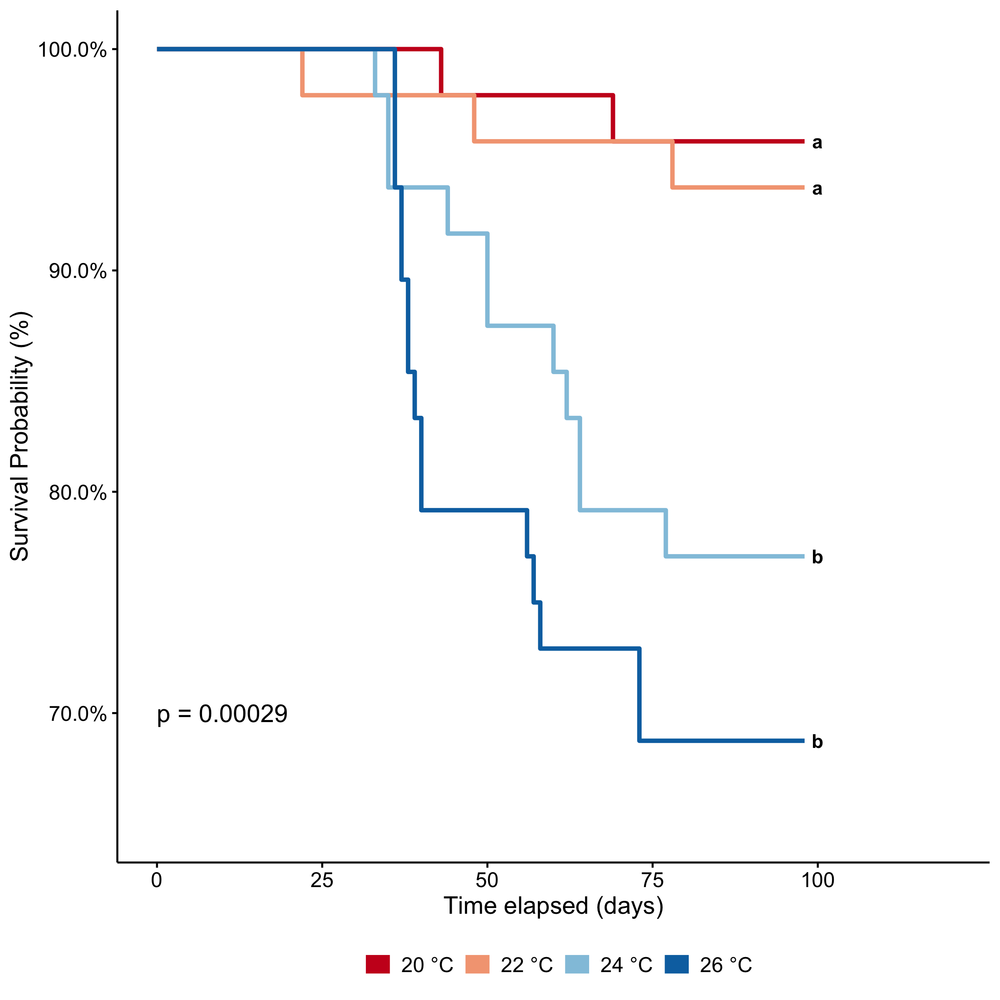
```

(ref:c2survival) Survival in *Heliocidaris erythrogramma* over 14 weeks of acclimation to elevated temperature treatments of 20 &deg;C, 22 &deg;C, 24 &deg;C and 26 &deg;C. Day zero is the time when target temperature was reached after temperature adjustments (+1 &deg;C every 6 days). Survival was significantly lower in the high temperature treatments (24 &deg;C, 26 &deg;C: log-rank test, Bonferroni-corrected, $p <$ 0.0083), but not for 22 &deg;C. Shaded regions denote 95 \% confidence interval. $n =$ 48 treament^-1^.

(ref:sc2survival) Survival in *Heliocidaris erythrogramma* over 14 weeks of acclimation to elevated temperature treatments of 20 &deg;C, 22 &deg;C, 24 &deg;C and 26 &deg;C

```{r c2coxtab, message=FALSE, out.extra=''}

c2cox_tab <- readr::read_csv("assets/data_in/c2_cox.csv")
knitr::kable(c2cox_tab, "latex", booktabs = T, escape = F,
  caption = "(ref:c2coxtab)",
  caption.short = "(ref:sc2coxtab)") %>%
  # kable_styling(position = "center") %>%
  # kable_styling(latex_options = "hold_position") %>%
  # kable_styling(full_width = T) %>%
  row_spec(c(0), bold = F) # bold the first row. Set to false now

```

(ref:c2coxtab) Results of Cox proportional hazards analysis on the risk of death in the sea urchin, *Heliocidaris erythrogramma* when acclimated to elevated temperatures of 22 &deg;C, 24 &deg;C, and 26&deg;C from the control temperature of 20 &deg;C. \*\* p <0.005, \* p < 0.05.

(ref:sc2coxtab) Results of Cox’s proportional hazards analysis on the risk of death in the sea urchin, *Heliocidaris erythrogramma*.

### Metabolic Rate

Elevated temperature had a significant effect on MO~2~ (ANOVA, F~3,20~ = 5.60, p = 0.005). Pairwise comparisons were complex (20 &deg;C = 22 &deg;C = 24 &deg;C; 20 &deg;C = 26 &deg;C; 22 &deg;C = 24 &deg;C < 26 &deg;C; Figure \@ref(fig:c2mr)). At +2 &deg;C and +4 &deg;C, there was a slight but not statistically significant increase in mean MO~2~. At +6 &deg;C, MO~2~ was significantly lower compared to the +2 &deg;C and +4 &deg;C treatments but not to the control (Tukey’s HSD, +2 &deg;C, p = 0.013; +4 &deg;C, p = 0.011). $Q_{10}$, with respect to the control treatment, were 1.67 for +2 &deg;C, 1.34 for +4 &deg;C, and 0.88 for +6 &deg;C.

```{r c2mr, fig.height=6, fig.cap="(ref:c2mr)", fig.scap="(ref:sc2mr)", fig.pos="p"}
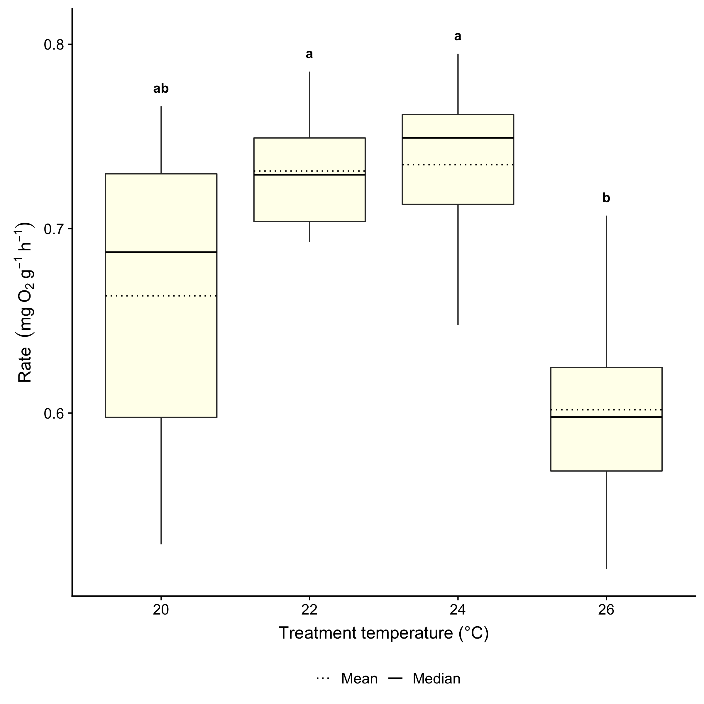
```

(ref:c2mr) Weight-specific metabolic rate for *Heliocidaris erythrogramma* after a 12-week acclimation to elevated temperature treatments of 20 &deg;C, 22 &deg;C, 24 &deg;C and 26 &deg;C. The top and bottom of the boxes represent the interquartile range (IQR) between the 25th and 75th percentile (Q1 and Q3, respectively). The horizontal line represents the median (Q2), the horizontal dotted line represents the mean, and the vertical lines (whiskers) represent the range of the data computed as follows: Q1 $-$ 1.5IQR (bottom whisker); greater than Q3+1.5 IQR (top whisker). Letters denote significant differences between treatment groups (Tukey's HSD, p < 0.05). n = 6 treatment^-1^.

(ref:sc2mr) Weight-specific metabolic rate for *Heliocidaris erythrogramma* after a 12-week acclimation to elevated temperature treatments

### HSP70 expression

Representative gel images are presented in Figure \@ref(fig:c2gels). HSP70 expression in the gonad tissue differed significantly between treatments (Kruskal-Wallis test, $\chi^2$ = 10.29, df = 3, p = 0.016). Mean HSP70 protein expression was significantly higher in the 24 &deg;C and 26 &deg;C treatments compared with the control (+4 &deg;C, p = 0.0159; +6 &deg;C, p = 0.0147), but the +2 &deg;C treatment did not differ from any treatment (Dunn’s test, 20 &deg;C = 22 &deg;C; 20 &deg;C $<$ 24 &deg;C = 26 &deg;C; 22 &deg;C = 24 &deg;C = 26 &deg;C; Figure \@ref(fig:c2hsp)).

```{r c2gels, fig.height=6, fig.cap="(ref:c2gels)", fig.scap="(ref:sc2gels)", fig.pos="p"}
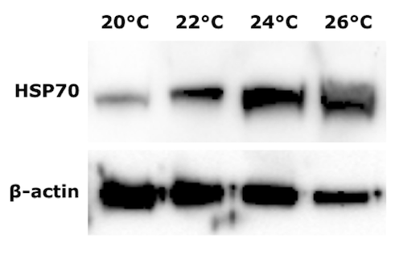
```

(ref:c2gels) Levels of HSP70 and n the gonad tissue of *Heliocidaris erythrogramma* after 14 weeks of acclimation to 20 &deg;C, 22 &deg;C, 24 &deg;C and 26 &deg;C treatments. Representative blots are shown for each acclimation temperature. Blots are quantified manually using ImageJ.

(ref:sc2gels) Levels of HSP70 and n the gonad tissue of *Heliocidaris erythrogramma* after 14 weeks of acclimation temperature treatments


```{r c2hsp, fig.height=6, fig.cap="(ref:c2hsp)", fig.scap="(ref:sc2hsp)", fig.pos="p"}
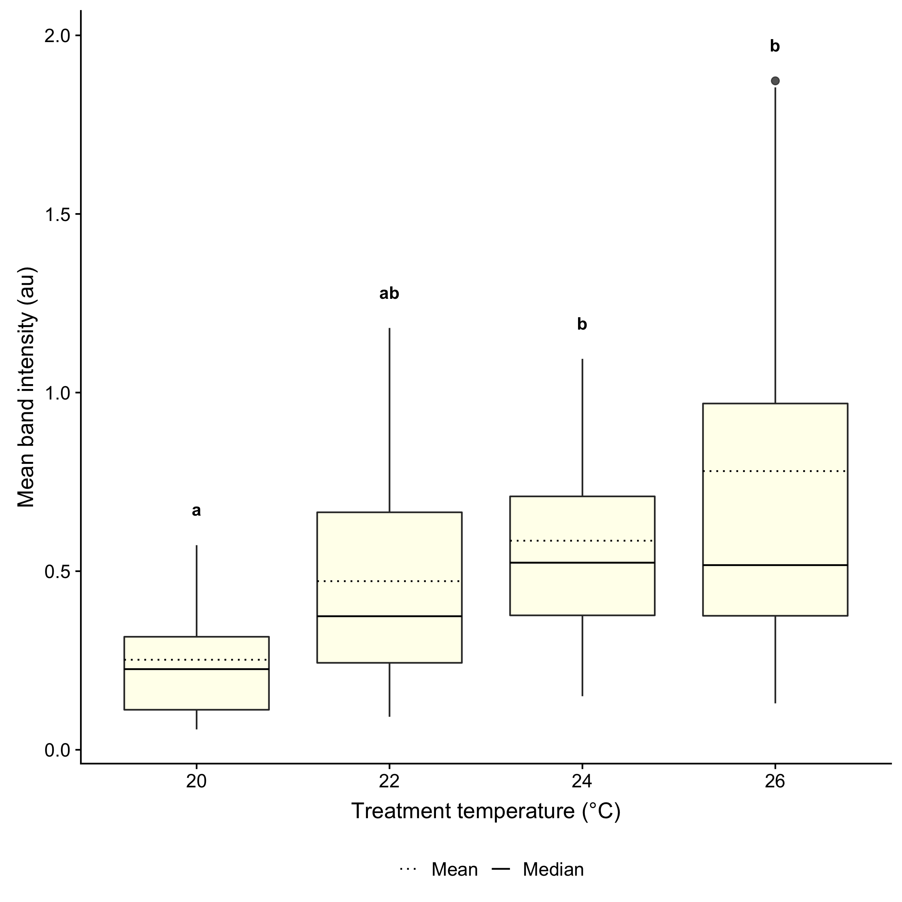
```

(ref:c2hsp) Relative HSP70 levels expressed in the gonad tissue of *Heliocidaris erythrogramma* after 14 weeks of acclimation in constant temperature treatments at 20 &deg;C, 22 &deg;C, 24 &deg;C and 26 &deg;C. The top and bottom of the boxes represent the interquartile range (IQR) between the 25th and 75th percentile (Q1 and Q3, respectively). The horizontal line represents the median (Q2), the horizontal dotted line represents the mean, and the vertical lines (whiskers) represent the range of the data computed as follows: Q1 $-$ 1.5 IQR (bottom whisker); greater than Q3+1.5 IQR (top whisker). Outliers that fall outside of the whiskers are included (dots). Letters indicate treatments that differed (Dunn’s test). 20 &deg;C, n = 13; 22 &deg;C, n = 15; 24 &deg;C, n = 14; 26 &deg;C, n = 12.

(ref:sc2hsp) Relative HSP70 levels expressed in the gonad tissue of *Heliocidaris erythrogramma* after 14 weeks of acclimation in constant temperature treatments

### Gonad index

All urchins had gonads and there were no significant differences in gonad index between treatments (ANOVA, F~1,55~ = 0.899, p = 0.35; Figure \@ref(fig:c2gi)). Partially spawned gonads were observed in 67 \%, 71 \%, 73 \% and 81 \% of gonad samples for the control, +2 &deg;C, +4 &deg;C and +6 &deg;C treatments, respectively. The remaining gonad samples had few or no gametes evident and were scored as "spent" (Figure \@ref(fig:c2histo)).

```{r c2gi, fig.height=6, fig.cap="(ref:c2gi)", fig.scap="(ref:sc2gi)", fig.pos="p"}
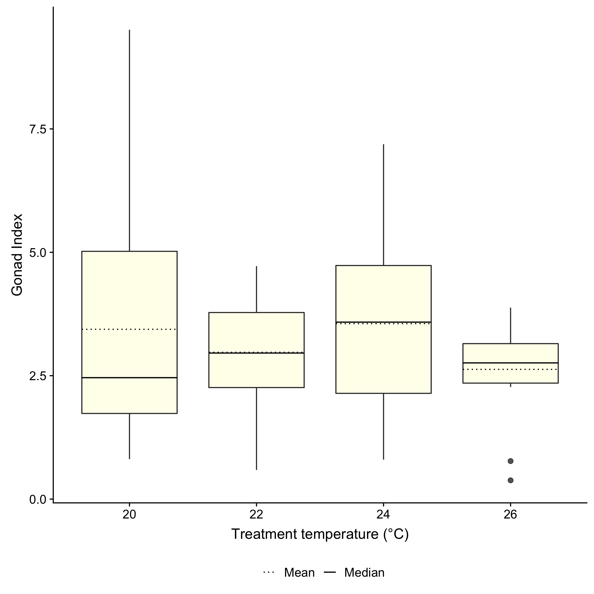
```

(ref:c2gi) Gonad index of *H. erythrogramma* after 14 weeks of acclimation in constant temperature treatments at 20, 22, 24 and 26 &deg;C. The top and bottom of the boxes represent the interquartile range (IQR) between the 25th and 75th percentile (Q1 and Q3, respectively). The horizontal line represents the median (Q2) and the vertical lines (whiskers) represent the range of the data computed as follows: Q1−1.5 IQR (bottom whisker); greater than Q3+1.5 IQR (top whisker). Outliers that fall outside of the whiskers are included (dots). There were no significant differences between treatments. n = 15 treatment^−1^.

(ref:sc2gi) Gonad index of *H. erythrogramma* after 14 weeks of acclimation in constant temperature treatments


```{r c2histo, fig.height=6, fig.cap="(ref:c2histo)", fig.scap="(ref:sc2histo)", fig.pos="p"}
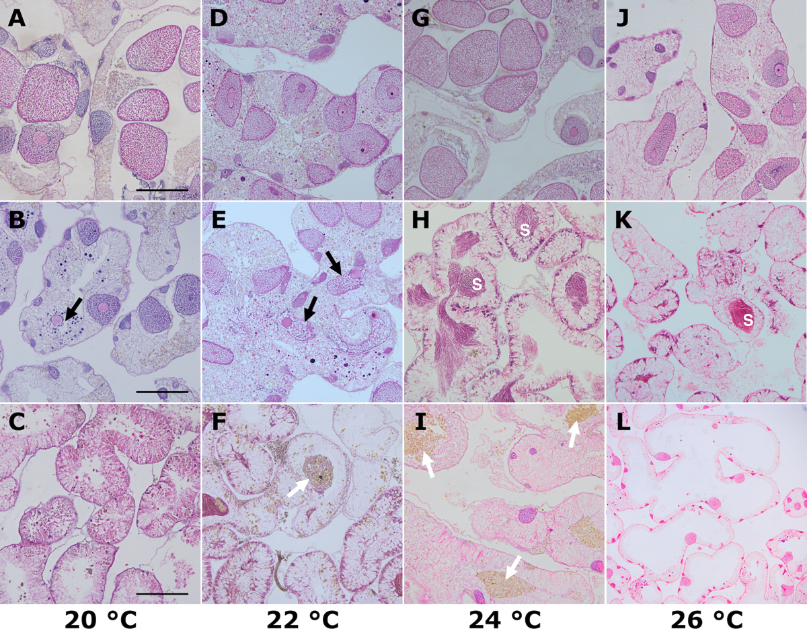
```

(ref:c2histo) Histology of the gonads of female (A, B, D, E, G, J, L) and male (C, F, H, K) *Heliocidaris erythrogramma* after 14 weeks of acclimation in experimental treatments. The gonads were in a range of conditions with a few remaining unspawned gametes (top row; A–J), a mixture of intact and degenerating (arrows) gametes (second row; B–K) or spent with few or no gametes (bottom row; C–L) some with lipofuschin-like degradation pigment (arrows). Scale bars = 50 $\mu$m.

(ref:sc2histo) Histology of the gonads of female and male *Heliocidaris erythrogramma* after 14 weeks of acclimation in experimental treatments

## Discussion

After a gradual introduction to increased temperatures over 6 weeks and subsequent acclimation for 14 weeks, *H. erythrogramma* exhibited a range of responses to warming across the traits investigated, and the different responses highlighted the importance of using multiple physiological traits to assess responses to global warming scenarios.
Survival data provided the clearest assessment of the sensitivity of this species to warming, where Cox proportional hazards analysis showed significantly higher risk of mortality (6--9 times) at the higher acclimation temperature treatments of +4 &deg;C and +6 &deg;C.
In comparison, a +2 &deg;C increase in acclimation temperature appeared to be tolerable for *H. erythrogramma* with no significant effect on survival.

Climate warming is expected to increase metabolic rates in marine ectotherms worldwide [@Yvon-Durocher2010; @Dillon2010; @Seebacher2014].
For *H. erythrogramma*, acclimation to intermediate levels of temperature increase (+2 &deg;C, +4 &deg;C) caused a slight, but non-significant increase in metabolic rate, but acclimation to (+6 &deg;C) decreased metabolic rate significantly such that it was similar to metabolic rate in control urchins.
The result suggested that metabolic depression [@Storey2004] or a disruption of cellular oxidative phosphorylation [reduced ATP turnover, @Guderley2002] might have occurred. With respect to potential metabolic depression, the sea urchins might also have actively suppressed physiological processes to maintain fitness.
This was indicated by the $Q_{10}$ values which were lower than those recorded for other echinoderms and aquatic ectotherms [@Lawrence1987; @DelGiorgio2005; @Fly2012; @McElroy2012].
For sea urchins, $Q_{10}$ typically lies between 1.2 to 3, including for *H. erythrogramma* [@Siikavuopio2008; @Carey2016].
In our results, mean $Q_{10}$ values showed a decreasing trend (from 1.67 to 0.88) as acclimation temperature increased, indicating decreasing thermal sensitivity [@Seebacher2014].

Reduced metabolic rate in response to increased temperature are common in nature, as seen in fish [@Kelly2013; @Kelly2014], molluscs [@Anestis2007; @Nguyen2011; @Marshall2011] and crustaceans [@Whiteley1997; @Terwilliger2001].
Metabolic depression due to elevated temperature has been reported in both acute and long-term studies on echinoderms with reduced metabolic rates at temperatures 1 to 3 &deg;C above maximum summer SST [@Christensen2011; @Delorme2016].
Such changes in metabolism could alter food consumption and feeding energetics [@OConnor2009]. As primary grazers [@Keesing2013], changes in feeding by *H. erythrogramma* in response to habitat warming may lead to altered plant-herbivore interactions and impact the structure of marine communities.
In our study, the urchins were fed *ad libitum* and were sufficiently nourished to produce gametes that were spawned while in treatment conditions and as indicated by gonad histology.
However, food is rarely unlimited in nature, and whether *H. erythrogramma* would be able to meet the energetic costs required to sustain performance in a warmer ocean is unknown, given that previous studies have shown that this species could not compensate for temperature-driven, increased metabolism with increased food intake [@Carey2016].

Elevated expression of HSP70 in response to acclimation to elevated temperature was in agreement with our expectations that this protein would be upregulated in response to increased temperature, and consistent with other findings that examined heat-shock responses in sea urchins [@Osovitz2005; @Nguyen2013].
The antibody we used detects both the stress-inducible HSP70 and the constitutively expressed HSC70 proteins [@Wood1998; @Clayton2000; @Garcia-Santos2011].
While HSP70 is typically upregulated rapidly in response to stress, HSC70 accumulates over time upon exposure to long-term, chronic stress [@Deane2006; @Pinsino2008], and is expressed prominently in response to prolonged exposure to increased temperature, pollution and other stressors in sea urchins and mussels [@Franzellitti2005; @Deane2006; @Pinsino2008; @Pinsino2015].

Regardless of what isoform is expressed, it is clear that the upregulation of HSP70 occurred during the acclimation indicating a protective response against heat damage. HSP synthesis is considered to be an energetically-demanding process [@Parsell1993; @Roberts1997; @Vergara2017], but metabolic rates did not significantly increase to keep up with increased energy demand from significantly increased HSP70 production.
This suggests that there may be a trade-off between respiratory physiology and the heat-shock response to maintain a compromised level of fitness, especially when held at sub-lethal (e.g. +6 &deg;C) temperature as seen in the survivors, which appear to be heat-tolerant in our experiment.
Also, it was possible that at 26 &deg;C, the ability of *H. erythrogramma* to maintain physiological function and maximise survival was impaired, perhaps due to a reduced capacity of its coelomic and respiratory systems to meet energetic and oxygen demands [@Portner2010].
This is significant, as warming of +6 &deg;C (from 17 &deg;C) has been known to diminish the physiological capacity of *H. erythrogramma* to maintain its cellular immune response and antibacterial resistance to disease [@Brothers2016].
The increased incidence of bald sea urchin disease which is known to be lethal in wild populations of *H. erythrogramma* over recent decades had also been ascribed to climate warming [@Sweet2016].

Few other studies have taken the gradual approach to introduce elevated temperatures followed by an acclimation period as we did for *H. erythrogramma* to measure HSP70 levels.
For example, @Buckley2001 acclimated the mussel *Mytilus trossulus* for 6 weeks to their winter-collected temperature, but measured HSP gene expression on isolated gill tissue following a 2-hour exposure to a range of elevated temperatures (14--35 &deg;C).
@Osovitz2005 acclimated the sea urchin, *Strongylocentrotus purpuratus* to both decreased (5 &deg;C) and increased (20 &deg;C) temperature for 4 weeks, and tested the HSP gene response in isolated tube feet that were incubated to 5--36.5 &deg;C for 30 min.
For *H. erythrogramma*, an 8-fold expression of HSP70 protein occurred following exposure to temperature shock at +3--8 &deg;C above ambient [@Nguyen2013].
It is evident that HSP70 is a useful cellular-level marker for both long-term and acute physiological stress.

The in-situ temperature data in the habitat of *H. erythrogramma* showed that the subtidal populations of *H. erythrogramma* in Sydney Harbour are already experiencing some of the temperature levels that were used in our experiments, though not over the long exposure time (14 weeks).
Over five years, temperatures during spring and summer periods exceeded 22 &deg;C for an average of 9 consecutive weeks, thus a near-future warming scenario of +2 &deg;C could mean that 24 &deg;C may become more common over the same period.
Further, due to the poleward advance of the EAC, a warming of up to 7 &deg;C above pre-industrial temperatures is projected for southeast Australia by the end of the century [@Lenton2015].
It is therefore conceivable that in the near future, the urchin populations investigated here will experience temperatures that we found deleterious in our study.

An EAC-driven migration of thermotolerant *H. erythrogramma* propagules could facilitate the persistence of local populations, with likely range retraction of more equatorward populations [@Byrne2011].
However, temperature is but one of a multitude of stressors that these urchins experience. Increased levels of ocean *p*CO~2~ are exposing *H. erythrogramma* to ocean acidification, and it is likely to interact with temperature [@Przeslawski2015].

Our study investigated responses of metabolic rate, HSP70 expression, gonad condition and survival to evaluate the influence of elevated temperature on *H. erythrogramma*.
Significantly increased HSP70 expression and mortality, especially at 24 &deg;C and 26 &deg;C, suggested that these temperature levels were thermally stressful.
Predicting the impact of these responses as they interact in long-term studies remains a high-priority area for future investigation.


<!--chapter:end:chapters/11-warming.Rmd-->

# Long-term study of the multistressor impacts of ocean warming and acidification on the physiology of the sea urchin, *Heliocidaris erythrogramma* {#multistressor}
\chaptermark{Warming and acidification on \textit{Heliocidaris erythrogramma}}

## Abstract{-}

The warming and acidification of the world's oceans affect nearly all aspects of marine organism physiology and it is important to consider both stressors when predicting biological responses to a changing climate. 
We investigated the effects of long-term exposure to warming and acidification on the physiological responses of the sea urchin, \textit{Heliocidaris erythrogramma}, a species that resides in the south-east Australian ocean warming hotspot. 
The urchins were slowly introduced to stressor conditions over a 7 week adjustment period to three temperature (ambient, +\SI{2}{\celsius}, +\SI{3}{\celsius}) and two pH (ambient -0, -0.4 pH units) treatments, before being maintained in seasonally changing temperature and fixed pH conditions for 22 weeks.
Temperature was adjusted weekly to follow seasonal temperature change from winter to summer.
Metabolic rate was measured at 4 and 12 weeks of acclimation, feeding rate and ammonia excretion rate at 12 weeks, assimilation efficiency at 13 weeks and survival was monitored for 22 weeks.
Acclimation to +\SI{3}{\celsius} was deleterious to \textit{H. erythrogramma} regardless of pH, with higher mortality starting from 6 weeks of acclimation with 37--45 \% survival by 22 weeks. In contrast, +\SI{2}{\celsius} had no observable effect on survival.
Increased temperature was associated with decreased feeding rate and increased excretion rate, but decreased pH had no effect on these parameters.
While metabolic rate increased additively with temperature and low pH at 4 weeks, there was no difference in metabolic rate between treatments at 12 weeks indicating that the urchins that survived ocean change conditions showed evidence of physiological acclimation. 
Modelling scope for growth indicated that regardless of treatment, the urchins had a net positive energy budget indicating the responses observed were due to energy limitation.
Our results showed the importance of long-term studies in predicting the consequences of climate change for marine species physiology. 
The mortality response was evident from 6 weeks and the potential that surviving urchins were able to acclimate to ocean warming and acidification was evident after 12 weeks of acclimation.

## Introduction

Many of the key challenges in predicting the ecological consequences of climate change stem from the fact that most ecosystems are simultaneously confronted with multiple chemical, physical and biological stressors, which often interact [@Byrne2013; @Przeslawski2015; @Goldenberg2017].
For the world's oceans, the impacts of global warming and ocean acidification (OA) are intricately linked as approximately 90 \% of the Earth's heat and 25 \% of anthropogenic CO\textsubscript{2} emissions are absorbed directly into the ocean [@Fletcher2006; @Gattuso2015; @Wanninkhof2013].

Ocean warming (OW) increases the body temperature of marine ectotherms, affecting metabolism and most biological processes [@Brown2004; @Hochachka2002].
Concurrently, OA alters the balance of carbonate saturation states in seawater, increasing the metabolic costs associated with acid-base regulation, calcification and skeletogenesis [@Doney2009; @Kroeker2013; @Portner2008; @Thomsen2015].
Given that both stressors influence important metabolic processes, interactions are inevitable and these can affect biological responses in unexpected ways [@Boyd2015; @Kordas2011], highlighting the uncertainty surrounding our understanding of the drivers of ecosystem change.   
For example, ocean warming affects both oxygen demand and the supply of oxygen in water [@Christensen2011; @Portner2010; @Schulte2015] and may limit oxygen delivery restricting metabolism, exacerbating the increased energetic demands elicited by ocean acidification [@Deutsch2015; @Dillon2010; @Lefevre2016].

Understanding the combined effects of ocean warming and acidification on marine ecosystems is ecologically important, but remains a challenge [@Byrne2013a; @Gaylord2015; @Queiros2015].
This issue is compounded by the difficulties of conducting multi-factorial experiments with respect to time and resources [@Boyd2017; @Collins2009].
Exposure to combined ocean warming and acidification often causes negative impacts that are either additive [e.g. increased metabolism in sea urchins, @Carey2016] or synergistic [e.g. increased photosynthesis in Foraminifera, @Schmidt2014].
However, in other cases, positive or neutral responses have been observed, such as in the development and thermal windows of echinoderm larvae [@Byrne2010; @Karelitz2016], the growth of juvenile and adult sea urchins [@Dworjanyn2018], growth in mussels [@Keppel2015] and reproduction in crustaceans, macroalgae and autotrophs [@Harvey2013].

Echinoderms are marine calcifiers and are important in many marine environments as ecosystem engineers through their roles in herbivory and bioturbation [@Ling2010; @Steneck2013].
These animals are at risk to the impacts of ocean warming and acidification [@Przeslawski2015], with reports of deleterious effects on larval and adult growth and development [@Byrne2011; @Sewell1999], juvenile behaviour [@Manriquez2017], adult immune defence [@Brothers2016; @Sweet2016], metabolism [@Carey2016] and reproduction [@Delorme2016; @Dworjanyn2018].

Despite the plethora of studies on the effects of warming and ocean acidification on echinoderms as individual stressors, and a few that consider both stressors [@Brothers2016; @Carey2016; @Karelitz2016; @Manriquez2017; @Morley2016; @Suckling2015], critical gaps remain in our knowledge with regard to our understanding of the ability of this important taxon to acclimate or adapt to global change stressors.
This is especially true considering that most studies involve short-term experiments investigating non-lethal responses.
In acute-type experiments where the stress is immediate, organisms are likely to respond differently compared to the scenario of a more gradually longer-term introduction to a stressor.
For global change studies a gradual introduction to increased temperature and acidification organisms in needed to provide organisms with the opportunity to acclimate to their new conditions.

There is compelling evidence that we need to conduct longer-term experiments to realistically incorporate acclimation and/or adaptation to climate change stressors conditions in the face of a changing climate.
In general, acclimation decreases thermal sensitivity over time [@Seebacher2014], reflecting increased resilience to habitat warming. The few studies that have incorporated an acclimation period have revealed responses that are not evident in short acute-type experiments. 
For example, exposure to long-term warming and acidification on the Antarctic sea urchin \textit{Sterechinus neumayeri} revealed that the negative effects of increased temperature (+\SI{2}{\celsius}) and decreased pH (-0.3 to -0.5 units) on metabolism and reproduction diminished within two years [@Morley2016; @Suckling2015].
@Dupont2013 showed that although four months exposure to acidification affected fecundity in \textit{Strongylocentrotus droebachiensis}, there was no effect for sea urchins acclimated to a longer, 16-month period.
Acclimation time is thus a crucial factor to consider when conducting experiments that investigate organismal responses to climate change and can be tested by assessing responses over different time periods [@Suckling2015; @Carey2016; @Morley2016].

We examined the combined effects of increased temperature and acidification in an acclimation experiment with the sea urchin \textit{Heliocidaris erythrogramma}.
This sea urchin is abundant and plays an ecologically important role in structuring subtidal kelp habitats across temperate Australia [@Keesing2013; @Ling2010; @Wright2005].
The animals were gradually adjusted to increased temperature (+\SI{2}{\celsius}, +\SI{3}{\celsius}) and acidification (-0.4 pH units) over seven weeks to avoid acute shock responses, and this was followed by up to 22 weeks of acclimation under a natural pattern of seasonally-changing temperature (offset at +\SI{2}{\celsius} and +\SI{3}{\celsius}).
\textit{Heliocidaris erythrogramma} resides in the south-east Australian ocean warming hotspot and the warming and acidification treatments were commensurate with conditions predicted for the near-future [@King2017; @Lenton2015; @Lough2011].
Survival was recorded over the 22-week acclimation period and metabolic rate was measured at 4 and 12 weeks to evaluate differences in physiological responses over two acclimation periods.
Feeding, assimilation efficiency, excretion and survival were also recorded to evaluate the fitness of \textit{H. erythrogramma} in response to warming and acidification.

Past studies on \textit{H. erythrogramma} indicate that this species has some capacity to acclimate to warming, but struggled to survive at \SI{26}{\celsius}, (+\SI{4}{\celsius}) with significant mortality when kept for 14 weeks at this temperature [@Harianto2018]. 
@Carey2016 acclimated \textit{H. erythrogramma} for 8 weeks and showed that warming and acidification increased metabolism additively, but feeding rates did not increase in response to higher energetic costs.
This species also exhibited a reduced immune capacity in response to a bacterial pathogen when maintained in warming and acidification conditions, although immune function showed signs of recovery after 30 days [@Brothers2016].

As maintaining energy is key to long-term survival, the data from all physiological metrics were used to model scope for growth (SfG), a single bioenergetics-based framework to empirically determine the overall performance of \textit{H. erythrogramma} maintained long term in climate change conditions.
This model assesses the rate and efficiency at which this species allocates energy in the different treatment conditions and is a physiological index used to quantify the energy budgets of organisms to optimise feeding strategies, as also applied to sea urchins [@Stumpp2011; @Delorme2016; @Orr2014; @Rubilar2016].
The SfG model was used to explore whether changes in the energy budget have an influence on the responses of \textit{H. erythrogramma} to warming and acidification.
This allows us to integrate multiple physiological traits under a single response metric, providing a better understanding of vulnerability to global change effects [@Leung2017; @Morley2016].

We hypothesised that: 
(1) there would be a greater initial tolerance to warming and acidification than seen in acute studies due to gradual introduction to these stressors, but that sensitivity to stressors would be detected in long term (22 weeks) acclimation period;
(2) warming and low pH would interact to affect metabolic rate, feeding rate and ammonia excretion rate, and
(3) acclimatory physiological adjustments would be evident over time.


## Materials and Methods

\textit{Heliocidaris erythrogramma} (\SI{44.15(325)}{\mm} test diameter) were collected from the subtidal (2-3 m depth) at low tide, at Milk Beach ([\ang{33;51;23.3}S, \ang{151;16;1.1}E](https://www.google.com/maps/?q=-33.856478,151.266958)) and Bottle and Glass Point ([\ang{33;50;52.7}S, \ang{151;16;12.4}E](https://www.google.com/maps/?q=-33.847960,151.270122)) in June, 2014. Sea surface temperature (SST) at the time was \SI{15.3}{\celsius}.
The urchins were transported to the Sydney Institute of Marine Science (SIMS) in Chowder Bay and were held in aquaria (80 L) supplied with ambient flow-through, filtered seawater (FSW, \SI{70}{\micro\m}, \SI{1.5}{L.min^{-1}}).
After one week, they were randomly allocated into six treatments, based on three temperature profiles (ambient +\SI{0}{\celsius}, elevated +\SI{2}{\celsius} and +\SI{3}{\celsius}), adjusted weekly with regard to the mean recent SST profile (Figure \ref{suppfig2}) and two constant total pH (pH\textsubscript{T}, on the total hydrogen scale) levels (ambient: 8.0, low: 7.6). For each treatment, we used three replicate tanks (28 L) with 10 urchins per tank.

### Experimental setup

Experiments were conducted in a constant-temperature room for precise adjustments of water temperature and pH (Figure \ref{suppfig1}).
Room lighting was adjusted weekly to reflect the diurnal sunrise/sunset cycle using a digital 24-hour timer.
Adjustments to water parameters were made in header tanks before the water was channeled to treatment tanks.
Each header tank was supplied with FSW (\SI{20}{\micro\m}) using a thermocouple-solenoid feedback system that automatically mixed warm (\SI{25}{\celsius}) and cold (\SI{14.5}{\celsius}) filtered FSW (\SI{20}{\micro\m}) in a 2 L mixing chamber to supply temperature-controlled water consistently.
Each header tank was also equipped with a heater (75 W, EHEIM GmbH \& Co KG, Germany) attached to a temperature controller (model 7028/3, TUNZE Aqraientechnik GmbH, Germany) as a second level of temperature control.

Seawater pH was maintained using a mixed CO\textsubscript{2} system, where a thermally-compensated, low-flow controller valve (Parker Hannifin, OH, USA) and a proportional integral derivative (PID) controller, updated every 10 s, were used to precisely inject food-grade CO\textsubscript{2} (BOC, Australia) into ambient air that had been scrubbed of CO\textsubscript{2}.
The CO\textsubscript{2} mix was bubbled vigorously and continuously into header tanks using \SI{20}{\cm} ceramic diffusers.

<!-- Figure  3.1 ----------------------------------------------------------- -->
\begin{figure}[t]
{\centering \includegraphics[width=0.8\linewidth]{assets/figs/c3edesign}

}
\caption[Diagram of the experimental setup used to control both temperature (\si{\celsius}) and pH (\textit{p}CO\textsubscript{2}) in flowthrough filtered seawater.]{Diagram of the experimental setup used to control both temperature (\si{\celsius}) and pH (\textit{p}CO\textsubscript{2}) in flowthrough filtered seawater. Briefly, filtered seawater (20 $\mu$m) was stored in warm (\SI{25}{\celsius}) and cold (\SI{14.5}{\celsius}) sumps and mixed to target temperatures via solenoid valves controlled by custom software. At the same time, food-grade carbon dioxide (CO\textsubscript{2}) was injected into CO\textsubscript{2}-scrubbed air to the desired ppm and bubbled vigorously into header tanks using 20 cm ceramic diffusers.}
\label{suppfig1}
\end{figure}

### Gradual adjustment to treatment conditions and acclimation

To minimise physiological shock to altered conditions, warming and acidification levels were changed gradually over 7 weeks, where no mortality occurred.
Temperature was increased at a rate of +\SI{1}{\celsius} every 6 days until target elevated temperatures were achieved.
seawater pH was decreased at a rate of -0.1 pH units every week.
These manipulations were performed on a staggered schedule such that all treatments achieved target conditions in the same week (Fig. 1 A).
Adjustments were made at the level of the header tanks such that the experimental tanks reached the new conditions within 1 to 2 days.
Once the treatment conditions were established, treatment temperatures were at \SI{15.6(4)}{\celsius} for the ambient, \SI{17.6(4)}{\celsius} for +\SI{2}{\celsius} and \SI{18.6(3)}{\celsius} for the +\SI{3}{\celsius} treatments, respectively (\si{\pm\ SD}).

After the adjustment period, the acclimation period started with temperature levels regulated weekly based on the mean weekly temperature over the same period (Figure \ref{acclim}), based on reference data collected from in situ loggers deployed in Chowder Bay from 2009-2014 (Figure \ref{suppfig2}).
Thus, treatment temperatures were changed to mimic the natural seasonal change that occurs from winter to summer in the \textit{H. erythrogramma} habitat.
Because temperature has an effect on CO\textsubscript{2} solubility and temperatures were changing every week, the system maintained constant pH (8.0, 7.6), not CO\textsubscript{2} ppm, within each treatment.

<!-- Figure  3.2 ----------------------------------------------------------- -->
\begin{figure}[t]
{\noindent\centering\includegraphics[width=350pt]{assets/figs/c3acclim}}
\caption[Temperature and pH in treatment tanks, measured daily.]{Temperature and pH in treatment tanks, measured daily. Only one replicate tank for every treatment was selected at random for daily measurements. Shaded regions are the pre-acclimation adjustment periods for temperature (pink) and pH (blue), respectively. (A) Coloured lines represent the planned temperature profiles (ambient, +\SI{2}{\celsius}, +\SI{3}{\celsius}), which change every week, while coloured dots represent the actual temperatures measured. Black dots are the reference temperatures collected from in situ loggers deployed in Chowder Bay from 2009 to 2014, averaged by day. (B) Black lines represent the reference constant pH\textsubscript{T} levels, with the initial adjustments (ambient 8.0, acidic 7.6). Shapes represent the pH treatment group (triangle: ambient 8.0; circle: acidic 7.6), colours represent the temperature treatment group (ambient, +\SI{2}{\celsius}, +\SI{3}{\celsius}).}
\label{acclim}
\end{figure}

<!-- Figure  3.3 ----------------------------------------------------------- -->
\begin{figure}[t]
{\centering \includegraphics[width=0.85\linewidth]{assets/figs/c3htemp}

}
\caption[Mean weekly-averaged temperature (\si{\pm SD}) for Chowder Bay, NSW, Australia, from 2009 to 2014.]{Mean weekly-averaged temperature (\si{\pm SD}) for Chowder Bay, NSW, Australia, from 2009 to 2014. Data were obtained from loggers deployed in situ at 3 m depth at the level of the sea urchin habitat. Colours represent the adjustment (blue) and acclimation (red) periods of the experimental treatments, respectively. The shaded region is the max/min of the temperatures recorded. These data were used to design the temperature profile of the elevated temperature treatments.}
\label{suppfig2}
\end{figure}

### Monitoring and survival

Specimens and treatment conditions were checked regularly throughout the experimental period.
Survival was recorded by documenting the survival time of individuals over 22 weeks (155 days; Aug–Dec).
The urchins were observed daily and dead individuals were removed immediately.
During the spawning season [Oct-Dec, @Laegdsgaard1991] the tanks were monitored for the presence of released eggs.
Spawning was easily detected as \textit{H. erythrogramma} releases large, buoyant eggs which were trapped on the water surface (Figure \ref{suppfig3}).
Spawning occurred overnight in all treatments but as we could not determine how many individuals released gametes, the observations were recorded but not analysed.


<!-- Figure  3.4 ----------------------------------------------------------- -->
\begin{figure}[t]
{\centering \includegraphics[width=0.85\linewidth]{assets/figs/c3eggs}

}
\caption[Eggs of \textit{Heliocidaris erythrogramma}, floating near the surface of the tank.]{Eggs of \textit{Heliocidaris erythrogramma}, floating near the surface of the tank. Mass spawning occurred in all treatments, spontaneously. As the eggs were buoyant, they were not immediately flushed by the flowthrough system. It was not possible to determine which urchins spawned as the spawning events were not directly observed.}
\label{suppfig3}
\end{figure}

Temperature was recorded daily in all treatments.
seawater pH was measured spectrophotometrically on the total scale (\si{pH_T}) with a custom-built pH sampling system connected to an Ocean Optics USB4000+ fiber optic spectrometer, using m-Cresol dye indicator (Acros Argonics, catalogue number 110585000, Lot A0321770) and calculated according to @Liu2011.
The measurements were calibrated to certified reference material (CRM) for CO\textsubscript{2} in seawater (Batch 139) following SOP 6b in @Dickson2007.
During the adjustment period the pH sampling system automatically measured pH in one ambient and one low pH treatment every two hours to characterise pH via sampling tubes connected to the tanks.
Once treatment pH was established, pH was monitored daily from random treatment tanks (Figure \ref{acclim}b).

For total alkalinity (A\textsubscript{T}) measurements, seawater samples (330 mL) were taken randomly from experimental tanks every 2 to 3 weeks (total n = 36 samples across all treatments).
A\textsubscript{T} was determined by potentiometric titration (907 Titrando, Metrohm), calibrated using seawater CRMs (Batch 139, Dickson et al., 2007).
The carbonate chemistry parameters \textit{p}CO\textsubscript{2}, calcite and aragonite saturation states \si{\ohm}Ca and \si{\ohm}Ar were calculated by running the data in the “seacarb” package in R [@Gattuso2018] using the constants for K\textsubscript{1} and K\textsubscript{2} from [@Lueker2000], the constant for K\textsubscript{f} from @Perez1987 and the constant for K\textsubscript{s} from @Dickson1990, as recommended by @Dickson2007 (Table \ref{carbchemtab}).


<!-- \begin{landscape} -->
\begin{table}[tb]
\centering
\caption[Carbonate system conditions during the 22 weeks of acclimation of \textit{Heliocidaris erythrogramma} in six treatments of three temperatures and two pH\textsubscript{T} levels.]{Carbonate system conditions (\si{\pm SD}) during the 22 weeks of acclimation of \textit{Heliocidaris erythrogramma} in six treatments of three temperatures (ambient, +\SI{2}{\celsius}, +\SI{3}{\celsius}) and two pH\textsubscript{T} levels (8.0, 7.6), including pH on the total scale (pH\textsubscript{T}), total alkalinity (A\textsubscript{T}, $\mu$mol kg\textsuperscript{-1}), dissolved inorganic carbon (DIC, $\mu$mol kg\textsuperscript{-1}) and calcite saturation state ($\Omega$Ca). There were 6 samples per treatment.}
\label{carbchemtab}
\begin{tabular}{rrrrrrr}
\toprule
\si{\celsius} | pH & pH\textsubscript{T} & A\textsubscript{T} & \textit{p}CO\textsuperscript{2} & DIC & $\Omega$Ca \\
\midrule
+0 | 8.0 & 8.02 $\pm$ 0.03 & 2298.18 $\pm$ 15.4 & 427.4 $\pm$ 19.2 & 2045.23 $\pm$ 20.8 & 4.35 $\pm$ 0.2 \\
+0 | 7.6 & 7.66 $\pm$ 0.04 & 2294.74 $\pm$ 13.0 & 1102.6 $\pm$ 47.7 & 2200.49 $\pm$ 17.6 & 2.11 $\pm$ 0.07 \\
+2 | 8.0 & 8.03 $\pm$ 0.02 & 2298.79 $\pm$ 13.9 & 422.9 $\pm$ 28.2 & 2026.77 $\pm$ 14.4 & 4.67 $\pm$ 0.2 \\
+2 | 7.6 & 7.65 $\pm$ 0.02 & 2298.42 $\pm$ 14.2 & 1129.2 $\pm$ 49.8 & 2196.48 $\pm$ 16.7 & 2.24 $\pm$ 0.2 \\
+3 | 8.0 & 8.04 $\pm$ 0.04 & 2289.20 $\pm$ 10.1 & 400.6 $\pm$ 14.4 & 2197.40 $\pm$ 7.8 & 4.95 $\pm$ 0.3 \\
+3 | 7.6 & 7.64 $\pm$ 0.05 & 2300.94 $\pm$ 14.3 & 1166.4 $\pm$ 31.8 & 2000.27 $\pm$ 18.6 & 2.28 $\pm$ 0.2 \\
\bottomrule
\end{tabular}
\end{table}
<!-- \end{landscape} -->
<!-- \si{\celsius} | pH & pH\textsubscript{T} & A\textsubscript{T} ($\mu$mol kg\textsuperscript{-1}) & \textit{p}CO\textsuperscript{2} & DIC ($\mu$mol kg\textsubscript{-1}) & $\Omega$Ca & $\Omega$Ar \\ -->
<!-- +0 | 8.0 & 8.02 $\pm$ 0.03 & 2298.18 $\pm$ 15.4 & 427.4 $\pm$ 19.2 & 2045.23 $\pm$ 20.8 & 4.35 $\pm$ 0.2 & 2.84 $\pm$ 0.1\\ -->
<!-- +0 | 7.6 & 7.66 $\pm$ 0.04 & 2294.74 $\pm$ 13.0 & 1102.6 $\pm$ 47.7 & 2200.49 $\pm$ 17.6 & 2.11 $\pm$ 0.07 & 1.38 $\pm$ 0.1\\ -->
<!-- +2 | 8.0 & 8.03 $\pm$ 0.02 & 2298.79 $\pm$ 13.9 & 422.9 $\pm$ 28.2 & 2026.77 $\pm$ 14.4 & 4.67 $\pm$ 0.2 & 3.06 $\pm$ 0.12\\ -->
<!-- +2 | 7.6 & 7.65 $\pm$ 0.02 & 2298.42 $\pm$ 14.2 & 1129.2 $\pm$ 49.8 & 2196.48 $\pm$ 16.7 & 2.24 $\pm$ 0.2 & 1.47 $\pm$ 0.1\\ -->
<!-- +3 | 8.0 & 8.04 $\pm$ 0.04 & 2289.20 $\pm$ 10.1 & 400.6 $\pm$ 14.4 & 2197.40 $\pm$ 7.8 & 4.95 $\pm$ 0.3 & 3.25 $\pm$ 0.2\\ -->
<!-- +3 | 7.6 & 7.64 $\pm$ 0.05 & 2300.94 $\pm$ 14.3 & 1166.4 $\pm$ 31.8 & 2000.27 $\pm$ 18.6 & 2.28 $\pm$ 0.2 & 1.50 $\pm$ 0.1\\ -->

### Maintenance

Specimens were fed on a diet mixture of fresh \textit{Ecklonia radiata} and \textit{Sargassum} spp. suspended in kelp-based agar (MSC CO, Kyeongnam, Korea).
To prepare the food, \textit{E. radiata}, and \textit{Sargassum} spp. were washed in fresh water, dried at \SI{50}{\celsius} for 48 hours, and then ground into fine powder for storage. 
The food was mixed with agar powder to a ratio of 1:4 by weight, and then mixed with FSW (\SI{20}{\micro\m}) to a ratio of 1:10 by weight at \si{\sim}\SI{80}{\celsius}. The agar was left to cool and solidify for 45 min before it was cut into 1 to 2 cm\textsuperscript{2} cubes and fed to the specimens.
We fed the specimens twice a week by placing 3 to 4 cubes on top of each individual urchin.
This approach ensured that each animal received the same amount of food in excess during the entire experimental period.
All treatment tanks were siphoned every two days to remove faecal matter and wiped weekly to minimise algal growth.
All CO\textsubscript{2} diffusers were scrubbed and replaced every 3 to 5 days.
Header tanks were cleaned of algal growth once a month.

### Metabolic rate

Routine weight-specific metabolic rate, MO\textsubscript{2}, was estimated using intermittent-flow respirometry at two time-points (at 4 and 12 weeks of acclimation), from a random sample of 10 specimens from each treatment.
At 4 weeks, the temperature levels were at 16.6, 18.6 and 19.6 \si{\celsius} and at 12 weeks, the temperature levels were at 20.7, 22.7 and 23.7 \si{\celsius} for the ambient, +2 and +\SI{3}{\celsius} treatments, respectively.
The specimens were not fed for 5 days prior to measurements and they were transferred individually into 1 L respirometry chambers maintained by individual water baths.
Each chamber contained an oxygen sensor spot (SP-PSt3-NAU, PreSens GmbH, Germany) for the detection of dissolved oxygen concentration using an external multi-channel sensor (OXY-10-mini, PreSens Gmbh, Germany).
A magnetic stirrer ensured even mixing of water. The specimens were allowed to adjust to the chambers under flow-through conditions for 30 min prior to respirometry measures.

To measure oxygen uptake, chambers were sealed in treatment water, transferred to water baths and dissolved oxygen (DO, \SI{}{mgO_2.L^{-1}}) was measured every 10 seconds until a 10 \% decrease in DO was recorded.
The chamber was then flushed, and the measurement repeated.
Background respiration was determined by recording FSW-only blanks (n = 8) to correct the recordings for background respiration and instrument drift.
At the end of each measurement, seawater weight was calculated by deducting chamber, stir bar and urchin wet weights from the total weight of the chamber, and then converted to volume using seawater density estimated from current temperature, salinity and barometric air pressure [@Fofonoff1983].
Weight-specific MO\textsubscript{2} (\SI{}{mgO_2.L^{-1}}) was calculated using the equation [@Lighton2008]:
\[MO_2=(\Delta O_2 V)/W\] 
where $\Delta$O\textsubscript{2} is the linear regression of O\textsubscript{2} concentration over time (\SI{}{mgO_2.L^{-1}}), V is the volume of the seawater available (L) and W is the wet weight of the urchin (g).

### Ammonia excretion

Ammonia excretion rate was determined at 12 weeks of acclimation immediately after respiration experiments were completed.
Ten specimens were randomly selected from each treatment and transferred into 1L chambers supplied with flowthrough FSW at the same treatment conditions, and left to rest for at least 45 min.
Initial water samples were carefully collected (50 mL, \SI{0.22}{\micro\m}) and frozen.
The chambers were then sealed and left in the water baths for 3 hours before final water samples were collected. Background ammonia levels were determined by repeating the procedure without a specimen (n = 3 treatment\textsuperscript{-1}). 
The water samples were immediately frozen and stored in the dark until they were analysed spectrophotometrically (within 10 days) for total ammonia, following [@Parsons2013].
Spectrophotometric readings were obtained at 640 nm on a microplate reader (CLARIOstar Microplate Reader, BMG LABTECH, Offenburg, Germany) and calibrated using daily blanks and a standard ammonium solution.
Ammonia excretion rate, U (\si{\micro g.kg^{-1}.h^{-1}}) was calculated according to the equation: 
\[U=N_c/(W\cdot T)\] 
where N\textsubscript{c} is the concentration of ammonia (\si{\micro g} at–N \si{L^{-1}}), W is the weight of the specimen in kg and T is the time elapsed in hours. Ammonia concentration, NC is determined using the equation:
\[N_c=(3\cdot V)/\Delta E\]
where $\Delta$E is the difference between the standard and corrected spectrophotometric extinction values of the blue indophenol colour formed with ammonia and V is the volume of the chamber (L).

### Feeding rate and assimilation efficiency

Feeding trials were conducted after 13 weeks of acclimation where the temperature levels were at 20.1, 22.1 and \SI{23.1}{\celsius} for the ambient, +2 and +\SI{3}{\celsius} treatments, respectively.
Ten random specimens from each treatment were transferred into individual tanks (4 L) supplied with flowthrough FSW (\SI{6}{L.h^{-1}}) at the same treatment conditions.
They were starved for 6 days in their new environments before feeding trials commenced, using the same agar-based food mixture used in routine feeding.
The initial wet weight of the diet was determined and the food was added to each tank in excess.
Food-only autogenic controls were used to determine background changes in agar composition (n = 24).

After 48 hours, unconsumed food was carefully collected and oven dried at \SI{80}{\celsius} for 48 h, and then re-weighed.
Faecal pellets were also syphoned at the same time for calculations of assimilation efficiency (see below).
The specimens were removed from the tanks, blotted briefly with a paper towel, and weighed.
To convert the initial wet weight (Wwet) of the food to their dry-weight equivalents, the wet:dry ratio of the food was determined in a regression analysis of wet to dry weights (n = 60, r\textsuperscript{2} = 0.82, p < 0.01), and determined as:
\[W_{dry}=(0.1529 \times W_{wet})-0.036\]
Feeding rate, C (mg day-1 kg-1), was calculated by subtracting the final dry weight (W\textsubscript{T1}) from the initial dry weight (W\textsubscript{T0}), with adjustments for background changes and specimen weight (W\textsubscript{sp}) and adjusted by time (T):
\[C=(W_{T0}-W_{T1})/(W_{sp} \cdot T)\]
Faecal samples were dried at \SI{80}{\celsius} for 48 hours and weighed. These samples were then ashed in a muffle furnace at \SI{500}{\celsius} for 2–3 hours and re-weighed to determine their ash-free dry weight (AFDW). 
Assimilation efficiency (\%) was calculated using the Conover method [@Conover1966]:
\[A=[(F-E)/((1-E) \cdot F)] \times 100\%\]
where F and E denote the AFDW:dry weight fraction measured in the diet and the faeces, respectively.
All weights were determined using the same analytical balance accurate to 0.0001 g.

### Scope for growth (SfG) parameters

To explore the influence of temperature and pH stressors on the growth potential of \textit{H. erythrogramma}, we constructed an SfG model using data from respirometry and ammonia analyses (week 12) and feeding trials (week 13).
Oxygen consumption was converted to energy equivalent values to calculate the energy lost in respiration per day, \si{R_E}, using a conversion factor of \SI{14.4}{J.mg^{-1}.O_2} [@Elliott1975]. 
A conversion factor of \SI{0.025}{J.g^-1} ammonia [@Crisp2013; @Elliott1975] was used to estimate the energy equivalent of the energy lost due to ammonia excretion per day, U\textsubscript{E}.
The energy available from food, \si{C_E}, was calculated with bomb-calorimetry using an automatic adiabatic bomb calorimeter (Gallenkamp, London).
The calorimeter was calibrated for the heat of combustion of 1 g of benzoic acid (\SI{26.493}{kJ.g^{-1}}) at least three times to determine the approximate effective heat capacity of both the bomb chamber and the mass of the water within the calorimeter chamber, \si{C_S} (\SI{10.27(007)}{SD.kJ.\celsius}).
The diet was dried in an oven at \SI{60}{\celsius} to remove moisture.
Approximately 1 g of the diet was used each time to determine gross energy by combustion (n = 6) and an average value (\SI{12.67(025)}{SD.kH.g^{-1}}) was obtained using the equation:
\[C_E=(\Delta T \cdot C_S)/W_S\]
where $\Delta$T (\si{\celsius}) is is the change in temperature, detected using a Beckmann thermometer, between the initial and post-combustion of the sample, \si{C_S} is the effective heat capacity of the system (bomb chamber and water), and \si{W_S} is the weight of the diet sample (g).
To calculate scope for growth (SfG) we used the equation adapted from @Winberg1960:
\[SfG=C_E \cdot A-(R_E+U_E)\]
where \si{C_E} is the energy obtained from diets, A is the assimilation efficiency, \si{R_E} is the energy lost in respiration and \si{U_E} is the energy lost due to ammonia excretion.
All energy-related units are in \si{kJ.g^{-1}.day^{-1}}, while assimilation efficiency is a proportion.

### Statistical analyses

Analyses were performed in R (v 3.4.3).
The survival time for each specimen was determined by the number of days from time zero (when the acclimation period started) to the end of the experiment, a total period of 155 days. 
Survival data were analysed using Kaplan-Meier log-rank analysis, with right censoring, to determine whether temperature and pH affected survival. 
In addition, a Cox proportional hazards model (Cox, 1972) was fitted using survival as a function of temperature and pH to assess the effects of each stressor to mortality risk. 
The fitted Cox regression met the assumption of proportional hazards (Schoenfeld residual tests, Grambsch and Therneau 1994; p = 0.673). 
As no interactions were found between temperature and pH (Cox proportional hazards regression, z = 0.61, d.f. = 3, p = 0.54), the interaction term was removed and the analysis was repeated with only the main effects tested. 
Post-hoc tests for the differences between treatments were determined using pairwise tests of significance corrected using the Benjamini-Hochberg (BH) false discovery rate method [@Benjamini1995].

Metabolic rate data were first analysed by constructing a generalised linear mixed model of metabolic rate as a function of relative temperature (ambient, +\SI{2}{\celsius}, +\SI{3}{\celsius}) and pH (8.0, 7.6). 
Acclimation time was not included as a factor and the two periods (4 and 12 weeks) were analysed separately to avoid potential effects of survivor bias on the results. 
Feeding rate and ammonia excretion rate data were also analysed as above with the response variable as a function of temperature and pH. 
For all analyses, the nested effects of tank, temperature within tank and pH within tank were added as a random parameter in the models, and then tested using a likelihood ratio test on random effects, which were all not significant (p > 0.9 for all tests).
Thus, the nested tank parameter was removed from all models and data were analysed individually using simple linear models.
To test for fixed effects, ANOVA was performed on the models, using Type III sums of squares when interactions were present, or Type II sums of squares when they were not [@Langsrud2003].

For metabolic rate data, there were no interactions between temperature and pH at 4 weeks (\si{F_{2,54}} = 0.2, p = 0.93), thus the interaction term was removed from the model and the data re-analysed to only test for main effects. 
For feeding and ammonia excretion rate data, there were no significant interactions between temperature and pH (\si{F_{2,47}} = 1.07, p = 0.35 and \si{F_{2,54}} = 2.31, p = 0.11, respectively) and so the interaction term was also removed before ANOVA was performed on each model.

All ANOVA analyses were tested for normality using the Shapiro-Wilk test [@Royston1983], and homogeneity of variances using the Fligner-Killeen Test [@Conover1981].
Where treatment conditions were indicated to be significantly different, estimated marginal means (EMM, i.e. Least-Squares Means) were used to develop linear estimates, and then analysed using the post-hoc Tukey Highest Significant Difference (HSD) test to identify the significance between temperature-pH combinations.
Significance was determined at p < 0.05 for all tests.

For SfG, as the parameters used to construct the model were obtained from different individual sea urchins (i.e. the urchins were not tagged), the metric was calculated using treatment-averaged parameters (thus, n = 1), similar to other sea urchin studies [@Delorme2016; @Stumpp2011].
We constructed the SfG model using all the physiological parameter data, to provide an indicative assessment of the impacts of the acclimation treatments on \textit{H. erythrogramma}, but statistical analyses were not performed.

## Results

### Survival

There was a significant effect of treatment on survival (logrank test, $\lambda$~2~ = 61.23, d.f. = 3, p < 0.001). 
As single stressors, the +\SI{2}{\celsius} and decreased pH treatments did not affect survival (>80 \% survival at 22 weeks). 
The +\SI{3}{\celsius}, treatments resulted in decreased survival regardless of pH level (p < 0.001, HR: 17.2, 95 \% CI: 5.27-56.25).  
These treatments intersected the median survival threshold after 14 to 20 weeks (Figure \ref{surv}). 
Cox proportional hazards analysis showed a significant effect of temperature, but not pH, on survival risk (hazard ratios of 3.38 and 0.47, respectively). 
Post-hoc results (pairwise tests, BH-corrected) showed that urchins acclimated to +\SI{3}{\celsius} had significantly lower survival compared to all other treatments (p < 0.01 for all pairwise combinations), with no significant differences in all other pairwise comparisons. 
At 22 weeks, urchins acclimated to +\SI{3}{\celsius} and pH 7.6 had the lowest survival at 33 \%.

### Metabolic rate

After 4 weeks of acclimation, the metabolic rate of \textit{H. erythrogramma} was significantly affected by increased temperature (\si{F_{2,54}} = 15.9, p < 0.001) and decreased pH (\si{F_{1,54}} = 23.4, p < 0.001) with no interaction between stressors (Table \ref{mranovatab}). 
Generally, metabolic rate increased by up to 35 \% with warming and 25 \% with reduced pH. 
Their combined effects of warming and acidification were additive, increasing metabolic rate by up to 56 \% (Figure \ref{respire}A). Tukey’s HSD showed significant differences between groups at 4 weeks (Table \ref{mrcontraststab}).
At 12 weeks of acclimation, metabolic rate responses were significantly affected by warming (\si{F_{2,51}} = 9.49, p < 0.001) and acidification (\si{F_{1,51}} = 16.37, p < 0.001), with a significant interaction between these stressors (\si{F_{2,51}} = 10.5, p < 0.001) (Table \ref{mranovatab}) resulting in an antagonistic effect on metabolic rate (Figure \ref{respire} \& Figure \ref{interact}). 
<!-- \begin{table}[tbp] -->

<!-- \caption{\label{mranovatab}Analysis of Variance (ANOVA) of the effects of increased temperature and decreased pH, and their interaction on the metabolic rate of \emph{Heliocidaris erythrogramma}. Data were analysed separately for 4-week and 12-week acclimation periods. There were no significant interactions at 4 weeks, and thus the interaction term was removed and the data re-analysed. Significant differences are indicated with asterisks. ***: \(p <\) 0.001.} -->
<!-- \centering -->
<!-- \begin{tabu} to \linewidth {>{\raggedright}X>{\raggedleft}X>{\raggedleft}X>{\raggedleft}X>{\raggedright}X} -->
<!-- \toprule -->
<!-- \textbf{Source} & \textbf{Sum sq.} & \textbf{d.f.} & \textbf{F-value} & \textbf{p}\\ -->
<!-- \midrule -->
<!-- \textbf{4 weeks} & \textbf{} & \textbf{} & \textbf{}\\ -->
<!-- Temperature & 42.260 & 2 & 16.419 & ***\\ -->
<!-- pH & 31.100 & 1 & 24.172 & ***\\ -->
<!-- Residuals & 72.060 & 51 &  & \\ -->
<!-- --- &  &  &  & \\ -->
<!-- \addlinespace -->
<!-- \textbf{12 weeks} & \textbf{} & \textbf{} & \textbf{}\\ -->
<!-- Temperature & 10.390 & 2 & 9.491 & ***\\ -->
<!-- pH & 8.965 & 1 & 16.370 & ***\\ -->
<!-- Temperature:pH & 11.460 & 2 & 10.460 & ***\\ -->
<!-- Residuals & 27.920 & 51 &  & \\ -->
<!-- \bottomrule -->
<!-- \end{tabu} -->
<!-- \end{table} -->


\begin{table}[tb]

\caption[Analysis of Variance (ANOVA) of the effects of increased temperature and decreased pH, and their interaction on the metabolic rate of \emph{Heliocidaris erythrogramma}.]{\label{mranovatab}Analysis of Variance (ANOVA) of the effects of increased temperature and decreased pH, and their interaction on the metabolic rate of \emph{Heliocidaris erythrogramma}. Data were analysed separately for 4-week and 12-week acclimation periods. There were no significant interactions at 4 weeks, and thus the interaction term was removed and the data re-analysed. Significant differences are indicated with asterisks. ***: \(p <\) 0.001.}
\centering
\begin{tabular}[t]{lrrrl}
\toprule
Source & Sum sq. & df & F value & p \\
\midrule
\addlinespace[0.3em]
\multicolumn{5}{l}{\textit{4 weeks}}\\
\hspace{1em}Temperature & 42.260 & 2 & 16.419 & ***\\
\hspace{1em}pH & 31.100 & 1 & 24.172 & ***\\
\hspace{1em}Residuals & 72.060 & 51 &  & \\
\addlinespace[0.3em]
\multicolumn{5}{l}{\textit{12 weeks}}\\
\hspace{1em}Temperature & 10.390 & 2 & 9.491 & ***\\
\hspace{1em}pH & 8.965 & 1 & 16.370 & ***\\
\hspace{1em}Temperature:pH & 11.460 & 2 & 10.460 & ***\\
\hspace{1em}Residuals & 27.920 & 51 &  & \\
\bottomrule
\end{tabular}
\end{table}


Thus, while warming increased metabolic rate by 9 \%, and decreased pH elevated metabolic rate by 18 \%, in combination these stressors interacted antagonistically and reduced metabolic rate to levels similar to controls. Tukey’s HSD showed no differences between groups at 12 weeks (Table \ref{mrcontraststab}).

\begin{table}[tb]

\caption[Comparisons of performance of metabolic rate for \textit{H. erythrogramma} acclimated to six treatments of three temperatures and two pH\textsubscript{T} levels.]{\label{mrcontraststab}P-values from post hoc Tukey's Honest Significant Difference test performed on the estimated marginal means of treatment group results, for comparisons of performance of metabolic rate in six treatments of three temperatures (ambient, +\SI{2}{\celsius}, +\SI{3}{\celsius}) and two pH\textsubscript{T} levels (8.0, 7.6). Significant differences were found between treatments at 4 weeks of acclimation, but not at 12 weeks. ***: p \textless{} 0.001; **: p \textless{} 0.01; *: p
\textless{} 0.05; .: p \textless{} 0.1.}
\centering
\begin{tabular}[t]{lrrrrrl}
\toprule
Contrast & Estimate & SE & df & t ratio & p value & \\
\midrule
\addlinespace[0.3em]
\multicolumn{7}{l}{\textit{4 weeks}}\\
\hspace{1em}+\SI{0}{\celsius}, pH 7.6 | +\SI{2}{\celsius}, pH 7.6 & -0.379 & 0.383 & 107 & -0.989 & 0.920 & \\
\hspace{1em}+\SI{0}{\celsius}, pH 7.6 | +\SI{3}{\celsius}, pH 7.6 & -1.422 & 0.386 & 107 & -3.684 & 0.005 & **\\
\hspace{1em}+\SI{0}{\celsius}, pH 7.6 | +\SI{0}{\celsius}, pH 8.0 & 2.063 & 0.362 & 107 & 5.695 & 0.000 & ***\\
\hspace{1em}+\SI{0}{\celsius}, pH 7.6 | +\SI{2}{\celsius}, pH 8.0 & 1.023 & 0.424 & 107 & 2.412 & 0.161 & \\
\hspace{1em}+\SI{0}{\celsius}, pH 7.6 | +\SI{3}{\celsius}, pH 8.0 & -0.566 & 0.423 & 107 & -1.338 & 0.763 & \\
\hspace{1em}+\SI{2}{\celsius}, pH 7.6 | +\SI{3}{\celsius}, pH 7.6 & -1.043 & 0.386 & 107 & -2.703 & 0.083 & .\\
\hspace{1em}+\SI{2}{\celsius}, pH 7.6 | +\SI{0}{\celsius}, pH 8.0 & 2.441 & 0.424 & 107 & 5.754 & 0.000 & ***\\
\hspace{1em}+\SI{2}{\celsius}, pH 7.6 | +\SI{2}{\celsius}, pH 8.0 & 1.402 & 0.362 & 107 & 3.870 & 0.003 & **\\
\hspace{1em}+\SI{2}{\celsius}, pH 7.6 | +\SI{3}{\celsius}, pH 8.0 & -0.188 & 0.423 & 107 & -0.444 & 0.998 & \\
\hspace{1em}+\SI{3}{\celsius}, pH 7.6 | +\SI{0}{\celsius}, pH 8.0 & 3.485 & 0.423 & 107 & 8.231 & 0.000 & ***\\
\hspace{1em}+\SI{3}{\celsius}, pH 7.6 | +\SI{2}{\celsius}, pH 8.0 & 2.445 & 0.423 & 107 & 5.775 & 0.000 & ***\\
\hspace{1em}+\SI{3}{\celsius}, pH 7.6 | +\SI{3}{\celsius}, pH 8.0 & 0.855 & 0.367 & 107 & 2.332 & 0.191 & \\
\hspace{1em}+\SI{0}{\celsius}, pH 8.0 | +\SI{2}{\celsius}, pH 8.0 & -1.040 & 0.383 & 107 & -2.717 & 0.080 & .\\
\hspace{1em}+\SI{0}{\celsius}, pH 8.0 | +\SI{3}{\celsius}, pH 8.0 & -2.629 & 0.386 & 107 & -6.815 & 0.000 & ***\\
\hspace{1em}+\SI{2}{\celsius}, pH 8.0 | +\SI{3}{\celsius}, pH 8.0 & -1.590 & 0.386 & 107 & -4.121 & 0.001 & **\\
\addlinespace[0.3em]
\multicolumn{7}{l}{\textit{12 weeks}}\\
\hspace{1em}+\SI{0}{\celsius}, pH 7.6 | +\SI{2}{\celsius}, pH 7.6 & 0.488 & 0.383 & 107 & 1.274 & 0.798 & \\
\hspace{1em}+\SI{0}{\celsius}, pH 7.6 | +\SI{3}{\celsius}, pH 7.6 & 1.021 & 0.410 & 107 & 2.489 & 0.137 & \\
\hspace{1em}+\SI{0}{\celsius}, pH 7.6 | +\SI{0}{\celsius}, pH 8.0 & 0.833 & 0.362 & 107 & 2.299 & 0.203 & \\
\hspace{1em}+\SI{0}{\celsius}, pH 7.6 | +\SI{2}{\celsius}, pH 8.0 & 0.660 & 0.424 & 107 & 1.554 & 0.630 & \\
\hspace{1em}+\SI{0}{\celsius}, pH 7.6 | +\SI{3}{\celsius}, pH 8.0 & 0.646 & 0.423 & 107 & 1.527 & 0.648 & \\
\hspace{1em}+\SI{2}{\celsius}, pH 7.6 | +\SI{3}{\celsius}, pH 7.6 & 0.534 & 0.410 & 107 & 1.301 & 0.784 & \\
\hspace{1em}+\SI{2}{\celsius}, pH 7.6 | +\SI{0}{\celsius}, pH 8.0 & 0.346 & 0.424 & 107 & 0.814 & 0.964 & \\
\hspace{1em}+\SI{2}{\celsius}, pH 7.6 | +\SI{2}{\celsius}, pH 8.0 & 0.172 & 0.362 & 107 & 0.475 & 0.997 & \\
\hspace{1em}+\SI{2}{\celsius}, pH 7.6 | +\SI{3}{\celsius}, pH 8.0 & 0.159 & 0.423 & 107 & 0.376 & 0.999 & \\
\hspace{1em}+\SI{3}{\celsius}, pH 7.6 | +\SI{0}{\celsius}, pH 8.0 & -0.188 & 0.460 & 107 & -0.409 & 0.998 & \\
\hspace{1em}+\SI{3}{\celsius}, pH 7.6 | +\SI{2}{\celsius}, pH 8.0 & -0.362 & 0.460 & 107 & -0.787 & 0.969 & \\
\hspace{1em}+\SI{3}{\celsius}, pH 7.6 | +\SI{3}{\celsius}, pH 8.0 & -0.375 & 0.384 & 107 & -0.976 & 0.925 & \\
\hspace{1em}+\SI{0}{\celsius}, pH 8.0 | +\SI{2}{\celsius}, pH 8.0 & -0.174 & 0.383 & 107 & -0.453 & 0.998 & \\
\hspace{1em}+\SI{0}{\celsius}, pH 8.0 | +\SI{3}{\celsius}, pH 8.0 & -0.187 & 0.386 & 107 & -0.483 & 0.997 & \\
\hspace{1em}+\SI{2}{\celsius}, pH 8.0 | +\SI{3}{\celsius}, pH 8.0 & -0.013 & 0.386 & 107 & -0.034 & 1.000 & \\
\bottomrule
\end{tabular}
\end{table}

### Feeding rate

Feeding rate was significantly influenced by elevated temperature (ANOVA, \si{F_{2,49}} = 13.5, p < 0.001, Figure \ref{feeding}, Table \ref{feedanovatab}), but not pH with no interaction between temperature and pH. 
Tukey’s HSD pairwise comparisons showed that feeding tended to decrease with increasing temperature, and that +\SI{2}{\celsius} and +\SI{3}{\celsius} decreased feeding at pH 7.6 (p = 0.001 and p = 0.008, respectively), but not at pH 8.0. 

\begin{table}[tb]

\caption[Analysis of Variance (ANOVA) test on the effects of temperature or pH on the feeding rate of \emph{H. erythrogramma} after 12 weeks of incubation to six treatments of three temperatures and two pH\textsubscript{T} levels.]{\label{feedanovatab}Analysis of Variance (ANOVA) test on the effects of temperature or pH on the feeding rate of \emph{H. erythrogramma} after 12 weeks of incubation to six treatments of three temperatures (ambient, +\SI{2}{\celsius}, +\SI{3}{\celsius}) and two pH\textsubscript{T} levels (8.0, 7.6). The ANOVA was performed with the non-significant interaction terms removed. n = 10.}
\centering
\begin{tabu} to \linewidth {>{\raggedright}X>{\raggedleft}X>{\raggedleft}X>{\raggedleft}X>{\raggedright}X}
\toprule
\textbf{Source} & \textbf{Sum sq.} & \textbf{d.f.} & \textbf{F-value} & \textbf{p}\\
\midrule
Temperature & 0.001900 & 2 & 13.50 & \textbf{< 0.001***}\\
pH & 0.000098 & 1 & 1.25 & 0.27\\
Residuals & 0.003500 & 49 &  & \\
\bottomrule
\end{tabu}
\end{table}

### Ammonia excretion rate

Urchins acclimated to elevated temperature treatments had significantly higher ammonia excretion rates (ANOVA, \si{F_{2,56}} = 8.94, p < 0.001; Figure \ref{ammonia}), with no effect of decreased pH and no interaction between temperature and pH (Table \ref{nh3anovatab}).  
Tukey’s HSD (p = 0.05) showed that at ambient pH (8.0), acclimation to +2 \si{\celsius} increased ammonia excretion by 1.3-fold (d.f. = 54, p = 0.016), but not at +3 \si{\celsius} (p = 0.099). 
At low pH (7.6), acclimation to +\SI{2}{\celsius} did not significantly affect ammonia excretion (p = 0.29), but at +\SI{3}{\celsius}, excretion increased by 1.5-fold (p = 0.016).

\begin{table}[tb]

\caption[Analysis of Variance (ANOVA) test on the effects of temperature or pH on the ammonia excretion rate of \emph{H. erythrogramma} after 12 weeks of incubation to six treatments of three temperatures and two pH\textsubscript{T} levels.]{\label{nh3anovatab}Analysis of Variance (ANOVA) test on the effects of temperature or pH on the ammonia excretion rate of \emph{H. erythrogramma} after 12 weeks of incubation to six treatments of three
temperatures (ambient, +\SI{2}{\celsius}, +\SI{3}{\celsius}) and two pH\textsubscript{T} levels (8.0, 7.6). The ANOVA was performed with the non-significant interaction terms removed. n = 10.}
\centering
\begin{tabu} to \linewidth {>{\raggedright}X>{\raggedleft}X>{\raggedleft}X>{\raggedleft}X>{\raggedright}X}
\toprule
\textbf{Source} & \textbf{Sum sq.} & \textbf{d.f.} & \textbf{F-value} & \textbf{p}\\
\midrule
Temperature & 8353.3 & 2 & 8.95 & \textbf{< 0.001***}\\
pH & 425.6 & 1 & 0.91 & 0.34\\
Residuals & 26135.6 & 56 &  & \\
\bottomrule
\end{tabu}
\end{table}


### Scope for growth

The scope for growth model for \textit{H. erythrogramma}, incorporating metabolic rate, feeding rate, ammonia excretion rate and assimilation efficiency data, showed that there was a net positive energy budget under all experimental scenarios of warming and acidification after 12 weeks of acclimation (SfG > 0, Figure \ref{sfg}). 
Further, the energy acquired through feeding (with food in excess) contributed to most (> 90 \%) of the energy budget (Table \ref{sfgtab}). 
While \textit{H. erythrogramma} acclimated to low pH recorded a 16 \% increase in SfG (1.17), exposure to +\SI{2}{\celsius} and +\SI{3}{\celsius} reduced SfG by 31 to 41 \%. 
In urchins acclimated to both stressors, mean SfG was reduced the most by 42 to 45 \%.


\begin{table}[tb]

\caption[Scope for growth (SfG) parameters, standardised to the same unit (kJ g\textsuperscript{-1} day\textsuperscript{-1}).]{\label{sfgtab}Scope for growth (SfG) parameters, standardised to the same unit (kJ g\textsuperscript{-1} day\textsuperscript{-1}). Each parameter was obtained after 12--13 weeks of acclimation to six treatments of three temperatures (ambient, +\SI{2}{\celsius}, +\SI{3}{\celsius}) and two pH\textsubscript{T} levels (8.0, 7.6).}
\centering
\begin{tabular}[t]{lrrrrr}
\toprule
Treatment & AE (\%) & Feeding & Respiration & Excretion & SfG\\
\midrule
+\SI{0}{\celsius}; pH 8.0 & 69.594 & 1.610 & 0.105 & 0.002 & 1.013\\
+\SI{0}{\celsius}; pH 7.6 & 67.750 & 1.909 & 0.124 & 0.002 & 1.167\\
+\SI{2}{\celsius}; pH 8.0 & 66.912 & 1.220 & 0.112 & 0.003 & 0.702\\
+\SI{2}{\celsius}; pH 7.6 & 67.744 & 1.043 & 0.113 & 0.002 & 0.591\\
+\SI{3}{\celsius}; pH 8.0 & 64.225 & 1.098 & 0.114 & 0.002 & 0.589\\
+\SI{3}{\celsius}; pH 7.6 & 64.306 & 1.029 & 0.102 & 0.003 & 0.557\\
\bottomrule
\end{tabular}
\end{table}


### Spawning

Synchronous spawning occurred overnight on 7 and 24 October with the first event occurring all treatments and the second spawning event only occurring in the +\SI{3}{\celsius} treatments and combined +\SI{2}{\celsius}/7.6 \si{pH_T} treatments. 

## Discussion

Long-term acclimation to warming and acidification affected the survival, feeding, metabolic and ammonia excretion rates of \textit{H. erythrogramma}, especially at the highest temperature offset (+\SI{3}{\celsius}).
Contrary to our predictions, we found no evidence of interactive effects between temperature and pH on survival, feeding and ammonia excretion.
For metabolic rate, temperature and pH did not interact at 4 weeks of acclimation, but significant, antagonistic interactions were detected at 12 weeks, where at pH 7.6, metabolic rate decreased with increasing temperature.
The +\SI{3}{\celsius} treatment caused significant mortality while the other treatments did not affect survival.
It appears that pH had a significant effect on the metabolic rate response only, while the +\SI{3}{\celsius} warming significantly influenced every parameter measured. Scope for growth values were positive in all treatments, indicating that energy surplus (excess food) was adequate to support energy demands.

### Effect on survival

Analysis of data from daily monitoring of survival over 22 weeks determined the mortality risks associated with the treatments used.
Warming (+\SI{3}{\celsius}) regardless of pH was the main driver of increased mortality risk (\si{\sim}3 fold) while low pH did not interact with temperature and was associated with a much lower risk (\si{\sim}0.5 fold).
Previous studies also indicate no evidence of pH affecting survival [@Byrne2009; @Byrne2011; @Harianto2018].
Interestingly, in the +\SI{3}{\celsius} treatments, up to 25 \% mortality occurred when temperatures were still increasing from \SI{20}{\celsius} to \SI{24}{\celsius} over 10 weeks, well before the previously determined sublethal temperature thresholds of 24 to 26 \si{\celsius} [@Harianto2018] were achieved.
However, the same temperature range -- which occurred approximately 3 weeks later for our +\SI{2}{\celsius} treatments -- did not cause similar levels mortality.
High mortality due to acclimation to temperatures below 24 \si{\celsius} was not expected since both @Carey2016 and @Harianto2018 showed that long-term acclimation (2 months and 3 months, respectively) to those temperatures were not lethal.
It appeared that the earlier arrival of warmer temperature in the +\SI{3}{\celsius} increase to the baseline seasonal pattern was stressful to \textit{H. erythrogramma}.

In \textit{H. erythrogramma} gonad growth occurs from winter to spring [@Laegdsgaard1991].
Gonad growth in sea urchins is a metabolically intensive process, where protein, lipid and carbohydrate reserves accumulate in the gonads [@Marsh2007].
When increased temperatures are kept constant in global change studies, gonad development is impaired with no gonad development in some species of sea urchin, an effect suggested to indicate an energetic trade-off to maintain critical physiological functions [@Uthicke2014; @Brothers2015; @Delorme2016; @Morley2016; @Harianto2018].
Although we did not dissect the urchins in our study to obtain a comparative gonad index, spawning was observed in all treatments, indicating that gonad development did occur.
This may be due to incorporation of temperature seasonality which is an entraining factor in \textit{H. erythrogramma} for gametogenesis [@Laegdsgaard1991].
Consequently, constant temperature conditions in global change studies may result in an inhibition of gonad growth.
The importance of natural seasonal variation has been highlighted [@Gunderson2016] as most marine invertebrates exhibit a seasonal cycle in biological activities.

For \textit{H. erythrogramma} the thermal offset to the ambient levels had negative consequences at +\SI{3}{\celsius}, but not at +\SI{2}{\celsius}.
The effect of this \SI{1}{\celsius} difference would not be detected if seasonal environmental variation was not incorporated into the long-term acclimation experiments.
Thus, understanding the effects of seasonal change on biology is vital for predicting how organisms will respond to temporal changes with the added pressure of ocean warming [@Kreyling2013; @Thompson2013].

### Effect on metabolism

As single stressors, both increased temperature and reduced pH had a clear, positive effect on the metabolic rate of \textit{H. erythrogramma} after 4 and 12 weeks of acclimation. 
This was expected – it is well-known that temperature modulates physiological activity in ectotherms [@Brown2004; @Dillon2010; @Hochachka2002; @Somero2017], and changes in oceanic pH alters biochemical pathways which affects acid-base relationships associated with maintaining physiological processes in echinoderms [@Catarino2012; @Collard2013; @Dupont2012; @Kurihara2008].

Combined warming and acidification resulted in an increase in metabolic rate at 4 weeks when the treatments were at \SI{16.6}{\celsius}, \SI{18.6}{\celsius} and \SI{19.6}{\celsius}. 
There were no interactions between both stressors, similar to that found by @Carey2016 where \textit{H. erythrogramma}, after 8 weeks in constant warming and low pH conditions (\SI{18}{\celsius}, \SI{23}{\celsius}; \si{pH_T} 8.0, 7.6). 
However, after 12 weeks, antagonistic interactions between temperature and pH resulting in decreased metabolic rate (metabolic depression) of \textit{H. erythrogramma}.
Metabolic depression is a known stress response of many organisms when faced with stressful conditions [@Guppy1999] as lowering of metabolism is an effective mechanism to conserve energy and maximise fitness especially when exposed to extreme temperatures [@Guppy1999; @Guppy1994; @Storey1990].
Similarly, \textit{Paracentrotus lividus} upregulated its metabolic rate in low pH conditions [@Catarino2012] and reduced pH has been shown to reduce ATP allocation in sea urchins [@Pan2015; @Stumpp2011].
Thus, the combined physiological impacts of warming and acidification have the potential to cause significant impacts to metabolic functioning [@Pan2015].
Here, metabolic depression occurred as a clear stress response to combined warming and reduced pH.
This was not observed when the sea urchins were exposed to each stressor separately.

The metabolic depression response observed may be due to several factors. At 12 weeks, temperatures were at \SI{20.7}{\celsius}, \SI{22.7}{\celsius} and \SI{23.7}{\celsius}. 
It appears that the higher temperature level was energetically demanding, but \textit{H. erythrogramma} was able to respond appropriately by increasing metabolic rates, although the high mortality showed that this was a stressful temperature level. 
Since altered pH also influences metabolism in marine organisms [@Hendriks2010; @Melzner2009], the metabolic costs of maintaining physiological homeostasis -- in addition to the physiological stress from increased metabolism -- may have resulted in a forced depression of physiological activity. 
This was reflected in the significant reduction in feeding rates, indicating ongoing energetic trade-offs between the needs of routine metabolism and important processes such as feeding, reproduction, and ATP allocation [@Pan2015; @Portner2010].  

### Long-term multistressor impacts

Long-term exposure to low pH did not significantly affect feeding, excretion and survival rates of \textit{H. erythrogramma}, even when combined with warming, suggesting that this species was able to successfully compensate for the potential effects of ocean acidification on these traits. 
Energetic trade-offs would be necessary to maintain acid-base balance, however metabolic rate did not increase with warming and low pH but was depressed as described above, limiting the energy available to maintain these processes. 
While metabolic depression might be a necessary response to maintain the balance between energy supply and demand [@Guderley2002; @Guppy1999; @Guppy1994], in the longer term it can lead to a decrease in energy budget and reproduction as seen in gastropods and urchins [@Stumpp2011; @Zhang2015]. 
This depression of metabolic rate would be expected to impair the ability to persist in the face of ongoing ocean warming and acidification.

Long-term multistressor experiments spanning months on adult echinoderms are limited to a few studies [@Suckling2015; @Morley2016; @Carey2016].
@Morley2016 presented the longest (40-month) study to date investigating the effects of both warming and acidification on the Antarctic sea urchin \textit{Sterechinus neumayeri}.
They found that long-term acclimation to warming and acidification had diminished the negative effects of these stressors on feeding bioenergetics, with no significant differences between stress-acclimated (+\SI{2}{\celsius}, -0.3 and -0.5 pH) and ambient-acclimated sea urchins.
@Carey2016 investigated the metabolic and feeding responses of \textit{H. erythrogramma} after two months of acclimation to constant warming and acidification conditions, and showed evidence of metabolic acclimation.
Importantly, none of these studies incorporated seasonal temperature variation that the study organisms would be expected to experience in nature.

Only two other studies have incorporated temperature offset from the seasonal trend in investigation of the impact of warming on sea urchins [@Yeruham2015; @Zhao2018], although these studies did not incorporate a gradual introduction to increased temperature.  
For \textit{Paracentrotus lividus}, long-term (90+ days) exposure to increased (+\SI{2}{\celsius}) temperature was lethal, causing up to 100 \% mortality [@Yeruham2015].
In a transgenerational study of \textit{Strongylocentrotus intermedius}, parental acclimation to warming (+\SI{3}{\celsius} for 15 months) had a negative effect on fertilisation and larval size [@Zhao2018].
In our study, \textit{H. erythrogramma} was introduced to treatment conditions gradually over 7 weeks and were acclimated for another 12 weeks before physiological responses were recorded.
Incorporating seasonal variation revealed stress responses that would not have been detected if it was not considered.

As found here, previous studies of several sea urchins show their tolerance of decreased pH conditions as indicated by their ability to maintain internal coelomic fluid acid-base balance [@Catarino2012; @Uthicke2014]. 
However, maintenance of acid-base balance is a metabolically costly process requiring regulation of ions and can result in an upregulation of metabolism [@Catarino2012].
Thus, exposure to OA effects often impacts metabolism, as shown in this study by the significantly increased metabolic rates when \textit{H. erythrogramma} was exposed to low pH.
Energetic responses to ocean acidification conditions on sea urchins are also evident in long term studies of growth with \textit{Tripneustes gratilla} reared in low pH conditions for 6 months from the juvenile to the mature adult, a  result attributed to energetic constraints at low pH as well as the reduced saturation of the carbonate minerals required for test growth [@Dworjanyn2018].

### Conclusions

Our findings underscore the need for a multifactorial and integrative approach to predicting the effects of climate change stressors on marine species as they show how physiological responses can change the interpretation of sensitivities to climate change [@Gunderson2016].
Increased energetic costs of OA may interact with warming to affect metabolism that contrasts with responses to single stressor effects alone.
While a +\SI{3}{\celsius} increase in temperature caused significant levels of mortality in our treatments, a lower +\SI{2}{\celsius} increase did not.
It is possible that the +\SI{3}{\celsius} offset across seasons approached lethal tolerance limits for \textit{H. erythrogramma}.
Taking seasonal patterns of temperature into account, our results suggest that \textit{H. erythrogramma} currently lives close to its lethal, long-term temperature limit in its subtidal habitats in Sydney Harbour.
Despite using a slow acclimation approach to expose this species to increased temperatures, our data shows that \textit{H. erythrogramma} is vulnerable to future near-future ocean warming and acidification especially during summer months when temperatures approach \SI{25}{\celsius}.


<!-- Figure  3.5 ----------------------------------------------------------- -->
\begin{figure}[t]
{\noindent\centering\includegraphics[width=350pt]{assets/figs/c3surv}}
\caption[Survival in \textit{Heliocidaris erythrogramma} acclimated to combinations of increased temperature and two pH\textsubscript{T} levels in 6 treatments.]{Survival in \textit{Heliocidaris erythrogramma} acclimated to combinations of increased temperature (ambient, +\SI{2}{\celsius}, +\SI{3}{\celsius}) and two pH\textsubscript{T} levels (ambient 8.0, decreased 7.6) in 6 treatments. Letters indicate treatments that differed (pairwise tests, with Benjamini-Hochberg [BH] false discovery rate corrections, p < 0.05). The horizontal line is the median survival threshold; vertical lines highlight periods of data collection at 4 and 12 weeks of acclimation.}
\label{surv}
\end{figure}

<!-- Figure  3.6 ----------------------------------------------------------- -->
\begin{figure}[t]
{\noindent\centering\includegraphics[width=330pt]{assets/figs/c3respire}}
\caption[Metabolic rate of \textit{Heliocidaris erythrogramma} acclimated for 4 weeks and 12 weeks in six treatments of three temperatures and two pH\textsubscript{T} levels.]{Metabolic rate of \textit{Heliocidaris erythrogramma} acclimated for (A) 4 weeks, and (B) 12 weeks in six treatments of three temperatures (ambient, +\SI{2}{\celsius}, +\SI{3}{\celsius}) and two pH\textsubscript{T} levels (white: 8.0, blue: 7.6). The top and bottom of the boxes represent the interquartile range (IQR) between the 25th and 75th percentile (Q1 and Q3, respectively). The horizontal line represents the median (Q2), the horizontal dotted line represents the mean, and the vertical lines (whiskers) represent the range of the data computed as follows: less than Q1 - 1.5IQR (bottom whisker); greater than Q3 + 1.5 IQR (top whisker).}
\label{respire}
\end{figure}

<!-- Figure  3.7 ----------------------------------------------------------- -->
\begin{figure}[t]
{\noindent\centering\includegraphics[width=380pt]{assets/figs/c3rinteract}}
\caption{Interaction plots showing the effects of pH\textsubscript{T} (8.0, 7.6) in three temperature treatments (ambient, +\SI{2}{\celsius}, +\SI{3}{\celsius}) on metabolic rate at 4 weeks and 12 weeks of acclimation to conditions.}
\label{interact}
\end{figure}

<!-- Figure  3.8 ----------------------------------------------------------- -->
\begin{figure}[t]
{\noindent\centering\includegraphics[width=350pt]{assets/figs/c3feeding}}
\caption[Feeding rate, in dry food weight of \textit{Heliocidaris erythrogramma} acclimated for 12 weeks to six treatments of three temperatures and two pHT levels.]{Feeding rate, in dry food weight of \textit{Heliocidaris erythrogramma} acclimated for 12 weeks to six treatments of three temperatures (ambient, +\SI{2}{\celsius}, +\SI{3}{\celsius}) and two pHT levels (white: 8.0, blue: 7.6). The top and bottom of the boxes represent the interquartile range (IQR) between the 25th and 75th percentile (Q1 and Q3, respectively). The horizontal line represents the median (Q2), the horizontal dotted line represents the mean, and the vertical lines (whiskers) represent the range of the data computed as follows: Q1 - 1.5IQR (bottom whisker); greater than Q3 + 1.5 IQR (top whisker).}
\label{feeding}
\end{figure}

<!-- Figure  3.9 ----------------------------------------------------------- -->
\begin{figure}[t]
{\noindent\centering\includegraphics[width=350pt]{assets/figs/c3ammonia}}
\caption[Ammonia (\si{NH_3}) excretion rate of \textit{Heliocidaris erythrogramma} acclimated for 12 weeks to to six treatments of three temperatures and two pH\textsubscript{T} levels.]{Ammonia (\si{NH_3}) excretion rate of \textit{Heliocidaris erythrogramma} acclimated for 12 weeks to to six treatments of three temperatures (ambient, +\SI{2}{\celsius}, +\SI{3}{\celsius}) and two pH\textsubscript{T} levels (white: 8.0, blue: 7.6). The top and bottom of the boxes represent the interquartile range (IQR) between the 25th and 75th percentile (Q1 and Q3, respectively). The horizontal line represents the median (Q2), the horizontal dotted line represents the mean, and the vertical lines (whiskers) represent the range of the data computed as follows: less than Q1 - 1.5IQR (bottom whisker); greater than Q3 + 1.5 IQR (top whisker).}
\label{ammonia}
\end{figure}

<!-- Figure  3.10----------------------------------------------------------- -->
\begin{figure}[t]
{\noindent\centering\includegraphics[width=350pt]{assets/figs/c3sfg}}
\caption[Scope for growth (\si{\pm SD}) in the sea urchin, \textit{Heliocidaris erythrogramma} acclimated to to six treatments of three temperatures and two pH\textsubscript{T} levels.]{Scope for growth (\si{\pm SD}) in the sea urchin, \textit{Heliocidaris erythrogramma} acclimated to to six treatments of three temperatures (ambient, +\SI{2}{\celsius}, +\SI{3}{\celsius}) and two pH\textsubscript{T} levels (white: 8.0, blue: 7.6). The model was determined from measurements of metabolic rate, feeding rate, ammonia excretion rate and assimilation efficiency. n = 10.}
\label{sfg}
\end{figure}


<!--chapter:end:chapters/12-multi.Rmd-->

# Offspring metabolic performance to ocean warming and acidification are shaped by parental environment in the sea urchin, *Heliocidaris erythrogramma* {#transgen}

\chaptermark{Offspring metabolic responses to warming and acidification}


## Abstract {-}

<!-- Marine organisms can maintain their performance under ocean warming and acidification conditions by  -->
<!-- The damaging impacts of ocean warming and ocean acidification on calcifying marine organisms are well-established  -->
<!-- The damaging effects of ocean warming and ocean acidification on marine calcifiers are well-understood and they have limited capacity to acclimate to these stressors through phenotypic plasticity. -->
<!-- However, whether these manifestations of plasticity can persist across generations remains largely unanswered. -->
Transgenerational carry-over effects are mechanisms which allow for rapid responses of offspring to environmental stress based on the experiences of their parents to the same stressors.
<!-- and can also include carry-over effects during early development. -->
<!-- The environmental stressors experienced by parents can modify the responses of their offspring -->
<!-- The environment experienced by parents can modify offspring performances -->
<!-- Marine organisms appear to have some capacity to acclimate to changing climate through phenotypic plasticity and maximise fitness by modulating their sensitivity to warming and acidification. -->
<!-- Past studies of the effects of ocean warming and ocean acidification have provided important insights into the responses of marine organisms to climate change, and have shown that they have some capacity to acclimate to changing environments due to their phenotypic plasticity. -->
<!-- It would be advantageous for established populations to maximise fitness by modulating the effects of these stressors on to their offspring.  -->
This study investigated the potential transgenerational carry-over effects of adult exposure to warming or low pH on the metabolic responses and growth of their offspring using the model sea urchin species *Heliocidaris erythrogramma*.
Adults were exposed to two temperature treatments (ambient, elevated +2 &deg;C) and two pH~T~ levels (8.0, 7.6) in a fully factorial design. 
Treatment temperatures were adjusted to an offset with respect to the seasonal cycle to promote gonad development. 
<!-- At the same time they were exposed to two constant pH~T~ treatments, for a fully factorial design over the gonad development period of winter to summer (3 months). -->
<!-- and two pH~T~ (ambient 8.0, low 7.6) treatments in a fully factorial design for 3 months over the gonad developmental period of winter to summer. -->
The sea urchins were spawned to generate offspring which were placed in four temperature treatments (18 &deg;C, 20 &deg;C, 22 &deg;C, 24 &deg;C) and at two pH~T~ (ambient 8.0, low 7.6) levels over 14 days to the juvenile stage.
Metabolic rate and growth performances were tested.
<!-- treatments reared over 14 days to the settled juvenile at 4 temperatures (18 &deg;C, 20 &deg;C, 22 &deg;C, 24 &deg;C) and at two pH~T~ (ambient 8.0, low 7.6) levels. -->
<!-- Gametes were collected, fertilised and incubated over 14 days to the settled juvenile stage at 4 temperatures (18 &deg;C, 20 &deg;C, 22 &deg;C, 24 &deg;C) and at two pH~T~ (ambient 8.0, low 7.6) levels. -->
<!-- The juveniles were then tested for metabolic rate and growth using test diameter.  -->
Offspring from the warm treatment parents altered their metabolism by increasing their respiration by up to 30\% at 24 &deg;C.
In contrast, parental pH treatment had no effect on offspring metabolic rates.
Growth was not influenced by parental acclimation to temperature and pH. 
These findings imply that parental exposure to environmental change, particularly warming, may shape the performance of offspring to the same range of conditions. This plasticity may act as an important mechanism for rapid acclimatisation of populations to maximise fitness in a changing ocean.

## Introduction

The unprecedented rate in which anthropogenic carbon dioxide (CO~2~) is being absorbed by the ocean has significantly altered its physical and chemical properties, contributing to the phenomena of ocean warming and ocean acidification [@Caldeira2003; @Howes2015]. 
These two environmental stressors are well-studied with diverse and interactive effects documented across many taxa where negative effects on fitness are reported [reviewed by @Byrne2013; @Harvey2013; @Przeslawski2015; @Poloczanska2016].
Generally, increased temperature alters all levels of animal physiology due to its direct physical effects on metabolism [@Somero2010; @Somero2012; @Verberk2016], while ocean acidification alters the carbonate chemistry of seawater, influencing biochemical pathways and affecting physiological functioning [@Cyronak2016; @Clements2018].

The resilience of marine organisms in the short term to ocean warming and acidification will depend on their phenotypic plasticity to acclimate to increased environmental stress [@Munday2013; @Seebacher2014; @Murren2015].
Recognising the extent to which the plastic responses are beneficial to fitness is challenging due to the difficulties in identifying the physiological mechanisms underlying changes in performance [@Portner2004; @Portner2008].
For example, increased metabolism due to warming may be a result of an increase in aerobic scope for growth and reproduction, which is beneficial [@Sandblom2014; @Hansen2017], however it may also signal trade-offs diverting energy from growth and reproduction to metabolism in order to maintain fitness, which is detrimental [@Marshall2011; @Hoefnagel2017].
<!-- Thus it is important to demonstrate whether an observed plastic response increases the fitness of individuals with rigorous experimental design. -->

<!-- to incorporate all of the above mechanisms to describe possible influences of parental exposure to environmental conditions on offspring responses. -->
<!-- Generally, parents experiencing stressful conditions can influence their offspring by adjusting resources to the egg (i.e. maternal investment), or by influencing the offspring phenotype directly [@Donelson2018]. -->
<!-- Carry-over effects have been demonstrated in fish [@Donelson2012; @Heckwolf2018; @Allan2014], bivalve molluscs [@Parker2015; @Scanes2018], crustaceans [@Pedersen2014; @Borges2018] and sea urchins [@Wong2018; @Zhao2018]. -->

Because marine calcifiers are particularly vulnerable to the effects of ocean warming and acidification especially during early development [@Byrne2011; @Byrne2013; @Nagelkerken2015; @Poloczanska2016], many studies have used sea urchin larvae as model species to assess the response of calcifying marine organisms to changing climate [@ODonnell2009; @Sewell1999; @Byrne2011; @Stumpp2011; @Dorey2013; @Hardy2014; @Gianguzza2014].
However, it is not known how the stress experienced by the previous generation may influence the responses of these larvae.
Plastic responses to environmental stress within one generation may influence the responses to environmental conditions in the next as a mechanism for climate adaptation [e.g. @Borges2018; @Scanes2018; @Wong2018; @Zhao2018]. This is an area of active research with investigations of developmental plasticity, maternal effects and transgenerational plasticity [reviewed by @Ross2016; @Torda2017; @Donelson2018].
Here the term "carry-over" effects is used as our experiments involved exposure of parents to environmental stress to assess the performance of their offspring in response to these stressors.

The influence of carry-over effects between generations of sea urchins in the context of climate change has only been considered recently.
Few studies have examined the effects of parental environmental history on offspring responses to ocean warming and acidification although it has long been known that the temperature at which gametes develop directly influences the thermal tolerance of offspring [@Byrne2011].
For sea urchins, @Wong2018 demonstrated that incubating *Strongylocentrotus purpuratus* adults to upwelling conditions of colder temperature and high *p*CO~2~ for 4.5 months intensified the transcriptomic and growth (i.e. size) responses of the progeny.
Similarly, @Zhao2018 found evidence of transgenerational effects in the sea urchin *S. intermedius* when they were incubated for 15 months to elevated temperature conditions, whereby the hatchability and size of larvae were negatively affected by parental exposure to warming.
For *Heliocidaris erythrogramma*, the species investigated here, the progeny of parents from warmer latitudes were more tolerant to increased temperature than those of parents from cooler climes [@Byrne2011].
These results suggest the importance of parental environmental history on the responses of offspring as their effects may either buffer or negate the performance of developing sea urchin larvae to future climate change scenarios.

<!-- to better visualise -->
In this study, the carry-over effects of increased temperature and reduced pH were investigated in the sea urchin, *H. erythrogramma*.
The adults were incubated for 3 months to temperature (ambient, +2 &deg;C) which was modulated to follow an offset to the seasonal cycle to promote gonad development, and to two pH~T~ levels (8.0, 7.6).
These urchins were then spawned to generate offspring which were incubated to 4 temperature (18 &deg;C, 20 &deg;C, 22 &deg;C, 24 &deg;C) and two pH~T~ (8.0, 7.6) treatments in a fully factorial design for 14 days.
<!-- Interactions between parental treatments and offspring plastic responses were compared using general linear models of their thermal performances with metabolic rate and growth as performance traits. -->
Interactions between parental treatments and offspring plastic responses were compared, and metabolic rate was used as it is a fundamental biological rate that modulates all other biological activities [@Brown2004]. 
Measuring metabolic rate performance in sea urchin larvae can provide important insights to their plasticity as it can be associated with bioenergetics and fitness consequences [e.g. @Stumpp2011; @Dorey2013].
The aim of this study was to determine whether parental exposure to warming or low pH alters the metabolic rate thermal norms of offspring at ambient or low pH.
It was hypothesised that interactions between parental acclimation environments (temperature/pH) and offspring metabolic rate and growth performances to temperature would be evident, indicating carry-over effects to the offspring from parental environments.


## Methods

<!-- From past research we know that an offset of $+2 ^{\circ}C$ is non-lethal to the species. -->
<!-- pH was set at 6 levels ranging from 7.6 to 8.0. -->

### Collection of adults

<!-- *Heliocidaris erythrogramma* (35--44 $mm$ test diameter) were collected from Milk Beach ([-33.856478, 151.266958](https://www.google.com/maps/?q=-33.856478,151.266958)) in Sydney Harbour during low tide. -->
*Heliocidaris erythrogramma* (35--44 mm test diameter) were collected from three locations within Sydney Harbour: Milk Beach ([-33.856478, 151.266958](https://www.google.com/maps/?q=-33.856478,151.266958)), Bottle and Glass Point ([-33.847960, 151.270122](https://www.google.com/maps/?q=-33.847960,151.270122)) and Chowder Bay ([-33.841657, 151.253677](https://www.google.com/maps/?q=-33.847960,151.270122)).
The sea urchins were collected in the subtidal zone (2--3 m) in June 2015 in mid-winter when the gonads were in the resting stage [@Laegdsgaard1991] and transported to the Sydney Institute of Marine Science (SIMS) in Chowder Bay, Australia.
There, they were maintained at the ambient flowthrough facility with filtered seawater (FSW, 70 µm, 1.5 L min^-1^) for 2 weeks before they were transferred into acclimation treatments.

### Experimental design

All experiments were performed in a climate-controlled room which was capable of adjusting room temperature, lighting, seawater temperature and pH. 
Room lights were corrected weekly to follow the diurnal sunrise/sunset cycle.
A thermocouple-solenoid feedback system controlled seawater temperature by automatically mixing warm (26 &deg;C) and cold (14.5 &deg;C) filtered FSW (20 µm) to produce water at a constant temperature. 
The water was stored in insulated header tanks, and each header tank was further equipped with a submersible heater (200 W, Blue Sea, Guangdong, China) attached to a temperature controller (model 7028/3, TUNZE Aqraientechnik GmbH, Germany) to maintain stable temperature.

Seawater pH control was performed separately for adult treatments and larval cultures.
In the adult treatments, pre-mixed CO~2~ gas was bubbled vigorously into header tanks using a venturi injector.
<!-- which allows the flowthrough system to maintain stable pH rapidly. -->
The gas was prepared real-time using a proportional–integral–derivative controller which injects food-grade CO~2~ (BOC, Australia) into scrubbed ambient air through a control valve (Parker Hannifin, OH, USA).
For larval experiments, the total flow rate was higher to maintain more treatments (>2 L min^-1^), thus pH was controlled by mixing pure CO~2~ gas directly into header tanks. This was done using an APEX AquaController system (Neptune Systems, Inc., CA, USA), where lab grade pH probe modules (model no. PRBPH) were used to provide feedback to control modules (model no. PM1) for adjustments to seawater pH. 
The pH was adjusted to the total scale (pH~T~) by an offset to spectrophotometric measurements of pH, which was measured daily (see below).
The control modules automatically injected CO~2~ micro-bubbles via solenoid valves into CO~2~ reactors (Max Mix 2000 L hr^-1^, Ista Professional Aquarium System, Taiwan) attached to submersible pumps (model AP550LV, Aquatec Equipment, Perth, Australia) inside each header tank.
<!-- that run continuously to mix the CO~2~-infused water into header tank. -->

Treatment temperature was logged daily (adults: every 2 hours; juveniles: every 4 hours) in all treatments using PT1000 resistance temperature detectors (RTDs) attached to a Graphtec Multifunction logger (model: GL840, Graphtec; Appendix Figure \@ref(fig:juvtemps)). 
Treatment pH on the total scale was measured spectrophotometrically using a custom-built automated sampling system connected to an optic-fibre spectrophotometer (model: USB4000+, Ocean Optics, Inc., FL, USA).
Spectrophotometric pH sampling was performed once daily for each treatment from any randomly selected tank or kreisel (see Appendix Table \ref{juvcarbchem} for treatment carbonate chemistry parameters).
The dye indicator used for spectrophotometric measurements was m-cresol (Acros Argonics, catalogue number 110585000, Lot A0321770) and all measurements were calibrated to certified reference material (CRM) for CO~2~ in seawater obtained from the Scripps Institution of Oceanography (University of California, San Diego, USA) following SOP 6b in @Dickson2007. Calculations of pH were based on @Liu2011.

### Adult treatment setup

Sea urchins were randomly assigned to 4 treatments of two temperatures (ambient, elevated +2 &deg;C) and two pH levels (ambient 8.0 pH~T~, 7.6 pH~T~). 
Each treatment combination consists of five replicate tanks (4 L) with three sea urchins per tank for a total of 15 sea urchins per treatment.
<!-- The temperatures and pH levels were selected based on projections of OA conditions predicted for the region by the year 2100 [@Lenton2015]. -->
To minimise physiological stress, all treatments were at ambient temperature and pH followed by an adjustment period during which temperature and pH changes were carried out slowly at +1 &deg;C week^-1^ and -0.1 pH week^-1^.
Once treatment levels were established the acclimation period started and continued for 3 months during which pH was kept constant while temperature was adjusted weekly based on the natural temperature profile of Chowder Bay, determined using in situ loggers previously deployed in sea urchin habitats from 2009--2014 (See Figure \ref{suppfig2}). 


### Larval kreisel setup

Embryos were incubated in custom-built, mini-kreisels of similar design to those built by @Hammill2017.
<!-- as these tanks allow us to culture larvae in flowthrough conditions. -->
Each kriesel was constructed by mounting a cylindrical acrylic tube (10 cm diameter, 4 cm wide) between two acrylic panels (12 $\times$ 11 $\times$ 0.3 cm) using acetone adhesive (Figure \@ref(fig:kreisel)).
An inflow tubing leading into the kreisel provided continuous laminar flow in a circular motion within the kreisel.
As the seawater input was flowthrough, it was delivered through a series of three filters (70 µm $\Rightarrow$ 20 µm $\Rightarrow$ 1 µm) to prevent pelagic organisms in the flowthrough system from interacting with the specimens.
The outflow was covered with a 50 µm mesh to prevent escape.

There were 8 treatments of 4 temperatures (18 &deg;C, 20 &deg;C, 22 &deg;C, 24 &deg;C) and two pH levels (8.0, 7.6). Each treatment contained three experimental kreisels, supplied with flow-through seawater at a rate of 50 mL min^-1^. 
<!-- The flow rate was adjusted slightly ($\pm 5\ mL\ min^{-1}$) for each kreisel to ensure that the larva were not pressed against the outflow mesh. -->

```{r kreisel, fig.cap = "(ref:kreisel)", fig.scap = "(ref:skreisel)", fig.pos="p"}
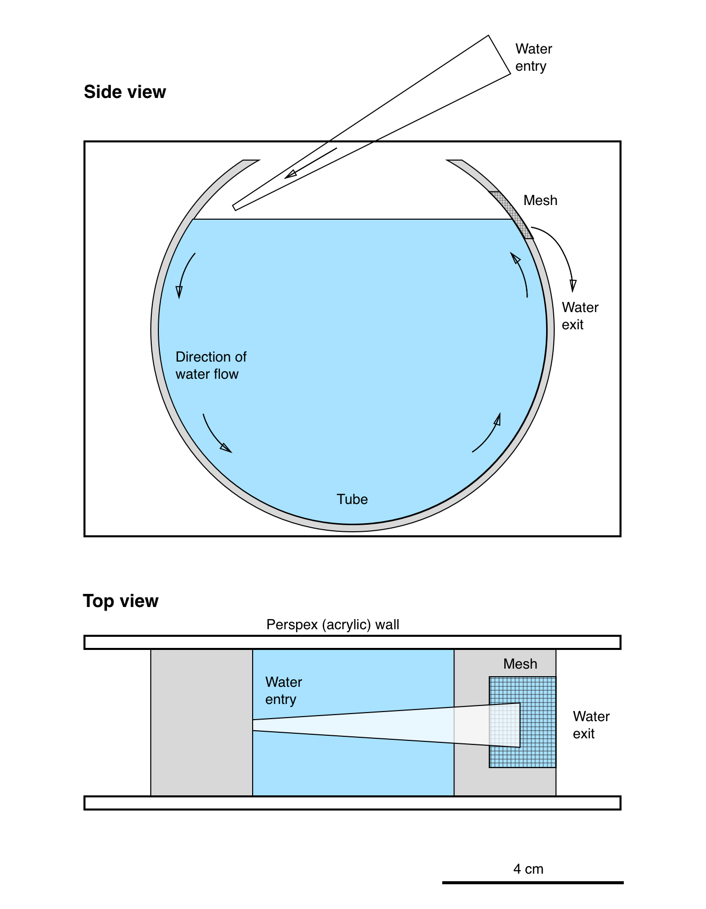
```

(ref:kreisel) Diagram of the mini-kreisel used to incubate *Heliocidaris erythrogramma* embryos. Filtered seawater was supplied at a rate of 50 $\mathrm{mL\ min^{-1}}$. As it enters the kreisel it generates a continuous, circular flow which suspends larvae until they settle.

(ref:skreisel) Diagram of the mini-kreisel used to incubate *Heliocidaris erythrogramma* embryos. 

### Spawning and incubation

<!-- To accommodate all treatments in the larval culture system, larval spawning was performed sequentially for each adult treatment. -->
<!-- The selection of treatment group was performed at random and incubations lasted 14 days each, starting in October 2015 and ending in December 2015. -->
After ca. 3 months, during the spawning season the sea urchins were used to generate larval cultures.
Spawning was induced in October 2015 by injection of 1--2 mL of 0.5 M potassium chloride (KCl).
<!-- During spawning, all treatments were held at their temepratures (ambient: 18.2 &deg;C, elevated 20.2 &deg;C) and the weekly adjustments to temperature were halted. -->
To better represent population-level repsonses to treatments, gametes from at least 3 females and 2 males were pooled, and eggs were pooled at their parental conditions.
Approximately 1000--1500 unfertilised eggs were transferred directly into each kreisel.
Sperm was introduced to all 8 treatment after 15 minutes at a pre-diluted sperm concentration of approximately 2 $\times$ 10^5^ sperm mL^-1^.
<!-- to avoid polyspermy (cite?). -->
The flowthrough system was not turned off during fertilisation, but fertilisation success was checked for each treatment after 20 minutes (98--100 \% for all treatments). 
The embryos left to develop and incubate in the kreisels into settled juveniles, over 14 days, under constant temperature (18 &deg;C to 24 &deg;C) and pH levels (8.0, 7.6), before metabolic rate measurements were made.


### Metabolic rate and growth

Metabolic rate (MO~2~) was estimated using constant-volume respirometry. 
The respirometry chambers used were 2 mL borosilicate glass vials with silicon septum lids (Mfr. No. CERT97E-12, Thomas Scientific, NJ, USA).
Oxygen concentration within the glass vials was measured using needle-type microsensors (NTH-PSt1, PreSens GmbH, Regensburg, Germany) attached to 4-channel and 10-channel meters (OXY-10 micro and OXY-4 micro, PreSens GmbH).
From each kreisel, 50 juveniles were collected at random and placed into a respirometry vial for measurement of oxygen uptake to obtain a collective respirometry value.
Each respirometry vial was rinsed at least two times and filled with 0.22 µm FSW at the same treatment conditions as the source juveniles before the specimens were transferred for measurement.
To account for background respiration, 4 to 6 vials containing only treatment water were measured separately for each larval group.
Respirometry experiments ran for 12 to 15 hours in the dark and oxygen concentrations did not drop below 85 \% air saturation when the experiments were completed.
Temperature was kept constant throughout the experiment using a water bath.

After respirometry, juveniles were collected and photographed under a compound microscope. 
To test for the effects of parental and offspring treatments on growth, 30 photographed juveniles were randomly sampled for measurements of test diameter (µm) as a proxy for growth (Figure \@ref(fig:juvdiam)).
A total of 960 juveniles were measured for test diameter.
Metabolic rate results were scaled to the average test diameter per larvae based on the juveniles measured [pmol O2 h^-1^ larvae^-1^ µm^-1^, @Dorey2013].

```{r juvdiam, fig.cap="(ref:juvdiam)", fig.pos="p"}
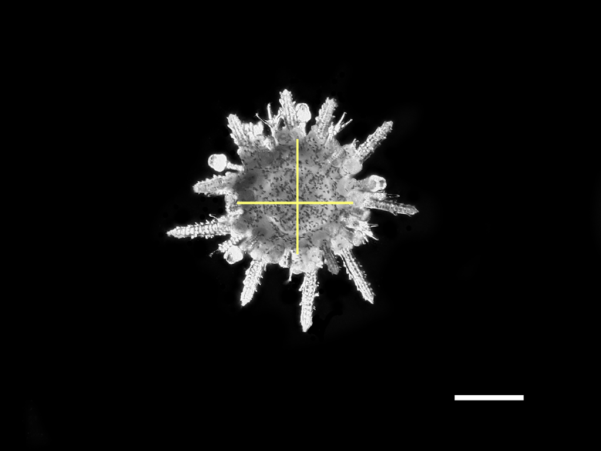
```

(ref:juvdiam) Micrograph of a juvenile *Heliocidaris erythrogramma* after 14 days in treatments. Juveniles that were used for metabolic rate analysis were measured on the oral surface as indicated by the lines to obtain estimates of test diameter (yellow lines) using the image analysis software ImageJ. Scale = 200 µm.

### Data analyses

To test for the effect of parental treatments on metabolic rate and growth response of juveniles across the four temperature treatments, we ran a general linear mixed model (GLMM) on the response data using parental temperature and parental pH as categorical variables, larval temperature and pH as continuous covariates, kreisels as random variables, and then included all possible interactions between all variables.
The GLMM was analysed for effects using analysis of covariance (ANCOVA) with type III error to test for both main effects and the interaction terms.
For metabolic rate, there were no significant three-way interactions ($p <$ 0.05) when the analysis was run, thus the terms were removed and the model re-analysed.
For growth, there were no two- or three-way interactions, thus the model was analysed for main effects only using type II error. 
All data were analysed in R (version 3.5.0) using the `car` package for ANCOVA analyses.

## Results

### Metabolic Rate

We found a significant interaction between parental temperature treatment and offspring metabolic response to temperature (GLMM ANCOVA, F~3,\ 22~ = 24.04, p < 0.001). 
Juvenile metabolic rate increased significantly with temperature (F~1,\ 22~ = 20.41, p < 0.001), but parental acclimation to warmer warmer treatments (+2 &deg;C) resulted in increased metabolism at higher temperatures. 
At 24 &deg;C, the difference in metabolic rates between larval groups was up to $\sim$ 30 \% depending on whether their parents had been acclimated to increased temperature.
Parental acclimation to low pH (7.6) did not have an effect on metabolic rate responses of the offspring (F~1,\ 22~ = 1.63, p = 0.22). 
Offspring exposure to low pH, regardless of parental environment, also did not significantly affect metabolic rate responses (F~1,\ 22~ = 0.65, p = 0.43).

```{r c4ancovamr, message=FALSE}

c4ancovamr <- readr::read_csv("assets/tabs/c4ancovamr.csv")


# example below
# c4mrancova <- readr::read_csv("input/ch_larval/c4ancovagrowth.csv")
kable(c4ancovamr, "latex", caption = "(ref:c4ancovamr)", 
  caption.short = "(ref:sc4ancovamr)", booktabs = TRUE) %>%
  kable_styling(position = "center") %>%
  # kable_styling(latex_options = "hold_position") %>%
  kable_styling(full_width = T) %>%
  row_spec(c(0), bold = T) #%>%  
  # footnote("***: p < 0.001; **: p < 0.01")

```

(ref:c4ancovamr) Generalised linear mixed model (GLMM) analyses of covariance (ANCOVA, Type III) on the effect of parental environments (ambient, +2 &deg;C, pH~T~ 8.0, pH~T~ 7.6) and offspring treatments (18 &deg;C, 20 &deg;C, 22 &deg;C, 24 &deg;C, pH~T~ 8.0, pH~T~ 7.6) on juvenile (14-day) metabolic rate in *Heliocidaris erythrogramma*. Non-significant three-way interactions were removed from the model. \*\*\*: p < 0.001; \*\*: $p <$ 0.01.

(ref:sc4ancovamr) Generalised linear mixed model (GLMM) analyses of covariance (ANCOVA, Type III) on the effect of parental environments and offspring treatments on juvenile metabolic rate in *Heliocidaris erythrogramma*. 


```{r juvrates, fig.cap="(ref:juvrates)", fig.scap="(ref:sjuvrates)", fig.pos="p", out.width="90%"}

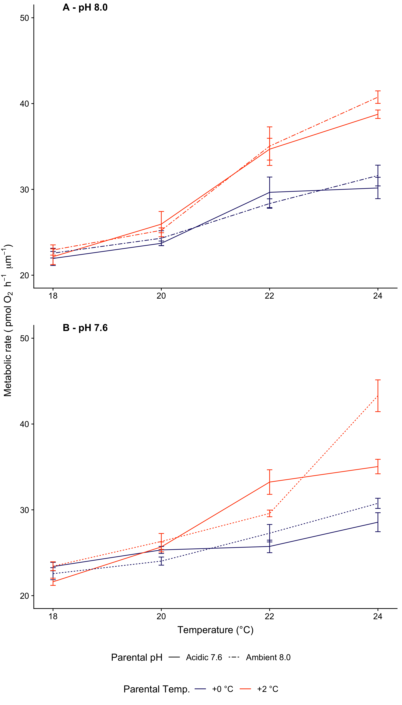

```

(ref:juvrates) Mean metabolic rate ($\pm$SE) of 14-day, juvenile *Heliocidaris erythrogramma* in response to rearing at a range of temperatures (18 &deg;C, 20 &deg;C, 22 &deg;C, 24 &deg;C) under constant **(A)** ambient pH~T~ (8.0); and **(B)** low pH~T~ (7.6) conditions. The juveniles were generated from parents acclimated for 3 months to two temperature (blue: ambient +0 &deg;C, red: elevated +2 &deg;C) and two pH~T~ levels (dashed: ambient 8.0, line: 7.6).

(ref:sjuvrates) Mean metabolic rate ($\pm$SE) of 14-day, juvenile *Heliocidaris erythrogramma* in response rearing at a range of temperatures under constant **(A)** ambient pH~T~; and **(B)** low pH~T~ conditions.

### Growth

Juveniles grew less under acidified (7.6 pH~T~) conditions (F~1,\ 953~ = 38.1, p < 0.001, Table \@ref(tab:juvgrowthancova)), but there was no evidence of any effect of parental acclimation to temperature (F~1,\ 953~ = 0.003, p = 0.95, Table \@ref(tab:juvgrowthancova)) or pH (F~1,\ 953~ = 1.99, p =  0.16, Table \@ref(tab:juvgrowthancova)) on juvenile test diameter.
Overall, there was a 4\% decrease in the mean test diameter of juveniles across all four temperature treatments at ambient pH~T~ (8.0) and low pH~T~ (7.6).


```{r juvgrowthancova, message=FALSE}

gdt <- readr::read_csv("assets/tabs/c4ancovagrowth.csv")

kable(gdt, "latex", caption = "(ref:juvgrowthancova)", 
  caption.short = "(ref:sjuvgrowthancova)", booktabs = TRUE) %>%
  kable_styling(position = "center") %>%
  # kable_styling(latex_options = "hold_position") %>%
  kable_styling(full_width = T) %>%
  row_spec(c(0), bold = T) 


```

(ref:juvgrowthancova) Generalised linear mixed model (GLMM) analyses of covariance (ANCOVA, Type II) on the effect of parental environments (ambient, +2 &deg;C, pH~T~ 8.0, pH~T~ 7.6) and offspring treatments (18 &deg;C, 20 &deg;C, 22 &deg;C, 24 &deg;C, pH~T~ 8.0, pH~T~ 7.6) on juvenile (14-day) test diameter of *Heliocidaris erythrogramma*. Only main effects were analsed as interactions were all not significant. Significant differences are indicated with asterisks. ***: p < 0.001.

(ref:sjuvgrowthancova) Generalised linear mixed model (GLMM) analyses of covariance (ANCOVA, Type II) on the effect of parental environments and offspring treatments on juvenile test diameter of *Heliocidaris erythrogramma*.


```{r juvgrowth, fig.cap="(ref:juvgrowth)", fig.scap="(ref:sjuvgrowth)", fig.pos="p"}

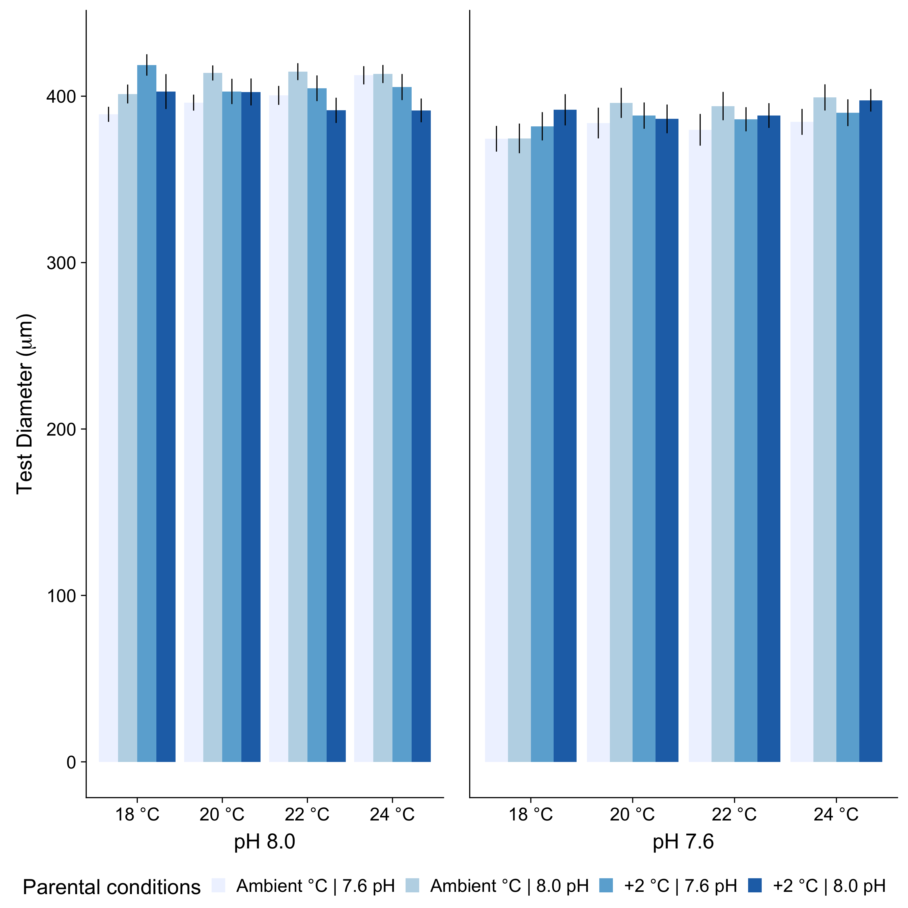

```

(ref:juvgrowth) Mean test diameter (µm $\pm$ SD) of juvenile *Heliocidaris erythrogramma* following rearing to a range of temperatures (18 &deg;C, 20 &deg;C, 22 &deg;C, 24 &deg;C) under constant *(A)* ambient pH~T~ (8.0); and *(B)* low pH~T~ (7.6) conditions. The juveniles were generated from parents that had been acclimated for 3 months to two temperature (blue: ambient +0 &deg;C, red: elevated +2 &deg;C) and two pH~T~ levels (8.0, 7.6).

(ref:sjuvgrowth) Mean test diameter ($\mu m \pm$ SD) of juvenile *Heliocidaris erythrogramma* following rearing to a range of temperatures under constant *(A)* ambient pH~T~; and *(B)* low pH~T~ conditions.

## Discussion

<!-- This study provides experimental evidence that the environment experienced by adult *H. erythrogramma* over a short period of incubation the gonad development period from resting to maturity [see @Laegdsgaard1991] can rapidly alter the response of offspring with respect to changes in temperature. -->
This study provides experimental evidence that the environmental history of the adult *H. erythrogramma* over the gonad development period [see @Laegdsgaard1991] can rapidly alter the response of offspring.
Parental acclimation to warming, but not pH, significantly altered offspring thermal performance, and both parental and offspring environments interacted to influence the shape of metabolic rate performance curve of the offspring.
<!-- In contrast, differences in test size between offspring treatments were not influenced by parental temperature, parental pH environment, or offspring temperature. -->
In contrast, offspring growth was not influenced by parental temperature, parental pH environment, or offspring temperature.
However, offspring incubation to low pH (7.6 pH~T~) significantly reduced the test size of the juveniles, which was expected as low pH has been shown to affect calcification in post-metamorphic juveniles as they begin to calcify to produce their skeleton [@Wolfe2013; @Byrne2011].

The physiological responses of adult *H. erythrogramma* and their resilience to increased temperature and low pH are well-understood from previous studies [[Chapter 3](#multistressor); @Byrne2009; @Byrne2011; @Carey2016; @Harianto2018].
This sea urchin is able to withstand long-term exposure to increased temperature of up to 24 &deg;C without significant mortality [@Byrne2011; @Harianto2018] and it is more sensitive to warming than low pH [[Chapter 3](#multistressor); @Byrne2009].
It was expected that the progeny of *H. erythrogramma* would respond to warmer temperature by increasing their metabolic rates as a potential means to sustain energy balance to support increased growth and development in response to warming, as this was found for *Strongylocentrotus purpuratus* larvae [@Stumpp2011]. 
This was evident from their thermal performances which showed significant increases in metabolic rate with warming.
Whether the increased metabolic performance is beneficial to the fitness of the juveniles is not known from the available data that we have collected.
<!-- Thus the increase in metabolic rate as a carry-over effect is interpreted as a beneficial response. -->
The linear slope of the thermal performance curves differed between juveniles depending on parental temperature treatment.
This indicated strong influence of parental environment on offspring physiological performance.

Our results reinforce the idea that physiological acclimation capacity can be influenced by the interactions between the environmental conditions of the previous generation as well as the conditions experienced during early development.
This is interesting as it implies that transgenerational effects and acclimation are mechanistically linked, which is ecologically important. 
This adds to our understanding of the thermotolerance of *H. erythrogramma* and the influence of parental environment on development [@Byrne2011].
<!-- It is possible that the warm temperature experienced by the adult urchins during gametogenesis led to increased metabolism in their offspring. -->
<!-- *Heliocidaris erythrogramma* has been shown to metamorphose and settle early at higher temperature due to accelerated development [@Byrne2010; @Byrne2011]. -->
<!-- However, this study showed that if parent urchins were acclimated to warmer (+2 &deg;C) temperature prior to spawning, the slope of thermal reaction norms for metabolic rate in offspring were altered, resulting in increased metabolism at higher incubation temperatures compared to offspring spawned from parents acclimated to ambient temperature. -->

<!-- Whether the increased metabolic performance is beneficial to the fitness of the juveniles is not known from the available data that we have collected. -->
<!-- The physiological basis behind bioenergetic processes influenced by metabolism is poorly understood for sea urchin larvae [but see @Stumpp2011] and here, we tested the responses in newly settled juveniles for the first time. -->
In this study, the physiological responses of newly settled sea urchin juveniles were investigated for the first time by measurement of metabolic rate performance.
It is difficult to determine if the increased metabolic performance in the offspring of parents incubated in warmer environments is beneficial and represents increased fitness, or if this would be detrimental to survival in the long term.
While increased metabolism to support growth and development would theoretically be advantageous in early developmental stages, the juvenile test diameter data from this study did not indicate any influence of parental environments on the size of juveniles.
There was no evidence that temperature affected juvenile test size, as found in a previous study on the same species by @Wolfe2013 which also found no significant effects of temperature (21 &deg;C to 25 &deg;C) but a significant effect of low pH (8.0, 7.8, 7.6, 7.4) on the test size of 14-day juveniles.
<!-- It is possible that the sea urchin -->
<!-- Without additional data on metabolic processes  -->

<!-- Interestingly, @Wolfe2013 found that both increased temperature and low pH significantly affected spine length, measured from micrographs obtained by scanning electron microscopy.  -->

<!-- Offspring responses were indicative of the role of parental exposure in influencing their metabolic traits, but  -->
The mechanisms underlying the differences observed between offspring phenotypes observed here are likely due to a combination of different selection pressures. 
Although trans-generational plasticity (TGP) is sometimes attributed to observations of effects on one generation associated with the exposures of a previous generation [@Scanes2018; @Parker2012; @Putnam2015], these cases involved conditioning of adults with established gonads which could already be the source of eventual phenotypes, and thus may not be TGP effects [@Torda2017; @Donelson2018].
In this case, the term carry-over effects may be more accurate as it can include a combination of TGP, maternal or paternal influence and developmental plasticity [@Torda2017; @Beaman2016]. 
<!-- *Heliocidaris erythrogramma* larvae are lecithotrophic, thus maternal legacy. -->
In this study, adults had the opportunity to respond to altered environmental conditions during gametogenesis by modifying maternal investment or cellular defensive mechanisms in the egg [e.g. @Hamdoun2007]. 
As *H. erythrogramma* larvae are lecithotrophic, maternal influence can shape the resilience of developmental stages prior to metamorphosis into juveniles [@Hamdoun2007; @Foo2016].

Developmental plasticity [@Beaman2016] may also have influenced our results especially if environmental conditions present a bottle-neck for successful acclimation, and selective mortality results in only resilient larvae that successfully metamorphose into juveniles.
This has been previously demonstrated by @Foo2016 who showed that strong interactions between maternal source and stress factors (warming and acidification) can result in carry-on effects on fertilisation, larval development and juvenile calcification.
<!-- in carry-on effects between developmental stages to affect fertilisation, larval development and juvenile calcification. -->
To discern this effect the experiment would need to observe the performance of individual offspring from early development, however, this was not possible in our flow-through experiment as dead organisms are washed away.
<!-- which is especially important for *H. erythrogramma* as its larvae is lecithotrophic. -->
<!-- This in turn can have selective consequences on the development of the offspring, which . -->


<!-- and once settled, the juvenile does not consume food for 3 weeks [@Williams1975]. -->
<!-- Thus increased metabolism would therefore deplete its energy reserves quicker to support accelerated development due to increased temperature. -->


<!-- The consequences of increased metabolism are normally moderated with increased feeding or physiological trade-offs to maintain energetic balance [] -->

Transgenerational carry-over studies on marine invertebrates to date have focused on the effects of ocean acidification (i.e. low pH or high *p*CO~2~) on offspring responses [@Thor2015; @Parker2015; @Borges2018; @Scanes2018; @Wong2018; @DeWit2016; @Pedersen2014].
For echinoderms, only two studies so far investigated the effects of temperature [@Zhao2018; @Wong2018], and one looked at the multistressor effects of temperature and pH [@Wong2018].
We measured the effect of parental environment on offspring responses in a multistressor context to investigate metabolic performance by incubating them across a range of temperatures (18 &deg;C to 24 &deg;C).
We also incorporated a seasonal temperature profile for the adult urchins so that parental experience during gametogenesis followed the natural seasonal pattern from winter to summer. 
Sea urchin reproduction involves substantial gonad growth that is influenced by seasonal temperature change [@Giese1959; @Laegdsgaard1991].
<!-- This is in contrast to past studies of transgenerational carry-over effects on marine invertebrates which often maintain constant temperature during parental incubation [e.g. @Wong2018; but see @Zhao2018]. -->
<!-- At a +2 &deg;C increase in temperature, *H. erythrogramma* produced offspring which increased their respiration rates substantially compared to the offspring of parents acclimated to ambient temperature. -->
The experimental design allowed us to realistically quantify performance through a comparison of thermal responses, and to obtain critical insights on offspring responses based on the interactions between parental and offspring environments following acclimation of parents in a seasonally-relevant temperature regime.

Our results indicated that there was an effect of parental acclimation on the physiological responses of their offspring to increased temperature.
Trans-generational effects through phenotypic plasticity are well known to occur through a generation and can play a major role in determining the range of acclimatory responses to temperature, and other environmental variables including ocean acidification [@Zhao2018a], pollution [@Duan2018; @Scanes2018] and ultraviolet radiation [@Kazerouni2017].
A multitude of other environmental variables remain unexplored and it is still unclear how interactions between parents and offspring environments influence adaptation, especially in the context of TGP [@Donelson2018; @Luquet2016].
In addition, inter-individual variation and how it affects selection responses has not been tested in the current study.
Investigating this variation will be essential in determining if there are individuals within the population which may be pre-adapted to future climate change.
For ecologically-important sea urchins such as *H. erythrogramma*, further research is required to better understand the potential for multi-generational TGP effects in which germ-line effects can be discerned, and how these mechanisms will facilitate persistence in a rapidly changing ocean.


<!-- which shapes the transgenerational strategies in response to environmental change. -->
<!-- While the only interactions we saw were only  -->


<!-- Whether this increases the resilience of the juveniles to the increased temperature cannot be determined from the data presented. -->
<!-- *Heliocidaris erythrogramma* larvae is lecithotrophic and once settled, the juvenile does not consume food for 3 weeks [@Williams1975]. -->
<!-- Thus increased metabolism would therefore deplete its energy reserves quicker to support accelerated development due to increased temperature. -->


<!-- Cite Kenny to show that we can't see growth from test size here, but his paper showed the same result but there were differences in spine development. -->
<!-- In general, changes in temperature or pH have also been shown to affect  -->
<!-- Sea urchin parental phenotypes induced by the environment can influence offspring responses, as shown in past studies investigating the effects on larval developmental responses when parents were acclimated to differential temperature [@Wong2018; @Zhao2018] or pH environments [@Dupont2013; @Uthicke2013; @Suckling2014]. -->


<!-- While metabolic responses are fully reversible  -->
<!-- Further, while developing in low pH conditions significantly lowered the test diameter of offspring juveniles, there was no evidence to show that parental acclimation influenced the growth response. -->
<!-- The experimental design highlights that parental influence on offspring responses can occur rapidly within a generation and over a short period of gamete development.  -->
<!-- Despite showing that there was an effect of parental environment on offspring phenotype, the exact mechanisms responsible for the differences observed between offspring responses cannot be determined from the data presented.  -->
<!-- The possibility of trans-generational plasticity is often cited for past studies when offspring phenotypes differ, but carry-over effects across a single generation may also be due to a combination of maternal or paternal influence and developmental plasticity and may not involve trans-generational plasticity [@Torda2017].    -->

<!-- Exposure to warming increased metabolic rates significantly in the juveniles, which is in accordance with the literature due to the  -->

<!-- This study tested for the parental effects of acclimation to warming and reduced pH conditions in *H. erythrogramma* using laboratory conditions. -->

<!-- Many past studies investigating any carry-over effects of climate change have assumed transgenerational plasticity even though adults experienced changes in environmental conditions during their adult life [e.g. @Zhao2018] -->


<!-- Identifying whether the carry-over effects of resilience to climate change across a single generation is due to transgenerational plasticity is challenging since any differences observed in these experiments could also be due to a combination of developmental plasticity [@Beaman2016; @Torda2017] or maternal influence [@Wong2018]. -->

<!-- Parental exposure to warming and reduced pH conditions were only performed over 3 months before the spawning season. -->


<!--chapter:end:chapters/13-transgen.Rmd-->

# `respR` -- an R package for the analysis of respirometry data {#package}
\chaptermark{respR -- an R package for respirometry}


```{r}
library(respR)
```
<!-- {\small -->
<!-- This chapter is formatted for Methods in Ecology and Evolution. It is under review as "Harianto J, Carey N and Byrne M (2018). respR -- an R package for the analysis of respirometry data." The R package, \texttt{respR}, has been published on GitHub as an open-source project. -->
<!-- } -->


## Abstract {-}

1. Respirometry is a ubiquitous practice in experimental biology, but there is a lack of standard practices when analysing the resulting data, limiting transparency and reproducibility. As respirometry datasets become increasingly large and analytical approaches more complex, manipulating the data remains a challenge and often intractable with existing tools.
2. Here we describe the \texttt{respR} R package, a collection of functions that implement a workflow-based approach to automate the analysis and visualisation of respirometry data. The package can be used for closed, intermittent flow, flow-through and open-tank respirometry and uses well-defined sets of rules to reliably and rapidly generate reproducible results.
3. We demonstrate how \texttt{respR} uses novel computing methods such as rolling regressions and kernel density estimates to reliably detect maximum, minimum and most linear sections of the data, and critical oxygen tension, P\textsubscript{crit}.
4. Although designed specifically with aquatic respirometry in mind, the object-oriented approach of the package and the unit-less nature of its analytical functions mean that parts of the package can easily be used to estimate linear relationships from a range of applications in many research disciplines.


##   Introduction

Metabolic rate is a fundamental trait associated with virtually all biological functions and is key in predicting patterns in ecology and conservation biology, from populations [@Seibel2007; @Barneche2014] to ecosystems [@Brown2004].
It has been widely investigated in studies of the effects of external stressors on organisms and is increasingly used to study resilience in climate change-related studies where warming is expected to drive increased metabolism in ectotherms [e.g. @Portner2002; @Carey2016; @Delorme2016].
It is also is by far the most common metric used to assess physiological performance in whole organisms, tissues and cells [@White2013].
While there are other methods such as monitoring heart or ventilatory rates, metabolic rate is typically quantified using respirometry, which measures the rate of oxygen uptake over time [@Lighton2008].

Depending on the experiment, different metabolic rate parameters may be of interest to researchers.
These include maximum metabolic rate (MMR, or \(\dot{M}\mathrm{O_{2,max}}\)), rates under high activity or exhaustive exercise, and minimal metabolic rate (\(\dot{M}\mathrm{O_{2,min}}\)), which may be termed standard (SMR), basal (BMR), or resting metabolic rate, and typically represents the minimum metabolic cost of maintaining biological functioning [@White2013; @Chabot2016].
Routine metabolic rate (RMR) is similar to \(\dot{M}\mathrm{O_{2,min}}\), but takes into account that in some organisms energy is expended on small, spontaneous movements to maintain posture or position [@Rogers2016].
Another metric of interest is the critical oxygen tension, which represents the lowest level of oxygen at which aerobic metabolism is independent of the ambient partial pressure of oxygen [P~crit~; @Yeager1989; @Hochachka2002].

Respirometry studies are increasingly outputting large, high-resolution data conducted over long periods [e.g.~20 h; @Norin2012].
In many cases, processing the data involves an ad hoc selection of data points with poorly reported criteria, and subsequent manual processing of the data subset(s) using a spreadsheet program (e.g.~Microsoft Excel) or an integrated development environment (IDE, e.g.~R or Matlab).
These approaches can be tedious and time-consuming especially when spreadsheet programs struggle with the vast datasets that are generated, while IDEs require a degree of expertise to use and have substantial learning curves.
Dedicated software are also available to perform metabolic rate analyses, but many have costly licensing requirements (e.g.~AutoResp by Loligo Systems), complicating or preventing their use on multiple machines, and are proprietary and closed-source, hindering scientific reproducibility and transparency.

A number of open-source R software packages have recently become available which are designed for, or are suitable to analyse data from respirometry.
The \texttt{respirometry} package (\url{https://CRAN.R-project.org/package=respirometry}) contains a comprehensive collection of tools to explore and evaluate experimental parameters in aquatic respirometry and is useful for the design and diagnosis of experimental setups.
The \texttt{rMR} package (\url{https://CRAN.R-project.org/package=rMR}) performs interval-based metabolic rate calculations and has a method to analyse P\textsubscript{crit} using the "broken-stick" regression method (Yeager \& Ultsch, 1989).
\texttt{FishResp} (\url{https://CRAN.R-project.org/package=FishResp}) is focused on the analysis of intermittent respirometry and performs background respiration corrections.
The package \texttt{LoLinR} [@Olito2017], while not specifically coded for respirometry, provides a statistically robust method of detecting a "best-fit" regression, and performs well at identifying truly linear subsets of a data series.

Here we describe \texttt{respR}, an open-source R package designed to provide an efficient and reproducible workflow for the analysis of respirometry data (Table \ref{funlist}).
The package contains utilities to: (1) analyse closed, intermittent, flow-through and open-tank respirometry data [see @Lighton2008; @Svendsen2016], (2) determine volume and mass specific oxygen uptake rates, (3) automatically detect maximal and minimal rates, P\textsubscript{crit}, and (4) detect the most linear sections of data using novel rolling regression and kernel density estimation techniques.
In addition, the package contains "housekeeping" functions for data import and export as supplementary material at all stages of respirometry analysis, including saving raw data, subsetting criteria, background corrections, units of measure, and resulting metabolic rates.
This streamlines the reporting of analytical methods and allows reviewers or other investigators to fully reproduce or scrutinise the results.
Additional functions useful in processing respirometry data are available, and are described in more detail in our online documentation (\url{https://januarharianto.github.io/respR/}).
A comprehensive series of vignettes, which explain all package functions, discuss best practices and alternative methods are also available (Table \ref{vignettelist}).

\section{Package overview}\label{package-overview}

The \texttt{respR} package streamlines the analysis of respirometry data by partitioning the data processing workflow into several independent actions: (1) initially, data are imported, checked for common errors, plotted for visual inspection and exported as an object; (2) the object is then analysed to estimate the desired rate parameter; (3) diagnostic plots are automatically generated and the data can be further explored using the generic S3 \texttt{print()}, \texttt{plot()}, and \texttt{summary()} commands to verify the results; (4) adjustments to the data from background respiration are applied; (5) volume or mass-specific rate conversions, specific to the respiratory chamber and specimen(s), are calculated where necessary (Fig. \ref{diagram}).
By design, each step of the workflow requires minimal manual manipulation of the data, and the user can pass the output of each function to the next.
This object-oriented approach makes \texttt{respR} easy to use, even for novice users of R, and allows R programmers to extend the functionality of the package easily.
Note, we use \(\dot{O} \mathrm{_2}\) in the text to represent the unit-less rate of O\textsubscript{2} use with regard to the time unit, and to distinguish it from other commonly reported metrics (e.g. \(\dot{M}\mathrm{O_2}\), \(\dot{V}\mathrm{O_2}\)).
Installation of \texttt{respR} can be performed directly via the R console using \texttt{devtools}:

<!-- \begin{lstlisting} -->
<!-- # install.packages("devtools") # uncomment to run -->
<!-- devtools::install_github("januarharianto/respR") # install -->
<!-- library(respR) # load -->
<!-- \end{lstlisting} -->


```{r, echo=TRUE, eval=FALSE}
# install.packages("devtools") # uncomment to run
devtools::install_github("januarharianto/respR") # install
library(respR) # load package
```


To illustrate the main features of the package, five example datasets, (\texttt{sardine.rd}, \texttt{urchin.rd}, \texttt{intermittent.rd}, \texttt{squid.rd} and \texttt{zeb\_intermittent.rd}) are distributed with  \texttt{respR}.


\section{Data import and exploration}\label{data-import-and-exploration}

Data should be formatted correctly before use in \texttt{respR}. The function \texttt{inspect()} extracts a two-column data frame from a multi-column dataset and performs error checks while plotting the data for quick data visualisation.
Time data, being a continuous variable, should be sequential, without duplicates.
Ideally, sampling frequency will be monotonic, but in many instances this may not be the case, such as experiments with irregular sampling intervals, or because machine drift and/or data dropouts frequently occur during regular sampling.
The information obtained from the checks allow us to make informed decisions on how to best analyse the data, and fix any cryptic errors (e.g.~non-numeric data) easily.
In particular, knowing whether a timeseries is irregular, or not, will allow us to decide whether to use time-based data extraction methods to obtain data segments of predetermined time intervals.

Using \texttt{inspect()} is optional -- the main functions in our package will readily work with data frames that were not processed by the function.
Running \texttt{inspect()} is an exploratory step that flags potential issues before analysis. Error check results are summarised in the R console and all tests are saved in the output object with the locations (i.e.~row numbers), if any, of the errors:

<!-- \begin{lstlisting} -->
<!-- inspect(squid.rd, plot = F) -->

<!-- #> No issues detected while inspecting data frame. -->
<!-- #>  -->
<!-- #> # inspect # ----------------------------- -->
<!-- #>               Time   o2 -->
<!-- #> NA/NAN        pass pass -->
<!-- #> sequential    pass    - -->
<!-- #> duplicated    pass    - -->
<!-- #> evenly-spaced pass    - -->
<!-- \end{lstlisting} -->

```{r, echo=TRUE, eval=FALSE}
inspect(squid.rd, plot = FALSE)
#> # inspect # -----------------------------
#>               Time   o2
#> NA/NAN        pass pass
#> sequential    pass    -
#> duplicated    pass    -
#> evenly-spaced pass    -

```


\section{Data analysis}\label{data-analysis}


\subsection{Calculating background rate}\label{calculating-background-rate}

Background oxygen consumption rate is often measured to account for the contribution of microbial respiration, and applied as a correction to experimental rates [@Rogers2016].
Background rates typically account for a small percentage of experimental rates, and multiple ``blank'' experiments are usually conducted and the rates averaged to obtain a more accurate estimate of the correction [e.g. @Daoud2007; @Carey2014a].
The function \texttt{calc\_rate.bg()} uses simple linear regression to process multiple background rate measurements simultaneously.
Data segments can be truncated before analysis by time period or row numbers. The results are stored as an object for later use.


\subsection{Processing respirometry data}\label{processing-respirometry-data}

Typically, the analysis of respirometry data requires the selection one or more linear sections of the data for more accurate calculations of \(\dot{O} \mathrm{_2}\) [e.g. @Gordon1989; @Carey2016; @Chu2017].
The function \texttt{calc\_rate()} can manually extract and process data subset from respirometry data. Data subsets can be selected by (1) time period, (2) row numbers, (3) O\textsubscript{2} decrease or (4) proportion, which should accommodate most, if not all, manual data selection requirements and allow for consistent reporting of methods and results.
Rates are determined using linear regression.

For more complex respirometry parameters, the function \texttt{auto\_rate()} uses a novel method of combining rolling regression and kernel density estimate algorithms to detect patterns in respirometry data.
First, \texttt{auto\_rate()} always performs a rolling linear regression on the data before additional methods are applied.
The rolling regression runs all possible ordinary least-squares (OLS) linear regressions \((y=\beta_0+\beta_1X+\epsilon)\) of a fixed sample width across the entire data series, and is expressed as: \[y_t(n)=X_t(n)\beta(n)+\epsilon_t(n), t=n,...,T\] where \(n\) is the window of width \(n < T\), \(T\) is the total length of the dataset, \(y_t(n)\) is the vector of observations (e.g.~oxygen concentration), \(X_t(n)\) is the matrix of explanatory variables, \(\beta (n)\) is a vector of regression paramters and \(\epsilon_t(n)\) is a vector of error terms. Thus, a total of \((T - n) + 1\) number of overlapping regressions are fitted.
Here, we can obtain maximum and minimum rate values of width \(n\) by ranking the regressions, and if a periodic, interval-based regression is required, the function automatically selects regression metrics for non-overlapping sections of the data (Fig. \ref{rollvsint}).

The \texttt{auto\_rate()} function can also automatically select the most stable (i.e. most linear) sections of noisy data by applying additional analytical techniques.
First, we take advantage of the key assumption that linear sections of a data series are reflected by stable parameters across the rolling estimates, a property that is often applied in financial statistics to evaluate model stability and make forward predictions on time-series data [@Zivot2006].
We use kernel density estimation (KDE) techniques, often applied in various inference procedures such as machine learning, pattern recognition and computer vision, to automatically aggregate stable (i.e. linear) segments as they naturally form one or more local maximums (``modes'') in the probability density estimate.

KDE requires no assumption that the data is from a parametric family, and learns the shape of the density automatically without supervision.
KDE can be expressed as: \[\hat{f}(x) = \frac{1}{nh^d}\sum_{i = 1}^{n} K \left(\frac{x - X_i}{h} \right)\] where \(f\) is the density function from an unknown distribution \(P\) for \(X_1,...,X_n\), \(K\) is the kernel function and \(h\) is the optimal smoothing bandwidth. The smoothing bandwidth is computed using the solve-the-equation plug-in method [@Sheather1991; @Jones1996] which works well with multimodal or non-normal densities [@Raykar2006].

We then use \(h\) to select all values in the rolling regression output that match the range of values around each mode (\(\theta_n\)) of the KDE (i.e. \(\theta_n \pm h\)). These rolling estimates are grouped and ranked by size, and the upper and lower bounds of the data windows they represent are used to re-select linear segments from the original data series. The rolling estimates are then discarded while the ranked data segments are analysed using linear regression. Summary diagnostics and visual plots provide supporting information on the technique and the validity of the results (Figs. \ref{autorate1} \& \ref{autorate2}).
The performance of this particular method is further discussed in Appendix C.


\subsection{Estimating rate from flow-through respirometry}

The function \texttt{calc\_rate.ft()} is used to specifically analyse flow-through respirometry data, and is similar to \texttt{calc\_rate()} in functionality. However it accepts additional inputs of incurrent and excurrent oxygen concentration, and flow rate, based on the equation: \[\dot O_2 = (C_iO_2 - C_eO_2)FR\] where \(\dot{O} \mathrm{_2}\) is the rate of O\textsubscript{2} uptake over time, \(C_iO_2\) and \(C_eO_2\) are the incurrent and excurrent O\textsubscript{2} concentrations, and \(FR\) is the flow rate of water through the system [@Lighton2008].


\subsection{Estimating critical oxygen tension, P\textsubscript{crit}}

We provide two methods of estimating P\textsubscript{crit}. The first is a "broken-stick" regression (BSR) approach, adopted from @Yeager1989 in which two segments of the data are iteratively fitted and the intersection with the smallest sum of the residual sum of squares between the two linear models is the estimated critical point.
The second method is a wrapper for the segmented, or non-linear "broken-line" regression approach, presented by @Muggeo2003 and available as part of the \texttt{segmented} R package [@Muggeo2008], which estimates the critical point by iteratively fitting two intersecting models on the data and selecting the point that minimises the ``gap'' between the two fitted lines.
Both methods are well-used in the literature [@Labra2016; @Chu2017; @Hansen2017; @Svendsen2016; @Regan2017].
Note that the accuracy of the BSR method to describe non-linear traits is increasingly being debated [@Marshall2013] and is discussed in greater detail in our vignettes (see Supplementary Material).

As P\textsubscript{crit} is the break-point in the relationship between ambient dissolved oxygen (O\textsubscript{2}) and rate of oxygen uptake (\(\dot{O} \mathrm{_2}\)), the user has two options to input data.
With an \(O_2 \sim\) timeseries dataset, the function will automatically perform both a rolling mean and a rolling regression of O\textsubscript{2} data over time to produce the required \(\bar O_2 \sim \dot O_2\) dataset (Fig. \ref{fpcrit}).
This computationally intensive, but fast, method is unique to \texttt{respR} as most other methods use non-overlapping intervals to characterise their data, but rolling metrics are more sensitive to P\textsubscript{crit} analysis due to their high resolution.
Alternatively, the user can input previously-determined rate \(\sim \dot{O}\)\textsubscript{2} data and the function will determine P\textsubscript{crit} using the input data directly.


\section{Correcting, converting and scaling data}


\subsection{Corrections for background respiration}

The function \texttt{adjust.rate()} can be used to correct \(\dot{O} \mathrm{_2}\) estimates for background respiration.
As the oxygen consumption units are not mass-specific at the point of correction, the function adjusts \(\dot{O} \mathrm{_2}\) directly without bias using the equation: \[\dot O_{2(correction)} = \dot O_2 - (\phi_d + \dot O_{2(bg)})\] where \(\phi_d\) is the air-water oxygen flux as determined by Fick's Law [@Leclercq1999] and \(\dot O_{2(bg)}\) is background respiration.


\subsection{Rate conversions}\label{rate-conversions}

Because \texttt{respR} does not make any underlying assumptions on the units used to calculate metabolic rate, we provide two functions, \texttt{convert\_DO()} and \texttt{convert\_rate()}, to transform \(\dot{O} \mathrm{_2}\) into volume-adjusted or mass-specific units.
These functions are comprehensive and can currently convert between 168 combinations of units and has support for changes in temperature, salinity and pressure (Table \ref{convertlist}).
This unique approach has the advantage of allowing rate calculations for data that may not be entirely supported by the \texttt{respR} workflow.
For example, measurements of respiration can be scaled to surface area [e.g. diatoms \& coral; @Iversen2013; @Naumann2014], volume [e.g. copepod eggs, @Hammervold2015], or density [e.g. sea urchin larvae, @Stumpp2011], all of which are not yet supported in \texttt{respR}'s conversion functions.
Thus any respirometry data may still be analysed without any restriction until conversion is required, in which users at this point perform those conversions manually.

The function \texttt{convert\_DO()} is used to convert units of oxygen concentration only (e.g. \(\mathrm{mg/L}\) or \%; Table 2).
For ease of use, we implemented a simple fuzzy string-matching algorithm to match relevant units (e.g. "\(\mathrm{mg/L}\)", "\(\mathrm{mg/l}\)", "\(\mathrm{mg\ L^{-1}}\)" and "\(\mathrm{mg\ l^{-1}}\)" are identified as the same units).
The function \texttt{convert\_rate()} is conceptually similar to \texttt{convert\_DO()}, but it focuses on volumetric and mass-specific conversions (e.g. \(\mathrm{mg\ h^{-1}\ kg^{-1}}\)).

\section{Concluding remarks and future improvements}

The package \texttt{respR} implements a number of methods not available in any other R package or software.
These include the use of rolling regression techniques to estimate \(\dot{M}\mathrm{O_{2,max}}\), \(\dot{M}\mathrm{O_{2,min}}\), and P\textsubscript{crit}, the use of kernel density estimation techniques to detect and rank linear segments of the data, support for unevenly-spaced time data, and the ability to extract and analyse data precisely by time, row, or O\textsubscript{2} concentration.
It is important to note, however, that while \texttt{respR} contains automated methods to assist in processing difficult data, no amount of data manupilation can fix poor data.
Users should still ensure that their data has been collected using acceptable methods [e.g. closed respirometry setups should always be equipped with mixing devices, see @Clark2013] before performing analyses of any kind.
Nevertheless, \texttt{respR} adheres to well-defined rules to obtain rates of interest, is extensively documented online, and its methods and results are transparent and fully reproducible.
The \texttt{respR} package allows for more effective and less time-consuming handling and processing of the broad datasets that are increasingly common in respirometry research.


<!-- \section{Acknowledgements} -->

<!-- This work was supported by an NSW Environmental Trust grant (MB), and Endeavour Postdoctoral Fellowship (NC) and a Professor NGW \& Mrs Ann Macintosh Memorial Scholarship from the University of Sydney (JH). -->
<!-- Some experimental data were obtained from experiments performed at the  Sydney Institute of Marine Science (SIMS). -->
<!-- This manuscript is SIMS  contribution number 240. We thank our reviewers, whose comments have  greatly improved the manuscript. -->


<!-- \section{Data Accessibility} -->

<!-- The \texttt{respR} R package is open-source and available on GitHub (\url{https://github.com/januarharianto/respR}). -->
<!-- Package vignettes are also open-source, accessible at \url{https://januarharianto.github.io/respR/index.html}. -->
<!-- Installing and loading \texttt{respR} will automatically load all example  data used in this paper. -->
<!-- Alternatively, the data may be downloaded manually from GitHub at \url{https://github.com/januarharianto/respR/tree/master/data}. -->
<!-- Since the package is updated regularly, all code, data and documentation used to reproduce this manuscript have been archived at \url{http://doi.org/10.5281/zenodo.2548602} as \texttt{respR} v.1.5.1. -->

<!-- \section{Author contributions}\label{author-contributions} -->

<!-- JH, NC and MB conceived the ideas and designed methodology; JH wrote the code, NC edited code and analysed the example data; JH, NC and  MB led the writing of the manuscript. -->
<!-- All authors contributed critically  to the drafts and gave final approval for publication. -->


<!-- TABLE 1 ============================================================== -->

\begin{table}[ht]
\centering
\caption{Main functions available in \texttt{respR}.}
\label{funlist}
\begin{tabular}[t]{p{0.3\linewidth}p{0.7\linewidth}}
\toprule
Treatment A&Treatment B\\
\midrule
\texttt{import\_data()} & Automatically import and format raw data files from commonly-used respirometry devices. \\
\texttt{inspect()} & Checks data for errors, extracts a two-column dataframe for analysis, and plots the data for quick visualisation. \\
\texttt{calc\_rate.bg()} & Calculates background oxygen uptake rate. \\
\texttt{calc\_rate()} & Calculates oxygen uptake rate from precise segment(s) of the data. \\
\texttt{calc\_rate.ft()} & Calculates oxygen uptake rate in flowthrough experiments. \\
\texttt{auto\_rate()} & Calculates ``max'', ``min'', ``interval'' or ``best-fit'' rates. \\
\texttt{adjust\_rate()} & Corrects data for background changes in oxygen concentration. \\
\texttt{convert\_DO()} & Converts between units of oxygen concentration. \\
\texttt{convert\_rate()} & Converts experimental rates to specific units. \\
\texttt{pcrit()} & Calculates critical oxygen tension, P\textsubscript{crit}. \\
\texttt{subsample()} & Reduces the size of a large data frame, by extracting every n-th row. \\
\texttt{subset\_data()} & Extract a subset of a data frame. \\
\texttt{intermittent.rd.rda} & Respirometry data for a single sea urchin~specimen (\textit{Heliocidaris erythrogramma}) collected using intermittent respirometry. Data were collected over 80 minutes. \\
\texttt{sardine.rd.rda} & Respirometry data for a single sardine specimen, \textit{Sardinops sagax}. Data were collected over 2 hours. \\
\texttt{squid.rd.rda} & Respirometry data for a single squid specimen, \textit{Doryteuthis opalescens}, to determine P\textsubscript{crit}. Data were collected over a 9-hour period. \\
\texttt{urchins.rd.rda} & Multi-column dataset containing respirometry and background respirometry data for 16 sea urchin specimens (\textit{Heliocidaris erythrogramma}). Data for each urchin were collected over 45 minutes. \\
\texttt{zeb\_intermittent.rd.rda} & Multiple measurements (106 replicates, plus initial and end background measurements) of oxygen consumption in a zebrafish, \textit{Danio rerio}, obtained using intermittent flow respirometry. \\
\bottomrule
\end{tabular}
\end{table}

<!-- % TABLE 2 ============================================================= -->

\begin{table}[ht]
\centering
\caption[R Vignettes for the \texttt{respR} package, with worked examples, discussions and comparisons to other R package functions.]{R Vignettes for the \texttt{respR} package, with worked examples, discussions and comparisons to other R package functions. Available online: https://januarharianto.github.io/respR/articles/respR.html.}
\label{vignettelist}
\begin{tabular}[t]{>{\raggedright}p{0.4\linewidth}p{0.6\linewidth}}
\toprule
Treatment A&Treatment B\\
\midrule
Getting Started & Introduction to respirometry and \texttt{respR}. \\
Importing your data & How to import and format data using \texttt{respR}. \\
Closed-chamber respirometry & A typical workflow example that introduces the main functions of \texttt{respR}. \\
\texttt{auto\_rate()}: Automatic detection of metabolic rates & Introduction to the \texttt{auto\_rate()} function. \\
Performance of \texttt{auto\_rate()} in detecting linear regions & Assessing the accuracy of \texttt{auto\_rate()} using custom performance tests. \\
Comparative performance of \texttt{auto\_rate()} and LoLinR & A comparison of \texttt{auto\_rate()} with a similar function in \texttt{LoLinR} (Olito et al., 2017). \\
Intermittent-flow respirometry: Simple example & How to analyse simple intermittent-flow data. \\
Intermittent-flow respirometry: Complex example & A more complex example on the analysis of intermittent-flow data from a larger experiment. \\
Flowthrough respirometry & How to analyse flowthrough respirometry data. \\
P\textsubscript{crit} analysis & How to estimate P\textsubscript{crit}. \\
Reproducibility & Using \texttt{respR} to promote open, reproducible respirometry analyses. \\
respR and the tidyverse & A quick guide on how to integrate \texttt{respR} functions with the popular \texttt{dplyr} package, and more. \\
A comparison of \texttt{respR} with other R packages & Comparing outputs of \texttt{respR} to other R package functions, and a discussion of the advantages of using \texttt{respR}. \\
When to use \texttt{respR} & A discussion of what \texttt{respR} offers and when users should consider using the package for respirometry analyses. \\
\bottomrule
\end{tabular}
\end{table}

<!-- % TABLE 3 ============================================================= -->

\begin{table}[tbp]
\centering
\caption{Units available for conversions in \texttt{convert\_DO()} and \texttt{convert\_rate()} functions in \texttt{respR}.}
\label{convertlist}
\begin{tabular}{p{0.2\linewidth}p{0.3\linewidth}p{0.5\linewidth}}
\toprule
\textbf{Parameter} & \textbf{Used in} & \textbf{Units} \\
\midrule
Oxygen; O\textsubscript{2} & \texttt{convert\_DO()}, \texttt{convert\_rate()} & mg L\textsuperscript{-1}, $\mu$g L\textsuperscript{-1},  $\mu$mol L\textsuperscript{-1}, mL L\textsuperscript{-1}, $\mu$g kg\textsuperscript{-1}, mg kg\textsuperscript{-1}, $\mu$mol kg\textsuperscript{-1}, mmol kg\textsuperscript{-1}, mL kg\textsuperscript{-1}, hPa, kPa, mmHg, inHg\\
Mass & \texttt{convert\_rate()} & $\mu$g, mg, g, kg \\
Time & \texttt{convert\_rate()} & second, minute, hour \\
\bottomrule
\end{tabular}
\end{table}

<!-- % FIGURE 1 ============================================================ -->

\begin{figure}

{\centering \includegraphics[width=1\linewidth]{assets/figs/c5fig1}

}

\caption[Diagram showing steps in a typical workflow in the analysis of respirometry data using \texttt{respR}.]{Diagram showing steps in a typical workflow in the analysis of respirometry data using \texttt{respR}.
\textbf{(A)} Data are first checked for errors before \textbf{(B)} main functions are used to extract and analyse segments of the data.
\textbf{(C)} Summarised results and diagnostic plots provide immediate visual feedback on the outcome of the analyses. \textbf{(D)} Once the rate estimates are obtained, they can be converted into volume and/or mass-specific rates.}\label{diagram}
\end{figure}

<!-- % FIGURE 2 ============================================================ -->

\begin{figure}

{\centering \includegraphics[width=0.85\linewidth]{assets/figs/c5fig2}

}

\caption[Illustration showing the sampling methods used by \texttt{auto\_rate()}.]{Illustration showing the sampling method used by \texttt{auto\_rate()} during \textbf{(A)} interval regression analysis, where sample windows do not overlap and \textbf{(B)} rolling regression analysis, where sample windows overlap and move forward by one sample unit at a time.}\label{rollvsint}
\end{figure}

<!-- % FIGURE 3 ============================================================ -->

\begin{figure}

{\centering \includegraphics[width=0.7\linewidth]{assets/figs/c5fig3}

}

\caption[Output plots produced by \texttt{auto\_rate()}.]{Depending on the \texttt{method} input, the function, \texttt{auto\_rate()} is able to show: (A) the maximum rate detected; (B) the minimum rate detected; (C) the most linear region as determined by kernel density estimates; and (D) calculation of rate by fixed-width intervals.
Data obtained from analysis of the \texttt{sardine.rd} dataset.}\label{autorate1}
\end{figure}

<!-- % FIGURE 4 ============================================================ -->

\begin{figure}

{\centering \includegraphics[width=0.7\linewidth]{assets/figs/c5fig4}

}

\caption[Diagnostic plots produced by the function, \texttt{auto\_rate()}.]{Diagnostic plots produced by the function, \texttt{auto\_rate()}: (A) the rolling regression of rate as a function of time, with dotted lines indicating the region used to estimate the parameter; (B) a kernel density plot that shows only when the \texttt{linear} method is called; (C) a residual plot of the regression; and (D) a normal Q-Q plot of the residuals of the regression.
Data obtained from analysis of the \texttt{sardine.rd} dataset.}\label{autorate2}
\end{figure}

<!-- % FIGURE 5 ============================================================ -->

\begin{figure}

{\centering \includegraphics[width=0.85\linewidth]{assets/figs/c5fig5}

}

\caption[Output plots of the function \texttt{pcrit()}, used in the calculation of critical oxygen tension, P\(_{crit}\).]{Output plots of the function \texttt{pcrit()}, used in the calculation of critical oxygen tension, P\(_{crit}\). \textbf{(A)} To determine P\(_{crit}\) in a regular \(O_2\) time series, the function performs a rolling regression against the rolling mean of the data. This step is skipped if similar data is already provided, and the
argument \texttt{has.rate\ =\ TRUE} is used in the function. This produces \textbf{(B, C)} data that represents the rate of \(O_2\) consumption as a function of \(O_2\) concentration. Regression lines are then fitted iteratively, based on the broken-stick methods of Yeager and Ultsch (1989) and the segmented approach of Muggeo (2003), until convergence is achieved. The output then highlights the critical points as indicated by the coloured lines.
\textbf{(D)} A close-up plot of the results in B and C is provided for the user to visualise the positions of the dotted lines relative to the x-axis.}\label{fpcrit}
\end{figure}


<!--chapter:end:chapters/14-app.Rmd-->

# General discussion {#gendiscussion}

<!-- The future of our oceans depend on the amount of anthropogenic carbon emitted in the next few decades. -->

<!-- The era of the Anthropocene continues to stress our climate system worldwide, and these changes are causing deterioration of our marine ecosystems at an unprecedented scales, from mass mortality events to the redistribution of marine biodiversity, all compounded by the threat of increased extreme events [@Hughes2017a; @Harris2018; @Sommer2018]. -->
A significant challenge in this era of the Anthropocene is to improve our predictive power with regards to the ecologically important outcomes of climate change on our ocean. 
These impacts are multi-faceted, with strong synergies between abiotic stressors (e.g. temperature and pH) shaped by regional patterns of variability of these stressors and the physiological responses of associated populations.
Addressing the influence of these factors is vital to predicting the resilience of marine communities to environmental change [@Boyd2015; @Lange2017].
<!-- However, understanding the basic physiological mechanisms influencing the responses of marine organisms to these stressors, of which temperature is a fundamental driver, is also important [[Chapter 2](#warming), [Chapter 3](#multistressor), [Chapter 4](#transgen); @Somero2017; @Pettersen2018]. -->
In addition, understanding the basic physiological mechanisms influencing the responses of marine organisms to these stressors, of which temperature is a fundamental driver, is also important ([Chapter 2](#warming), [Chapter 3](#multistressor), [Chapter 4](#transgen)).
<!-- To accomplish this, we need to integrate ecophysiological responses and test hypotheses involving multiple stressors, changing abiotic conditions and phenotypic plasticity.  -->
To accomplish this, we need to integrate ecophysiological responses and test hypotheses involving multiple stressors and phenotypic plasticity. 
<!-- It is also important that methods are easily reproducible so that the research in the field can progress through time and replication.  -->
This thesis addresses these knowledge gaps in long-term and multistressor experiments and investigating the physiological responses of *H. erythrogramma* acclimated to the combined effects of ocean warming and acidification. 
The outcomes of this study, though based on a single sea urchin species, are relevant to current and future predictions of resilience to climate change stress for many similar taxa in the ocean.
A chapter is also dedicated to the development of novel methods to rapidly and reproducibly analyse metabolic rate data ([Chapter 5](#package)).
<!-- While the experiments in this thesis were applied to a single species of sea urchin, the outcomes are relevant to current and future predictions of resilience in our increasingly altered ocean. -->

## Metabolic rate is a key physiological response variable

<!-- The ability to alter metabolic rates to compensate for the negative effects of stress can have important consequences because organisms with the greatest capacity for physiological plasticity are hypothesised to be most resilient to climate change stressors [@Tomanek2008; @Somero2010; @Dingemanse2010]. -->

Changes in metabolic rate can provide vital insights to the compensatory mechanisms involved to maintain fitness in organisms, because animals with the greatest capacity for physiological plasticity are hypothesised to be most resilient to climate change stressors [@Tomanek2008; @Somero2010; @Dingemanse2010].
For adult *H. erythrogramma*, long-term exposure to warming had predictable effects on metabolic rates as the physiological responses of many marine ectotherms to temperature are well-characterised [reviewed by @Schulte2015].
However, increased metabolism expends considerable energy, and when it becomes a burden, metabolic depression ensues as a mechanism to conserve energy.
This effect may not be a voluntary response if there are unavoidable trade-offs from the lack of food or oxygen, often at the organism’s thermal tolerance limit which ultimately causes mortality [@Verberk2016].
Thus when acclimated to 26 &deg;C it was obvious that *H. erythrogramma* was at its thermal tolerance limit, since feeding rates decreased and survival was also significantly affected ([Chapter 2](#warming)).
This is an important finding with regards to predictions on the persistence of *H. erhythrogramma* populations in southeast Australia. 
As seen in the recent El Nino year temperatures approached 25.5 &deg;C in Sydney Harbour ([Chapter 2](#warming)).

Multi-stressor effects could further reduce metabolic performance as metabolic depression occurred at a lower temperature threshold (23.7 &deg;C) when low pH stress was included as an additional stressor ([Chapter 3](#multistressor)).
It is important to note that the interpretation of metabolic depression as an unpreventable, stressful response was only possible when data from other physiological traits (HSP70 expression, feeding rate, scope for growth, excretion) were available as all these processes depend on adequate metabolism to function properly.

<!-- such as HSP70 protein expression ([Chapter 2](#warming)), feeding rates ([Chapter 2](#warming), [Chapter 3](#multistressor)) and scope for growth (SfG) parameters of assimilation and excretion ([Chapter 3](#multistressor)), all of which depend on proper metabolism to function properly. -->

<!-- Thus when significant metabolic depression was experienced when the species acclimated to the warmest treatment of 26 &deg;C ([Chapter 2](#warming)) or acclimated to the combined effects of warming (+3 &deg;C) and acidification (7.6 pH~T~), metabolic depression was observed at a lower temperature threshold of 23.7 &deg;C. -->
<!-- The sea urchin appears to adopt different strategies depending on the types and magnitude of stress experienced in its environmental history,  -->
<!-- Warmer conditions often require increased metabolism due to increased oxygen demand [@Verberk2016], thus metabolic depression often signals important trade-offs between the need to regulate respiratory physiology and other physiological functions which are necessary for the organisms to survive.  -->
<!-- Processes such as HSP70 protein expression ([Chapter 2](#warming)), feeding rates ([Chapter 2](#warming), [Chapter 3](#multistressor)) and scope for growth (SfG, Chapter [Chapter 3](#multistressor)) are determined by the availability of energy which is regulated by rates of individual metabolism. -->
<!-- Thus the combined responses of decreased metabolic rate, reduced feeding and high mortality for *H. erythrogramma* when acclimated to both warming and low pH conditions (+3 &deg;C, pH 7.6 was obviously very stressful to the sea urchin ([Chapter 3](#multistressor)). -->
<!-- Similarly, observed metabolic depression due to exposure to high levels of warming (+6 &deg;C at 26 &deg;C, [Chapter 2](#warming)) would indicate an active suppression of metabolic processes affecting all other physiological processes, and provided a physiological basis for the interpretation of other physiological responses.  -->
<!-- Of these, high mortality and greatly increased mortality indicated that the conditions mentioned above were deleterious. -->
<!-- , thus indicating underlying obstacles affecting fitness and survival.  -->

Metabolic rate is a vital component of scope for growth (SfG), providing valuable information about the changing energy budgets of organisms as they experience environmental stress to maintain physiological homeostasis at the expense of growth and reproduction [@Hoefnagel2017]. 
*Heliocidaris erythrogramma* has a net positive scope for growth under all warming and acidification scenarios ([Chapter 3](#multistressor)).
Thus there was sufficient available energy for allocation to growth, reproduction and other physiological processes [@Filgueira2011].
Despite available excess energy, the species suffered significant mortality at a +3 &deg;C level of warming, which was unaffected by the inclusion of low pH.
This indicated that while the species was not limited by energy availability, other underlying issues were impacting its fitness, which may include limitations to aerobic scope [@Verberk2016] or insufficient physiological plasticity to compensate for the negative effects of thermal stress [@Seebacher2014]. 

As SfG models integrate multiple growth components into a single performance metric of energy acquisition (feeding, assimilation) and expenditure (respiration, excretion), they are a useful approach to quantify the effects of environmental stress on organisms.
The SfG approach used here followed Sydney Harbour populations of *H. erythrogramma* but did not collect the physiological metrics on an individual basis.
<!-- calculating SfG is worthwhile to quantify the effects of environmental stress on the net energy available for growth. -->
It would be useful to determine SfG for individual *H. erythrogramma* and other species to obtain detailed statistical differences in SfG and determine metabolic stress and its variation among individuals, as a better indicator of species resilience to changing climate [e.g. @Tateda2015].

<!-- If SfG is positive, an organism has sufficient excess energy that can be allocated to growth and reproduction. In contrast, negative SfG indicates over-utilisation of energy reserves, thus growth and reproduction will be impacted or decrease [@Filgueira2011]. -->

<!-- model SfG on individual sea urchins, which was a limitation of this study. -->

<!-- In contrast, negative SfG indicates over-utilisation of energy reserves, thus growth and reproduction will be impacted or decrease [@Filgueira2011]. -->
<!-- When adult *H. erythrogramma* altered its metabolic rate, it was in response to exposure to increased temperature, low pH, or the combination of both stressors (Chapters \@ref(chapter2), \@ref(chapter3)).  -->


<!-- Importantly, this thesis shows evidence that the future will pose considerable challenges to the resilience of this sea urchin (and similar taxa), the outcomes of this thesis highlight the fact that that in addition to phenotypic plasticity, trans-generational effects (e.g. transgenerational plasticity and developmental plasticity) and genetic adaptation will also play major roles in the alteration of species occurrences and performances under climate change. -->
<!-- The results of experiments highlighted the importance of temperature, and the interactive influence (from a multistressor context) of low pH, on the physiological responses of *H. erythrogramma*. -->


## Timing and magnitude of stress events can influence the outcome of stressor experiments

<!-- To be ecologically relevant, experiments that aim to determine the stress responses of an organism to environmental stressors must first consider the spatial and temporal nature of the natural environment that the organism occupies. -->
All adult acclimation experiments in this thesis (Chapters [Chapter 2](#warming) to [Chapter 4](#transgen)) were performed with careful consideration of the natural thermal environment inhabited by *H. erythrogramma*.
<!-- Temperature levels were determined based on in situ loggers deployed at collection sites, and  -->
The first study ([Chapter 2](#warming)) used the annual mean temperature of the sea urchin habitat in Sydney Harbour.
This provided the contextual baseline to establish warming treatments and to determine long-term thermal limits.
Subsequent studies (Chapters [Chapter 3](#multistressor), [Chapter 4](#transgen)) incorporated a seasonal thermal flux component to mimic the natural cycle, and is a highly novel feature of the thesis.
<!-- a baseline representation of temperature conditions with weekly adjustments, based on logger data to reflect the realistic pattern of seasonal change experienced by the sea urchins. -->
This consideration was critical in disentangling the chronic effects of environmental stress on the physiological responses of *H. erythrogramma*. 

The results of [Chapter 2](#warming) showed that the upper thermal tolerance limit of *H. erythrogramma* was 26 &deg;C, but [Chapter 3](#multistressor) showed that significant mortality occurred at lower temperature levels (20 &deg;C to 24 &deg;C).
This difference emphasised several important findings: (1) the importance of long-term acclimation, (2) that the timing of stress can strongly influence physiological processes (e.g. gonad growth), and (3) inclusion of a natural temperature cycle was essential to interpret the significance of ocean warming to the fitness of this species in nature.
<!-- In contrast, at those same temperature levels (20 &deg;C to 24 &deg;C) under constant temperature conditions ([Chapter 2](#warming)), survivorship was not significantly affected. -->
<!-- Because all studies in this thesis involved long-term experiments, it was important that  -->

It appears that the experimental simulation of an early arrival of summer temperatures from weekly adjustments of temperature was more stressful to *H. erythrogramma* than if it were acclimated constantly to the same summer-level (i.e 22 &deg;C) temperature.
The results underline the importance of seasonal dynamics on organismal responses, and the consequences of exposure to climate change stressors depend critically on the timing of introduction of stressors.
<!-- Further, the sea urchins were collected at the beginning of winter in June, which was at the beginning of *H. erythrogramma's* peak gonadal developmental season before spawning [@Williams1975; @Laegdsgaard1991]. -->
Gametogenesis is an energetically demanding biological process [@Marsh2007] that can potentially be an important factor affecting metabolic and physiological responses to stressors at its seasonal peak.
The inclusion of seasonality of temperature (or other environmental variables) is rarely taken into account as most studies use constant temperature to establish their conditions [@Gunderson2015], but for long-term studies it is a vital consideration since many marine invertebrates follow a seasonal cycle for growth, reproduction and feeding, all of which may affect metabolic responses.

In addition to the timing of experiments, their durations are also important considerations affecting the interpretation of stressor studies.
Many of the responses here would not have been observed if the experimental durations were short, a problem acknowledged in many studies [@Gunderson2015; @Przeslawski2015; @Morley2016; @Verges2016; @Hoefnagel2017]. 
<!-- may be different, or may not have been observed if the experimental durations were short, as is often discussed for climate change experiments from various studies and reviews [@Gunderson2015; @Przeslawski2015; @Morley2016; @Verges2016; @Hoefnagel2017].  -->
This highlights the importance of discerning long-term trends from acute responses as they represent different scenarios with distinct ecological relevances.
Past studies on marine ectotherms have demonstrated that high thermal tolerance cannot determine resilience to chronic warming [@Madeira2018; @Nguyen2011].
Thus, while acute responses are essential to understanding rapid responses to environmental variability, understanding the effects of long-term exposure to the same levels of stress are particularly important to understand species resilience to climate change at longer timescales.

## Offspring responses are influenced by parental environments

Transgenerational effects are important mechanisms for organisms to acclimate and adapt to ocean change as they can alter phenotypic plasticity across generations [@Ross2016; @Donelson2018].
This thesis showed evidence that the metabolic response of 14-day juveniles to warming and acidification were influenced by the conditions experienced by their parents ([Chapter 3](#multistressor)), where parental acclimation to warming increased the slope of juvenile metabolic rate performance with increased temperature.
<!-- Although the experiment incubated both adults and larvae to warming and low pH treatment, there was no effect of parental exposure to pH on metabolic rate performance.  -->
<!-- By incubating the embryos at a range of conditions during development it was possible to  -->

<!-- Transgenerational effects from parents to their progeny have important consequences on studies of the influences of temperature and elevated *p*$\mathrm{CO_2}$ on early developmental stages of sea urchins as larvae are thought to be particularly sensitive to both changes in temperature and pH compared to adults [@Byrne2013]. -->
<!-- However, there are still few studies to date which have measured the effects of parental environments on offspring responses in sea urchins [@Ross2016]. -->

As the conditions that the embryos experienced during development may have influenced their responses, it was not possible to distinguish between trans-generational plasticity (TGP) [@Donelson2018] or developmental plasticity [@Torda2017; @Beaman2016] in the study.
TGP occurs when the phenotype of offspring is influenced by the environment experienced by the parental generation, while developmental plasticity refers to phenotypic changes that occur within the same generation during early development (i.e. prezygotic and post-zygotic environments), which then persist to maturity [@Beaman2016].
This thesis provides evidence that trans-generational carry-over effects could happen rapidly over one single offspring generation, which needs to be further investigated as understanding the underlying mechanisms of these responses are critical for the understanding of environmental adaptation across generations.
However, to properly comprehend and predict mechanisms of TGP, future studies will need prior knowledge of any effects on developing reproductive cells or design experiments spanning across more than a single generation [e.g. @Pedersen2014; @Thor2015].
<!-- The experimental design used in this thesis detected trans-generational carry-over effects, but the source of the phenotypic differences was not  -->

## Modern analytical techniques to improve the analysis respirometry data

<!-- The analysis of metabolic rate is a key theme of this thesis, and involves the measurement of respiratory rates. -->
<!-- Thus, metabolic rate measurements through respirometry are a ubiquitous practice in experimental biology, however, the process often involves noisy data due to the nature of data collection that is dependent on variations in equipment, sampling methods and experimental conditions [@Olito2016]. -->
Increasingly complex respirometry data, as well as the lack of a standardised workflow in the collection and reporting of metabolic rate data, is problematic and this prompted the development of `respR` as a significant improvement to the handling of such data in this thesis ([Chapter 5](#package)). 
<!-- Published online as an open-source R package (https://github.com/januarharianto/respR), `respR` contains functions that can meet the majority of requirements during the analysis of respirometry data, from the automatic import of proprietary raw outputs of various commercial machines, to the manual analysis of closed, intermittent flow, flow-through and open-tank respirometry data using current linear regression techniques, to the use of machine learning techniques for the detection of maximum, minimum, most linear sections of noisy data, and the calculation of critical oxygen tension, $P_{crit}$. -->

<!-- `respR` is necessary in today's modern world as data is becoming increasingly large and complex.  -->
Respirometry data are becoming increasingly large and can span multiple days with more than one measurement occurring at the same time, resulting in data containing thousands of data points that are difficult to process in typical analytical workflows using proprietary software (e.g. Microsoft Excel for data storage and processing).
<!-- Current techniques using spreadsheet programs are time-consuming and difficult to replicate, while  -->
`respR` uses automated techniques that can import, analyse and store data and results rapidly and transparently.
<!-- While it has been emphasised that `respR` was developed for respirometry data analysis in mind, it is important to understand that the analytical techniques developed in the software are applicable to any time-series data for the measurement of any biological or non-biological rates. -->
<!-- This is because the package was developed as a series of discrete functions which can operate independently from each other, thus data handling, analysis and post-processing can be performed separately. -->
Users may use `respR` to measure photosynthetic, carbonate production or any other monotonic data by using the analytic functions of `respR`. 
This is arguably `respR`'s most important feature, although this was only briefly mentioned in the chapter as its focus was to emphasise its usefulness in respirometry analysis.

<!-- Comparing `respR` to other available solutions, even for the same programming language (R) is difficult as only one other R package so far offer the automatic detection of metabolic rates [@Olito2017]. -->
`respR` is the first to implement novel rolling regression techniques to analyse respirometry data, and is also the first to use machine learning techniques to accurately detect linear sections of data that is often necessary for the analysis of respirometry when calculating resting metabolic rates [@Chabot2016b; @Lighton2008].

## Concluding remarks and future directions

There is no doubt that climate change is altering marine biodiversity [@Hillebrand2018; @Hughes2017; @Ramirez2017] and will continue to do so in the future. 
For sea urchins such as *H. erythrogramma*, there is potential for resilience through the alteration of physiology and phenotypic plasticity.
The work presented here provides an experimental framework with which to undertake long-term climate change research using multiple stressors under a unifying theme of metabolic rate response, and delivers novel methods in the analysis of physiological rates in a new, open-source R package that has the potential use across multiple disciplines.
The investigation of phenotypic plasticity and trans-generational carry-over effects remains largely unexplored, but are crucial to understand, to better predict the impacts of climate change on populations.
Incorporating temporal variations in environmental conditions is also an important consideration as shown here.
The results of this thesis provide guidance for future research to obtain a better, ecologically relevant understanding of species resilience to climate change.
<!-- to future changes in our marine environments. In addition, while briefly explored in this thesis, understanding the dynamics of temporal variations in environmental conditions is also an important consideration as different responses can occur if experiments incorporate realistic experimental conditions that better reflect the variations in stress patterns experienced by organisms in their natural environments. -->
<!-- Anticipating these future directions will provide better ecological interpretations of species resilience to climate change stress. -->

<!-- must consider the dynamics of environmental stress at the spatial and temporal scales appropriate for the organism under study. -->


<!-- very different responses to the same stressor combinations can occur in the same organism depending on how realistic the experimental conditions are, which carries subsequent implications for the ecological interpretation as well. -->


<!-- END -->


<!--chapter:end:chapters/15-discussion.Rmd-->

# References {-}

\SingleSpacing


<!-- \setlength{\parindent}{-0.5in} -->
<!-- \setlength{\leftskip}{0.5in} -->
<!-- \setlength{\parskip}{8pt} -->

<div id="refs"></div>

\OnehalfSpacing

<!--chapter:end:chapters/21-references.Rmd-->


\appendix

# Search terms used for Figures \@ref(fig:pcount) and \@ref(fig:pgroups){#appendixa}

To create Figure \@ref(fig:pcount), the Clarivate Web of Science database was searched on 27 May 2018, using the following keywords:

\begin{cipher}{}
\texttt{"climate*change" or "environmental change" or "climate*driven" AND marine or ocean or sea or coastal or *tidal AND physiolog* or ecophysiolog* or "evolutionary physiolog*" or *toleran* or metabolic or biomarker or respirat* or heat*shock AND respirometry or respiration or "metabolic rate" or "oxygen uptake" or "oxygen consumption" or BMR or *energetics}
\end{cipher}

Publications were searched by "Topic" and results were counted per publication by year from 1970 to 2017. Data was then saved to a .csv file and plotted in R.


To create Figure \@ref(fig:pgroups), the Clarivate Web of Science database was searched on 27 May 2018 using the following keywords:

\begin{cipher}{}
\texttt{"climate*change" or "environmental change" or "climate*driven" AND marine or ocean or sea or coastal or *tidal}
\end{cipher}

<!-- Search results were then narrowed down to specific, pre-determined categories to include physiological markers: -->

Search results were narrowed down to specific, pre-determined topics using the most common keywords. These keywords are not exhaustive and may not capture all related topics. However, they provide a reasonable snapshot of the number of publications per topic, per year from 1970 to 2017. The data was saved to a .csv file and plotted in R.

\begin{cipher}{Physiological markers}
\texttt{AND physiolog* or ecophysiolog* or "evolutionary physiolog*" or *toleran* or metabolic or biomarker or respirat* or heat*shock}
\end{cipher}

\begin{cipher}{Metabolic rate}
\texttt{respirometry or respiration or metabolic or metabolism or "oxygen uptake" or "oxygen consumption" or BMR or ctmax or ctmin or Q10 or "O2 uptake" or "critical o* tension"}
\end{cipher}

\begin{cipher}{Heat shock proteins}
\texttt{heat*shock or hsp* or hsc*}
\end{cipher}

\begin{cipher}{Feeding}
\texttt{"feeding rate" or feeding}
\end{cipher}

\begin{cipher}{Survival}
\texttt{"survival rate" or "survivorship" or "increase* survival" or "decrease* survival" or "reduce* survival" or "increase* mortality" or "decrease* mortality" or "reduce* mortality" or "surviving"}
\end{cipher}

\begin{cipher}{Immune response}
\texttt{antibacterial or immune or disease}
\end{cipher}

\begin{cipher}{Calcification}
\texttt{calcification or dissolution}
\end{cipher}

\begin{cipher}{Lipid or fatty acid}
\texttt{lipid* or fatty*acid*}
\end{cipher}

\begin{cipher}{ATP}
\texttt{ATP* or "ATP concentration" or "ATP activity"}
\end{cipher}

\begin{cipher}{Assimilation Efficiency}
\texttt{assimilation*efficiency}
\end{cipher}


<!--chapter:end:chapters/31-appendix1.Rmd-->


# Treatment conditions for larval kreisel experiments in Chapter \@ref(transgen) {#appendixb}


```{r juvtemps, fig.height=4, fig.cap = "(ref:juvtemps)",fig.scap="(ref:sjuvtemps)",fig.pos="ht"}

dt <- read_excel("assets/data_in/c4_krieseltemps.xlsx", 1) %>%
  group_by(Day, Treatment) %>%
  summarise(mean = mean(Temp), sd = sd(Temp))


juvtemp <- ggplot(dt, aes(Day, mean, col = Treatment)) +
  geom_errorbar(aes(ymin = mean-sd, ymax = mean+sd), width = 0) +
  geom_line() +
  scale_colour_brewer(palette = "Paired") +
  scale_x_continuous(name= "Days", limits=c(0, 17)) +
  scale_y_continuous(name= "Temperature (°C)",
    limits=c(16, 26),
    breaks = seq(16, 26, by = 2)) +
  theme(legend.position= "bottom",
    legend.text = element_text(size = 9)) +
  geom_blank()

if(output %in% c("latex","docx")){
  juvtemp
} else if(output == "html"){
  ggplotly(juvtemp)
} else(print("No format defined for this output filetype"))

```

(ref:juvtemps) Treatment temperature (&deg;C $\pm$ SD), logged every 4 hours from juvenile kreisel experiments (see Chapter \@ref(transgen)) and averaged every 12 hours. Temperature was recorded at the level of header tank to ensure that the probes did not interfere with flow in kreisels.

(ref:sjuvtemps) Treatment temperature (&deg;C $\pm$SD), logged every 4 hours from juvenile kreisel experiments and averaged every 12 hours.


\begin{table}[tb]
\centering
\caption[Carbonate system conditions (\si{\pm SD}) in larval kreisels used to incubate \textit{Heliocidaris eryrthrogramma} juveniles over 14 days.]{Carbonate system conditions (\si{\pm SD}) in larval kreisels used to incubate \textit{Heliocidaris eryrthrogramma} juveniles over 14 days. Data recorded include pH on the total scale (pH\textsubscript{T}), total alkalinity (A\textsubscript{T}, $\mu$mol kg\textsuperscript{-1}), dissolved inorganic carbon (DIC, $\mu$mol kg\textsuperscript{-1}), and calcite saturation state ($\Omega$Ca). Aragonite saturation state ($\Omega$Ar) is not included. There were 6 samples per treatment, taken every 2 days. Treatments consist of 4 temperature (18, 20, 22 and \SI{24}{\celsius}) and 2 pH\textsubscript{T} levels.}
\label{juvcarbchem}
\begin{tabular}{rrrrrrr}
\toprule
\si{\celsius} | pH & pH\textsubscript{T} & A\textsubscript{T} & \textit{p}CO\textsuperscript{2} & DIC & $\Omega$Ca \\
\midrule
  18 °C $|$ 7.6 & 7.65 ± 0.03 & 2290.02 ± 7.83 & 1134.44 ± 83.7 & 2199.81 ± 14.63 & 2.06 ± 0.18 \\ 
  18 °C $|$ 8.0 & 8.03 ± 0.02 & 2285.3 ± 7.23 & 421.26 ± 23.5 & 2031.58 ± 8.3 & 4.36 ± 0.15 \\ 
  20 °C $|$ 7.6 & 7.65 ± 0.02 & 2296.24 ± 17.15 & 1127.87 ± 48.8 & 2194.04 ± 25.19 & 2.24 ± 0.14 \\ 
  20 °C $|$ 8.0 & 8.03 ± 0.02 & 2300.02 ± 8.36 & 421.13 ± 26.2 & 2027.35 ± 16.26 & 4.69 ± 0.19 \\ 
  22 °C $|$ 7.6 & 7.64 ± 0.01 & 2280.48 ± 9.43 & 1155.91 ± 34.8 & 2177.56 ± 18.88 & 2.25 ± 0.17 \\ 
  22 °C $|$ 8.0 & 8.04 ± 0.01 & 2297.41 ± 15.68 & 398.31 ± 14.6 & 2005.68 ± 10.74 & 5 ± 0.36 \\ 
  24 °C $|$ 7.6 & 7.62 ± 0.02 & 2285.16 ± 15.3 & 1238.3 ± 66.3 & 2186.31 ± 16.57 & 2.22 ± 0.08 \\ 
  24 °C $|$ 8.0 & 8.04 ± 0.03 & 2288.22 ± 9.18 & 397.2 ± 36.9 & 1990.55 ± 24.87 & 5.09 ± 0.32 \\ 
\bottomrule
\end{tabular}
\end{table}

<!--chapter:end:chapters/32-appendix2.Rmd-->

<!-- ##  -->

# Assessing the performance of the `resprR` function, `auto_rate()`{#appendixc}

The function `auto_rate()` uses rolling regression and kernel density estimation techniques to automatically detect the most linear sections of respirometry data. 
The unit-less nature of the function, however, also allows it to be applied to any dataset for linear regression analysis. 
To our knowledge, the methods we use here are novel, and not reported in past publications involving linear data detection and analysis of biological data.
@Olito2017 describes a different, though very robust, method to detect and rank linear segments in data using their R package, `LoLinR`. 

To assess `auto_rate()`'s performance, we created two internal functions designed to quantify the accuracy of our techniques to detect linear data. 
The first function, `sim_data()`, generates random data containing a combination of linear and non-linear segments.
The second function, `test_lin()`, specifically performs `auto_rate()` repeatedly on the randomly generated data, and aggregates performance metrics which are based on the proportion of linear segments correctly identified by the function.
Both performance functions are published with the `respR` package, thus anyone can use them. These functions are by no means comprehensive, but provide a starting point in generating the data and statistics necessary for users to make informed decisions on using `auto_rate()` to analyse their data.

### Generating simulated data for tests

The function `sim_data()` is used to randomly generate three kinds of data based on the `method` argument. 
It accepts inputs to customise the length of the data (no. of samples), the type of data (described below), the degree of noise as specified by the standard deviation of the data (default: 0.05), and a preview toggle to plot and visualise the simulated dataset.
A preview of the types of data generated is provided in Figure \@ref(fig:simfigs).

```{r simfigs, fig.cap="(ref:simfigs)", fig.scap="(ref:ssimfigs)", fig.pos="p", out.width ='70%', fig.align='center'}
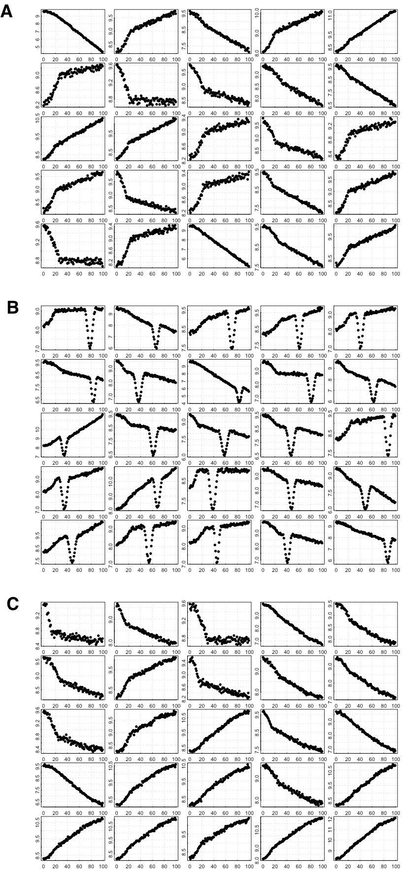
```

(ref:simfigs) Example data produced by the function `sim_data()`, containing continuous variables on both the x and y-axis and classified as (A) "default" data, which is made of a non-linear data segment appended to a linear segment of known length; (B) "corrupted" data, which is similar to "default" data, but includes a random dip in the trace which recovers to mimic equipment interference; and (C) "segmented" data, which is similar to "default" data, but contains two linear data segments instead of one. All data were randomly generated. No units of measure are necessary since the data is only used to test linear data detection performance of the `auto_rate()` function in `respR`.

(ref:ssimfigs) Example data produced by the function `sim_data()` for (A) "default"; (B) "corrupted"; and (C) "segmented" data.


#### "Default" data

A non-linear segment is first generated using a sine or cosine function with a random length of `floor(abs(rnorm(1,.25*len, .05*len)))` where `len` is the total number of observations in the data defined in the function argument with an amplitude of `rnorm(1,.8,.05)`. 
This data segment is appended to a linear segment with a randomly-generated slope of `rnorm(1,0,0.02)`.
The shape of the dataset is designed to mimic common respirometry data whereby the initial sections of the data are often non-linear (Figure \@ref(fig:simfigs)A). 

#### "Corrupted" data

This data uses the "default" data as a template, but a dip in the trace is inserted randomly at any point within the linear segment, which recovers.
This event mimics equipment interference that does not necessarily invalidate the dataset if the corrupted section is omitted from the analysis (Figure \@ref(fig:simfigs)B). 
The dip is generated by a cosine function of fixed amplitude of 1, and the length is randomly generated using `floor(rnorm(1,.25*len_x,.02*len_x))`, where `len_x` is the length of the linear segment.

Thus, to detect the valid linear segment, `auto_rate()` will need to omit the initial non-linear segment, ignore the dip, and then pick the longer of the two remaining linear segments that are separated by the dip.

#### "Segmented" data

This data uses the "default" data as a template, but the data is modified to contain two linear segments of different slopes. 
The slope of the second linear segment is randomly chosen at approximately 0.5$\times$ to 0.6$\times$ of the first linear segment (i.e the slope is always a magnitude smaller than the first linear segment; Figure \@ref(fig:simfigs)C). 

Thus, to detect the correct linear segment, `auto_rate()` would need to correctly omit the initial non-linear segment, and also, ignore the end segment of the data as it has a different slope.

### Test conditions

To quantify the performance and accuracy of `auto_rate()`'s linear detection technique, the function `test_lin()` runs the linear detection technique (`method = "linear"`) iteratively and extracts specific output parameter for analysis.
The parameters include: (1) The length of the true segment (len~t~); (2) the length of the detected segment that is correctly sampled (len~c~); (3) the length of the detected segment that is *incorrectly* sampled (len~i~); (4) the slope of the true segment ($\beta$~detected~; or true rate); and (5) the slope of the detected segment ($\beta$~detected~, or detected rate).

From the above data, we can generate four kinds of performance metrics for visualisation: (1) A density plot of the proportion of the linear segment correctly identified. Each data point is a measure of len~c~ $\div$ len~t~; (2) a density plot of the proportion of incorrectly-sampled data. Each data point is a measure of len~i~ $\div$ len~c~; (3) a linear regression plot, where each data point is a measure of of $\beta$~detected~ (y) as a function of $\beta$~true~ (x); and (4) an x-y plot of the deviation between $\beta$~detected~ and $\beta$~true~. Each data point is a measure of $\beta$~true~ $-\beta$~detected~, plotted against $\beta$~true~.


We performed `test_lin()` with 1,000 iterations, for all of the three kinds of data produced by `sim_data()` ("default", "corrupted", and "segmented"). 
To check performance on different data lengths, we ran the tests using 100 and 500 data points. The output of our performance test is available from within the package as a data object called `test_lin_data`.


### Results

#### "Default" data

Results were generally positive; when run on data with 100 samples `auto_rate()` correctly detected a large proportion of the true segment (Figure \@ref(fig:plotdefault100)A), and incorrectly sampled only a small amount of other data (Figure \@ref(fig:plotdefault100)B). 
Comparison of $\beta$~detected~ against $\beta$~detected~ showed very stable detection across all slopes, even when slope values approached zero (Figure \@ref(fig:plotdefault100)C). 
The maximum $\beta$~detected~ values had $\pm 0.004$ deviation from the $\beta$~true~ values across all values of $\pm 0.06$, even for values close to zero (Figure \@ref(fig:plotdefault100)D).

```{r plotdefault100, fig.cap="(ref:plotdefault100)", fig.scap="(ref:splotdefault100)", fig.pos="p"}
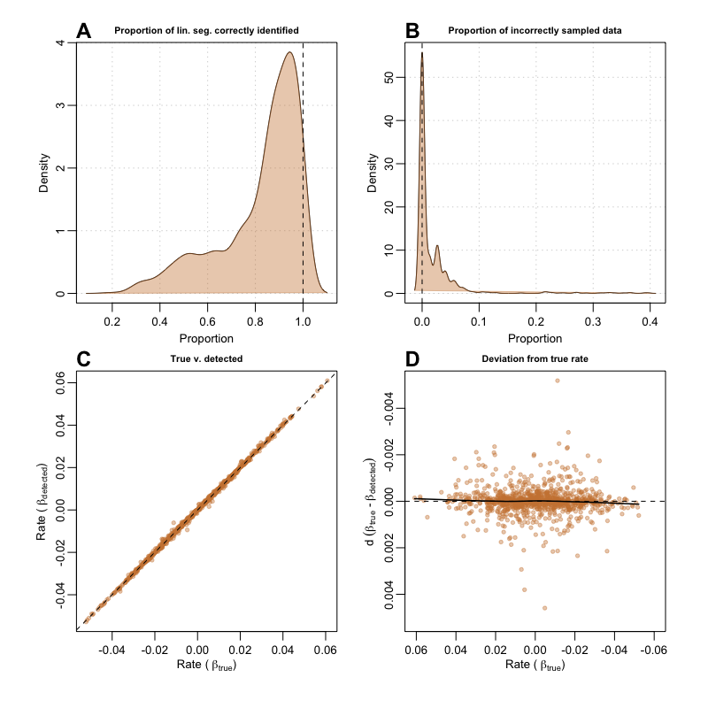
```

(ref:plotdefault100) Performance of `auto_rate()`'s linear detection methods (`method = "linear`) using randomly simulated "default" data with a sample size of 100 observations per dataset, showing (A) A density plot of the proportion of the linear segment correctly identified. Each data point is a measure of len~c~ $\div$ len~t~. (B) A density plot of the proportion of incorrectly-sampled data. Each data point is a measure of len~i~ $\div$ len~c~. A linear regression plot, where each data point is a measure of of $\beta$~detected~ (y) as a function of $\beta$~true~ (x). (D) an x-y plot of the deviation between $\beta$~detected~ and $\beta$~true~. Each data point is a measure of $\beta$~true~ $-\beta$~detected~, plotted against $\beta$~true~. Data contains 1,000 iterations.

(ref:splotdefault100) Performance of `auto_rate`s linear detection methods (`method = "linear`) using randomly simulated "default" data with a sample size of 100 observations per dataset.

Running the test on larger data revealed that `auto_rate()` performed even better when provided with bigger data. 
With a 500-sample dataset, `auto_rate()` generally detected a larger proportion of the true data (Figure \@ref(fig:plotdefault500)A) and was less prone to sampling incorrect portions of the data (Figure \@ref(fig:plotdefault500)B).
Linear regression had an R^2^ of 0.999 (Figure \@ref(fig:plotdefault500)C), and deviation was 10$\times$ smaller than when sample size was at 100 (Figure \@ref(fig:plotdefault500)D).


```{r plotdefault500, fig.cap="(ref:plotdefault500)", fig.scap="(ref:splotdefault500)", fig.pos="p"}
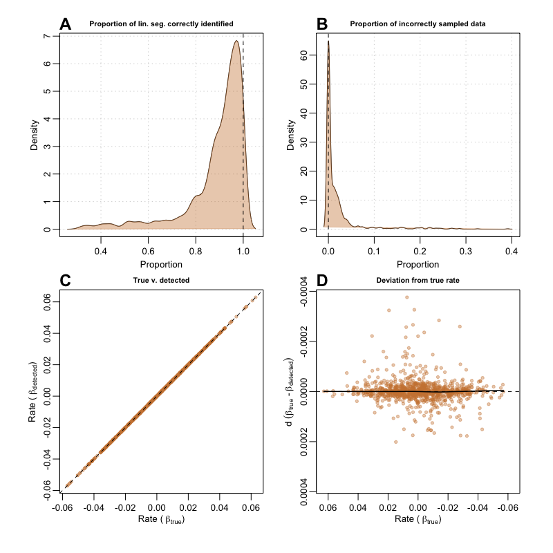
```

(ref:plotdefault500) Performance of `auto_rate()`'s linear detection methods (`method = "linear`) using randomly simulated "default" data with a sample size of 500 observations per dataset, showing (A) A density plot of the proportion of the linear segment correctly identified. Each data point is a measure of len~c~ $\div$ len~t~. (B) A density plot of the proportion of incorrectly-sampled data. Each data point is a measure of len~i~ $\div$ len~c~. A linear regression plot, where each data point is a measure of of $\beta$~detected~ (y) as a function of $\beta$~true~ (x). (D) an x-y plot of the deviation between $\beta$~detected~ and $\beta$~true~. Each data point is a measure of $\beta$~true~ $-\beta$~detected~, plotted against $\beta$~true~. Data contains 1,000 iterations.

(ref:splotdefault500) Performance of `auto_rate()`'s linear detection methods (`method = "linear`) using randomly simulated "default" data with a sample size of 500 observations per dataset.

#### "Corrupted" data

In this challenging data scenario `auto_rate()` had a tendency to under-sample the linear segment. 
As this particular type of data consisted of two linear segments separated by a "dip", the function also sometimes detected the shorter segment as the top-ranked result, resulting in the correct estimate of $\beta$~detected~, but the wrong linear segment detected (Figure \@ref(fig:plotcorrupted100)A). 
Thus, the function may incorrectly sample none of the linear segment, but only rarely; in most cases, it still identified the right segment, and incorrectly sampled only a small amount of data (Figure \@ref(fig:plotcorrupted100)B). Comparison of $\beta$~true~ against $\beta$~detected~ showed stable, but relatively noisy detection of the true rate across all slopes when compared to its performance with "default"-type data (Figure \@ref(fig:plotcorrupted100)C). The deviation plot showed that performance was generally poorer at values close to zero (Figure \@ref(fig:plotcorrupted100)D).

```{r plotcorrupted100, fig.cap="(ref:plotcorrupted100)", fig.scap="(ref:splotcorrupted100)", fig.pos="p"}
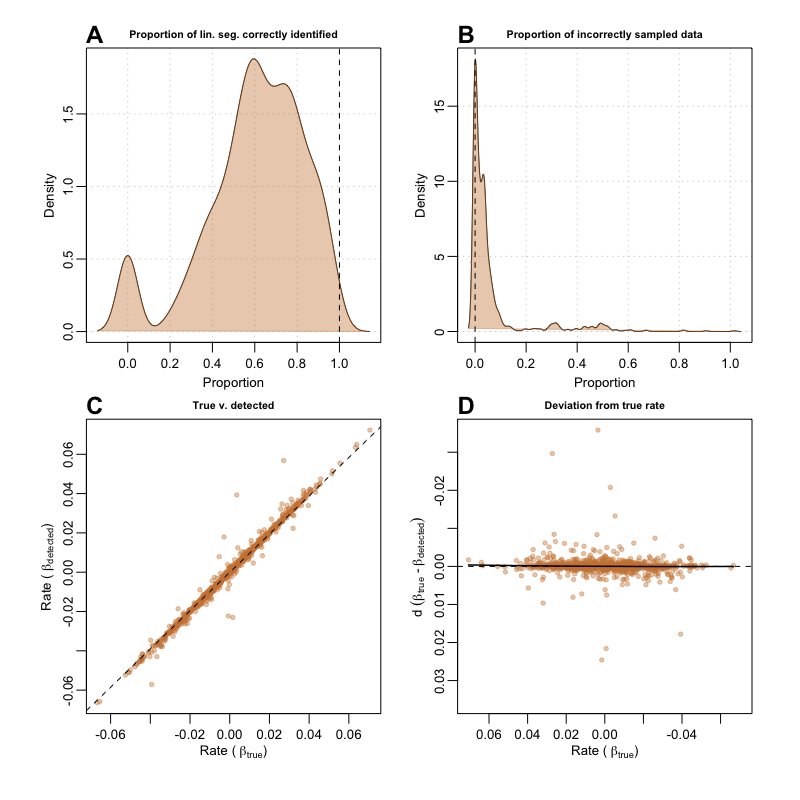
```

(ref:plotcorrupted100) Performance of `auto_rate()`'s linear detection methods (`method = "linear`) using randomly simulated "corrupted" data with a sample size of 100 observations per dataset, showing (A) A density plot of the proportion of the linear segment correctly identified. Each data point is a measure of len~c~ $\div$ len~t~. (B) A density plot of the proportion of incorrectly-sampled data. Each data point is a measure of len~i~ $\div$ len~c~. A linear regression plot, where each data point is a measure of of $\beta$~detected~ (y) as a function of $\beta$~true~ (x). (D) an x-y plot of the deviation between $\beta$~detected~ and $\beta$~true~. Each data point is a measure of $\beta$~true~ $-\beta$~detected~, plotted against $\beta$~true~. Data contains 1,000 iterations.

(ref:splotcorrupted100) Performance of `auto_rate`'s linear detection methods (`method = "linear`) using randomly simulated "corrupted" data with a sample size of 100 observations per dataset.

Again, `auto_rate()` performed better when provided with bigger data. At 500 samples the same issue where the the shorter linear segment was incorrectly selected still persisted (Figure \@ref(fig:plotcorrupted500)A), but the function sampled incorrect segments less often (Figure \@ref(fig:plotcorrupted500)B). 
Linear regression of $\beta$~true~ against $\beta$~detected~ had a better goodness of fit (Figure \@ref(fig:plotcorrupted500)C) and deviation values from $\beta$~detected~ were substantially smaller with seemingly fewer poor estimates when slope values approach zero (Figure \@ref(fig:plotcorrupted500)D).

```{r plotcorrupted500, fig.cap="(ref:plotcorrupted500)", fig.scap="(ref:splotcorrupted500)", fig.pos="p"}
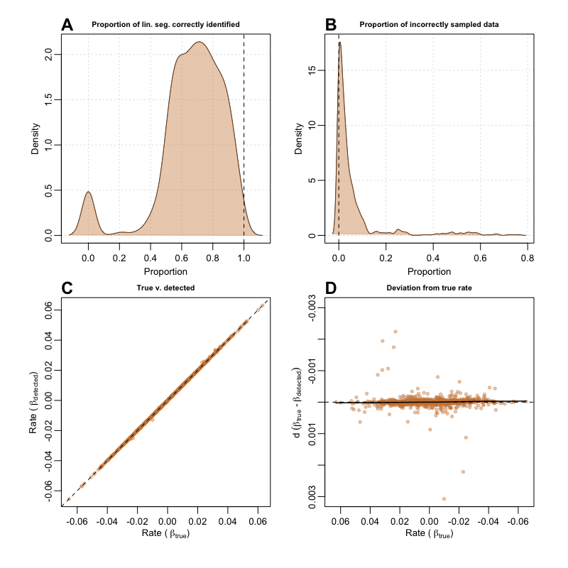
```

(ref:plotcorrupted500) Performance of `auto_rate()`'s linear detection methods (`method = "linear`) using randomly simulated "corrupted" data with a sample size of 500 observations per dataset, showing (A) A density plot of the proportion of the linear segment correctly identified. Each data point is a measure of len~c~ $\div$ len~t~. (B) A density plot of the proportion of incorrectly-sampled data. Each data point is a measure of len~i~ $\div$ len~c~. A linear regression plot, where each data point is a measure of of $\beta$~detected~ (y) as a function of $\beta$~true~ (x). (D) an x-y plot of the deviation between $\beta$~detected~ and $\beta$~true~. Each data point is a measure of $\beta$~true~ $-\beta$~detected~, plotted against $\beta$~true~. Data contains 1,000 iterations.

(ref:splotcorrupted500) Performance of `auto_rate()`'s linear detection methods (`method = "linear`) using randomly simulated "corrupted" data with a sample size of 500 observations per dataset.

#### "Segmented" data

This type of data is the most difficult to handle as `auto_rate()` needed to disregard the curved, but increasingly-linear top portion of the data, and also discard the slight degree of change in slope towards the end of the data. 
Thus, `auto_rate()` performed well in many cases, but poorly in others. 
In the majority of cases, when it managed to sample the linear segment, it did so for a very large fraction of the data (Figure \@ref(fig:plotsegmented100)A). It performed less well at avoiding incorrect sampling since it sometimes selected the other linear segment (Figure \@ref(fig:plotsegmented100)B). 
However, the plot of $\beta$~true~ against $\beta$~detected~ showed that it still performed surprisingly well most of the time, despite the errors (Figure \@ref(fig:plotsegmented100)C), and the deviance from the true rate appeared to be poorer when slope values are closer to zero (Figure \@ref(fig:plotsegmented100)D).

```{r plotsegmented100, fig.cap="(ref:plotsegmented100)", fig.scap="(ref:splotsegmented100)", fig.pos="p"}
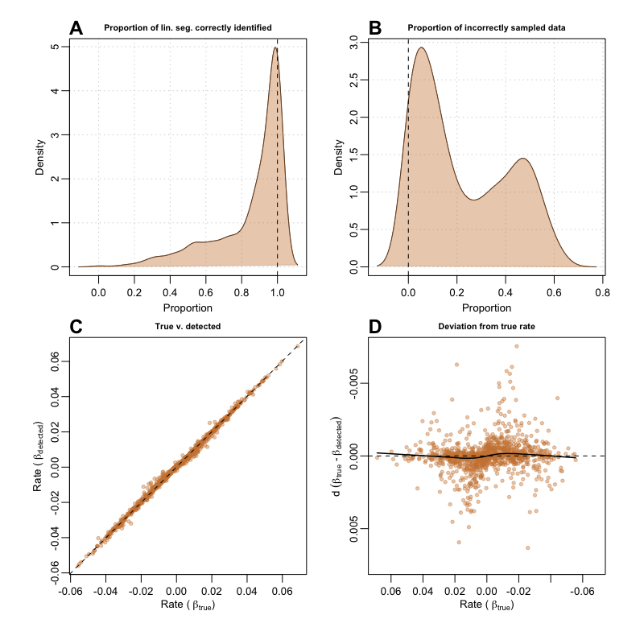
```

(ref:plotsegmented100) Performance of `auto_rate()`'s linear detection methods (`method = "linear`) using randomly simulated "segmented" data with a sample size of 100 observations per dataset, showing (A) A density plot of the proportion of the linear segment correctly identified. Each data point is a measure of len~c~ $\div$ len~t~. (B) A density plot of the proportion of incorrectly-sampled data. Each data point is a measure of len~i~ $\div$ len~c~. A linear regression plot, where each data point is a measure of of $\beta$~detected~ (y) as a function of $\beta$~true~ (x). (D) an x-y plot of the deviation between $\beta$~detected~ and $\beta$~true~. Each data point is a measure of $\beta$~true~ $-\beta$~detected~, plotted against $\beta$~true~. Data contains 1,000 iterations.

(ref:splotsegmented100) Performance of `auto_rate()`'s linear detection methods (`method = "linear`) using randomly simulated "segmented" data with a sample size of 100 observations per dataset.

Again, with a larger dataset, `auto_rate()`'s performance was substantially better. With a 500-sample dataset, many of the issues that occurred in the previous test were better resolved. 
The function correctly sampled the right segment most of the time (Figure \@ref(fig:plotsegmented500)A), and rarely sampled other data or the other linear segment (Figure \@ref(fig:plotsegmented500)B). 
Linear regression of $\beta$~detected~ against $\beta$~true~ had a $R^2$ of 0.999 (Figure \@ref(fig:plotsegmented500)C), and deviations from $\beta$~detected~ were much smaller in magnitude (Figure \@ref(fig:plotsegmented500)D).

```{r plotsegmented500, fig.cap="(ref:plotsegmented500)", fig.scap="(ref:splotsegmented500)", fig.pos="p"}
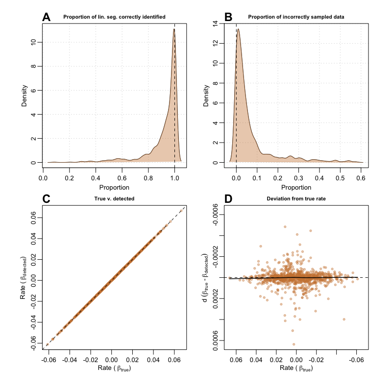
```

(ref:plotsegmented500) Performance of `auto_rate()`'s linear detection methods (`method = "linear`) using randomly simulated "segmented" data with a sample size of 500 observations per dataset, showing (A) A density plot of the proportion of the linear segment correctly identified (len~c~ $\div$ len~t~); (B) a density plot of the proportion of incorrectly-sampled data (len~i~ $\div$ len~c~). A linear regression plot, where each data point is a measure of of $\beta$~detected~ (y) as a function of $\beta$~detected~ (x). (D) an x-y plot of the deviation between $\beta$~detected~ and $\beta$~true~. Each data point is a measure of $\beta$~true~ $-\beta$~detected~, plotted against $\beta$~true~. Data contains 1,000 iterations. Data contains 1,000 iterations.

(ref:splotsegmented500) Performance of `auto_rate()`'s linear detection methods (`method = "linear`) using randomly simulated "segmented" data with a sample size of 500 observations per dataset.


### Concluding remarks and future improvements

The package `respR` implements a number of methods not available in any other R package or software. 
These include the use of rolling regression techniques to estimate $\dot{M}$O~2,max~, $\dot{M}$O~2,min~, and P~crit~, the use of kernel density estimation techniques to detect and rank linear segments of the data, support for unevenly-spaced time data, and the ability to extract and analyse data precisely by time, row, or O~2~ concentration.

It is important to note, however, that while `respR` contains automated methods to assist in processing difficult data, no amount of data manipulation can fix poor data. Users should still ensure that their data has been collected using acceptable methods (e.g. closed respirometry setups should always be equipped with mixing devices, see @Clark2013 before performing analyses of any kind.
Nevertheless, `respR` adheres to well-defined rules to obtain rates of interest, and its methods and results are transparent and fully reproducible. 
The `respR` package allows for more effective and less time-consuming handling and processing of the extensive datasets that are increasingly common in respirometry research.


<!--chapter:end:chapters/33-appendix3.Rmd-->

